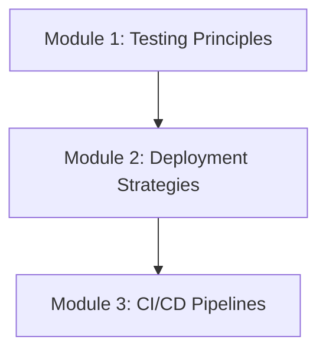

# Phase 10: Production React

Welcome to the final phase of the React Engineering Academy, **Production React**. This phase covers how to build, test, and deploy production-grade React applications: writing automated tests (Unit, Integration, and E2E), setting up deployment strategies (Edge vs. CDN), and configuring CI/CD automation pipelines.

## Why this topic exists

Building component layouts is only the first step. Shipping software to users requires ensuring stability, performance, and automatic delivery.
- If you deploy code without automated tests, minor adjustments to core utilities can introduce regressions that break production features.
- If you build bundles without optimizing assets, pages load slowly, leading to high bounce rates.
- If you deploy changes manually from developer terminals, environments desynchronize, and deployments become error-prone.

Mastering production operations ensures your applications remain stable, performant, and automatically updated.

---

## Learning Objectives

By the end of this phase, you will be able to:
- Write unit and integration tests using Jest and Vitest for hooks and components.
- Set up and run end-to-end (E2E) tests using Playwright.
- Optimize production bundles by configuring asset minification, code splitting, and tree shaking.
- Deploy React apps to platforms like Vercel, Netlify, or AWS using CDNs and Edge networks.
- Configure GitHub Actions to automate linting, testing, and deployment (CI/CD).

---

## Prerequisites

Before starting this phase, you should have completed:
1. **[Phase 1: React Fundamentals](../phase-1-fundamentals)**
2. **[Phase 2: Components & JSX](../phase-2-components-jsx)**
3. **[Phase 3: State Management](../phase-3-state-management)**
4. **[Phase 4: React Hooks](../phase-4-hooks)**
5. **[Phase 5: Routing & Data Fetching](../phase-5-routing-fetching)**
6. **[Phase 6: Performance Optimization](../phase-6-performance)**
7. **[Phase 7: Advanced React](../phase-7-advanced)**
8. **[Phase 8: Modern React](../phase-8-modern)**
9. **[Phase 9: Architecture & Enterprise Patterns](../phase-9-architecture)**

---

## Learning Roadmap & Topics Covered

This phase is broken down into three comprehensive modules:

1. **[Module 1: Testing Principles](testing-principles)**  
   Writing unit tests for hooks, component rendering tests with React Testing Library, and E2E testing with Playwright.
2. **[Module 2: Deployment Strategies](deployment-strategies)**  
   Production build compilation, static asset hosting, CDNs, Edge rendering configurations, and caching rules.
3. **[Module 3: CI/CD Pipelines](ci-cd-pipelines)**  
   Automating quality gates using GitHub Actions, continuous deployment triggers, and hosting platform integrations.

---

## Estimated Learning Time

- **Total Time**: 8 - 10 Hours
- **Module 1**: 4 Hours
- **Module 2**: 2 Hours
- **Module 3**: 3 Hours
- **Exercises & Projects**: 1 Hour

---

## Real-World Applications

- **Enterprise SaaS Platforms**: Configuring automated test runs to verify features before they are merged to main branch.
- **High-Traffic E-Commerce Sites**: Setting up global CDN deployments to ensure pages load instantly for international users.
- **Agile Development Teams**: Deploying preview branches automatically on every pull request to gather feedback.

---

## Practice Exercises

- **Mock Hook test case**: Writing a Vitest test case for a custom input toggle hook.
- **Vite bundle visualizer audit**: Running asset audits using Vite rollup-plugin-visualizer.
- **GitHub Action pipeline build**: Writing a YAML workflow script to run tests on pull requests.

---

## Mini Projects

- **Automated Deployment Pipeline**: Setting up a sample workspace project with Vitest test suites, Vite asset bundling rules, and GitHub Actions configs to automate deployments.

---

## Related Topics

- [Performance Optimization Overview](../phase-6-performance)
- [Architecture & Enterprise Patterns](../phase-9-architecture)

---

## Further Reading

- **React Testing Library**: [Official Documentation](https://testing-library.com/docs/react-testing-library/intro/)
- **Playwright**: [Official Documentation](https://playwright.dev/)
