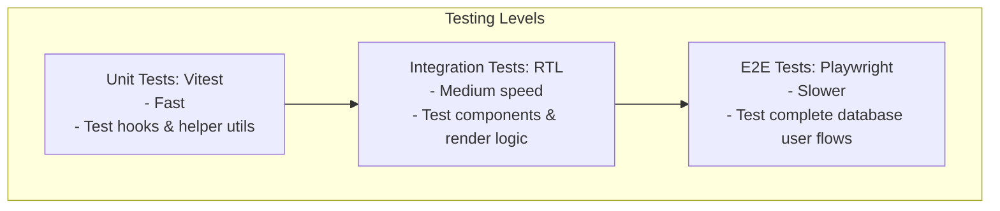
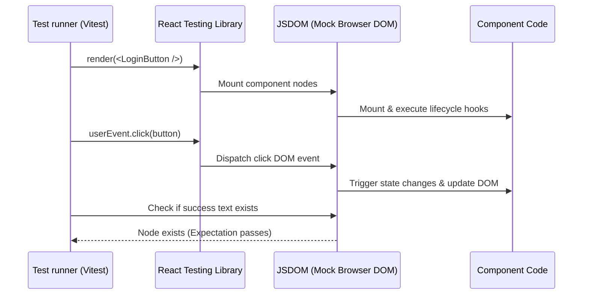
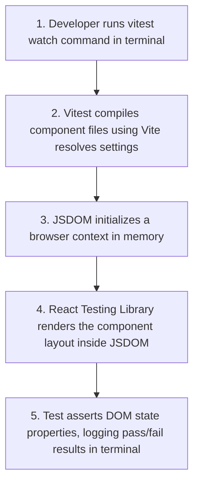

# Testing Principles & Vitest

## Introduction

In modern software development, writing components is only half the battle. To ensure stability and prevent regressions, you must write automated tests. This module covers the core testing methodologies in the React ecosystem: **Unit Testing** custom hooks using **Vitest** (or Jest), **Integration Testing** component behavior using **React Testing Library (RTL)**, and **End-to-End (E2E) Testing** using **Playwright**.

---

## Why do we need this?

Manual verification (opening a browser and clicking buttons) is slow, scales poorly, and misses hidden edge case bugs.

### Problem Statement
Consider a user checkout form featuring discount codes, validation checks, and API requests.
1. A developer edits the postal code validator helper function to fix a bug.
2. During the fix, they accidentally introduce a bug into the discount code validation script.
3. Because they only test the postal code field manually, they deploy the update to production.
4. The discount validation breaks, preventing users from checking out and causing lost sales.

We need automated test suites that run in milliseconds to verify validation rules, component rendering outputs, and user interaction flows on every code edit.

---

## Real World Story

In early React codebases, developers tested components using Enzyme. Enzyme focused on internal implementation details (e.g., checking component state, reading private properties).

This made tests fragile: if you refactored a component's state structure without changing its user-facing behavior, the tests broke anyway. In 2018, Kent C. Dodds created **React Testing Library**. It introduced a new testing philosophy: "The more your tests resemble the way your software is used, the more confidence they can give you." Instead of checking internal state, RTL queries elements using visible text, labels, and ARIA roles (user-centric), allowing developers to refactor component internals safely without breaking tests.

---

## Real World Analogy

Think of automated testing like a **Manufacturing Car Assembly Line Test Station** compared to **Driving the Car on public streets to test it**.

- **Without Automated Testing (Driving on Streets)**: You assemble a car. To test if the brakes, airbags, and headlights work, you drive it directly onto a busy highway. If the brakes fail, you crash. It is dangerous, slow, and expensive.
- **With Automated Testing (Test Station)**: Before the car leaves the factory, you place it on a test platform. Robotic actuators press the brake pedals (Vitest/RTL unit tests), sensors check headlight voltages (integration tests), and a crash-test dummy verifies airbag deployments in controlled crashes (Playwright E2E tests). You identify errors safely in milliseconds before shipping the car to customers.

---

## Visual Explanation

Below is a diagram showing the React Testing Pyramid from fast unit tests to complete E2E user flow tests.

### React Testing Pyramid
```
      / \
     /   \     E2E Tests (Playwright) - Complete app flows (Slowest)
    / E2E \
   /-------\
  / Integr  \  Integration Tests (RTL) - Component behavior & events
 /-----------\
/    Unit     \ Unit Tests (Vitest) - Isolated helper functions & hooks (Fastest)
/_____________\
```



---

## Internal Working

React Testing Library uses **jsdom** (a pure JavaScript representation of browser APIs) to render components in a mock terminal environment, bypassing real browsers.

When you run a component test using RTL:
1. RTL's `render()` method mounts the component inside jsdom.
2. You query elements using accessibility selectors: `screen.getByRole('button', { name: /submit/i })`.
3. You simulate user interactions using `userEvent.click(button)`.
4. RTL updates the mock DOM nodes and runs state changes.
5. You write assert statements: `expect(screen.getByText('Success')).toBeInTheDocument()`.



---

## Architecture

Testing folders are organized alongside component files, allowing developers to locate and run test suites cleanly.

```
components/
├── LoginForm.jsx
└── __tests__/
    ├── LoginForm.spec.jsx   # Integration test suites
    └── useSession.spec.js   # Custom hook unit test suites
```

---

## Step-by-Step Flow

When running Vitest test suites, the following steps occur:



---

## Syntax

```javascript
// Basic Vitest/RTL Test Syntax
import { render, screen } from '@testing-library/react';
import userEvent from '@testing-library/user-event';
import { expect, test } from 'vitest';
import Button from './Button.jsx';

test('renders button and responds to click', async () => {
  const handleClick = vi.fn(); // Mock function
  render(<Button label="Submit" onClick={handleClick} />);

  const button = screen.getByRole('button', { name: /submit/i });
  expect(button).toBeInTheDocument();

  await userEvent.click(button);
  expect(handleClick).toHaveBeenCalledTimes(1);
});
```

---

## Basic Example

Here is a basic Vitest unit test case verifying that a helper calculator utility computes totals correctly.

```javascript
// 1. mathUtils.js (Utility Helper)
export function addTax(amount, taxRate = 0.1) {
  return amount + (amount * taxRate);
}

// 2. mathUtils.spec.js (Vitest Test Suite)
import { expect, test } from 'vitest';
import { addTax } from './mathUtils.js';

test('calculates correct tax amount', () => {
  // Test basic tax calculation
  expect(addTax(100, 0.2)).toBe(120);
  
  // Test default parameter fallback value
  expect(addTax(100)).toBe(110);
});
```

---

## Intermediate Example

An intermediate test suite showing how to render a component and test state changes (clicking a toggle button changes displayed state) using React Testing Library.

```jsx
// 1. ToggleCard.jsx (Component)
import React, { useState } from 'react';

export default function ToggleCard() {
  const [active, setActive] = useState(false);
  return (
    <div>
      <p>Status: {active ? 'Enabled' : 'Disabled'}</p>
      <button onClick={() => setActive(!active)}>Toggle Status</button>
    </div>
  );
}

// 2. ToggleCard.spec.jsx (Integration Test)
import React from 'react';
import { render, screen } from '@testing-library/react';
import userEvent from '@testing-library/user-event';
import { expect, test } from 'vitest';
import ToggleCard from './ToggleCard.jsx';

test('toggles active state status text on button click', async () => {
  render(<ToggleCard />);

  // 1. Verify initial state text is rendered
  expect(screen.getByText('Status: Disabled')).toBeInTheDocument();

  // 2. Locate the button by its ARIA role
  const button = screen.getByRole('button', { name: /toggle status/i });
  
  // 3. Simulate user click interaction
  await userEvent.click(button);

  // 4. Verify updated status text is rendered
  expect(screen.getByText('Status: Enabled')).toBeInTheDocument();
});
```

---

## Advanced Example

An advanced test suite illustrating how to unit-test custom hooks using the **`renderHook`** utility, verifying state isolation and action dispatches.

```javascript
// 1. useCounter.js (Custom Hook)
import { useState } from 'react';

export function useCounter(initialValue = 0) {
  const [count, setCount] = useState(initialValue);
  const increment = () => setCount(prev => prev + 1);
  return { count, increment };
}

// 2. useCounter.spec.js (Hook Test Suite)
import { renderHook, act } from '@testing-library/react';
import { expect, test } from 'vitest';
import { useCounter } from './useCounter.js';

test('manages and increments counter state within hook', () => {
  // Render custom hook in isolated testing context
  const { result } = renderHook(() => useCounter(5));

  // Verify initial hook value
  expect(result.current.count).toBe(5);

  // State updates inside custom hooks must be wrapped in 'act' to ensure React processes rendering updates
  act(() => {
    result.current.increment();
  });

  // Verify updated state value
  expect(result.current.count).toBe(6);
});
```

---

## Production Example

A production-grade test file demonstrating how to mock network API calls using mock utilities, handle asynchronous queries (`findBy`), and verify loading and success layout transitions safely.

```jsx
// 1. UserFetcherCard.jsx (Component)
import React, { useState, useEffect } from 'react';

export default function UserFetcherCard() {
  const [user, setUser] = useState(null);
  const [error, setError] = useState(null);

  useEffect(() => {
    fetch('https://jsonplaceholder.typicode.com/users/1')
      .then(res => {
        if (!res.ok) throw new Error('Failed to load user');
        return res.json();
      })
      .then(setUser)
      .catch(err => setError(err.message));
  }, []);

  if (error) return <div role="alert">Error: {error}</div>;
  if (!user) return <p>Loading profiles...</p>;

  return <div>Active Profile: {user.name}</div>;
}

// 2. UserFetcherCard.spec.jsx (Mock API Integration Test)
import React from 'react';
import { render, screen } from '@testing-library/react';
import { expect, test, vi, beforeEach } from 'vitest';
import UserFetcherCard from './UserFetcherCard.jsx';

// Stub/Mock global fetch requests
const mockFetch = vi.fn();
vi.stubGlobal('fetch', mockFetch);

beforeEach(() => {
  mockFetch.mockReset();
});

test('renders loader on mount, then displays profile name on fetch success', async () => {
  // Configure mock fetch to return mock JSON data
  mockFetch.mockResolvedValueOnce({
    ok: true,
    json: async () => ({ name: 'Alice Smith' })
  });

  render(<UserFetcherCard />);

  // 1. Verify loading indicator is displayed on initial render
  expect(screen.getByText('Loading profiles...')).toBeInTheDocument();

  // 2. Await asynchronous display of profile text using findBy queries
  const profileText = await screen.findByText('Active Profile: Alice Smith');
  expect(profileText).toBeInTheDocument();
});

test('displays alert banner on fetch failure', async () => {
  // Configure mock fetch to return HTTP failure
  mockFetch.mockResolvedValueOnce({
    ok: false,
    status: 500
  });

  render(<UserFetcherCard />);

  // Await error banner display using role locator
  const alertBanner = await screen.findByRole('alert');
  expect(alertBanner).toHaveTextContent('Error: Failed to load user');
});
```

---

## Folder Structure

```
testing-sandbox/
├── src/
│   ├── utils/
│   │   ├── mathUtils.js
│   │   └── __tests__/
│   │       └── mathUtils.spec.js
│   ├── components/
│   │   ├── ToggleCard.jsx
│   │   └── __tests__/
│   │       └── ToggleCard.spec.jsx
│   ├── App.jsx
│   └── main.jsx
├── package.json
└── vite.config.js
```

---

## Best Practices

💡 **Did You Know?**  
React Testing Library encourages using query helpers that match how users navigate pages (e.g. `screen.getByRole('button')`) rather than targeting internal class selectors or IDs, ensuring tests don't break when CSS layout selectors change.

🚀 **Best Practices**
- Focus on testing user-facing behavior rather than internal component implementation details (avoid testing component private states directly).
- Query components using accessibility selectors like `screen.getByRole('button', { name: /submit/i })` to verify that your pages are accessible.
- Mock network API requests using mocks to make test suites fast and independent of active backend servers.

---

## Common Mistakes

⚠ **Common Mistakes**

### Updating State inside custom hooks without using 'act'
Modifying state inside custom hooks or test suites without wrapping the action in the `act()` helper will cause Vitest to throw warnings: `An update to component inside a test was not wrapped in act(...)`. This occurs because React needs to flush updates before the test runner asserts states.

```jsx
// ❌ WRONG (Throws act warning)
result.current.increment();
expect(result.current.count).toBe(1);

//  RIGHT
act(() => {
  result.current.increment();
});
expect(result.current.count).toBe(1);
```

---

## Performance Notes

⚡ **Performance Tips**
Vitest matches and runs tests in parallel. Keep tests isolated by cleaning up global mocks in `beforeEach` hooks to prevent side effects between test suites.

---

## Accessibility Notes

♿ **Accessibility Tips**
Use **`jest-axe`** inside your test suites to scan components for accessibility violations automatically (like checking for sufficient color contrast or missing label inputs).

```javascript
import { axe, toHaveNoViolations } from 'jest-axe';
expect.extend(toHaveNoViolations);

test('component has no accessibility violations', async () => {
  const { container } = render(<MyForm />);
  const results = await axe(container);
  expect(results).toHaveNoViolations();
});
```

---

## SEO Notes

Semantic structures verified by tests (such as headings and link references) ensure pages remain crawlable and optimized for search engines.

---

## Interview Questions

🎯 **Interview Tips**  
In an interview, explain that React Testing Library encourages testing component behavior (what the user sees) rather than implementation details (private states or variables). This makes tests resilient to refactoring.

### Q1: What is the difference between `queryBy`, `getBy`, and `findBy` in React Testing Library?
**Answer**:
- **`getBy`**: Returns the matching element, and throws an error immediately if the element is not found. Useful for elements that should always be present on screen.
- **`queryBy`**: Returns the matching element, or returns `null` if the element is not found. Useful for verifying that elements (like error banners) are absent from screen.
- **`findBy`**: Returns a Promise that resolves when the element appears on screen. Useful for asserting asynchronous updates (like rendering data after a fetch request).

### Q2: Why is the `act` helper required when testing state updates?
**Answer**: The `act()` helper tells React to flush all pending state updates, side effects, and re-rendering cycles synchronously before the test runner executes the next assertion line. This ensures your tests check the fully updated DOM layout.

---

## MCQs

1. **Which query type should be used to assert that an element is ABSENT from the screen?**
   - A) `screen.getBy`
   - B) `screen.queryBy`
   - C) `screen.findBy`
   - D) `screen.locateBy`
   - *Answer: B*

2. **Which package renders components inside a mock DOM terminal environment without real browsers?**
   - A) Playwright
   - B) jsdom
   - C) Vite compiler
   - D) Sentry logger
   - *Answer: B*

3. **Why does React Testing Library encourage queries based on ARIA roles (e.g., getByRole)?**
   - A) It makes CSS rendering faster.
   - B) It tests visual layout styles.
   - C) It matches how screen readers navigate pages, ensuring layouts are accessible and resilient to CSS refactoring.
   - D) It bypasses network requirements.
   - *Answer: C*

4. **Which testing methodology runs complete database flows in real browser windows?**
   - A) Unit testing
   - B) Integration testing
   - C) End-to-End (E2E) testing (e.g., Playwright)
   - D) Static analysis linting
   - *Answer: C*

5. **How should you mock a global API fetch request using Vitest?**
   - A) By calling `document.write()`.
   - B) By using `vi.stubGlobal('fetch', mockFunction)`.
   - C) By adding values to localStorage.
   - D) By disabling React Strict Mode.
   - *Answer: B*

---

## Practice Exercise

### Exercise 1: getByRole selector config
Complete the query to target a button labeled "Log In":
```javascript
// TODO: Write getByRole query
const button = screen.getByRole();
```

*Solution*:
```javascript
const button = screen.getByRole('button', { name: /log in/i });
```

### Exercise 2: Hook increment test
Create a custom hook called `useToggle` managing a boolean flag. Write a Vitest hook test case verifying that calling the toggle action flips the flag state.

### Exercise 3: async item loader test
Write an integration test for a component that displays dynamic text after a 1-second timeout. Use `findBy` to assert the updated layout state.

---

## Debugging Exercise

### The Flaky Async Test Bug
A developer writes a test case for a data loader component. They fetch matching users in the background, but the test suite passes or fails randomly. Identify the bug and write the fix.

```javascript
// UserGrid.spec.jsx
import React from 'react';
import { render, screen } from '@testing-library/react';
import { expect, test, vi } from 'vitest';
import UserGrid from '../UserGrid.jsx';

test('loads and renders user records', () => {
  render(<UserGrid />);

  // BUG: Using synchronous getBy selector on an element that is rendered
  // asynchronously after a database query resolves. The test finishes before the query resolves.
  const userRow = screen.getByText('Member: Bob');
  expect(userRow).toBeInTheDocument();
});
```

#### Solution
The element is rendered asynchronously after a network request resolves. Using `screen.getByText` immediately fails because the data has not finished loading. To fix this, change the query to the asynchronous `screen.findByText` and await the result:

```javascript
// Corrected test case
test('loads and renders user records', async () => { // Add async keyword
  render(<UserGrid />);

  // Use findByText and await to wait for the element to appear on screen
  const userRow = await screen.findByText('Member: Bob');
  expect(userRow).toBeInTheDocument();
});
```

---

## Real-world Scenario

You are building a complex banking application where security and stability are critical. The transfer panel must validate routing numbers and handle network failures gracefully. Explain your testing strategy.
- **Design Strategy**: Write unit tests using Vitest to test routing number validation helpers with multiple mock inputs. Write integration tests using React Testing Library to verify that the transfer component displays loading spinners, catches API failures, and displays red error banners correctly. Finally, write Playwright E2E tests to verify the complete transfer flow, from login to transaction confirmation.

---

## Interview Coding Question

### Problem Statement
Write a React Testing Library test case that:
- Renders a LoginForm component containing email/password inputs and a submit button.
- Simulates user input by typing into the fields.
- Clicks the submit button.
- Asserts that a mock onSubmit callback handler is called with the entered values.

```jsx
import React from 'react';
import { render, screen } from '@testing-library/react';
import userEvent from '@testing-library/user-event';
import { expect, test, vi } from 'vitest';

// 1. Simple LoginForm component
function LoginForm({ onSubmit }) {
  const handleSubmit = (e) => {
    e.preventDefault();
    const data = new FormData(e.currentTarget);
    onSubmit(data.get('email'), data.get('password'));
  };

  return (
    <form onSubmit={handleSubmit}>
      <label htmlFor="email">Email</label>
      <input id="email" name="email" type="email" />
      
      <label htmlFor="password">Password</label>
      <input id="password" name="password" type="password" />
      
      <button type="submit">Submit</button>
    </form>
  );
}

// 2. Test Suite
test('submits login form with user credentials', async () => {
  const mockSubmit = vi.fn();
  render(<LoginForm onSubmit={mockSubmit} />);

  // Locate input fields by their label associations
  const emailInput = screen.getByLabelText(/email/i);
  const passwordInput = screen.getByLabelText(/password/i);
  const submitButton = screen.getByRole('button', { name: /submit/i });

  // Simulate user input
  await userEvent.type(emailInput, 'user@example.com');
  await userEvent.type(passwordInput, 'secretPassword');
  
  // Submit the form
  await userEvent.click(submitButton);

  // Assert onSubmit callback was called with correct values
  expect(mockSubmit).toHaveBeenCalledWith('user@example.com', 'secretPassword');
});
```

---

## Mini Project

### Test Suite Workspace
Build a workspace testing playground:
- Implement custom hooks to manage shopping cart balances and items.
- Write unit tests for the custom hooks using Vitest and `renderHook`.
- Write component integration tests using React Testing Library, mocking fetch calls and verifying loading, error, and success layouts.

---

## Summary

🧠 **Memory Tricks**  
`Users click, tests look`  
- Query components using accessibility selectors like `screen.getByRole` to match how users navigate pages.
- Focus on testing user behavior rather than internal component state.

📖 **Summary**  
Automated testing ensures application stability. By writing unit tests for hooks with Vitest, integration tests for component behavior with React Testing Library, and E2E tests with Playwright, React applications remain stable and production-ready.

---

## Cheat Sheet

```javascript
// Querying components with RTL selectors
const button = await screen.findByRole('button', { name: /submit/i });
```

---

## Related Topics
- [Advanced & Edge Hooks](../phase-4-hooks/advanced-hooks)
- [Deployment Strategies (Next Module)](deployment-strategies)

---

## Further Reading
- [React Testing Library: Queries Guide](https://testing-library.com/docs/queries/about/)
- [Vitest: Official API Guide](https://vitest.dev/api/)
