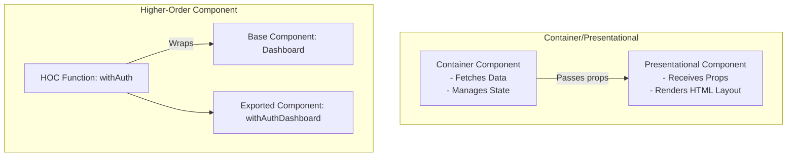
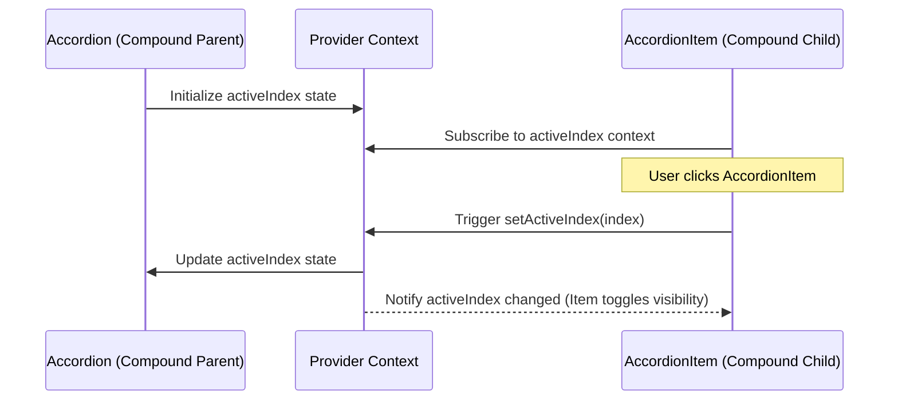
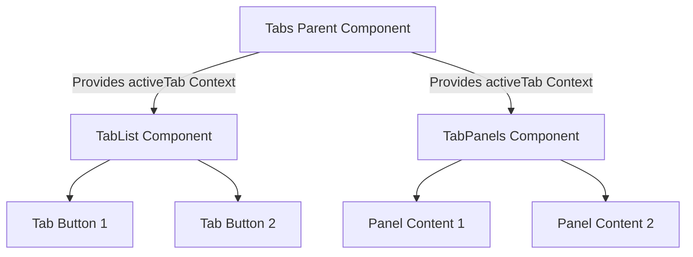
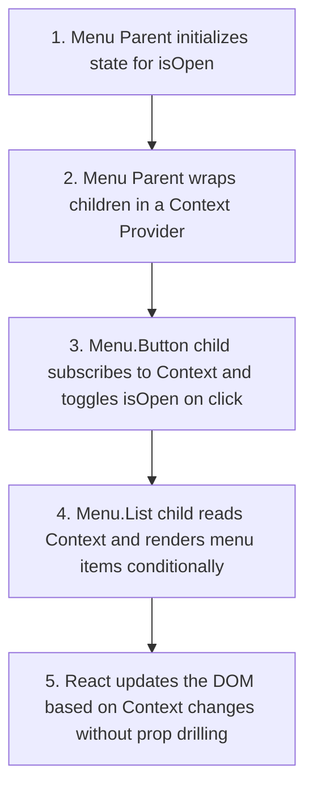

# Advanced Component Patterns

## Introduction

As React applications grow, writing simple components leads to duplication of logic and markup. To build clean, maintainable codebases, you need to understand advanced component patterns. These patterns allow you to separate logic from layout, share concerns across components, and build highly flexible, composable interfaces. This module covers the Container/Presentational design pattern, Higher-Order Components (HOCs), Render Props, and Compound Components.

---

## Why do we need this?

If every component in your application handles data fetching, business logic, state management, and HTML layout updates, your components will grow massive, making them difficult to test, reuse, or adapt.

### Problem Statement
Consider an application that displays user directories, product catalogs, and transaction history. Each list component needs to:
1. Fetch data from an API endpoint.
2. Show a loading spinner during the fetch.
3. Show an error banner if the fetch fails.
4. Render the list of items.

If you write this logic inside every component, you duplicate the loading, error, and fetch boilerplate code across all three lists. Furthermore, if you want to switch from a list view to a grid view, you have to rewrite the rendering logic inside a component that is already cluttered with data-fetching code. We need patterns that split logic from presentation, wrap cross-cutting concerns, and delegate layout control.

---

## Real World Story

In the early days of React, developers struggled to share code across components. Class components did not support custom hooks, so engineers relied on **Mixins** to inject functionality. However, mixins caused method name collisions, hidden dependencies, and made code difficult to understand. 

To solve this, React pioneer Dan Abramov proposed the **Presentational and Container Components** pattern, which separated data-fetching logic from layout presentation. Shortly after, the community popularized **Higher-Order Components (HOCs)** and **Render Props** to encapsulate shared logic (like tracking mouse coordinates or checking authentication status). Today, while custom hooks have replaced HOCs and Render Props for sharing pure state logic, these patterns remain critical for building modular layouts, component libraries, and composite UI structures.

---

## Real World Analogy

Think of advanced component patterns like a **Restaurant Operations Model** compared to a **Single Food Vendor**.

- **Without Patterns (Single Food Vendor)**: The vendor takes orders, cooks the food, serves the customers, cleans the tables, and runs the accounting. If the business grows, hiring more vendors is difficult because each new hire must learn how to perform every job.
- **With Design Patterns (Restaurant Operations)**:
  - **Container / Presentational**: The Cashier (Container Component) takes the orders and fetches the payment. The Chef (Presentational Component) prepares the food and plates it, without needing to know about cash drawer balances.
  - **Higher-Order Component**: The health inspector attaches a standard sanitization station (HOC wrapper) to the restaurant entrance, protecting the kitchen without changing how food is cooked inside.
  - **Compound Components**: The dining table set consists of a table, chairs, and plates. They share the same space (Context) to work together, but can be rearranged to fit any room layout.

---

## Visual Explanation

Below is a diagram showing the comparison of Container vs. Presentational patterns, alongside the wrapping structure of Higher-Order Components.

### Presentational vs. Container Pattern
```
[Container Component (Logic)] ──(Passes Fetched Data)──> [Presentational Component (UI)]
   └─ Handles fetching & loading state                      └─ Purely renders HTML & CSS
```

### Higher-Order Component Wrapper
```
[HOC Wrapper (e.g., withAuth)]
   └──> [Original Component] ──> [Secured Component Output]
```



---

## Internal Working

The core of these patterns lies in **composition**. By separating logic from layout, we can build components that accept other components as inputs.

- **Render Props**: A component accepts a function as a prop and calls it to render its UI, passing internal state values as parameters.
- **Compound Components**: Sibling components share state implicitly using React Context. This allows them to work together without forcing you to pass props down manually to each element.



---

## Architecture

Compound components organize layouts cleanly. The parent component acts as a state coordinator, providing context to nested children.



---

## Step-by-Step Flow

When using the Compound Components pattern to build a dropdown menu, the following steps occur:



---

## Syntax

Here is the basic syntax for a Higher-Order Component:

```jsx
// A HOC is a function that returns a wrapped component
function withSubscription(WrappedComponent) {
  return function SubscriptionComponent(props) {
    // 1. Add custom state or effects
    // 2. Render wrapped component with original props + new props
    return <WrappedComponent {...props} extraData={data} />;
  };
}
```

---

## Basic Example

Here is a simple example showing the Container/Presentational design pattern. The Container component fetches data from an API, while the Presentational component renders the list layout.

```jsx
import React, { useState, useEffect } from 'react';

// 1. Presentational (Dumb) Component
// Receives data via props and handles layout styling only
function UserListUI({ users, loading }) {
  if (loading) return <p>Loading directory...</p>;
  return (
    <ul>
      {users.map(user => <li key={user.id}>{user.name}</li>)}
    </ul>
  );
}

// 2. Container (Smart) Component
// Manages data fetching, loading state, and passes data to the UI component
export default function UserDirectoryContainer() {
  const [users, setUsers] = useState([]);
  const [loading, setLoading] = useState(true);

  useEffect(() => {
    fetch('https://jsonplaceholder.typicode.com/users')
      .then(res => res.json())
      .then(data => {
        setUsers(data);
        setLoading(false);
      });
  }, []);

  return (
    <div style={{ padding: '16px', background: '#fafafa' }}>
      <h3>Directory</h3>
      <UserListUI users={users} loading={loading} />
    </div>
  );
}
```

---

## Intermediate Example

An intermediate component showing the Render Props pattern. The `MouseTracker` component manages mouse movement state and passes the coordinates to a render function prop, allowing other components to render their UI dynamically based on the coordinates.

```jsx
import React, { useState } from 'react';

// Reusable behavior component using the Render Props pattern
function MouseTracker({ render }) {
  const [coords, setCoords] = useState({ x: 0, y: 0 });

  const handleMouseMove = (e) => {
    // Find mouse coordinates relative to the tracker element
    const rect = e.currentTarget.getBoundingClientRect();
    setCoords({
      x: Math.floor(e.clientX - rect.left),
      y: Math.floor(e.clientY - rect.top)
    });
  };

  return (
    <div
      onMouseMove={handleMouseMove}
      style={{ height: '200px', border: '2px dashed gray', position: 'relative' }}
    >
      {/* Call the render function prop, passing state as arguments */}
      {render(coords)}
    </div>
  );
}

export default function GameScreen() {
  return (
    <div style={{ padding: '16px' }}>
      <h3>Interactive Game Arena</h3>
      <MouseTracker render={({ x, y }) => (
        <span style={{ position: 'absolute', left: x + 10, top: y + 10, pointerEvents: 'none' }}>
          🎯 Pointer at ({x}px, {y}px)
        </span>
      )} />
    </div>
  );
}
```

---

## Advanced Example

An advanced example showing the Compound Components pattern. It uses React Context to share state implicitly between a parent `<Select>` component and its child `<Select.Option>` elements, building a clean and flexible select menu.

```jsx
import React, { useState, createContext, useContext } from 'react';

// Create Context to share state between parent and child options
const SelectContext = createContext(null);

// 1. Parent Compound Component
export function CustomSelect({ children, defaultValue, onChange }) {
  const [selectedValue, setSelectedValue] = useState(defaultValue);

  const selectOption = (value) => {
    setSelectedValue(value);
    if (onChange) onChange(value);
  };

  return (
    <SelectContext.Provider value={{ selectedValue, selectOption }}>
      <div style={{ border: '1px solid #ccc', padding: '12px', borderRadius: '6px' }}>
        {children}
      </div>
    </SelectContext.Provider>
  );
}

// 2. Child Compound Option Component
function Option({ value, children }) {
  const context = useContext(SelectContext);
  if (!context) {
    throw new Error('Select.Option must be used within a CustomSelect wrapper.');
  }

  const { selectedValue, selectOption } = context;
  const isSelected = selectedValue === value;

  return (
    <div
      onClick={() => selectOption(value)}
      style={{
        padding: '8px',
        margin: '4px 0',
        cursor: 'pointer',
        backgroundColor: isSelected ? '#e3f2fd' : 'transparent',
        borderLeft: isSelected ? '4px solid #1e88e5' : '4px solid transparent'
      }}
    >
      {children}
    </div>
  );
}

// Attach the Option component to the CustomSelect object
CustomSelect.Option = Option;

export default function FormSelectPage() {
  return (
    <div style={{ maxWidth: '300px' }}>
      <h3>Compound Component Form</h3>
      <CustomSelect defaultValue="dev" onChange={val => console.log('Selected:', val)}>
        <CustomSelect.Option value="design">Graphic Designer</CustomSelect.Option>
        <CustomSelect.Option value="dev">Software Engineer</CustomSelect.Option>
        <CustomSelect.Option value="product">Product Manager</CustomSelect.Option>
      </CustomSelect>
    </div>
  );
}
```

---

## Production Example

A production-grade Higher-Order Component (HOC) called `withAuthentication`. This wrapper checks the user's login status, handles loading states, and redirects unauthenticated users, protecting routes and dashboard layouts from unauthorized access.

```jsx
import React, { useState, useEffect } from 'react';

// Mock auth check helper
const checkSessionValidity = async () => {
  // Simulates network latency
  await new Promise(resolve => setTimeout(resolve, 800));
  const token = localStorage.getItem('user_session_token');
  return !!token;
};

// 1. Higher-Order Component Definition
export function withAuthentication(WrappedComponent, FallbackComponent = null) {
  return function SecuredComponent(props) {
    const [authStatus, setAuthStatus] = useState({ loading: true, authenticated: false });

    useEffect(() => {
      let isSubscribed = true;
      async function runAuthCheck() {
        const hasSession = await checkSessionValidity();
        if (isSubscribed) {
          setAuthStatus({ loading: false, authenticated: hasSession });
        }
      }
      runAuthCheck();
      return () => { isSubscribed = false; };
    }, []);

    if (authStatus.loading) {
      return <div aria-live="polite">Verifying credentials...</div>;
    }

    if (!authStatus.authenticated) {
      if (FallbackComponent) {
        return <FallbackComponent />;
      }
      return (
        <div role="alert" style={{ border: '1px dashed red', padding: '16px', color: 'red' }}>
          <h4>Access Denied</h4>
          <p>You must sign in to view this admin panel directory.</p>
        </div>
      );
    }

    // Pass original props to the wrapped component
    return <WrappedComponent {...props} />;
  };
}

// 2. Base Admin Panel Component to protect
function AdminConsole({ adminRole }) {
  return (
    <div>
      <h2>Secure Enterprise console</h2>
      <p>Privileges: <strong>{adminRole}</strong></p>
    </div>
  );
}

// Export the protected component wrapped in the auth HOC
export const SecureAdminConsole = withAuthentication(AdminConsole);
```

---

## Folder Structure

```
advanced-component-patterns/
├── src/
│   ├── components/
│   │   ├── CustomSelect.jsx
│   │   └── withAuthentication.jsx
│   ├── App.jsx
│   └── main.jsx
├── package.json
└── vite.config.js
```

---

## Best Practices

💡 **Did You Know?**  
Higher-Order Components are not part of the core React API. They are a design pattern that leverages JavaScript's functional nature: functions that take a component as an argument and return a new, wrapped component.

🚀 **Best Practices**
- Pass all unrelated props through to the wrapped component inside your HOCs using the spread operator (`{...props}`). This ensures they continue to work correctly when wrapped.
- Provide a helpful display name for HOCs (e.g., `withAuth(MyComponent)`) to make debugging easier in the React DevTools.
- Throw descriptive errors inside Compound Components if child elements are rendered outside their parent context.

---

## Common Mistakes

⚠ **Common Mistakes**

### Defining HOCs inside the Render Method
Defining a Higher-Order Component inside the render method of another component causes React to recreate the wrapped component on every render. This resets the component's state and lifecycle methods, causing slow rendering performance and screen flashes.

```jsx
// ❌ WRONG
function Parent(props) {
  // Recreated on every render, resetting state and DOM nodes
  const ProtectedChild = withAuthentication(ChildComponent);
  return <ProtectedChild />;
}

//  RIGHT
// Define HOC wrapper outside the component once, or inside useEffect
const ProtectedChild = withAuthentication(ChildComponent);
function Parent(props) {
  return <ProtectedChild />;
}
```

---

## Performance Notes

⚡ **Performance Tips**
Using Compound Components with React Context can trigger re-renders in all subscribed child elements whenever the context value changes. To optimize performance, separate state providers or use memoization on the child nodes.

### Performance Example
Using `useMemo` to cache context values and prevent unnecessary re-renders in child components:

```jsx
// Optimize the provider value reference inside parent components
const contextValue = React.useMemo(() => ({
  selectedValue,
  selectOption
}), [selectedValue]); // Only updates when selectedValue changes

return (
  <SelectContext.Provider value={contextValue}>
    {children}
  </SelectContext.Provider>
);
```

---

## Accessibility Notes

♿ **Accessibility Tips**
- Ensure that Compound Components like Tabs or Select Menus map the appropriate ARIA roles (e.g., `role="tablist"`, `role="tab"`, `role="tabpanel"`) to their HTML markup.
- Bind keyboard events to Tab selectors so users can navigate between options using the arrow keys.

---

## SEO Notes

When dividing layouts into Smart and Dumb components, ensure that presentational components render semantic HTML structures. This allows search engines to parse and index your layouts correctly.

---

## Interview Questions

🎯 **Interview Tips**  
In an interview, explain HOCs as "functions that take a component as an argument and return a new, wrapped component, adding shared features or behaviors." Contrast this with Render Props, which delegate layout control by accepting a render function prop.

### Q1: What is the Compound Component Pattern, and when should you use it?
**Answer**: The Compound Component pattern is a design pattern where multiple components work together to manage shared state implicitly via React Context. It is used to build flexible and highly customizable UI controls (like accordions, drop-down menus, tabs, or select menus). This allows developers to rearrange components without having to pass props down manually to each element.

### Q2: What are the main drawbacks of using Higher-Order Components (HOCs)?
**Answer**: The main drawbacks include:
1. **Prop Name Collisions**: If a HOC injects a prop with the same name as an existing prop, it will overwrite the original prop value.
2. **Implicit Props**: It is not always clear which props are injected by the HOC and which are passed from the parent component, making the code harder to read.
3. **Boilerplate**: Writing custom TypeScript interfaces for HOC wrappers can be complex and verbose.

---

## MCQs

1. **What is the primary role of a Container Component?**
   - A) Renders complex CSS styling grids.
   - B) Manages data fetching, business logic, and local state.
   - C) Defines route paths for navigation.
   - D) Translates layouts into mobile-compatible builds.
   - *Answer: B*

2. **How does the Render Props pattern share logic?**
   - A) By inheriting from a base class component.
   - B) By injecting code blocks using mixins.
   - C) By accepting a function as a prop and calling it to render the UI, passing internal state as arguments.
   - D) By copying files into a build directory.
   - *Answer: C*

3. **Which API is used by Compound Components to share state implicitly between siblings?**
   - A) React Reducer hook
   - B) React Context API
   - C) WebSockets
   - D) Local Storage
   - *Answer: B*

4. **Why is defining a HOC inside a component's render method discouraged?**
   - A) It throws compilation syntax errors.
   - B) It forces React to recreate the wrapped component on every render, resetting state and DOM nodes.
   - C) It exposes secret API keys to the browser.
   - D) It disables CSS imports.
   - *Answer: B*

5. **Which pattern is typically used to implement route protection in React routers?**
   - A) Presentational Component
   - B) Render Props
   - C) Higher-Order Component (HOC)
   - D) Recursive function component
   - *Answer: C*

---

## Practice Exercise

### Exercise 1: Container/Presentational Refactoring
Refactor this monolithic component into separate Container and Presentational components:
```jsx
function MonolithicUserLoader() {
  const [data, setData] = React.useState(null);
  React.useEffect(() => {
    fetch('/api').then(res => res.json()).then(setData);
  }, []);
  if (!data) return <p>Loading...</p>;
  return <div>Welcome, {data.username}</div>;
}
```

### Exercise 2: withLogger HOC
Write a HOC called `withLogger` that prints the component's name and props to the console every time it renders.

### Exercise 3: Compound Accordion Structure
Create an accordion component structure using the Compound Components pattern, consisting of: `<Accordion>`, `<Accordion.Item>`, `<Accordion.Header>`, and `<Accordion.Panel>`.

---

## Debugging Exercise

### The Isolated Compound Child Error
A developer is trying to build a select list using compound components, but they get a runtime error: `SelectContext is undefined`. Identify the bug and write the fix.

```jsx
// CustomOption.jsx
import React, { useContext } from 'react';
import { SelectContext } from './CustomSelect.jsx';

export default function CustomOption({ value, children }) {
  // BUG: Not verifying if the child is rendered within the provider context
  const { selectedValue, selectOption } = useContext(SelectContext);

  return (
    <div onClick={() => selectOption(value)}>
      {children}
    </div>
  );
}

// App.jsx
// The developer renders the option outside the select parent container
export function App() {
  return <CustomOption value="1">Standalone Option</CustomOption>;
}
```

#### Solution
The child compound component is rendered outside the parent component's context provider, causing the context value to be undefined. To fix this, add a check to verify the context is defined:

```jsx
// Corrected CustomOption component
export default function CustomOption({ value, children }) {
  const context = useContext(SelectContext);
  
  // Guard check: ensures the component is wrapped in the parent provider
  if (!context) {
    throw new Error('CustomOption must be rendered within a CustomSelect container.');
  }

  const { selectedValue, selectOption } = context;
  return (
    <div onClick={() => selectOption(value)} style={{ cursor: 'pointer' }}>
      {children}
    </div>
  );
}
```

---

## Real-world Scenario

You are building a dynamic form generator that renders form controls based on a JSON configuration schema received from a backend API. Explain how you would render these inputs dynamically without using conditional JSX loops.
- **Design Strategy**: Create a map of form components. Look up the appropriate component using the input field type from the schema, and instantiate it using `React.createElement(componentMap[field.type], { ...field.props })` to render the correct input field dynamically.

---

## Interview Coding Question

### Problem Statement
Write a Higher-Order Component called `withLoadingDelay` that delays rendering the wrapped component for `1500ms` and displays a loading spinner in the meantime.

```jsx
import React, { useState, useEffect } from 'react';

// 1. HOC Wrapper
export function withLoadingDelay(WrappedComponent) {
  return function DelayedComponent(props) {
    const [loading, setLoading] = useState(true);

    useEffect(() => {
      const timer = setTimeout(() => {
        setLoading(false);
      }, 1500);
      return () => clearTimeout(timer);
    }, []);

    if (loading) {
      return <div className="spinner">Spinning loader active...</div>;
    }

    return <WrappedComponent {...props} />;
  };
}

// 2. Base Component
function HelloCard({ name }) {
  return <h1>Hello, {name}!</h1>;
}

// 3. Export wrapped component
export const DelayedHello = withLoadingDelay(HelloCard);
```

---

## Mini Project

### Tabs Builder Studio
Build a tabbed container library using the Compound Component pattern:
- The structure must support:
  ```jsx
  <Tabs defaultValue="t1">
    <Tabs.List>
      <Tabs.Trigger value="t1">Tab 1</Tabs.Trigger>
      <Tabs.Trigger value="t2">Tab 2</Tabs.Trigger>
    </Tabs.List>
    <Tabs.Content value="t1">Content 1</Tabs.Content>
    <Tabs.Content value="t2">Content 2</Tabs.Content>
  </Tabs>
  ```
- Toggle active states implicitly using React Context.
- Highlight the active tab selection and display the matching content panel on screen.

---

## Summary

🧠 **Memory Tricks**  
`HOCs are filters` - Think of a HOC like a camera filter. The camera (base component) takes the picture, but the filter (HOC) alters the final image (adding auth, logging, or styles) without modifying the camera.

📖 **Summary**  
Advanced component patterns separate concerns and optimize layout architectures. The Container/Presentational pattern separates logic from styling, HOCs wrap cross-cutting concerns, Render Props share state values dynamically, and Compound Components share state implicitly between sibling elements.

---

## Cheat Sheet

```javascript
// Render Props pattern syntax
<Tracker render={(state) => <Display {...state} />} />

// Compound Components pattern syntax
<Parent>
  <Parent.Child value="A">Item A</Parent.Child>
</Parent>
```

---

## Related Topics
- [Props & Unidirectional Data Flow](props-data-flow)
- [Managing Global State with Context API](../phase-3-state-management/context-api)

---

## Further Reading
- [Dan Abramov: Presentational and Container Components](https://medium.com/@dan_abramov/smart-and-dumb-components-7ca2f9a7c7d0)
- [React Docs: Higher-Order Components](https://legacy.reactjs.org/docs/higher-order-components.html)
