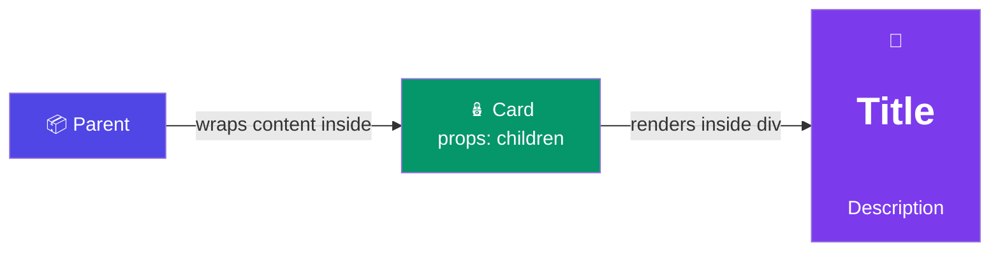

# Children Prop

## Simple Analogy 🎁

Imagine you order a pizza box. The box itself is the component — but what matters is what's **inside** the box (the pizza). The `children` prop is exactly that: it captures whatever you put **between** a component's opening and closing tags.

> `<Card>` → wraps around → `<h1>Title</h1>` → becomes `children`

---

## What is the Children Prop?

Every React component automatically gets a special prop called `children`.

It captures **everything placed between the opening and closing tags** of that component.

```jsx
function Card({ children }) {
  return <div className="card">{children}</div>;
}

<Card>
  <h1>Title</h1>
  <p>Description</p>
</Card>
```

👉 Whatever is inside `<Card>...</Card>` becomes the `children` prop.

---

## Children Prop Visualization



---

## Why is `children` Useful?

The `children` prop makes components **reusable** and **composable**. The wrapper decides the layout, the caller decides the content.

### Same Layout, Different Content

```jsx
function Card({ children }) {
  return (
    <div className="card">
      <div className="card-body">{children}</div>
    </div>
  );
}

// Different content, same card wrapper:
<Card>
  <h2>Welcome</h2>
  <p>This is the home page</p>
</Card>

<Card>
  
  <button>Edit Profile</button>
</Card>
```

---

## What Can `children` Be?

Children can be **any valid JSX**:

### 1. Text
```jsx
<Button>Click Me</Button>
```

### 2. JSX Elements
```jsx
<Card>
  <h1>Title</h1>
  <p>Description</p>
</Card>
```

### 3. Expressions
```jsx
<Card>
  {isLoggedIn ? <Profile /> : <Login />}
</Card>
```

### 4. Multiple Elements (Fragment)
```jsx
<Card>
  <>
    <h1>Title</h1>
    <p>Description</p>
  </>
</Card>
```

### 5. A Function (Render Prop pattern)
```jsx
<DataProvider>
  {(data) => <UserList users={data} />}
</DataProvider>
```

---

## Real-World Examples

### Example 1: Layout Wrapper
```jsx
function Layout({ children }) {
  return (
    <div className="layout">
      <Header />
      <main>{children}</main>
      <Footer />
    </div>
  );
}

// Usage — just wrap any page content:
<Layout>
  <HomePage />
</Layout>
```

### Example 2: Modal
```jsx
function Modal({ children, isOpen, onClose }) {
  if (!isOpen) return null;
  return (
    <div className="modal-overlay">
      <div className="modal-content">
        <button onClick={onClose}>✕</button>
        {children}
      </div>
    </div>
  );
}

<Modal isOpen={showModal} onClose={() => setShowModal(false)}>
  <h2>Confirm Delete</h2>
  <p>Are you sure you want to delete this item?</p>
  <button onClick={handleDelete}>Yes, Delete</button>
</Modal>
```

---

## Multiple Children Slots (Advanced)

For complex components, you can pass children to specific places using named props instead of `children`:

```jsx
function PageLayout({ header, sidebar, main }) {
  return (
    <div>
      <header>{header}</header>
      <aside>{sidebar}</aside>
      <main>{main}</main>
    </div>
  );
}

<PageLayout
  header={<h1>My App</h1>}
  sidebar={<NavMenu />}
  main={pageContent}
/>
```

---

## ⚠️ Common Mistakes

### Forgetting to Render `children`
```jsx
function Card({ children }) {
  return <div className="card"></div>; // ❌ children is ignored!
}
```

### Wrapping in Extra `<div>`
```jsx
function Card({ children }) {
  return (
    <div className="card">
      <div>{children}</div> {/* ❌ Unnecessary wrapper */}
    </div>
  );
}
```

---

## 🧠 In Simple Words

- **`children`** is a special prop that captures everything between the opening and closing tags
- It lets you build **reusable wrapper components** (cards, modals, layouts)
- Children can be **anything**: text, JSX, expressions, even functions
- The wrapper **controls the layout**, the caller **controls the content**
- For complex layouts with multiple sections, use **named props** instead of `children`
