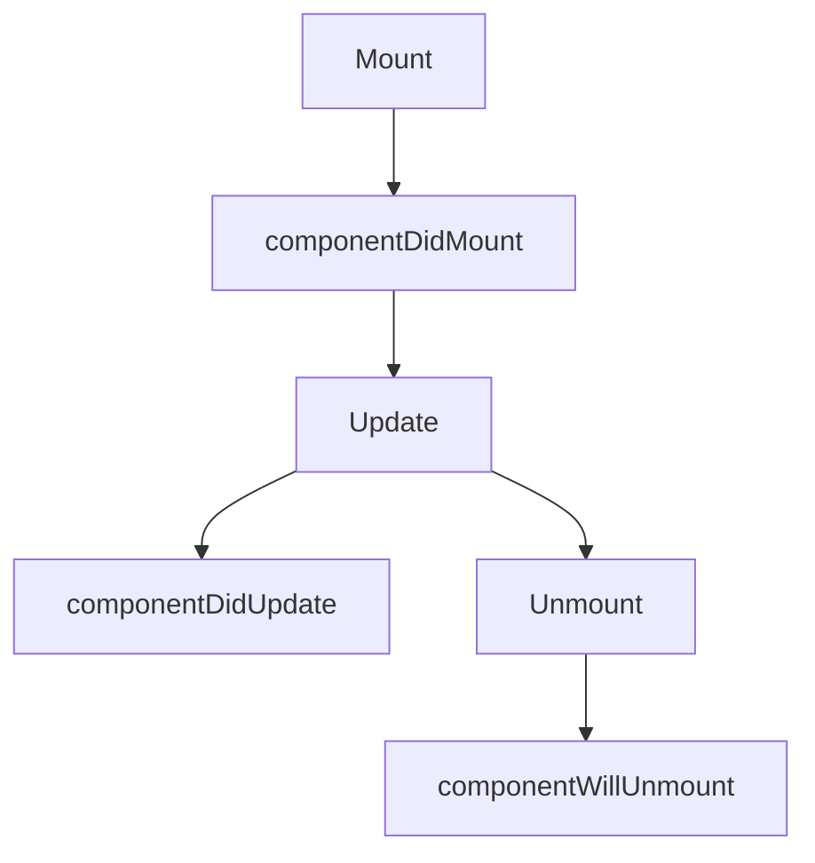

# Class Components

## Introduction

Class components were the primary way to build React components before Hooks (React 16.8). They extend `React.Component`, use a `render()` method, and support lifecycle methods.

## Syntax

```jsx
class Welcome extends React.Component {
  render() {
    return <h1>Hello, {this.props.name}</h1>;
  }
}
```

## State & Lifecycle

```jsx
class Counter extends React.Component {
  constructor(props) {
    super(props);
    this.state = { count: 0 };
  }

  componentDidMount() {
    document.title = `Count: ${this.state.count}`;
  }

  componentDidUpdate() {
    document.title = `Count: ${this.state.count}`;
  }

  render() {
    return (
      <div>
        <p>{this.state.count}</p>
        <button onClick={() => this.setState({ count: this.state.count + 1 })}>+</button>
      </div>
    );
  }
}
```

## Lifecycle Mapping



## Key Differences from Functional Components

| Feature | Class | Functional + Hooks |
|---------|-------|-------------------|
| State | `this.state` + `this.setState` | `useState` hook |
| Effects | `componentDidMount/Update/WillUnmount` | `useEffect` |
| Context | `this.context` or `Context.Consumer` | `useContext` |
| Refs | `this.ref` or `createRef` | `useRef` |
| `this` binding | Manual bind in constructor | Not needed |

## When to Use

⚠ Avoid in new code — use functional components with hooks instead.
✅ Maintain legacy codebases that use class components.

## MCQ

1. **What class must class components extend?** A) React.Component  B) React.PureComponent  C) React.Hooks  D) A or B → *D*
2. **Why avoid class components today?** A) Slower  B) More boilerplate  C) No hooks  D) All → *D*

## Summary

📖 Class components use ES6 classes. Legacy but still maintained. Use functional components for new code.

## Related Topics

[Functional Components](functional-components) | [Component Lifecycle](component-lifecycle)
