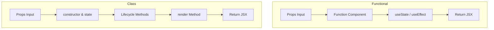
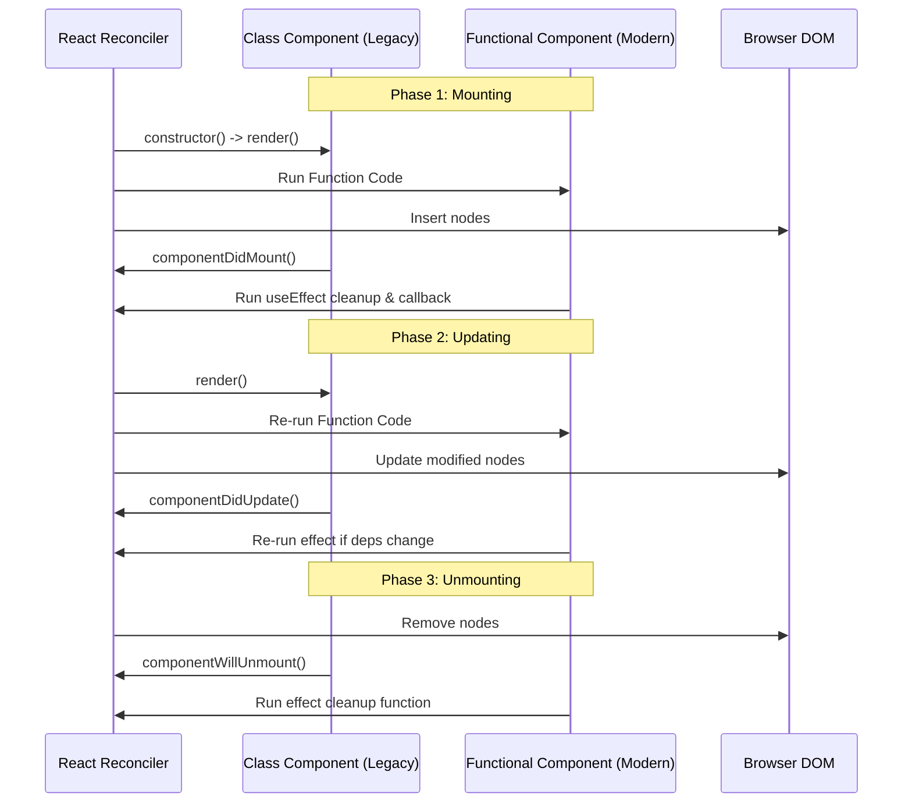
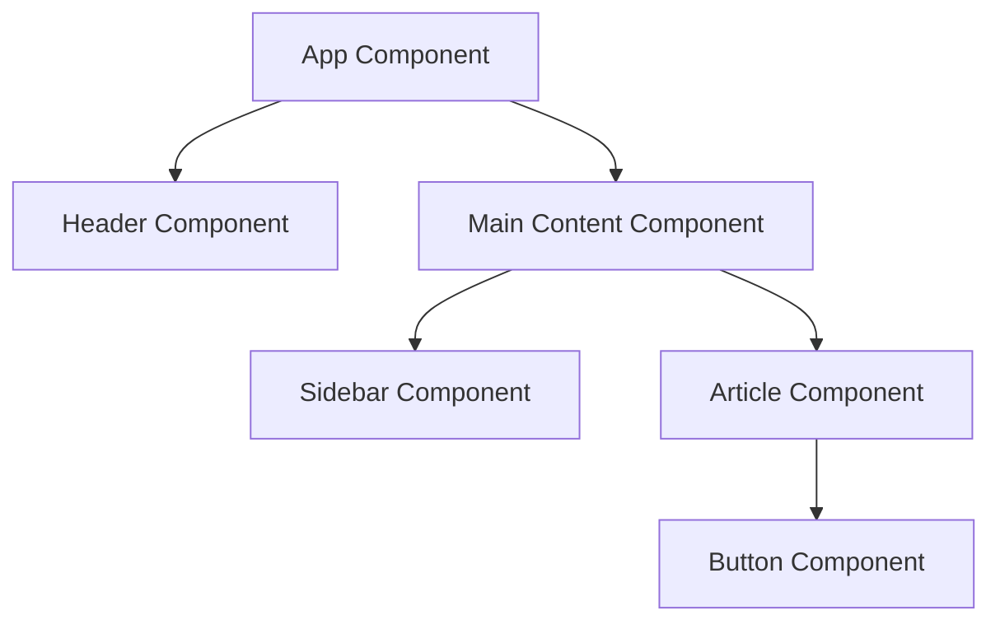
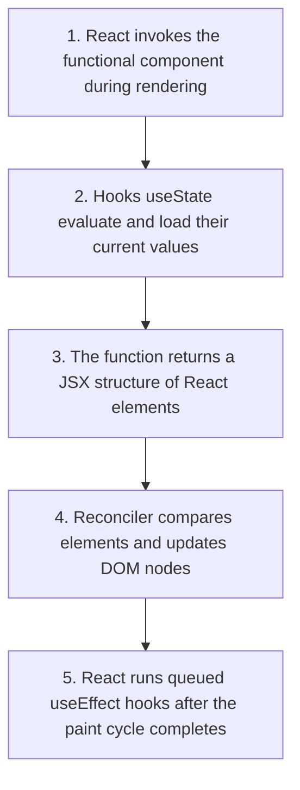

# React Component Fundamentals

## Introduction

Components are the primary building blocks of React applications. A component represents a self-contained unit of user interface that encapsulates its own structure (HTML-like JSX), style, and behavior (JavaScript logic). This module covers the difference between modern Functional Components and legacy Class Components, and maps how components mount, update, and unmount.

---

## Why do we need this?

Web applications are built of dozens of repeating interface patterns: buttons, inputs, profiles, layouts, cards. Without components, developers have to copy-paste markup blocks and write custom scripts to bind events to each instance, leading to large, fragile files.

### Problem Statement
Consider an application with a user comment section. Each comment box has an avatar, username, timestamp, comment text, and an upvote/downvote button. If you build this section manually, you have to replicate the HTML structure for each comment. If you decide to change the upvote icon shape, you must edit the code for every comment box individually. Furthermore, managing the voting click event listeners for 50 comments on a single page leads to messy event delegators. We need a way to wrap the HTML, CSS, and JS of a single comment into a reusable block.

---

## Real World Story

When React was created, JavaScript lacked native support for modular classes (classes were only introduced in ES6 in 2015). To build components, React developers used a custom API method called `React.createClass()`. 

When ES6 classes arrived, React introduced class components that inherited from `React.Component`. This became the industry standard for years, as only class components could hold state and run lifecycle methods (like `componentDidMount`). However, class components required writing complex constructor setups, binding event handlers, and managing the `this` keyword context. In 2019, React 16.8 introduced **Hooks**, which allowed functional components to use state and lifecycle methods. Functional components quickly replaced class components as the standard because they are simpler, write less boilerplate, and optimize better.

---

## Real World Analogy

Think of React components like **Modular LEGO Blocks** compared to **Molded Plastic Toys**.

- **Without Components (Molded Plastic)**: You mold a single toy truck from plastic. The wheels, cabin, and flatbed are fused. If a wheel breaks, you must replace the entire toy. If you want to build a tractor instead, you have to create a new mold from scratch.
- **With Components (LEGO Blocks)**: You build the truck using individual blocks: a chassis component, four wheel components, and a cabin component. If a wheel breaks, you pop it off and click on a new one. If you want a tractor, you reuse the chassis and wheels, swap the flatbed for a plow block, and assemble it in seconds.

---

## Visual Explanation

Below is a diagram showing the comparison of Functional Components vs. Class Components.

### Functional Component Model
```
[Props Input] ──> [Pure JS Function (Hooks)] ──> [JSX Output Element]
```

### Class Component Model
```
[Props Input] ──> [ES6 Class constructor / state] ──> [this.render()] ──> [JSX Output]
```



---

## Internal Working

Every React component goes through a lifecycle of three main phases:
1. **Mounting**: The component is created, initialized, and inserted into the browser's DOM.
2. **Updating**: The component's props or state changes, triggering React to re-run the component and update the DOM if necessary.
3. **Unmounting**: The component is removed from the DOM, and cleanup operations are executed.



---

## Architecture

Components are organized hierarchically, forming a tree structure. Parent components pass props down, control child layout flow, and capture events bubbled up from children.



---

## Step-by-Step Flow

When a functional component is executed and rendered by React, it follows this execution path:



---

## Syntax

Here is a comparison of class and functional component definitions.

### Legacy Class Component Syntax
```javascript
class MyComponent extends React.Component {
  render() {
    return <h1>{this.props.title}</h1>;
  }
}
```

### Modern Functional Component Syntax
```javascript
function MyComponent(props) {
  return <h1>{props.title}</h1>;
}
```

---

## Basic Example

Here is a basic Functional Component that displays a welcome card.

```jsx
import React from 'react';

// Basic Functional Component
export default function UserProfileCard({ name, role }) {
  return (
    <div style={{ border: '1px solid #ccc', padding: '16px', borderRadius: '4px' }}>
      <h3>User Profile</h3>
      <p>Name: <strong>{name}</strong></p>
      <p>Role: {role}</p>
    </div>
  );
}
```

---

## Intermediate Example

An intermediate component showing a legacy Class Component with local state and lifecycle methods. It illustrates state updates and logging when the component mounts and unmounts.

```jsx
import React, { Component } from 'react';

// Legacy Class Component representing a timer
export default class TimerClassComponent extends Component {
  constructor(props) {
    super(props);
    this.state = { seconds: 0 };
    this.timerId = null;
  }

  componentDidMount() {
    console.log('Timer mounted: starting interval...');
    this.timerId = setInterval(() => {
      this.setState(state => ({ seconds: state.seconds + 1 }));
    }, 1000);
  }

  componentDidUpdate(prevProps, prevState) {
    if (prevState.seconds !== this.state.seconds) {
      console.log(`Seconds updated to: ${this.state.seconds}`);
    }
  }

  componentWillUnmount() {
    console.log('Timer unmounting: clearing interval...');
    clearInterval(this.timerId);
  }

  render() {
    return (
      <div style={{ padding: '12px', background: '#f5f5f5' }}>
        <h4>Timer (Class Component)</h4>
        <p>Elapsed Time: {this.state.seconds}s</p>
      </div>
    );
  }
}
```

---

## Advanced Example

An advanced Functional Component equivalent to the timer class component above. It uses `useState` and `useEffect` to implement the same state initialization, logging, interval update, and cleanup.

```jsx
import React, { useState, useEffect } from 'react';

// Modern Functional Timer Component
export default function TimerFunctionalComponent() {
  const [seconds, setSeconds] = useState(0);

  useEffect(() => {
    console.log('Timer mounted: starting interval...');
    const timerId = setInterval(() => {
      setSeconds(prev => prev + 1);
    }, 1000);

    // This return function acts as the componentWillUnmount cleanup equivalent
    return () => {
      console.log('Timer unmounting: clearing interval...');
      clearInterval(timerId);
    };
  }, []); // Empty dependency array ensures this effect only runs on mount and unmount

  return (
    <div style={{ padding: '12px', background: '#e3f2fd' }}>
      <h4>Timer (Functional Component)</h4>
      <p>Elapsed Time: {seconds}s</p>
    </div>
  );
}
```

---

## Production Example

A production-grade component wrapper that logs component lifecycle metrics to an analytics endpoint. It measures rendering performance using the browser's user timing APIs.

```jsx
import React, { useEffect, useRef } from 'react';

export default function PerformanceMetricsWrapper({ componentName, children }) {
  const renderCount = useRef(0);
  const mountTime = useRef(performance.now());

  renderCount.current += 1;

  useEffect(() => {
    const elapsed = performance.now() - mountTime.current;
    console.log(`[ANALYTICS] Component ${componentName} mounted in ${elapsed.toFixed(2)}ms`);

    return () => {
      console.log(`[ANALYTICS] Component ${componentName} unmounted. Total Renders: ${renderCount.current}`);
    };
  }, [componentName]);

  return (
    <div style={{ position: 'relative', border: '1px dotted green', padding: '10px' }}>
      <span style={{ fontSize: '0.8rem', color: 'green', position: 'absolute', top: -8, left: 8, background: '#fff' }}>
        {componentName} (Renders: {renderCount.current})
      </span>
      {children}
    </div>
  );
}
```

---

## Folder Structure

```
components-fundamentals/
├── src/
│   ├── components/
│   │   ├── TimerFunctionalComponent.jsx
│   │   └── PerformanceMetricsWrapper.jsx
│   ├── App.jsx
│   └── main.jsx
├── package.json
└── vite.config.js
```

---

## Best Practices

💡 **Did You Know?**  
React functional components are much faster to bundle and minimize compared to class components. Minifiers (like terser or esbuild) struggle to rename class properties and methods safely, whereas functions are easily optimized.

🚀 **Best Practices**
- Build functional components by default. Use class components only when implementing legacy systems or custom Error Boundaries (since functional components do not support `componentDidCatch` yet).
- Always return cleanups inside `useEffect` calls to clear intervals, timers, and event listeners.
- Avoid performing heavy computations inside the main render/function body. Use hooks like `useMemo` to cache them.

---

## Common Mistakes

⚠ **Common Mistakes**

### Memory Leaks from Missing Cleanups
A common mistake in functional components is starting an interval inside `useEffect` without returning a cleanup function. If the component unmounts and remounts, new intervals are created while the old ones keep running in the background, consuming CPU resources.

```jsx
// ❌ WRONG
useEffect(() => {
  setInterval(() => {
    console.log("Tick");
  }, 1000);
}, []); // Interval leaks when component unmounts

//  RIGHT
useEffect(() => {
  const id = setInterval(() => {
    console.log("Tick");
  }, 1000);
  return () => clearInterval(id); // Cleanup function clears interval
}, []);
```

---

## Performance Notes

⚡ **Performance Tips**
Every time a component's parent renders, all children in its layout tree re-render by default. You can prevent child components from re-rendering unnecessarily by wrapping them in `React.memo`.

### Performance Example
Using memoization to avoid rendering child components when parent state changes:

```jsx
import React from 'react';

// Wrap the component with React.memo to skip updates if props are identical
const ExpensiveLabel = React.memo(({ value }) => {
  console.log("ExpensiveLabel Rendered");
  return <span>Label: {value}</span>;
});
```

---

## Accessibility Notes

♿ **Accessibility Tips**
- Ensure custom interactive components support keyboard navigation (e.g., matching Enter/Space keys to triggers, managing `tabIndex` states).
- Use focus traps in modal dialog containers to keep screen reader focus inside the dialog box while it is open.

---

## SEO Notes

When creating client-side layouts, avoid nesting headers inside deeply nested components if they represent key semantic content. Search engine crawlers prioritize clean, flat header hierarchies.

---

## Interview Questions

🎯 **Interview Tips**  
If asked to compare functional and class components, don't just list syntax differences. Mention that functional components are simpler, require less boilerplate, prevent issues with the `this` keyword context, and align with React's move toward hooks and concurrent rendering.

### Q1: Compare Class Components with Functional Components in React.
**Answer**: Class Components are ES6 classes that extend `React.Component`. They require constructor bindings, manage state using `this.state` / `this.setState()`, and use lifecycle methods (`componentDidMount`, etc.). Functional Components are standard JavaScript functions that receive props as an argument and return JSX. They manage state and lifecycle side effects using Hooks, which results in cleaner, easier-to-minimize code.

### Q2: What is the equivalent of `componentDidMount` in Functional Components?
**Answer**: The equivalent is a `useEffect` hook with an empty dependency array (`[]`). React will execute the effect callback only once after the component mounts. If the effect returns a function, React will execute that function when the component unmounts, acting as the equivalent of `componentWillUnmount`.

---

## MCQs

1. **Which JS feature is required to define a Class Component?**
   - A) Promises
   - B) Generators
   - C) ES6 Class extends React.Component
   - D) Arrow functions
   - *Answer: C*

2. **In a legacy Class Component, where is state initially defined?**
   - A) In the render method
   - B) Inside the constructor
   - C) In the template layout
   - D) Inside standard event handlers
   - *Answer: B*

3. **Which hook is used to implement lifecycle behaviors in Functional Components?**
   - A) `useState`
   - B) `useRef`
   - C) `useEffect`
   - D) `useReducer`
   - *Answer: C*

4. **When does the clean-up function returned by `useEffect` execute?**
   - A) Immediately before the component renders.
   - B) Right before the component unmounts, or before re-running the effect due to dependency updates.
   - C) Only when state variables are reset.
   - D) On browser tab closure.
   - *Answer: B*

5. **Which component type is generally preferred in modern React codebases?**
   - A) Class Components
   - B) MVC controller classes
   - C) Functional Components with Hooks
   - D) Single-file web components
   - *Answer: C*

---

## Practice Exercise

### Exercise 1: State Counter Class conversion
Convert this simple functional counter into a class component:
```jsx
function Counter() {
  const [count, setCount] = React.useState(0);
  return <button onClick={() => setCount(count + 1)}>{count}</button>;
}
```

### Exercise 2: Mounted Event Logger
Write a functional component that shows an alert popup containing the message `"Welcome!"` when it mounts to the screen.

### Exercise 3: Window Resize Tracker
Create a component that listens to the window resize event and renders the window width (`window.innerWidth`) on screen. Ensure that the listener is cleaned up when the component unmounts.

---

## Debugging Exercise

### The Double Fetch Bug
A developer notice that their API fetch effect is calling the backend twice when the page loads, which causes redundant database queries. They suspect this is a bug. Identify the cause and explain why this is normal behavior.

```jsx
import React, { useEffect } from 'react';

export default function DataFetcher() {
  useEffect(() => {
    console.log("Fetching API data...");
    fetch('/api/v1/metrics');
  }, []);

  return <div>Metrics Loaded</div>;
}
```

#### Solution
In development mode, React wraps the root node in `React.StrictMode`, which intentionally runs components and effects twice. This helps developers identify missing cleanups and memory leaks early. In production builds, this double execution is disabled. This is normal behavior, and no fix is required unless the effect lacks a cleanup function for operations like event listeners or fetch aborts.

---

## Real-world Scenario

You are maintaining an e-commerce platform where a product detail page displays a reviews section. Users report that reviews from a previous product sometimes flash on screen briefly when navigating to a new product. Explain how you would address this using component lifecycles.
- **Resolution Strategy**: When the product ID changes, clear the reviews state array immediately (setting it to an empty list or loading state) inside a cleanup function or before starting the new API call. This prevents stale state from flashing on screen.

---

## Interview Coding Question

### Problem Statement
Write a component that tracks network status (online/offline). Render a banner indicating connection changes and log network status changes to the console. Ensure all event listeners are cleaned up correctly on unmount.

```jsx
import React, { useState, useEffect } from 'react';

export default function ConnectionMonitor() {
  const [isOnline, setIsOnline] = useState(navigator.onLine);

  useEffect(() => {
    const goOnline = () => {
      console.log('Network connected');
      setIsOnline(true);
    };
    const goOffline = () => {
      console.log('Network disconnected');
      setIsOnline(false);
    };

    window.addEventListener('online', goOnline);
    window.addEventListener('offline', goOffline);

    // Clean up event listeners on unmount
    return () => {
      window.removeEventListener('online', goOnline);
      window.removeEventListener('offline', goOffline);
    };
  }, []);

  return (
    <div
      style={{
        padding: '10px',
        backgroundColor: isOnline ? '#d4edda' : '#f8d7da',
        color: isOnline ? '#155724' : '#721c24',
        textAlign: 'center'
      }}
    >
      Status: <strong>{isOnline ? 'Online' : 'Offline'}</strong>
    </div>
  );
}
```

---

## Mini Project

### Lifecycle Sandbox Hub
Create an interactive component sandbox page:
- Includes a button to mount/unmount a child component.
- The child component should:
  - Display a live countdown timer.
  - Log status changes to an on-screen log list component on mount, update, and unmount.
  - Listen to mouse movements and display the cursor's coordinates, showing coordinate values updating in real-time.
  - Clean up event listeners correctly when unmounted.

---

## Summary

🧠 **Memory Tricks**  
`useEffect Empty Deps = Mount/Unmount` - Think of a `useEffect` hook with empty brackets `[]` like a door: it runs once when the component enters (mounts), and its cleanup function runs once when it leaves (unmounts).

📖 **Summary**  
React components encapsulate layout and logic in Functional or Class structures. Modern functional code manages state and lifecycle side effects using Hooks, avoiding the boilerplate of legacy classes and simplifying updates and cleanups.

---

## Cheat Sheet

```javascript
// Functional lifecycle mapping
useEffect(() => {
  // 1. Mount behavior runs here

  return () => {
    // 2. Unmount cleanup behavior runs here
  };
}, []); // Empty dependencies list
```

---

## Related Topics
- [Props & Unidirectional Data Flow](props-data-flow)
- [Managing Local Component State](../phase-3-state-management/local-state-basics)

---

## Further Reading
- [React Docs: Your First Component](https://react.dev/learn/your-first-component)
- [React Docs: Synchronizing with Effects](https://react.dev/learn/synchronizing-with-effects)
