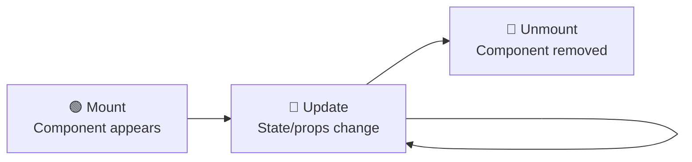
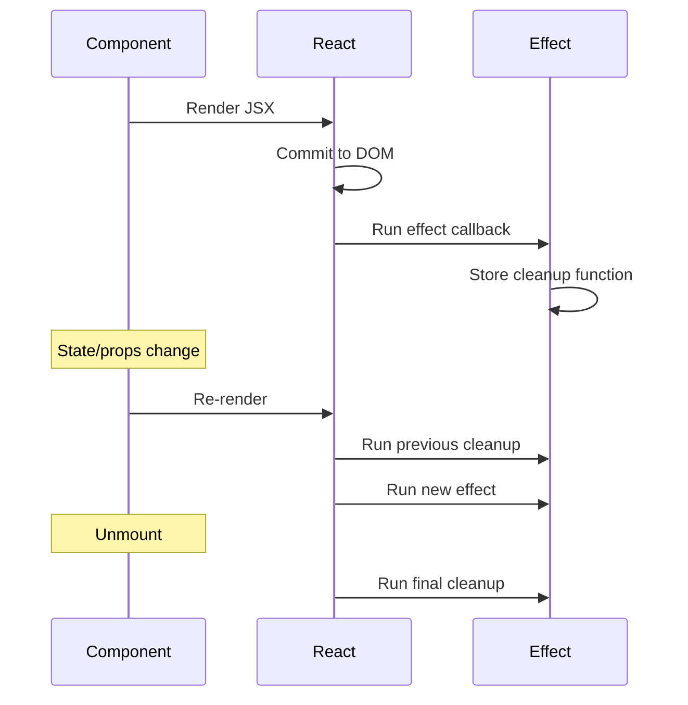

# Component Lifecycle

## Introduction

Every React component goes through a lifecycle: it appears on the screen (mounting), updates when state or props change (updating), and is removed from the screen (unmounting). Understanding this lifecycle helps you manage side effects, avoid memory leaks, and write predictable components.

---

## The Three Phases

### Mounting
The component is created, rendered for the first time, and inserted into the DOM.

### Updating
The component re-renders because its state changed, props changed, or a parent re-rendered.

### Unmounting
The component is removed from the DOM. Cleanup happens here (intervals, subscriptions, event listeners).

---

## Visual Overview



---

## Lifecycle in Class Components

In class components, lifecycle methods let you hook into each phase:

| Phase | Method | Purpose |
|-------|--------|---------|
| Mount | `constructor()` | Initialize state, bind handlers |
| Mount | `render()` | Return JSX |
| Mount | `componentDidMount()` | Fetch data, set up subscriptions |
| Update | `render()` | Re-render with new state/props |
| Update | `componentDidUpdate(prevProps)` | React to prop/state changes |
| Unmount | `componentWillUnmount()` | Clean up intervals, subscriptions |

```jsx
class Timer extends React.Component {
  constructor(props) {
    super(props);
    this.state = { seconds: 0 };
  }

  componentDidMount() {
    this.interval = setInterval(() => {
      this.setState(s => ({ seconds: s.seconds + 1 }));
    }, 1000);
  }

  componentDidUpdate(prevProps) {
    if (prevProps.timerId !== this.props.timerId) {
      console.log('Timer ID changed, resetting...');
      this.setState({ seconds: 0 });
    }
  }

  componentWillUnmount() {
    clearInterval(this.interval);
  }

  render() {
    return <p>Elapsed: {this.state.seconds}s</p>;
  }
}
```

**Explanation:** The timer starts when mounted (`componentDidMount`), tracks the timer ID for potential resets (`componentDidUpdate`), and stops when unmounted (`componentWillUnmount`). The lifecycle methods are split across the class.

---

## Lifecycle in Functional Components

Functional components use `useEffect` to handle lifecycle behaviors. A single `useEffect` can combine mount, update, and unmount logic.

```jsx
import { useState, useEffect } from 'react';

export default function Timer({ timerId }) {
  const [seconds, setSeconds] = useState(0);

  // Equivalent to componentDidMount + componentWillUnmount
  useEffect(() => {
    const interval = setInterval(() => {
      setSeconds(s => s + 1);
    }, 1000);

    // Cleanup: equivalent to componentWillUnmount
    return () => clearInterval(interval);
  }, []); // Empty deps = run once on mount

  // Equivalent to componentDidUpdate
  useEffect(() => {
    setSeconds(0);
  }, [timerId]); // Runs when timerId changes

  return <p>Elapsed: {seconds}s</p>;
}
```

---

## Lifecycle Mapping

| Class Method | Functional Equivalent |
|-------------|----------------------|
| `constructor` | `useState` initializer / lazy init |
| `componentDidMount` | `useEffect(() => {}, [])` |
| `componentDidUpdate` | `useEffect(() => {}, [deps])` |
| `componentWillUnmount` | Cleanup function in `useEffect` return |
| `shouldComponentUpdate` | `React.memo` |
| `getDerivedStateFromProps` | Derive state during render |

---

## The Effect Lifecycle



---

## Common Mistakes

⚠ **Missing Cleanup**

Starting an interval or subscription without cleanup causes memory leaks. The interval continues running even after the component unmounts.

```jsx
// ❌ BAD — interval leaks on unmount
useEffect(() => {
  setInterval(() => console.log('tick'), 1000);
}, []);

// ✅ GOOD — cleanup clears the interval
useEffect(() => {
  const id = setInterval(() => console.log('tick'), 1000);
  return () => clearInterval(id);
}, []);
```

⚠ **Unnecessary Dependencies**

Including an inline function or object in the dependency array without memoization causes infinite re-renders. Always use `useCallback` for stable callbacks.

---

## Summary

- **Mount:** Component appears. Set up subscriptions, fetch data.
- **Update:** Component re-renders. Respond to prop/state changes.
- **Unmount:** Component removed. Clean up subscriptions, intervals.
- In functional components, `useEffect` with `[]` = mount/unmount. `useEffect` with `[deps]` = didUpdate.
- Always clean up to prevent memory leaks.

## Related Topics

- [useEffect](../phase-4-hooks/use-effect)
- [Class Components](class-components)
- [Functional Components](functional-components)

## Further Reading

- [React Docs: Lifecycle of a Component](https://react.dev/learn/lifecycle-of-reactive-effects)
- [React Docs: Synchronizing with Effects](https://react.dev/learn/synchronizing-with-effects)
