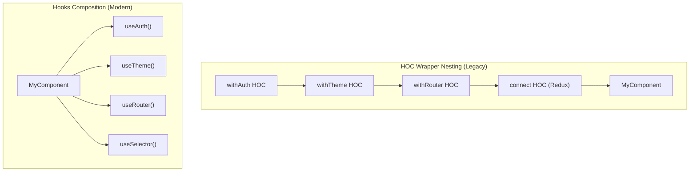
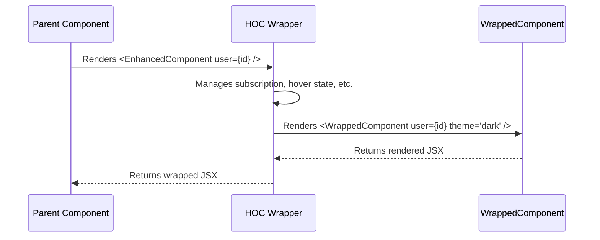
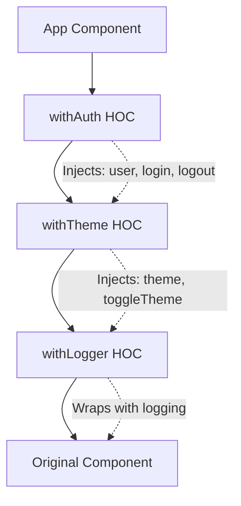
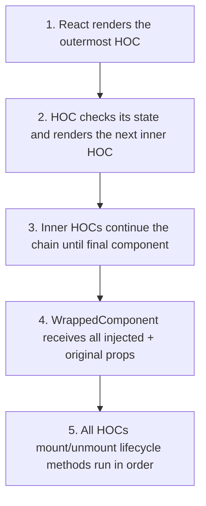

# Higher-Order Components (HOC)

## Introduction

A Higher-Order Component (HOC) is a function that takes a component and returns a new, enhanced component. Derived from the concept of Higher-Order Functions in JavaScript, HOCs were the primary pattern for reusing stateful logic in React before Hooks were introduced. While modern codebases prefer custom Hooks, understanding HOCs is essential for maintaining legacy React applications and understanding React's evolution.

---

## Why do we need this?

Before Hooks (React < 16.8), there was no way to extract and reuse stateful logic between class components.

### Problem Statement

Consider two unrelated components: a `UserProfile` component and a `ProductCard` component. Both need to:
1. Track whether the component is currently hovered.
2. Subscribe to a global theme and apply it.

Without a reuse pattern, you must copy-paste the hover tracking logic and theme subscription code into both components. If you discover a bug in the hover logic, you must fix it in every component that uses it. This violates the DRY principle and makes maintenance exponentially harder as the application grows.

---

## Real World Story

In 2015, the React ecosystem was dominated by class components. Libraries like Redux (`connect()`), React Router (`withRouter()`), and Material UI (`withStyles()`) all adopted the HOC pattern. A typical React application in 2016 had components wrapped in multiple HOCs:

```jsx
export default withRouter(withTheme(withStyles(styles, withAuth(MyComponent))));
```

This "wrapper hell" became a notorious pain point. In React DevTools, you'd see nesting trees like `Connect(WithTheme(WithStyles(WithAuth(MyComponent))))`. Each wrapper added abstraction overhead, made debugging harder, and created naming collisions. When React 16.8 introduced Hooks in 2019, the community rapidly adopted them as a cleaner alternative.

---

## Real World Analogy

Think of HOCs like **Ammunition Belts on a Soldier** compared to **Backpack Pouches**.

- **HOC Pattern (Ammunition Belt)**: You add a new belt for each type of ammo. Need a grenade belt? Add one. Need a first aid pouch? Add another belt. Soon you're wearing 5 belts stacked on top of each other.

- **Hooks Pattern (Backpack Pouches)**: You have a single backpack. Inside, you organize pouches: one for grenades, one for first aid, one for rations. You can grab what you need without unbuckling belts.

---

## Visual Explanation

Below is a comparison of HOC wrapper nesting vs. clean Hook composition.



---

## Internal Working

A HOC creates a wrapper component that manages additional state, intercepts props, and renders the original component with merged props.



---

## Architecture

HOCs wrap a component tree in layers. Each layer adds its own behavior by injecting props.



---

## Step-by-Step Flow

When a wrapped component renders, the following occurs:



---

## Syntax

```javascript
function withFeature(WrappedComponent) {
  return function EnhancedComponent(props) {
    // Add extra logic, state, or behavior here
    return <WrappedComponent {...props} extraProp="value" />;
  };
}
const EnhancedButton = withFeature(MyButton);
```

---

## Basic Example

A HOC that logs whenever a component renders.

```jsx
import React from 'react';

function withLogger(WrappedComponent) {
  return function LoggerWrapper(props) {
    console.log(`[withLogger] Rendering ${WrappedComponent.name}`);
    return (
      <div style={{ border: '1px dashed #ccc', padding: '8px' }}>
        <WrappedComponent {...props} />
      </div>
    );
  };
}

function Greeting({ name }) {
  return <p>Hello, {name}!</p>;
}

const GreetingWithLogger = withLogger(Greeting);

export default function App() {
  return <GreetingWithLogger name="Alice" />;
}
```

**Explanation:** `withLogger` takes a `WrappedComponent` and returns a new `LoggerWrapper` component. `LoggerWrapper` logs the component name on every render and renders the `WrappedComponent` with all original props spread via `{...props}`. The original `Greeting` component is unaware it's being wrapped.

---

## Intermediate Example

An HOC that adds hover tracking state to any component.

```jsx
import React, { Component } from 'react';

function withHoverTracking(WrappedComponent) {
  return class HoverTracker extends Component {
    state = { isHovered: false };
    handleMouseEnter = () => this.setState({ isHovered: true });
    handleMouseLeave = () => this.setState({ isHovered: false });
    render() {
      return (
        <div onMouseEnter={this.handleMouseEnter} onMouseLeave={this.handleMouseLeave}>
          <WrappedComponent {...this.props} isHovered={this.state.isHovered} />
        </div>
      );
    }
  };
}

function Tooltip({ text, isHovered }) {
  return (
    <div>
      {text}
      {isHovered && <div style={{ background: '#333', color: 'white', padding: '4px 8px' }}>Hovered!</div>}
    </div>
  );
}

const TooltipWithHover = withHoverTracking(Tooltip);
```

**Key Points:** The HOC injects `isHovered` prop, manages mouse event handlers internally, and spreads original props through `{...this.props}` to preserve parent-passed props.

---

## Advanced Example

A curried HOC that handles data fetching lifecycle — the standard pattern before custom hooks.

```jsx
import React, { Component } from 'react';

function withDataFetching(url, mapDataToProps) {
  return function(WrappedComponent) {
    return class DataFetcher extends Component {
      state = { data: null, loading: true, error: null };

      componentDidMount() { this.fetchData(); }

      componentDidUpdate(prevProps) {
        if (prevProps.url !== this.props.url) this.fetchData();
      }

      async fetchData() {
        this.setState({ loading: true, error: null });
        try {
          const resolvedUrl = typeof url === 'function' ? url(this.props) : url;
          const response = await fetch(resolvedUrl);
          if (!response.ok) throw new Error(`HTTP error! status: ${response.status}`);
          const json = await response.json();
          const mappedData = mapDataToProps ? mapDataToProps(json) : json;
          this.setState({ data: mappedData, loading: false });
        } catch (err) {
          this.setState({ error: err.message, loading: false });
        }
      }

      render() {
        return <WrappedComponent {...this.props} {...this.state} refetch={this.fetchData.bind(this)} />;
      }
    };
  };
}

function UserProfile({ data, loading, error, refetch }) {
  if (loading) return <div>Loading...</div>;
  if (error) return <div role="alert">Error: {error}</div>;
  return (
    <div>
      <h2>{data.name}</h2>
      <button onClick={refetch}>Refresh</button>
    </div>
  );
}

const UserProfileWithData = withDataFetching(
  (props) => `https://jsonplaceholder.typicode.com/users/${props.userId}`,
  (json) => ({ name: json.name, email: json.email })
)(UserProfile);
```

---

## Production Example

A production-grade authentication HOC with fallback UI for unauthenticated users.

```jsx
import React, { Component } from 'react';

const AuthContext = React.createContext({ user: null, isAuthenticated: false });

function withAuth(WrappedComponent) {
  return class AuthWrapper extends Component {
    static displayName = `withAuth(${WrappedComponent.displayName || WrappedComponent.name || 'Component'})`;
    static WrappedComponent = WrappedComponent;

    render() {
      return (
        <AuthContext.Consumer>
          {(auth) => {
            if (!auth.isAuthenticated) {
              return (
                <div style={{ padding: '40px', textAlign: 'center', backgroundColor: '#fef2f2' }}>
                  <h3>Access Denied</h3>
                  <button onClick={() => auth.login()}>Log In</button>
                </div>
              );
            }
            return <WrappedComponent {...this.props} user={auth.user} isAuthenticated={true} />;
          }}
        </AuthContext.Consumer>
      );
    }
  };
}
```

---

## Best Practices

💡 **Did You Know?** React DevTools used to show nesting like `Connect(WithTheme(WithAuth(MyComponent)))`. Custom Hooks flattened this entirely.

🚀 **Best Practices**
- Set `displayName` on HOCs for debugging.
- Pass unrelated props through with `{...this.props}`.
- Do not mutate the original component — compose it.
- Copy static methods from the original to the wrapper.
- **Prefer Hooks for new code** — only use HOCs when maintaining legacy code.

---

## Common Mistakes

⚠ **Common Mistakes**

### Props Name Collisions
```jsx
// Two HOCs injecting 'data' prop — only the last survives
withAuth(MyComponent);  // Injects { data: user }
withData(MyComponent);  // Injects { data: products } // Overwrites!
```

### Not Spreading Props
```jsx
function withBorder(Component) {
  return function(props) {
    return <div style={{ border: '1px solid red' }}>
      <Component /> {/* {...props} missing! className, id all lost */}
    </div>;
  };
}
```

### HOCs Inside Render Method
```jsx
function App() {
  const Enhanced = withLogger(MyComponent); // ❌ New component on every render
  return <Enhanced />;
}
```

---

## Performance Notes

Each HOC layer adds another component to the render tree. HOCs using classes create heavier instances than functional wrappers.

---

## Accessibility Notes

HOCs that add hover-only behavior break accessibility for keyboard users. Always provide keyboard equivalents.

---

## Interview Questions

### Q1: What is a Higher-Order Component?
**Answer:** A function that takes a component and returns a new enhanced component. It is a pattern, not a React API. HOCs wrap other components to inject additional props or behavior.

### Q2: Why did Hooks replace HOCs?
**Answer:** Hooks eliminate wrapper nesting, avoid prop name collisions, are simpler to compose and test, don't add extra components to the tree, and have cleaner TypeScript typing.

---

## MCQs

1. **What does a Higher-Order Component take as input?**
   - A) A JavaScript object / B) A React component / C) An HTML string / D) A configuration file
   - *Answer: B*

2. **What problem did HOCs solve in legacy React?**
   - A) CSS styling conflicts / B) Reusing stateful logic between class components / C) SSR / D) Image optimization
   - *Answer: B*

3. **What is "wrapper hell" in the context of HOCs?**
   - A) CSS specificity problems / B) Deeply nested component trees that are hard to debug / C) Slow bundling / D) Memory leaks
   - *Answer: B*

4. **Which modern feature replaced HOCs?**
   - A) React Fragments / B) Custom Hooks / C) Portals / D) Error Boundaries
   - *Answer: B*

5. **How should static methods on the original component be handled?**
   - A) They are automatically inherited / B) They must be manually copied to the wrapper / C) They are discarded / D) They cause errors
   - *Answer: B*

---

## Practice Exercise

### Exercise 1: Create a withBorder HOC
Write a HOC that adds a 2px solid blue border to any component.

### Exercise 2: Refactor to a Custom Hook
Convert `withWindowWidth` HOC into a custom `useWindowWidth` hook.

### Exercise 3: Composition Order
Predict: `withA(withB(withC(MyComponent)))` — in what order do mount/unmount lifecycle methods run?

---

## Debugging Exercise

A developer notices `className` props don't reach the wrapped component. Identify the bug.

```jsx
function withCard(WrappedComponent) {
  return function(props) {
    return <div className="card"><WrappedComponent /></div>; // BUG: {...props} missing
  };
}
```

**Solution:** Add `{...props}` to spread all original props onto the `WrappedComponent`.

---

## Real-world Scenario

You're taking over a legacy React project with 47 HOCs, some wrapping 6+ layers deep. Analytics events are firing twice.

**Strategy:** Use React DevTools to identify nesting, trace the double-fire source in the `withTracking` HOC, and gradually migrate to custom Hooks starting with the most nested components.

---

## Interview Coding Question

Write a `withToggle` HOC that injects `on`, `toggle()`, and `setOn()` props.

---

## Mini Project

Build a comparison page with two implementations of the same feature: one using 3 HOCs (`withAuth`, `withTheme`, `withDataFetching`) and one using corresponding custom hooks. Show the DevTools component tree for both.

---

## Summary

`HOC = Function(Component) => EnhancedComponent` — Think of HOCs as wrapping layers. Hooks provide cleaner composition without nesting.

---

## Cheat Sheet

```javascript
function withFeature(WrappedComponent) {
  return function Enhanced(props) {
    return <WrappedComponent {...props} extraProp={value} />;
  };
}
```

---

## Related Topics

- [Component Fundamentals](component-fundamentals)
- [Props & Data Flow](props-data-flow)
- [Custom Hooks](../phase-4-hooks/custom-hooks)

---

## Further Reading

- [React Docs: Higher-Order Components](https://legacy.reactjs.org/docs/higher-order-components.html)
- [React Docs: Hooks at a Glance](https://react.dev/reference/react/hooks)
