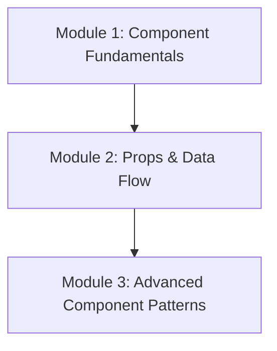

# Phase 2: Components & JSX

Welcome to the **Components & JSX** phase of the React Engineering Academy. This phase focuses on the structural building blocks of React: creating reusable components, managing properties (props), validating data shapes, and applying advanced architectural patterns.

## Why this topic exists

Modern user interfaces are dynamic and complex, composed of thousands of overlapping sections (menus, cards, buttons, sidebars). Attempting to build and maintain these layouts as single, monolithic pages leads to massive files that are impossible to test, edit, or reuse.

React solves this by introducing a **Component-Based Architecture**. By breaking user interfaces into small, isolated, self-contained components, developers can manage, test, and reuse UI logic efficiently. These components communicate using a strictly defined unidirectional data flow (props), ensuring layout behavior is predictable.

---

## Learning Objectives

By the end of this phase, you will be able to:
- Build and structure reusable Functional and Class components.
- Explain the component lifecycle phases (Mounting, Updating, Unmounting).
- Define, pass, destructure, and validate props inside components.
- Leverage the special `children` prop for composition patterns.
- Apply runtime validation using PropTypes and TypeScript shapes.
- Implement the Container/Presentational design pattern.
- Build flexible interfaces using Compound Components and Render Props.
- Understand the Higher-Order Component (HOC) structural pattern.

---

## Prerequisites

Before starting this phase, you should have completed:
1. **[Phase 1: React Fundamentals](../phase-1-fundamentals)**
2. Basic understanding of JavaScript ES6 Class inheritance and object destructuring.

---

## Learning Roadmap & Topics Covered

This phase is broken down into three comprehensive modules:

1. **[Module 1: Component Fundamentals](component-fundamentals)**  
   Functional vs Class components, lifecycle hooks, mounting/updating/unmounting processes, and when to choose each style.
2. **[Module 2: Props & Data Flow](props-data-flow)**  
   Unidirectional data flow, passing variables/functions, default props, destructuring, children composition, and prop validation.
3. **[Module 3: Advanced Component Patterns](advanced-component-patterns)**  
   Presentational/Container separations, layout components, Higher-Order Components, Render Props, and Compound Components.

---

## Estimated Learning Time

- **Total Time**: 8 - 10 Hours
- **Module 1**: 2.5 Hours
- **Module 2**: 2.5 Hours
- **Module 3**: 4 Hours
- **Exercises & Projects**: 1 Hour

---

## Real-World Applications

- **Design Systems**: Building unified, accessible component libraries (like Radix UI or Material UI) used across hundreds of products.
- **Micro-Frontends**: Developing modular, isolated UI features managed by separate engineering teams.
- **Enterprise Layouts**: Creating complex dashboard grid configurations that adapt dynamically based on user role props.

---

## Practice Exercises

- **Class to Functional refactoring**: Converting legacy React components into modern hooks-compatible functions.
- **Prop shape enforcement**: Writing strict validations for nested user data payloads.
- **Compound component builder**: Building an accordion/tabs drawer component from scratch.

---

## Mini Projects

- **An Interactive Component Library Showcase**: A local documentation panel displaying customized buttons, inputs, alerts, and modal dialogs constructed using advanced component patterns.

---

## Related Topics

- [React Fundamentals Overview](../phase-1-fundamentals)
- [Managing Component State](../phase-3-state-management)

---

## Further Reading

- [React.dev: Components and Props](https://react.dev/learn/your-first-component)
- [Kent C. Dodds: React Component Patterns](https://epicreact.dev/)
