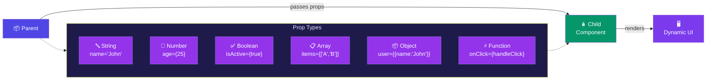

# Prop Types

## Simple Analogy 📦

Think of props like package labels. A package can carry different kinds of items:
- A **string** = a note with someone's name
- A **number** = a price tag
- A **boolean** = an "on/off" switch
- An **array** = a list of shopping items
- An **object** = a box containing multiple things
- A **function** = a walkie-talkie to call back to the sender

---

## Props Flow Into a Component



---

## 1. String

```jsx
function Greeting({ name }) {
  return <h1>Hello {name}</h1>;
}

<Greeting name="John" />
```

👉 Strings use **double quotes** (or single quotes) — no `{}` needed.

---

## 2. Number

```jsx
function User({ age }) {
  return <p>Age: {age}</p>;
}

<User age={25} />
```

👉 Numbers use **curly braces `{}`** — without braces, React treats it as a string.

---

## 3. Boolean

```jsx
function Button({ isActive }) {
  return (
    <button className={isActive ? "active" : "inactive"}>
      Click
    </button>
  );
}

<Button isActive={true} />
<Button isActive={false} />
```

👉 Booleans also use `{}`. Shortcut: `isActive` alone means `true`.

---

## 4. Array

```jsx
function List({ items }) {
  return (
    <ul>
      {items.map(item => <li key={item}>{item}</li>)}
    </ul>
  );
}

<List items={["Apple", "Banana", "Cherry"]} />
```

👉 Arrays use `{}`. Inside, use `.map()` to render each item.

---

## 5. Object

```jsx
function Profile({ user }) {
  return (
    <div>
      <h2>{user.name}</h2>
      <p>{user.email}</p>
    </div>
  );
}

<Profile user={{ name: "Prathamesh", email: "p@example.com" }} />
```

👉 Objects use **double `{}`** — one for JS expression, one for the object itself.

---

## 6. Function (Child → Parent Communication)

```jsx
function Button({ onClick }) {
  return <button onClick={onClick}>Click me</button>;
}

function App() {
  function handleClick() {
    alert("Button was clicked!");
  }
  return <Button onClick={handleClick} />;
}
```

👉 Passing a function lets the **child call back to the parent**. This is how children communicate upward.

---

## Quick Reference

| Type | Syntax | Example |
|------|--------|---------|
| String | `name="John"` | Text values |
| Number | `age={25}` | Numbers, dates |
| Boolean | `isActive={true}` | Toggle flags |
| Array | `items={["A","B"]}` | Lists of data |
| Object | `user={{name:"John"}}` | Grouped data |
| Function | `onClick={handleClick}` | Event handlers / callbacks |

---

## ⚠️ Common Mistake

```jsx
<User age="25" />  // ❌ Passes string "25", not number 25!
<User age={25} />  // ✅ Correct — passes number
```

Always use `{}` for any JavaScript value (numbers, booleans, arrays, objects, functions). Only strings can skip the braces.

---

## 🧠 In Simple Words

- **String**: plain text — use quotes `" "`
- **Number**: numeric value — use `{}`
- **Boolean**: true/false — use `{}` (or just the prop name for `true`)
- **Array**: list of items — use `{}` + `.map()` to render
- **Object**: grouped data — use `{}` with another `{}` inside
- **Function**: callback — lets child talk to parent
- **Rule of thumb**: any value that isn't a plain string needs `{}`
