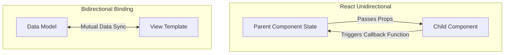
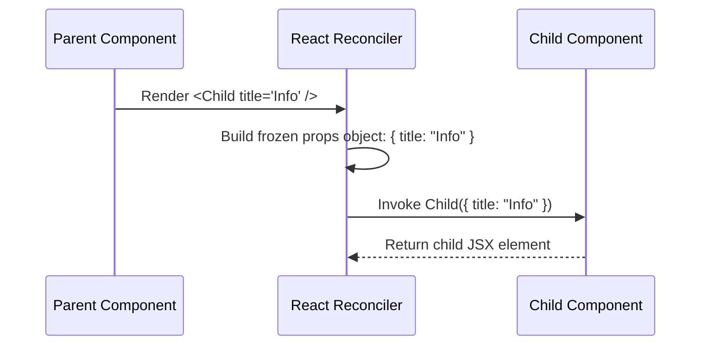
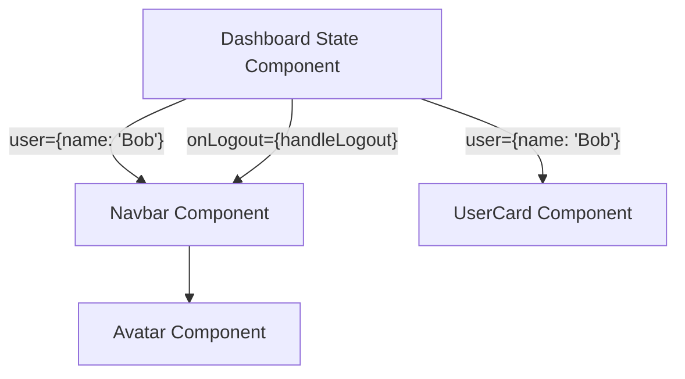
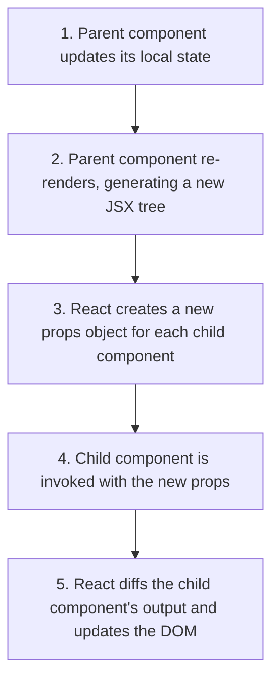

# Props & Unidirectional Data Flow

## Introduction

In React, components communicate with one another using **Props** (short for properties). Props are read-only inputs passed from parent components to child components. This data transmission follows a strict **Unidirectional Data Flow** (one-way data flow), which keeps layout updates predictable and easy to debug. This module covers how to pass, destructure, validate, and leverage props for clean component design.

---

## Why do we need this?

If components could modify their own inputs or directly edit their parents' data state, tracking down bugs would be extremely difficult. 

### Problem Statement
Imagine a settings dashboard with a toggled light/dark mode switch. If the toggle button directly mutates a global theme value, and three other components also write to that same theme value independently, it becomes very hard to know which component caused a theme bug. We need a clear hierarchy where data is owned by a single source of truth and passed down as immutable properties, while updates are requested via callbacks.

---

## Real World Story

Before React, frameworks like AngularJS (v1) featured **Two-Way Data Binding**. A model change updated the view, and editing a text field automatically mutated the model in the background. 

While two-way data binding felt productive for small forms, it became a major issue in larger applications. Data changes would trigger cascade updates across multiple models, creating circular render loops where components endlessly updated each other. To fix this, React's creators designed a model where data flows in only one direction: **downward** as read-only props. If a child component needs to change data, it must invoke a callback function passed down by its parent, letting the parent component update its state and pass the new data down.

---

## Real World Analogy

Think of React props like a **Company Chain of Command** compared to an **Unorganized Startup Gossip**.

- **Without Unidirectional Flow (Startup Gossip)**: Anyone can walk up to anyone's desk, change their project folder documents, and write edits on the project files. Within days, nobody knows what version of the project is current, or who edited what page.
- **With Unidirectional Flow (Chain of Command)**: The CEO (Parent Component) creates the project budget document and hands a read-only copy (Props) to the Manager (Child Component). The Manager cannot write edits on the CEO's original sheet. If the Manager needs more budget, they cannot write it in themselves; they must submit a budget request (Callback Event) to the CEO, who reviews it, updates the master sheet, and issues a new copy to the Manager.

---

## Visual Explanation

Below is a flowchart comparing React's unidirectional data flow with legacy bidirectional bindings.

### Unidirectional Data Flow (React)
```
[Parent State] ──(Passes Props)──> [Child Component]
       ▲                                 │
       └────(Invokes Callback Event)─────┘
```

### Legacy Bidirectional Data Binding
```
[Model Value] <═══(Automatic Sync)═══> [UI Input Element]
      (Changes on either side immediately overwrite the other)
```



---

## Internal Working

React props are immutable JavaScript objects. When a parent component renders a child, React packages the JSX attributes of the child element into a single `props` object and passes it as the first argument to the child function.

```javascript
// JSX syntax:
<UserProfile name="Alice" age={25} />

// Compiles into:
_jsx(UserProfile, { name: "Alice", age: 25 });
```

Inside the reconciler, React verifies that the props object reference is frozen (`Object.isFrozen(props)` is true in development). This prevents developers from writing mutations to `props` properties, ensuring that updates can only be initiated by re-rendering the parent.



---

## Architecture

Data cascades downward through the component tree. Components at the top of the tree hold the application state, while child components remain stateless ("presentational") and receive data and callback functions from above.



---

## Step-by-Step Flow

When a parent component updates its state and passes new props to a child, the following steps occur:



---

## Syntax

Props can be accessed by destructuring the arguments object directly in the functional component's signature:

```jsx
// Accessing props via destructuring, with optional default values
function UserCard({ name, role = 'Guest', children }) {
  return (
    <div className="card">
      <h3>{name}</h3>
      <p>{role}</p>
      {children} {/* Renders nested tags */}
    </div>
  );
}
```

---

## Basic Example

Here is a basic example showing a parent component passing a string prop and a numeric prop to a child component.

```jsx
import React from 'react';

// Child Component
function BookRating({ title, score }) {
  return (
    <div style={{ margin: '10px 0' }}>
      <strong>{title}</strong>: {score} / 5 stars
    </div>
  );
}

// Parent Component
export default function LibraryShelf() {
  return (
    <div>
      <h2>Reading List</h2>
      <BookRating title="Clean Code" score={5} />
      <BookRating title="Refactoring" score={4} />
    </div>
  );
}
```

---

## Intermediate Example

An intermediate component showing child-to-parent communication using callback functions. The parent component passes down a callback function (`onSelectTheme`) that the child component calls with the selected theme value.

```jsx
import React, { useState } from 'react';

// Child Component
function ThemeSelector({ activeTheme, onSelectTheme }) {
  const themes = ['Light', 'Dark', 'Ocean', 'Forest'];
  
  return (
    <div>
      <h4>Choose Color Scheme:</h4>
      {themes.map(theme => (
        <button
          key={theme}
          onClick={() => onSelectTheme(theme)}
          style={{
            margin: '4px',
            backgroundColor: activeTheme === theme ? '#007bff' : '#ccc',
            color: '#fff',
            border: 'none',
            padding: '6px 12px',
            cursor: 'pointer'
          }}
        >
          {theme}
        </button>
      ))}
    </div>
  );
}

// Parent Component managing state
export default function ThemeSettingsDashboard() {
  const [currentTheme, setCurrentTheme] = useState('Light');

  return (
    <div style={{ padding: '20px', border: '1px solid #ccc' }}>
      <h3>Theme Dashboard (Active: {currentTheme})</h3>
      <ThemeSelector activeTheme={currentTheme} onSelectTheme={setCurrentTheme} />
    </div>
  );
}
```

---

## Advanced Example

An advanced example illustrating layout composition using the special `children` prop and Prop-Types validation. This structure allows us to build reusable layout wrappers.

```jsx
import React from 'react';
import PropTypes from 'prop-types';

// Reusable Layout Container utilizing the special 'children' prop
function DialogBox({ title, isOpen, onClose, children }) {
  if (!isOpen) return null;

  return (
    <div style={{
      position: 'fixed', top: '50%', left: '50%',
      transform: 'translate(-50%, -50%)',
      border: '2px solid black', backgroundColor: 'white',
      padding: '24px', zIndex: 1000, borderRadius: '8px'
    }}>
      <header style={{ display: 'flex', justifyContent: 'space-between', borderBottom: '1px solid #ddd', marginBottom: '12px' }}>
        <h3>{title}</h3>
        <button onClick={onClose}>✕</button>
      </header>
      <main>{children}</main>
    </div>
  );
}

// Prop-Types validation definition
DialogBox.propTypes = {
  title: PropTypes.string.isRequired,
  isOpen: PropTypes.bool.isRequired,
  onClose: PropTypes.func.isRequired,
  children: PropTypes.node
};

// Default props definition
DialogBox.defaultProps = {
  title: 'Notification'
};

export default function DialogDemoPage() {
  const [showDialog, setShowDialog] = React.useState(false);

  return (
    <div>
      <button onClick={() => setShowDialog(true)}>Open Account Modal</button>
      <DialogBox isOpen={showDialog} onClose={() => setShowDialog(false)} title="Confirm Actions">
        <p>Are you sure you want to permanently delete this user directory index?</p>
        <button onClick={() => setShowDialog(false)}>Confirm</button>
      </DialogBox>
    </div>
  );
}
```

---

## Production Example

A production-ready component showcasing TypeScript interface declarations (implemented via jsdoc parameters for JS compatibility) and a rigid key validation system to handle complex api objects safely.

```jsx
import React from 'react';
import PropTypes from 'prop-types';

/**
 * @typedef {Object} Transaction
 * @property {string} id
 * @property {string} user
 * @property {number} amount
 * @property {string} currency
 * @property {'pending' | 'success' | 'failed'} status
 */

/**
 * Presentational Row displaying transaction details
 * @param {{ transaction: Transaction }} props
 */
function TransactionRow({ transaction }) {
  const getStatusColor = (status) => {
    switch (status) {
      case 'success': return '#d4edda';
      case 'failed': return '#f8d7da';
      default: return '#fff3cd';
    }
  };

  return (
    <tr style={{ backgroundColor: getStatusColor(transaction.status) }}>
      <td>{transaction.id}</td>
      <td>{transaction.user}</td>
      <td>{transaction.amount} {transaction.currency}</td>
      <td>{transaction.status.toUpperCase()}</td>
    </tr>
  );
}

TransactionRow.propTypes = {
  transaction: PropTypes.shape({
    id: PropTypes.string.isRequired,
    user: PropTypes.string.isRequired,
    amount: PropTypes.number.isRequired,
    currency: PropTypes.string.isRequired,
    status: PropTypes.oneOf(['pending', 'success', 'failed']).isRequired
  }).isRequired
};

export default function LedgerTable({ transactions = [] }) {
  if (transactions.length === 0) {
    return <p role="status">No recent transactions recorded.</p>;
  }

  return (
    <table style={{ width: '100%', borderCollapse: 'collapse', textAlign: 'left' }}>
      <thead>
        <tr>
          <th>Transaction ID</th>
          <th>User</th>
          <th>Amount</th>
          <th>Status</th>
        </tr>
      </thead>
      <tbody>
        {transactions.map(t => (
          <TransactionRow key={t.id} transaction={t} />
        ))}
      </tbody>
    </table>
  );
}

LedgerTable.propTypes = {
  transactions: PropTypes.arrayOf(PropTypes.object)
};
```

---

## Folder Structure

```
props-data-flow/
├── src/
│   ├── components/
│   │   ├── DialogBox.jsx
│   │   └── LedgerTable.jsx
│   ├── App.jsx
│   └── main.jsx
├── package.json
└── vite.config.js
```

---

## Best Practices

💡 **Did You Know?**  
React props are read-only. If you try to reassign a prop inside a child component (e.g., `props.name = 'New Name'`), JavaScript will throw a TypeError in Strict Mode because the props object is frozen.

🚀 **Best Practices**
- Keep props immutable. Never modify the props object or its properties directly.
- Destructure props in the component's function signature for cleaner and more readable code.
- Provide sensible default values for optional props to prevent rendering bugs (e.g., fallback images if a user avatar URL is missing).

---

## Common Mistakes

⚠ **Common Mistakes**

### Mutating Props Directly
A common error is trying to change a prop value inside a child component. React props are read-only, and mutating them causes unexpected side effects and bugs.

```jsx
// ❌ WRONG
function UserProfile(props) {
  props.role = 'Admin'; // Mutation Error: Cannot assign to read only property
  return <div>{props.role}</div>;
}

//  RIGHT
function UserProfile({ role = 'User' }) {
  // Use state or pass a default value instead of mutating inputs
  return <div>{role}</div>;
}
```

---

## Performance Notes

⚡ **Performance Tips**
Every time a parent component re-renders, it creates new object references for any props it passes down, which can trigger child components to re-render. If you pass callback functions to child components, you can prevent unnecessary re-renders by wrapping the callbacks in `useCallback` to cache their references.

### Performance Example
Using `useCallback` to ensure a callback function maintains its memory reference across parent renders:

```jsx
import React, { useState, useCallback } from 'react';

export function ParentComponent() {
  const [count, setCount] = useState(0);

  // Caches the function reference, preventing children from re-rendering unless dependency updates
  const handleAction = useCallback(() => {
    console.log("Action performed");
  }, []);

  return (
    <div>
      <button onClick={() => setCount(c => c + 1)}>Increment Count ({count})</button>
      <OptimizedChild onAction={handleAction} />
    </div>
  );
}
```

---

## Accessibility Notes

♿ **Accessibility Tips**
- When passing toggle control callback props down to child components, make sure the child button has the appropriate `aria-pressed` or `aria-expanded` attributes based on the current state prop.
- Ensure descriptive labeling text is passed as a prop for icon-only buttons.

```jsx
// Accessibility Example
export function IconToggleButton({ isPressed, onPress, label }) {
  return (
    <button onClick={onPress} aria-pressed={isPressed} aria-label={label}>
      ⭐
    </button>
  );
}
```

---

## SEO Notes

Semantic prop passing helps keep HTML layout hierarchies flat and clean, allowing search engines to index target content fields efficiently.

---

## Interview Questions

🎯 **Interview Tips**  
In an interview, define props as "the read-only input parameters passed from a parent component to a child component." Contrast this with state, which is local component memory that can be modified over time.

### Q1: What is Unidirectional Data Flow in React?
**Answer**: Unidirectional data flow means data has a single path of transmission: from parent components down to child components. Props passed from parent to child are immutable. If a child component needs to modify data, it calls a callback function passed down by the parent. The parent then updates its state and passes the updated data down, ensuring state updates are predictable and easy to debug.

### Q2: What is the purpose of the special `children` prop?
**Answer**: The `children` prop allows you to pass components or HTML elements as data to another component by nesting them between the component's opening and closing tags. This allows you to build reusable layout wrappers (like modals, sidebar drawers, or card panels) without hardcoding their contents.

---

## MCQs

1. **How do props flow in a React application?**
   - A) Upward from children to parent components.
   - B) Bidirectionally between all components.
   - C) Downward from parent to child components.
   - D) Horizontally between sibling components.
   - *Answer: C*

2. **Which of the following statements about React props is true?**
   - A) Child components can modify props directly.
   - B) Props are immutable (read-only) inside child components.
   - C) Props can only contain string values.
   - D) Props are only used in Class Components.
   - *Answer: B*

3. **What is the default value of the special 'children' prop when a component is defined with self-closing tags?**
   - A) `undefined`
   - B) `null`
   - C) An empty array
   - D) `""`
   - *Answer: A*

4. **Which React API is used to validate prop types at runtime?**
   - A) React.Validate
   - B) prop-types (npm library)
   - C) React.StrictMode
   - D) JSX compiler validator
   - *Answer: B*

5. **How can a child component update a state value held in its parent component?**
   - A) By modifying its parent's props directly.
   - B) By importing the parent's state setter function.
   - C) By calling a callback function passed down by the parent as a prop.
   - D) By querying the parent DOM element.
   - *Answer: C*

---

## Practice Exercise

### Exercise 1: Prop Destructuring Setup
Refactor this component signature to destructure `username`, `avatar`, and `bio` directly from props, and set a default fallback URL for the `avatar`:
```jsx
function UserPanel(props) {
  return ;
}
```

*Solution*:
```jsx
function UserPanel({ username, avatar = '/default-avatar.png', bio }) {
  return ;
}
```

### Exercise 2: Callback Button Event
Create a child component called `AlertButton` that accepts a `message` string prop and an `onClickAlert` function prop. When clicked, it should call the function and pass the message as an argument.

### Exercise 3: Children Card Wrapper
Create a component called `BorderCard` that wraps any children elements in a custom dashed-border container, using the `children` prop.

---

## Debugging Exercise

### The Read-Only Property Mutation Bug
The code below is throwing a TypeError: `Cannot assign to read only property 'status'` when the user clicks the toggle button. Identify the bug and write the fix.

```jsx
import React, { useState } from 'react';

// Child Component
function StatusToggle(props) {
  return (
    <button onClick={() => {
      // BUG: Mutating prop value directly
      props.status = props.status === 'Online' ? 'Offline' : 'Online';
    }}>
      Change Status: {props.status}
    </button>
  );
}

// Parent Component
export default function StatusPanel() {
  const [myStatus, setMyStatus] = useState('Online');
  return <StatusToggle status={myStatus} />;
}
```

#### Solution
Props are read-only and cannot be mutated inside a child component. Instead, pass a callback function prop from the parent to update the parent's state:

```jsx
// Corrected StatusToggle Child
function StatusToggle({ status, onToggle }) {
  return (
    <button onClick={onToggle}>
      Change Status: {status}
    </button>
  );
}

// Corrected Parent Component
export default function StatusPanel() {
  const [myStatus, setMyStatus] = useState('Online');
  const handleToggle = () => setMyStatus(prev => prev === 'Online' ? 'Offline' : 'Online');

  return <StatusToggle status={myStatus} onToggle={handleToggle} />;
}
```

---

## Real-world Scenario

You are building a complex multi-step checkout form. The state (cart items, shipping address, payment method) is managed at the top-level form component. Explain how you would pass this data and handle updates as the user moves through the steps.
- **Design Strategy**: Keep the checkout state in the parent component. Pass the current step's state down as props to each step component, and pass down validation callbacks that update the main state when the user clicks "Next Step". This keeps the step components clean and reusable.

---

## Interview Coding Question

### Problem Statement
Write a React component structure representing a task checklist:
- `Parent`: Manages a state array of tasks (each has an ID, text, and completed boolean).
- `Checklist`: Presentational component receiving the tasks array and an `onToggleTask` callback function.
- `TaskItem`: Row element receiving a single task object and the callback function, rendering a checkbox bound to the task's completed status.

```jsx
import React, { useState } from 'react';

// 1. TaskItem Component
function TaskItem({ task, onToggle }) {
  return (
    <li style={{ textDecoration: task.completed ? 'line-through' : 'none' }}>
      <input
        type="checkbox"
        checked={task.completed}
        onChange={() => onToggle(task.id)}
      />
      {task.text}
    </li>
  );
}

// 2. Checklist Component
function Checklist({ tasks, onToggleTask }) {
  return (
    <ul>
      {tasks.map(task => (
        <TaskItem key={task.id} task={task} onToggle={onToggleTask} />
      ))}
    </ul>
  );
}

// 3. Parent Component
export default function TaskManager() {
  const [tasks, setTasks] = useState([
    { id: 1, text: 'Study Props', completed: false },
    { id: 2, text: 'Review Lifecycle', completed: true }
  ]);

  const toggleTask = (id) => {
    setTasks(prev => prev.map(t => t.id === id ? { ...t, completed: !t.completed } : t));
  };

  return (
    <div>
      <h3>My Tasks</h3>
      <Checklist tasks={tasks} onToggleTask={toggleTask} />
    </div>
  );
}
```

---

## Mini Project

### Customizable Button Lab
Create a parent control center with child demo elements:
- Create a `CustomButton` component that accepts: `variant` (primary, secondary, danger), `size` (small, medium, large), `disabled` (boolean), `onClick`, and `children`.
- Create a parent dashboard that renders control inputs (dropdown selectors, checkboxes, text boxes).
- Pass these inputs as props to a `CustomButton` preview component, showing style updates live as the controls are toggled.

---

## Summary

🧠 **Memory Tricks**  
`Props are packages` - Parent components wrap data into a frozen package called `props` and pass it down. The child can open the package and read the contents, but it cannot edit or rewrite the items inside the package.

📖 **Summary**  
React props are read-only properties passed down from parent components to children. By enforcing unidirectional data flow and keeping props immutable, React ensures application updates are predictable and layouts are easier to debug.

---

## Cheat Sheet

```javascript
// Passing props to child components
<ProfileCard name="Alice" isActive={true} />

// Child component destructuring props with default values
function ProfileCard({ name, isActive = false }) { ... }
```

---

## Related Topics
- [Component Fundamentals & Lifecycles](component-fundamentals)
- [Managing Local Component State](../phase-3-state-management/local-state-basics)

---

## Further Reading
- [React Docs: Passing Props to a Component](https://react.dev/learn/passing-props-to-a-component)
- [React Docs: Composing Components with Children](https://react.dev/learn/sharing-state-between-components)
