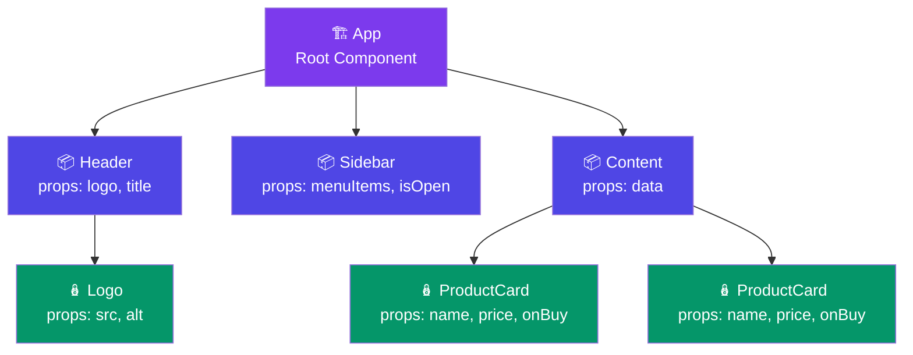

# What are Props?

In **React**, **props (short for properties)** are:
> 👉 Inputs passed from a parent component to a child component

They allow components to be **dynamic and reusable**.

---

## Simple Analogy

Think of a component like a function:

```js
function greet(name) {
  return "Hello " + name;
}
```

👉 `name` = input (like a prop)

Similarly in React:

```jsx
function Greeting(props) {
  return <h1>Hello {props.name}</h1>;
}
```

👉 `props.name` = the input passed from outside

---

## Component Tree + One-Way Props Flow

Props flow from **top → bottom** through the component tree. Children cannot modify their props directly.



📌 **Props flow ONE-WAY: top → bottom.** Parent components pass data down. Children receive and render it.

---

## Basic Example

### Parent Component
```jsx
function App() {
  return <Greeting name="Prathamesh" />;
}
```

### Child Component
```jsx
function Greeting(props) {
  return <h1>Hello {props.name}</h1>;
}
```

Output: `Hello Prathamesh`

---

## Multiple Props

```jsx
function User({ name, age }) {
  return <h1>{name} is {age} years old</h1>;
}

<User name="Prathamesh" age={25} />
```

---

## Props Are Read-Only ✋

```jsx
function Greeting(props) {
  props.name = "Changed"; // ❌ Not allowed!
}
```

👉 **Props are immutable.** You cannot modify them inside the child component. If you need to change data, use state instead.

---

## Props vs State

| Props | State |
|------------------|------------------------|
| Passed from parent | Managed inside component |
| Read-only | Mutable (via setter) |
| External data | Internal data |
| Cannot change | Triggers re-render on change |

---

## Real-World Example

```jsx
function ProductCard({ name, price, onBuy }) {
  return (
    <div>
      <h2>{name}</h2>
      <p>₹{price}</p>
      <button onClick={onBuy}>Buy</button>
    </div>
  );
}

function App() {
  function handleBuy() { alert("Purchased!"); }
  return (
    <ProductCard
      name="Laptop"
      price={50000}
      onBuy={handleBuy}
    />
  );
}
```

---

## ⚠️ Common Mistakes

| Mistake | Why | Fix |
|---------|-----|-----|
| `age="25"` instead of `age={25}` | Passes string instead of number | Use `{}` for JS values |
| `props.name = "X"` | Props are immutable | Use state for mutable data |
| Drilling props through 5+ layers | Makes code hard to maintain | Use Context API or state management |

---

## Explore More

- [Prop Types →](/DSA-Notes-Problems/react/props/prop-types) — String, number, boolean, array, object, function
- [Children Prop →](/DSA-Notes-Problems/react/props/children-prop) — Passing JSX content between tags
- [Default Props →](/DSA-Notes-Problems/react/props/default-props) — Default values and destructuring
- [Prop Drilling →](/DSA-Notes-Problems/react/advanced/prop-drilling) — Avoiding deep prop passing

---

## 🧠 In Simple Words

- **Props = inputs** passed from parent to child (like function arguments)
- Props flow **one-way: top → bottom**. Children can't modify them directly
- Props are **read-only** — never try to change them inside the child
- Use **state** for data that changes inside a component
- Check the sub-pages above for deep dives on each topic
