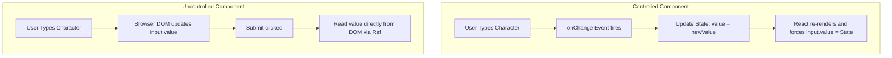
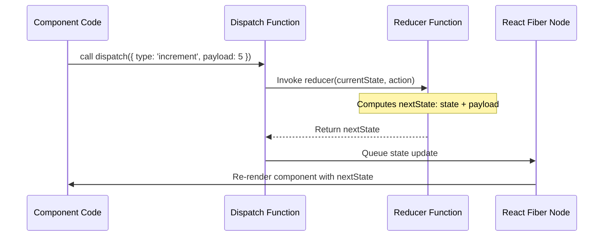
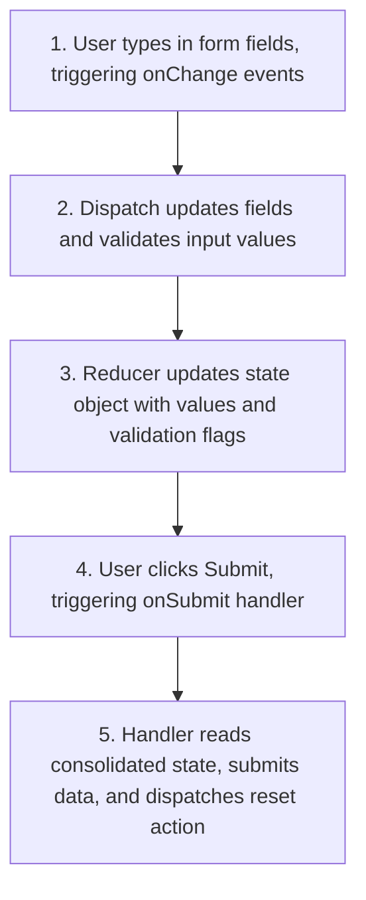

# Advanced Local State & Reducers

## Introduction

As user interfaces grow more interactive, managing state using multiple scattered `useState` hooks becomes difficult. This module covers advanced state patterns: **Lifting State Up** to share data between sibling components, contrasting **Controlled Components** with **Uncontrolled Components** for handling forms, and utilizing the **useReducer** hook to manage complex state transitions using the Reducer pattern.

---

## Why do we need this?

If every input field, dropdown, and button in a form manages its own local state independently, collecting the final form data on submission is difficult. Furthermore, if you have multiple related state values (e.g., `loading`, `error`, `data`) that change together, managing them with separate state setters can lead to out-of-sync states.

### Problem Statement
Consider a user registration form with fields for Email, Password, Password Confirmation, and a Terms checkbox.
1. The Submit button must be disabled until all fields are valid.
2. The Password Confirmation field must show an error if it doesn't match the Password field.
3. If the fields are managed independently inside each input, the parent form component cannot read their values to validate them or handle submissions.

We need patterns that consolidate state, centralize update rules, and let parent components control input values.

---

## Real World Story

In early versions of React, developers struggled to build complex forms. They either had to write dozens of separate change handlers or use libraries like Redux to manage simple form inputs. 

Redux introduced the **Reducer Pattern** to frontend web development. Redux used a single global store, and state updates could only be triggered by dispatching "Actions" to a "Reducer" function. While this pattern made state changes predictable and easy to debug, writing the boilerplate code for Redux was tedious. To bring the benefits of the Reducer pattern to local component state, React 16.8 introduced the `useReducer` hook. This allowed developers to manage complex state structures locally without the overhead of external libraries.

---

## Real World Analogy

Think of managing component state like **Managing a Company's Finances**.

- **useState Approach (Independent Expenses)**: Every department head (component) has their own credit card. They buy supplies, update their local notebooks (useState), and spend money as needed. If the CEO wants to calculate the total budget, they have to collect the notebooks from every department, which is slow and error-prone.
- **useReducer Approach (Centralized Finance Office)**: No department has direct access to the bank accounts. If a department needs supplies, they submit an Purchase Order (Action: `DISPATCH_PURCHASE`) containing the item details (Payload) to the Accountant (Reducer function). The Accountant processes the request, updates the master spreadsheet (State), and informs the departments of their remaining balance.

---

## Visual Explanation

Below is a diagram showing the comparison of Controlled inputs (where React state controls the input value) vs. Uncontrolled inputs (where the browser DOM holds the value, accessed via refs).

### Controlled Component Flow
```
[User Types] ──> [onChange handler] ──> [setTypedText state] ──> [React updates value prop]
```

### Uncontrolled Component Flow
```
[User Types] ──> [Browser DOM updates text value] ──> [Submit click] ──> [Read inputRef.current.value]
```



---

## Internal Working

The `useReducer` hook is a built-in React hook designed as an alternative to `useState` for managing complex state objects. It takes a **Reducer function** and an **Initial State**, and returns the current state and a **Dispatch function**.

```javascript
// useReducer Signature
const [state, dispatch] = useReducer(reducer, initialState);
```

When you dispatch an action:
1. You call `dispatch({ type: 'ACTION_NAME', payload: data })`.
2. React calls your Reducer function with the current state and the action object: `reducer(currentState, action)`.
3. The Reducer function calculates the next state and returns it: `return nextState;`.
4. React updates the component's Fiber state pointer and triggers a re-render.



---

## Architecture

Lifting State Up reorganizes data flow. Sibling components communicate by sharing state managed by their nearest common ancestor.

```mermaid
flowchart TD
    Parent[Parent Component\n- Holds shared state\n- Defines change handler]
    ChildA[Child A (Input)\n- Receives value prop\n- Calls change callback]
    ChildB[Child B (Display)\n- Receives value prop\n- Renders output]
    
    Parent -->|value prop & callback| ChildA
    Parent -->|value prop| ChildB
```

---

## Step-by-Step Flow

When submitting a controlled form managed by `useReducer`, the following steps occur:



---

## Syntax

```javascript
// Reducer function signature
function reducer(state, action) {
  switch (action.type) {
    case 'ACTION_TYPE':
      return { ...state, property: action.payload };
    default:
      throw new Error(`Unhandled action type: ${action.type}`);
  }
}
```

---

## Basic Example

Here is a basic example showing how sibling components share state by **Lifting State Up** to their parent.

```jsx
import React, { useState } from 'react';

// Child A: Input Panel
function NameInput({ name, onNameChange }) {
  return (
    <div style={{ margin: '8px 0' }}>
      <label htmlFor="name-input">Enter Name: </label>
      <input
        id="name-input"
        type="text"
        value={name}
        onChange={e => onNameChange(e.target.value)}
      />
    </div>
  );
}

// Child B: Display Panel
function GreetingBanner({ name }) {
  return <h3>Hello, {name || 'Stranger'}!</h3>;
}

// Parent Component holding state
export default function LiftingStateDemo() {
  const [username, setUsername] = useState('');

  return (
    <div style={{ padding: '16px', border: '1px dashed gray' }}>
      <GreetingBanner name={username} />
      <NameInput name={username} onNameChange={setUsername} />
    </div>
  );
}
```

---

## Intermediate Example

An intermediate form showing the difference between **Controlled Components** (inputs controlled by React state) and **Uncontrolled Components** (inputs controlled by the browser DOM, accessed via refs).

```jsx
import React, { useState, useRef } from 'react';

export default function FormInputsComparison() {
  // 1. Controlled Component state
  const [controlledValue, setControlledValue] = useState('');

  // 2. Uncontrolled Component reference
  const uncontrolledRef = useRef(null);

  const handleSubmit = (e) => {
    e.preventDefault();
    const uncontrolledVal = uncontrolledRef.current ? uncontrolledRef.current.value : '';
    alert(`Submitted!\nControlled: ${controlledValue}\nUncontrolled: ${uncontrolledVal}`);
  };

  return (
    <form onSubmit={handleSubmit} style={{ padding: '20px', maxWidth: '450px' }}>
      <h3>Form Input Paradigms</h3>
      
      {/* Controlled Input: React state controls the input value */}
      <div style={{ marginBottom: '12px' }}>
        <label htmlFor="controlled-in" style={{ display: 'block' }}>Controlled Input (updates state on type):</label>
        <input
          id="controlled-in"
          type="text"
          value={controlledValue}
          onChange={e => setControlledValue(e.target.value)}
          style={{ width: '100%', padding: '6px' }}
        />
        <span style={{ fontSize: '0.8rem', color: '#666' }}>Live State: "{controlledValue}"</span>
      </div>

      {/* Uncontrolled Input: Browser DOM holds the value */}
      <div style={{ marginBottom: '12px' }}>
        <label htmlFor="uncontrolled-in" style={{ display: 'block' }}>Uncontrolled Input (accessed via ref on submit):</label>
        <input
          id="uncontrolled-in"
          type="text"
          ref={uncontrolledRef}
          style={{ width: '100%', padding: '6px' }}
        />
      </div>

      <button type="submit">Submit Form</button>
    </form>
  );
}
```

---

## Advanced Example

An advanced example illustrating state management using the `useReducer` hook. It handles complex form inputs, validate email addresses on change, and manages loading/success states.

```jsx
import React, { useReducer } from 'react';

const initialState = {
  email: '',
  password: '',
  emailError: null,
  loading: false,
  success: false
};

function authFormReducer(state, action) {
  switch (action.type) {
    case 'SET_FIELD':
      return {
        ...state,
        [action.field]: action.value,
        // Reset success state when fields change
        success: false
      };
    case 'SET_EMAIL_ERROR':
      return { ...state, emailError: action.error };
    case 'SUBMIT_START':
      return { ...state, loading: true, success: false };
    case 'SUBMIT_SUCCESS':
      return { ...state, loading: false, success: true, email: '', password: '' };
    case 'SUBMIT_FAILURE':
      return { ...state, loading: false, success: false };
    default:
      return state;
  }
}

export default function RegistrationConsole() {
  const [state, dispatch] = useReducer(authFormReducer, initialState);

  const handleInputChange = (e, field) => {
    dispatch({ type: 'SET_FIELD', field, value: e.target.value });
    
    // Clear error validations on type
    if (field === 'email') {
      dispatch({ type: 'SET_EMAIL_ERROR', error: null });
    }
  };

  const handleEmailBlur = () => {
    if (state.email && !state.email.includes('@')) {
      dispatch({ type: 'SET_EMAIL_ERROR', error: 'Invalid email address.' });
    }
  };

  const handleFormSubmit = async (e) => {
    e.preventDefault();
    if (state.emailError || !state.email || !state.password) return;

    dispatch({ type: 'SUBMIT_START' });
    try {
      // Simulate network request latency
      await new Promise(resolve => setTimeout(resolve, 1500));
      dispatch({ type: 'SUBMIT_SUCCESS' });
    } catch (err) {
      dispatch({ type: 'SUBMIT_FAILURE' });
    }
  };

  return (
    <form onSubmit={handleFormSubmit} style={{ maxWidth: '350px', padding: '16px', border: '1px solid #ccc' }}>
      <h3>Register Profile</h3>
      {state.success && <p style={{ color: 'green' }} role="status">Profile registered successfully!</p>}
      
      <div style={{ marginBottom: '12px' }}>
        <label htmlFor="reg-email" style={{ display: 'block' }}>Email Address</label>
        <input
          id="reg-email"
          type="text"
          value={state.email}
          onBlur={handleEmailBlur}
          onChange={e => handleInputChange(e, 'email')}
          style={{ width: '100%', padding: '6px' }}
        />
        {state.emailError && <span style={{ color: 'red', fontSize: '0.8rem' }} role="alert">{state.emailError}</span>}
      </div>

      <div style={{ marginBottom: '12px' }}>
        <label htmlFor="reg-password" style={{ display: 'block' }}>Password</label>
        <input
          id="reg-password"
          type="password"
          value={state.password}
          onChange={e => handleInputChange(e, 'password')}
          style={{ width: '100%', padding: '6px' }}
        />
      </div>

      <button type="submit" disabled={state.loading || !state.email || !state.password}>
        {state.loading ? 'Registering...' : 'Register'}
      </button>
    </form>
  );
}
```

---

## Production Example

A production-ready checklist builder using `useReducer`. It manages tasks state, tracks completed counts, filters items, and structures state updates using defined action types.

```jsx
import React, { useReducer } from 'react';

// Action Types constants
const ACTIONS = {
  ADD_TASK: 'ADD_TASK',
  TOGGLE_TASK: 'TOGGLE_TASK',
  DELETE_TASK: 'DELETE_TASK',
  CLEAR_COMPLETED: 'CLEAR_COMPLETED'
};

function checklistReducer(state, action) {
  switch (action.type) {
    case ACTIONS.ADD_TASK:
      if (!action.payload.trim()) return state;
      return {
        ...state,
        tasks: [
          ...state.tasks,
          { id: Math.random().toString(36).substring(7), text: action.payload, completed: false }
        ]
      };
    case ACTIONS.TOGGLE_TASK:
      return {
        ...state,
        tasks: state.tasks.map(t => t.id === action.payload ? { ...t, completed: !t.completed } : t)
      };
    case ACTIONS.DELETE_TASK:
      return {
        ...state,
        tasks: state.tasks.filter(t => t.id !== action.payload)
      };
    case ACTIONS.CLEAR_COMPLETED:
      return {
        ...state,
        tasks: state.tasks.filter(t => !t.completed)
      };
    default:
      return state;
  }
}

const initialChecklistState = {
  tasks: [
    { id: 't1', text: 'Master useReducer', completed: false },
    { id: 't2', text: 'Build production forms', completed: true }
  ]
};

export default function ProductionTaskManager() {
  const [state, dispatch] = useReducer(checklistReducer, initialChecklistState);
  const [newText, setNewText] = React.useState('');

  const completedCount = state.tasks.filter(t => t.completed).length;

  const handleSubmit = (e) => {
    e.preventDefault();
    dispatch({ type: ACTIONS.ADD_TASK, payload: newText });
    setNewText('');
  };

  return (
    <div style={{ maxWidth: '400px', border: '1px solid #ddd', padding: '16px', borderRadius: '8px' }}>
      <h3>Tasks Board ({completedCount} / {state.tasks.length} Done)</h3>
      
      <form onSubmit={handleSubmit} style={{ display: 'flex', gap: '8px', marginBottom: '12px' }}>
        <input
          type="text"
          value={newText}
          onChange={e => setNewText(e.target.value)}
          placeholder="Add new task..."
          style={{ flexGrow: 1, padding: '6px' }}
        />
        <button type="submit">Add</button>
      </form>

      <ul style={{ listStyle: 'none', padding: 0 }}>
        {state.tasks.map(task => (
          <li key={task.id} style={{ display: 'flex', justifyContent: 'space-between', padding: '6px 0', borderBottom: '1px solid #eee' }}>
            <label>
              <input
                type="checkbox"
                checked={task.completed}
                onChange={() => dispatch({ type: ACTIONS.TOGGLE_TASK, payload: task.id })}
              />
              <span style={{ marginLeft: '8px', textDecoration: task.completed ? 'line-through' : 'none' }}>
                {task.text}
              </span>
            </label>
            <button
              onClick={() => dispatch({ type: ACTIONS.DELETE_TASK, payload: task.id })}
              style={{ background: 'none', border: 'none', color: 'red', cursor: 'pointer' }}
            >
              Delete
            </button>
          </li>
        ))}
      </ul>

      {completedCount > 0 && (
        <button
          onClick={() => dispatch({ type: ACTIONS.CLEAR_COMPLETED })}
          style={{ width: '100%', padding: '8px', marginTop: '12px', cursor: 'pointer' }}
        >
          Clear Completed Tasks
        </button>
      )}
    </div>
  );
}
```

---

## Folder Structure

```
advanced-local-state/
├── src/
│   ├── components/
│   │   ├── RegistrationConsole.jsx
│   │   └── ProductionTaskManager.jsx
│   ├── App.jsx
│   └── main.jsx
├── package.json
└── vite.config.js
```

---

## Best Practices

💡 **Did You Know?**  
React's `useState` hook is actually implemented using `useReducer` under the hood. In React's source code, `useState` simply dispatches a replacement action to a basic reducer function.

🚀 **Best Practices**
- Use **useState** when managing simple, independent state values (like a open/closed boolean toggle).
- Use **useReducer** when managing complex state structures where multiple fields depend on one another, or when the next state depends on the previous state.
- Keep reducer functions pure: they should only compute the next state based on the current state and the action, without making network calls or side effects.

---

## Common Mistakes

⚠ **Common Mistakes**

### Mutating State inside Reducers
Reducers must be pure functions. Directly modifying the current state object instead of returning a new, modified copy is a common mistake that prevents React from triggering re-renders because it sees the same object reference.

```jsx
// ❌ WRONG
function reducer(state, action) {
  state.count = state.count + 1; // Mutation error
  return state; // Returns the same object reference; no re-render
}

//  RIGHT
function reducer(state, action) {
  return { ...state, count: state.count + 1 }; // Returns a new object reference
}
```

---

## Performance Notes

⚡ **Performance Tips**
Updating a controlled text input on every character stroke triggers a re-render of the component and all of its children. For performance-sensitive search bars, use **Uncontrolled Components** with a debounce function to avoid unnecessary re-renders.

### Performance Example
Using a ref to capture input values only when the user submits, avoiding re-renders on every keystroke:

```jsx
import React, { useRef } from 'react';

export function SearchForm({ onSearch }) {
  const inputRef = useRef(null);

  const handleSubmit = (e) => {
    e.preventDefault();
    if (inputRef.current) onSearch(inputRef.current.value);
  };

  return (
    <form onSubmit={handleSubmit}>
      {/* Uncontrolled input: no re-renders occur on keystrokes */}
      <input type="text" ref={inputRef} />
      <button type="submit">Search</button>
    </form>
  );
}
```

---

## Accessibility Notes

♿ **Accessibility Tips**
- When inputs fail validation checks, make sure to add `aria-invalid="true"` to inform screen reader users of the error status.
- Use `role="alert"` or `aria-live="assertive"` on element containers that render form validation error messages live.

---

## SEO Notes

Ensure that forms built with client-side state management use semantic `<form>` and `<button type="submit">` tags. This allows web browsers and search engines to parse form layouts correctly.

---

## Interview Questions

🎯 **Interview Tips**  
In an interview, explain that Controlled components get their current value from props or state and update it via callbacks. Uncontrolled components store their value in the browser DOM, and you read it using a Ref.

### Q1: Compare Controlled vs Uncontrolled Components.
**Answer**: In a Controlled component, the input's value is controlled by React state (e.g., `<input value={state} onChange={handler} />`). In an Uncontrolled component, the input's value is managed by the browser's DOM. You access the value using a Ref when needed (e.g., on form submission), avoiding re-renders on every keystroke.

### Q2: When is `useReducer` preferred over `useState`?
**Answer**: `useReducer` is preferred when:
1. State logic is complex and contains multiple related values (like loading, error, and data) that must change together.
2. The next state depends on the previous state value.
3. You need to separate state update rules from the rendering logic, making the code easier to test.

---

## MCQs

1. **In a Controlled Component, where is the input field value stored?**
   - A) In the browser cache.
   - B) Inside React component state.
   - C) In the parent document header.
   - D) In local storage.
   - *Answer: B*

2. **How does an Uncontrolled Component access input field values?**
   - A) By calling `document.getElementById`.
   - B) Using a React `useRef` reference bound to the input element.
   - C) By triggering global context updates.
   - D) By resetting the form template.
   - *Answer: B*

3. **What is the primary requirement for a Reducer function?**
   - A) It must connect directly to database endpoints.
   - B) It must be a pure function that calculates and returns the next state without side effects.
   - C) It must run asynchronously.
   - D) It must return void.
   - *Answer: B*

4. **What does the `dispatch` function do?**
   - A) It removes a component from the DOM.
   - B) It sends an Action object to the Reducer function to trigger a state update.
   - C) It makes HTTP calls to api servers.
   - D) It clears the local storage cache.
   - *Answer: B*

5. **Why should you lift state up in React?**
   - A) To increase the rendering speed of the root component.
   - B) To share state between sibling components by moving it to their nearest common ancestor.
   - C) To keep environment variables secure.
   - D) To bypass JSX compilations.
   - *Answer: B*

---

## Practice Exercise

### Exercise 1: State Lifting Challenge
Refactor the following components to lift state up so that `Display` can render the uppercase value of the input entered in `Editor`:
```jsx
function Editor() {
  const [val, setVal] = React.useState('');
  return <input value={val} onChange={e => setVal(e.target.value)} />;
}
function Display() {
  return <p>Value: ?</p>;
}
```

### Exercise 2: useReducer Counter
Create a component that uses `useReducer` to manage a counter. The reducer should handle actions for: `INCREMENT`, `DECREMENT`, and `RESET`.

### Exercise 3: Controlled Form Validation
Create a controlled email input field that displays a red error message if the entered text does not contain an `@` symbol when the field loses focus (`onBlur`).

---

## Debugging Exercise

### The Reducer Mutation Bug
A developer wants to add new items to a cart state list using a reducer, but when they click the button, nothing updates on screen. Identify the bug and write the fix.

```jsx
// CartReducer.js
export function cartReducer(state, action) {
  switch (action.type) {
    case 'ADD_ITEM':
      // BUG: Mutating array in state directly and returning same reference
      state.items.push(action.payload);
      return state;
    default:
      return state;
  }
}
```

#### Solution
The reducer is mutating the current state array directly using `.push()`, which returns the same array reference. React does not detect the change because the reference is unchanged, so it does not trigger a re-render. To fix this, return a new state object and copy the array using the spread operator:

```jsx
// Corrected CartReducer
export function cartReducer(state, action) {
  switch (action.type) {
    case 'ADD_ITEM':
      return {
        ...state,
        items: [...state.items, action.payload] // Returns a new array reference
      };
    default:
      return state;
  }
}
```

---

## Real-world Scenario

You are building a complex checkout form with sections for Shipping, Payment, and Order Review. The state is shared across these sections. Explain how you would manage this state dynamically and validate it before submission.
- **Design Strategy**: Lift the state up to a parent checkout component. Use `useReducer` to manage the checkout state (shipping info, payment info, current step) using structured actions. Pass the state and dispatch function down to the step components, and validate the state before moving to the next step.

---

## Interview Coding Question

### Problem Statement
Write a component that manages a simple registration form using `useReducer`. The form must:
- Capture `username` and `termsChecked` (boolean checkbox).
- Validate that `username` has at least 3 characters.
- Enable the submit button only when `username` is valid and `termsChecked` is true.

```jsx
import React, { useReducer } from 'react';

const initialForm = { username: '', termsChecked: false };

function formReducer(state, action) {
  switch (action.type) {
    case 'UPDATE_INPUT':
      return { ...state, [action.name]: action.value };
    case 'RESET':
      return initialForm;
    default:
      return state;
  }
}

export default function SignupForm() {
  const [state, dispatch] = useReducer(formReducer, initialForm);

  const isUsernameValid = state.username.trim().length >= 3;
  const isFormValid = isUsernameValid && state.termsChecked;

  const handleSubmit = (e) => {
    e.preventDefault();
    if (!isFormValid) return;
    alert(`Signed up username: ${state.username}`);
    dispatch({ type: 'RESET' });
  };

  return (
    <form onSubmit={handleSubmit}>
      <div>
        <label htmlFor="user-in">Username: </label>
        <input
          id="user-in"
          name="username"
          type="text"
          value={state.username}
          onChange={e => dispatch({ type: 'UPDATE_INPUT', name: e.target.name, value: e.target.value })}
        />
      </div>
      <div>
        <label>
          <input
            name="termsChecked"
            type="checkbox"
            checked={state.termsChecked}
            onChange={e => dispatch({ type: 'UPDATE_INPUT', name: e.target.name, value: e.target.checked })}
          />
          I accept terms
        </label>
      </div>
      <button type="submit" disabled={!isFormValid}>Register</button>
    </form>
  );
}
```

---

## Mini Project

### Reducer-Driven Modal Playground
Create an interactive modal drawer simulator using a reducer:
- The state should manage: `isOpen` (boolean), `title` (string), `content` (string), and `confirmAction` (function reference).
- Dispatch actions to: `OPEN_ALERT`, `OPEN_CONFIRMATION`, and `CLOSE`.
- Render a modal container that reads this state, displaying the appropriate title, content text, and buttons dynamically based on the actions dispatched.

---

## Summary

🧠 **Memory Tricks**  
`Controlled = State Rule` - In a controlled component, the input field value is controlled by React state. If you don't define an `onChange` handler to update the state, you won't be able to type in the input because the state is not updating.

📖 **Summary**  
Advanced state patterns help manage complex UI interactions. Lifting state up shares data between sibling components, controlled inputs coordinate form updates, and `useReducer` centralizes state updates using pure reducer functions and actions.

---

## Cheat Sheet

```javascript
// useReducer hook initialization
const [state, dispatch] = useReducer(reducer, { count: 0 });

// Dispatch action to update state
dispatch({ type: 'INCREMENT', payload: 1 });
```

---

## Related Topics
- [Local State Basics & State Queueing](local-state-basics)
- [Managing Global State with Context API](context-api)

---

## Further Reading
- [React Docs: Sharing State Between Components](https://react.dev/learn/sharing-state-between-components)
- [React Docs: Extracting State Logic into a Reducer](https://react.dev/learn/extracting-state-logic-into-a-reducer)
