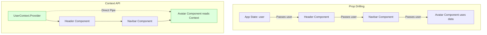
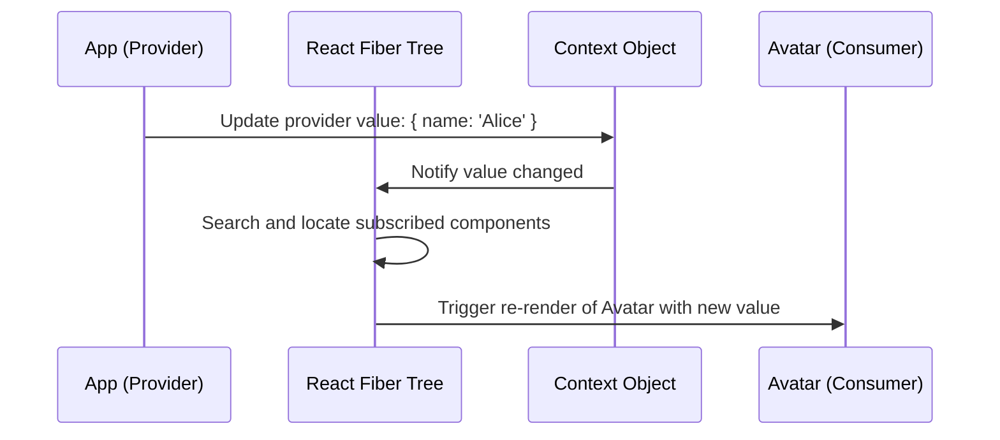
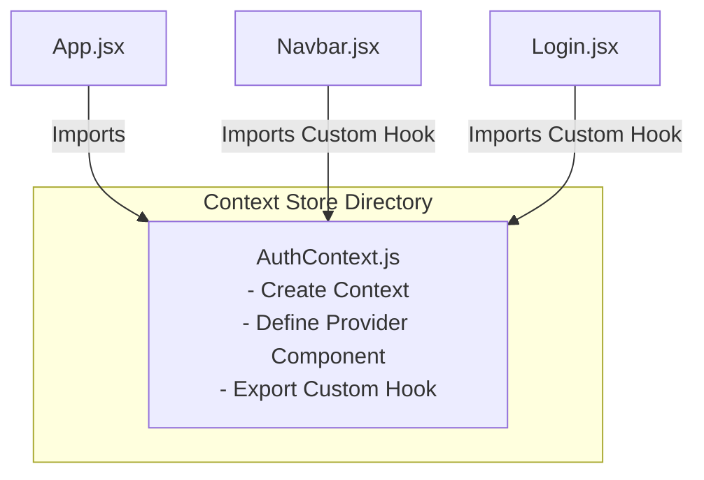

# The Context API & Global State

## Introduction

In standard React applications, data is passed down from parents to children via props. However, as the component tree grows deeper, passing props down through multiple layers of intermediate components that do not use the data (a problem known as **Prop Drilling**) becomes tedious and hard to maintain. To solve this, React provides the **Context API**. Context allows components to share data (like user authentication status, themes, or localized languages) globally without having to pass props down manually through every level of the tree.

---

## Why do we need this?

Prop drilling clutters intermediate components with props they don't need, making components harder to rename, refactor, or reuse.

### Problem Statement
Consider an application that displays a user's avatar image in the navigation bar, the sidebar panel, and the user profile page.
1. The user profile data is fetched at the root `<App />` component.
2. The avatar in the navbar is nested inside: `<App /> -> <Header /> -> <Navbar /> -> <UserControls /> -> <Avatar />`.
3. The `<Header />`, `<Navbar />`, and `<UserControls />` components do not use the user profile data themselves, but they must accept and pass down the `user` prop just so the `<Avatar />` component can read it.

```
[App Component] ──(Passes user)──> [Header] ──(Passes user)──> [Navbar] ──(Passes user)──> [Avatar]
```

This creates fragile components that depend on data they do not care about. We need a way to let the `<Avatar />` component subscribe directly to the user data source at the root of the tree, bypassing the intermediate components.

---

## Real World Story

Before React introduced the modern Context API in version 16.3, developers relied on a legacy, undocumented context system that was unstable and broke during updates. 

Because of this, global state libraries like Redux and MobX became popular. They allowed developers to store global state in an external store and connect components directly to it, bypassing prop drilling. However, setting up Redux required writing a lot of boilerplate code (actions, reducers, stores, connectors). When React released the modern Context API, developers gained a simple, built-in way to share state globally, significantly reducing the need for external state libraries in medium-sized applications.

---

## Real World Analogy

Think of using the Context API like installing a **Municipal Water Supply** compared to a **Bucket Brigade**.

- **Without Context (Bucket Brigade)**: If a house at the bottom of a hill (nested child) needs water, residents must stand in a line from the lake at the top of the hill (root parent) and pass water buckets (props) down the line. Every person in the line must stand there and pass the bucket, even if they aren't thirsty themselves.
- **With Context (Water Supply)**: The municipal water system pumps water from the lake into a central water tower (Context Provider). Every house on the hill has a pipe connected to this tower. When a resident needs water, they simply turn on their faucet (useContext hook) and draw water directly from the pipeline, without requiring any action from their neighbors.

---

## Visual Explanation

Below is a flowchart comparing prop drilling with the Context API direct subscription model.

### Prop Drilling Model
```
[App (State)] ──(user)──> [Header (Passes)] ──(user)──> [Navbar (Passes)] ──(user)──> [Avatar (Uses)]
```

### Context API Direct Subscription Model
```
[App (UserContext.Provider)]
       │
       ├─────────────────────────────────(Direct Pipe)──────────────────────────────┐
       ▼                                                                            ▼
[Header (Clean)] ──> [Navbar (Clean)]                                         [Avatar (useContext)]
```



---

## Internal Working

The Context API is powered by three main elements:
1. **`React.createContext()`**: Creates the context object wrapper.
2. **`Provider`**: A React component that wraps your layout and makes the context value available to all child components.
3. **`useContext()`**: A hook that allows child components to read the current context value.

```javascript
// 1. Create Context
const UserContext = React.createContext(null);

// 2. Wrap layout with Provider
<UserContext.Provider value={currentUser}>
  <Navbar />
</UserContext.Provider>

// 3. Read context in child components
const user = useContext(UserContext);
```

When the `value` prop of the `Provider` changes, React searches the component tree for any components that call `useContext(UserContext)`. React then schedules a re-render for all of these subscribed components automatically, ensuring their visual layout updates immediately.



---

## Architecture

To organize your code, keep your Context provider logic in separate context files. This separates the global state management from your main layout files.



---

## Step-by-Step Flow

When a user logs in and updates a global context value, the following steps occur:

```mermaid
flowchart TD
    Step1[1. User clicks login, calling AuthContext login function] --> Step2[2. AuthContext updates its local state]
    Step2 --> Step3[3. The Context Provider propagates the new state value down the tree]
    Step3 --> Step4[4. React identifies components calling useContext(AuthContext)]
    Step4 --> Step5[5. React re-renders only the subscribed components with the new value]
```

---

## Syntax

Here is the standard syntax for creating a Context Provider and a custom hook to consume it safely:

```jsx
import React, { createContext, useContext, useState } from 'react';

const MyContext = createContext(null);

export function MyProvider({ children }) {
  const [value, setValue] = useState('Default');
  return (
    <MyContext.Provider value={{ value, setValue }}>
      {children}
    </MyContext.Provider>
  );
}

// Custom hook to consume context with safety checks
export function useMyContext() {
  const context = useContext(MyContext);
  if (!context) {
    throw new Error('useMyContext must be used within a MyProvider.');
  }
  return context;
}
```

---

## Basic Example

Here is a basic example showing how to share a theme state across components using Context.

```jsx
import React, { createContext, useContext, useState } from 'react';

// 1. Create Theme Context
const ThemeContext = createContext(null);

function ThemeButton() {
  // 3. Consume Context in child component
  const { theme, setTheme } = useContext(ThemeContext);
  return (
    <button onClick={() => setTheme(theme === 'light' ? 'dark' : 'light')}>
      Active Theme: {theme.toUpperCase()} (Toggle)
    </button>
  );
}

// 2. Wrap layout with the Provider
export default function AppThemeSelector() {
  const [theme, setTheme] = useState('light');

  return (
    <ThemeContext.Provider value={{ theme, setTheme }}>
      <div style={{
        padding: '20px',
        backgroundColor: theme === 'light' ? '#fff' : '#333',
        color: theme === 'light' ? '#000' : '#fff'
      }}>
        <h3>Theme Switcher Panel</h3>
        <ThemeButton />
      </div>
    </ThemeContext.Provider>
  );
}
```

---

## Intermediate Example

An intermediate example showing how to build a custom Context Provider module. This encapsulates the theme state and provides a custom hook that checks if the context is being used correctly.

```jsx
import React, { createContext, useContext, useState } from 'react';

const LangContext = createContext(null);

// Custom Provider encapsulates state and logic
export function LanguageProvider({ children }) {
  const [language, setLanguage] = useState('en');

  const translate = (key) => {
    const dictionary = {
      en: { welcome: 'Welcome back!', logout: 'Sign Out' },
      es: { welcome: '¡Bienvenido de nuevo!', logout: 'Cerrar sesión' }
    };
    return dictionary[language]?.[key] || key;
  };

  return (
    <LangContext.Provider value={{ language, setLanguage, translate }}>
      {children}
    </LangContext.Provider>
  );
}

// Custom hook with validation guard check
export function useLanguage() {
  const context = useContext(LangContext);
  if (!context) {
    throw new Error('useLanguage must be used within a LanguageProvider wrapper.');
  }
  return context;
}

function WelcomeLabel() {
  const { translate } = useLanguage();
  return <h1>{translate('welcome')}</h1>;
}

function LanguageSelector() {
  const { language, setLanguage } = useLanguage();
  return (
    <select value={language} onChange={e => setLanguage(e.target.value)}>
      <option value="en">English</option>
      <option value="es">Español</option>
    </select>
  );
}

export default function LanguageSelectorPage() {
  return (
    <LanguageProvider>
      <div style={{ padding: '16px', border: '1px solid #ccc' }}>
        <WelcomeLabel />
        <LanguageSelector />
      </div>
    </LanguageProvider>
  );
}
```

---

## Advanced Example

An advanced example showing how to split state and dispatch providers to prevent unnecessary re-renders in consumer components. If state and dispatch are passed in the same context object, components that only call actions will still re-render whenever the state changes.

```jsx
import React, { createContext, useContext, useReducer, useMemo } from 'react';

// Create separate contexts for state and actions
const CounterStateContext = createContext(null);
const CounterDispatchContext = createContext(null);

function counterReducer(state, action) {
  switch (action.type) {
    case 'increment': return { count: state.count + 1 };
    default: throw new Error(`Unhandled action: ${action.type}`);
  }
}

export function CounterProvider({ children }) {
  const [state, dispatch] = useReducer(counterReducer, { count: 0 });

  return (
    <CounterStateContext.Provider value={state}>
      <CounterDispatchContext.Provider value={dispatch}>
        {children}
      </CounterDispatchContext.Provider>
    </CounterStateContext.Provider>
  );
}

// Custom hooks for accessing specific contexts
export function useCounterState() {
  const context = useContext(CounterStateContext);
  if (!context) throw new Error('useCounterState must be used inside CounterProvider.');
  return context;
}

export function useCounterDispatch() {
  const context = useContext(CounterDispatchContext);
  if (!context) throw new Error('useCounterDispatch must be used inside CounterProvider.');
  return context;
}

// Subscribed component: only re-renders when count changes
function CounterDisplay() {
  const state = useCounterState();
  console.log('CounterDisplay Rendered');
  return <p>Count value: {state.count}</p>;
}

// Dispatcher component: never re-renders when count changes
const IncrementButton = React.memo(() => {
  const dispatch = useCounterDispatch();
  console.log('IncrementButton Rendered (Should render only ONCE on mount)');
  return (
    <button onClick={() => dispatch({ type: 'increment' })}>
      Add Count
    </button>
  );
});

export default function SplitContextDemo() {
  return (
    <CounterProvider>
      <div style={{ border: '2px solid purple', padding: '16px' }}>
        <h3>Split Context Provider (Console Optimized)</h3>
        <CounterDisplay />
        <IncrementButton />
      </div>
    </CounterProvider>
  );
}
```

---

## Production Example

A production-grade Authentication Provider implementing login/logout actions, loading spinners, state memoization, and automatic token synchronization with localStorage.

```jsx
import React, { createContext, useContext, useState, useEffect, useMemo } from 'react';

const AuthContext = createContext(null);

export function AuthProvider({ children }) {
  const [user, setUser] = useState(null);
  const [loading, setLoading] = useState(true);

  useEffect(() => {
    // Check for saved session token on mount
    const savedToken = localStorage.getItem('auth_jwt_token');
    if (savedToken) {
      // Validate token structure
      setUser({ token: savedToken, name: 'Alice Dev' });
    }
    setLoading(false);
  }, []);

  const login = async (username, password) => {
    setLoading(true);
    try {
      // Simulate API verification request latency
      await new Promise(resolve => setTimeout(resolve, 1000));
      const mockToken = 'mock_jwt_response_12345';
      localStorage.setItem('auth_jwt_token', mockToken);
      setUser({ token: mockToken, name: username });
    } catch (e) {
      console.error('Login Failed', e);
    } finally {
      setLoading(false);
    }
  };

  const logout = () => {
    localStorage.removeItem('auth_jwt_token');
    setUser(null);
  };

  // Memoize context value to prevent unnecessary re-renders in consumers
  const memoizedValue = useMemo(() => ({
    user,
    loading,
    login,
    logout
  }), [user, loading]);

  return (
    <AuthContext.Provider value={memoizedValue}>
      {children}
    </AuthContext.Provider>
  );
}

export function useAuth() {
  const context = useContext(AuthContext);
  if (!context) {
    throw new Error('useAuth must be used inside an AuthProvider.');
  }
  return context;
}
```

---

## Folder Structure

```
context-api-demo/
├── src/
│   ├── context/
│   │   └── AuthContext.jsx
│   ├── components/
│   │   └── UserProfilePanel.jsx
│   ├── App.jsx
│   └── main.jsx
├── package.json
└── vite.config.js
```

---

## Best Practices

💡 **Did You Know?**  
React Context is not a state management tool. It is a dependency injection tool. Context does not store state itself; it merely passes state down the component tree. Under the hood, you still use `useState` or `useReducer` to manage the actual state.

🚀 **Best Practices**
- Use Context to share data that is needed by many components throughout the application (like user authentication, themes, or language settings).
- Avoid putting all your application state into a single global Context. Instead, create separate, focused contexts for different features.
- Memoize the context value object using `useMemo` to prevent consumer components from re-rendering on every parent render cycle.

---

## Common Mistakes

⚠ **Common Mistakes**

### Putting Transient State in Context
Putting state that changes frequently (like input field text or scrolling coordinates) into a global Context will force every consumer component to re-render on every change, slowing down application performance.

```jsx
// ❌ WRONG
// Putting live input text state into a global Context provider
<ScrollContext.Provider value={{ scrollPosition }}>
  <AppLayout /> {/* Force entire app to re-render on scroll */}
</ScrollContext.Provider>
```

---

## Performance Notes

⚡ **Performance Tips**
When a Context provider's value updates, all components that call `useContext` for that context will re-render automatically. To optimize performance:
1. **Split Contexts**: Separate state and dispatch into different context providers.
2. **Component Composition**: Pass components down as children (`{children}`) so that intermediate components do not re-render when the context value changes.

### Performance Example
Using children composition to prevent intermediate wrapper components from re-rendering:

```jsx
function AppProvider({ children }) {
  const [state, setState] = useState('Theme');
  return (
    <ThemeContext.Provider value={state}>
      {children} {/* Children pass through without re-rendering */}
    </ThemeContext.Provider>
  );
}
```

---

## Accessibility Notes

♿ **Accessibility Tips**
- When sharing state globally (like a theme), ensure that color contrast ratios comply with WCAG AA guidelines in both light and dark modes.
- Use context to share screen reader announcements globally, allowing any component to trigger accessibility alerts when dynamic updates occur.

---

## SEO Notes

Context API operations occur entirely on the client side. Ensure that the initial, server-rendered page includes semantic text headers so that search engine crawlers can index the page structure before the client-side context state loads.

---

## Interview Questions

🎯 **Interview Tips**  
In an interview, explain that Context is a dependency injection tool, not a state manager. Describe how to optimize Context performance using `useMemo` and by splitting state and dispatch contexts to prevent unnecessary re-renders.

### Q1: What is Prop Drilling, and how does the Context API solve it?
**Answer**: Prop drilling is the process of passing props down through multiple layers of intermediate components that do not use the data, just to reach a nested child component that needs it. This makes components fragile and hard to reuse. The Context API solves this by allowing components to subscribe directly to a context source using the `useContext` hook, bypassing the intermediate components entirely.

### Q2: Why does React Context sometimes cause performance issues?
**Answer**: When a Context provider's value changes, all components that consume that context re-render automatically. If the context holds a large state object and updates frequently, it will trigger unnecessary re-renders across the component tree. This can be resolved by splitting the state and actions into separate contexts, memoizing the context value, or wrapping components in `React.memo`.

---

## MCQs

1. **What problem does the Context API primarily solve in React?**
   - A) Running CSS animations on separate threads.
   - B) Prop Drilling (passing props through intermediate layers).
   - C) Fetching data from multiple APIs in parallel.
   - D) Translating layouts into mobile apps.
   - *Answer: B*

2. **Which method is used to initialize a new Context object?**
   - A) `React.createContext()`
   - B) `React.initContext()`
   - C) `useContext()`
   - D) `React.useProvider()`
   - *Answer: A*

3. **How does a consumer component read data from a Context provider?**
   - A) By calling `document.getContext()`.
   - B) Using the `useContext` hook inside the component.
   - C) By importing the state variable directly.
   - D) By resetting the component constructor.
   - *Answer: B*

4. **Why is it recommended to split State and Dispatch into separate contexts?**
   - A) To avoid writing CSS imports.
   - B) To prevent components that only call dispatch actions from re-rendering when the state changes.
   - C) Because React requires separate providers by default.
   - D) To import environmental variables.
   - *Answer: B*

5. **Is React Context a replacement for state management libraries like Redux?**
   - A) Yes, it handles global caching and data fetching out of the box.
   - B) No, Context is a dependency injection tool that relies on useState/useReducer under the hood to manage state.
   - C) Yes, but only in mobile browsers.
   - D) No, it can only hold string values.
   - *Answer: B*

---

## Practice Exercise

### Exercise 1: Context Hook Builder
Create an auth context called `AuthContext` and write a custom hook called `useAuth` that checks if the context is being used correctly and throws an error if it is consumed outside the provider.

### Exercise 2: Theme Selector page
Build a theme switcher app using Context where toggling the theme dynamically applies the appropriate CSS variables to the container element.

### Exercise 3: User Settings Provider
Create a settings context provider that manages user settings (like fontSize and soundEffects). Add a child component that reads the context and renders the setting values on screen.

---

## Debugging Exercise

### The Unwrapped Context Consumer Bug
A developer wants to access user profile details inside a navbar using a custom context hook, but gets a runtime crash: `Cannot read properties of null (reading 'user')`. Identify the bug and write the fix.

```jsx
// NavProfile.jsx
import React from 'react';
import { useAuth } from '../context/AuthContext.jsx';

export default function NavProfile() {
  const { user } = useAuth(); // CRASHES here

  return <div>Welcome, {user.name}</div>;
}

// App.jsx
import React from 'react';
import NavProfile from './components/NavProfile.jsx';
import { AuthProvider } from './context/AuthContext.jsx';

export function App() {
  // BUG: Rendered child component outside the AuthProvider wrapper
  return (
    <div>
      <NavProfile />
      <AuthProvider>
        <main>Main Content Drawer</main>
      </AuthProvider>
    </div>
  );
}
```

#### Solution
The child component is rendered outside the `AuthProvider` wrapper, causing the context value to be null. To fix this, wrap the entire application or the child component in the `AuthProvider`:

```jsx
// Corrected App component layout
export function App() {
  return (
    <AuthProvider> {/* Wrap the layout in the provider */}
      <div>
        <NavProfile /> {/* Child can now safely read context */}
        <main>Main Content Drawer</main>
      </div>
    </AuthProvider>
  );
}
```

---

## Real-world Scenario

You are building a multi-tenant enterprise portal where the user profile and permissions determine which features are visible. Sibling components across the layout must check user permissions before rendering. Explain how you would manage this using Context.
- **Design Strategy**: Create a `UserPermissionsContext` provider at the root of the application. Fetch user permissions on login and load them into the context state. Export a custom hook called `usePermissions` that exposes a `hasPermission(role)` helper function, allowing any component to check permissions easily.

---

## Interview Coding Question

### Problem Statement
Write a React Context structure representing a global shopping cart:
- `CartProvider`: Manages a state array of cart items.
- `useCart`: Custom hook exposing: `cart` (array of items), `addItem(item)` (adds item or increases count), and `clearCart()`.

```jsx
import React, { createContext, useContext, useState, useMemo } from 'react';

const CartContext = createContext(null);

export function CartProvider({ children }) {
  const [cart, setCart] = useState([]);

  const addItem = (item) => {
    setCart(prev => {
      const existing = prev.find(i => i.id === item.id);
      if (existing) {
        return prev.map(i => i.id === item.id ? { ...i, qty: i.qty + 1 } : i);
      }
      return [...prev, { ...item, qty: 1 }];
    });
  };

  const clearCart = () => setCart([]);

  const value = useMemo(() => ({ cart, addItem, clearCart }), [cart]);

  return (
    <CartContext.Provider value={value}>
      {children}
    </CartContext.Provider>
  );
}

export function useCart() {
  const context = useContext(CartContext);
  if (!context) throw new Error('useCart must be used inside a CartProvider.');
  return context;
}
```

---

## Mini Project

### Localization Hub Dashboard
Create a multilingual application using the Context API:
- Create a `LanguageProvider` that manages the user's language selection and loaded translations.
- Create UI panels (Navbar, Header, Settings page) that read translations from the provider.
- Add select menus that update the active language dynamically, displaying translation updates live across the application.

---

## Summary

🧠 **Memory Tricks**  
`Faucet & Reservoir` - Think of the Context Provider like a water reservoir, and the `useContext` hook like a water faucet. Any child component can turn on the faucet to draw data directly from the reservoir, without having to pass buckets down the line.

📖 **Summary**  
The Context API provides a clean way to share state globally across the component tree, solving the prop drilling problem. By wrapping layout hierarchies in Context Providers and consuming them with the `useContext` hook, React keeps codebases modular and easy to maintain.

---

## Cheat Sheet

```javascript
// Consume Context safely in consumer components
const { value, updateAction } = useCustomHook();
```

---

## Related Topics
- [Advanced Local State & Reducers](advanced-local-state)
- [React Hook Lifecycle](../phase-4-hooks/useeffect-lifecycle)

---

## Further Reading
- [React Docs: Passing Data Deeply with Context](https://react.dev/learn/passing-data-deeply-with-context)
- [React Docs: Scaling Up with Context and Reducers](https://react.dev/learn/scaling-up-with-context-and-a-reducer)
