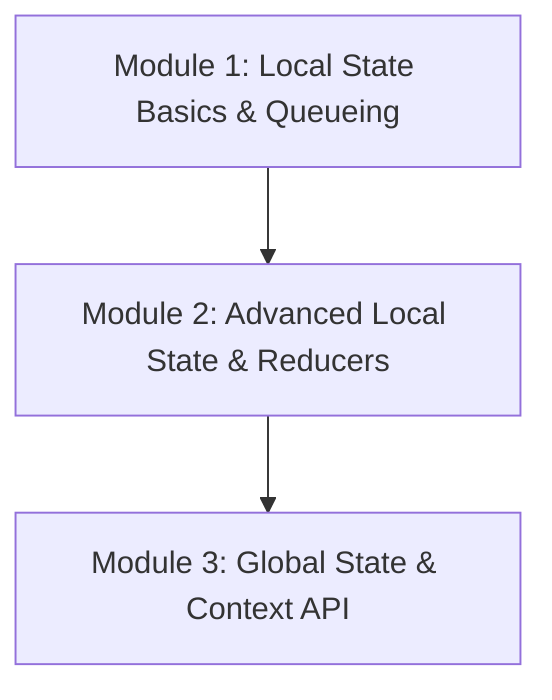

# Phase 3: State Management

Welcome to the **State Management** phase of the React Engineering Academy. This phase covers how React stores and updates local component memory, manages form inputs, and propagates data globally through your application using the Context API.

## Why this topic exists

Static pages are simple to render, but modern web applications are dynamic. When a user logs in, toggles a menu, adds items to a cart, or types in a text box, the application must store these changes in memory and update the UI accordingly.

In React, this memory is called **State**. Managing state correctly is critical: how you structure local variables, schedule batch updates, coordinate parent-child forms, and avoid prop drilling determines the scalability, responsiveness, and performance of your application.

---

## Learning Objectives

By the end of this phase, you will be able to:
- Explain what state is and contrast it with read-only props.
- Implement the `useState` hook and utilize functional updates.
- Understand React's asynchronous state batching and queueing mechanisms.
- Leverage lazy initialization of state for performance-sensitive tasks.
- Construct controlled and uncontrolled form inputs.
- Implement complex state transitions using the `useReducer` hook.
- Compare `useState` and `useReducer` and choose the correct pattern.
- Recognize and solve the prop drilling problem using the React Context API.
- Optimize Context performance to avoid unnecessary re-renders.

---

## Prerequisites

Before starting this phase, you should have completed:
1. **[Phase 1: React Fundamentals](../phase-1-fundamentals)**
2. **[Phase 2: Components & JSX](../phase-2-components-jsx)**

---

## Learning Roadmap & Topics Covered

This phase is broken down into three comprehensive modules:

1. **[Module 1: Local State Basics & Queueing](local-state-basics)**  
   Understanding component memory, the `useState` hook, asynchronous update batching, state queues, and lazy initialization.
2. **[Module 2: Advanced Local State & Reducers](advanced-local-state)**  
   Lifting state up, controlled vs uncontrolled inputs, form validations, the Reducer pattern, and the `useReducer` hook.
3. **[Module 3: Global State & Context API](context-api)**  
   Solving prop drilling, creating Context Providers and Consumers, splitting state/dispatch contexts, and optimization techniques.

---

## Estimated Learning Time

- **Total Time**: 10 - 12 Hours
- **Module 1**: 3 Hours
- **Module 2**: 4 Hours
- **Module 3**: 4 Hours
- **Exercises & Projects**: 1 Hour

---

## Real-World Applications

- **Interactive Forms**: Building step-by-step registration or checkout wizards with live input validations and error handling.
- **Complex UI Dashboards**: Syncing search filters, sorting options, and pagination controls dynamically across layouts.
- **Global Theme & Localization**: Propagating active color mode (dark/light) and user language preferences instantly throughout all components.

---

## Practice Exercises

- **State batch simulation**: Predicting component values across multiple sequential state setters.
- **Controlled multi-input forms**: Building a single handler function to manage forms with dozens of input fields.
- **Context optimization challenge**: Rewriting a context provider to prevent rendering of static header nodes when state updates.

---

## Mini Projects

- **An Interactive Task Management Board (Kanban Style)**: A fully functional board where users can create, edit, sort, and move tasks between lanes (To Do, In Progress, Done) powered by local state, reducers, and Context coordination.

---

## Related Topics

- [Components & JSX Overview](../phase-2-components-jsx)
- [React Hooks Deep Dive](../phase-4-hooks)

---

## Further Reading

- [React.dev: Managing State](https://react.dev/learn/managing-state)
- [Kent C. Dodds: State Management in React](https://epicreact.dev/)
