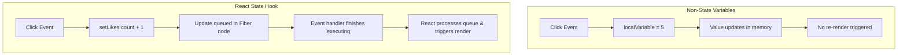
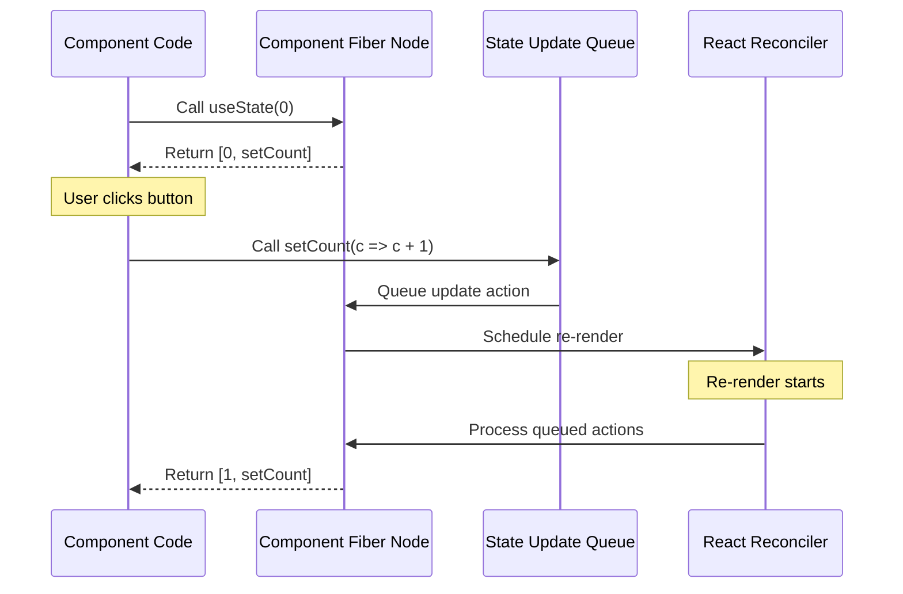
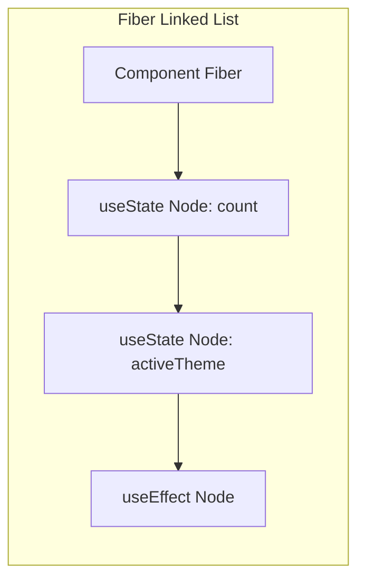

# Local State Basics & State Queueing

## Introduction

In React, components are functions. Standard JavaScript variables inside a function are discarded when the function finishes execution. To persist data across multiple render cycles and trigger UI updates when that data changes, React provides **State**. The main tool for managing state inside functional components is the `useState` hook. This module covers how state is stored in memory, how updates are queued asynchronously, how React batches state changes for performance, and how to initialize state lazily.

---

## Why do we need this?

Standard local variables do not trigger component renders or persist their values when React re-executes the component function.

### Problem Statement
Consider an interactive likes button. If you use a standard local variable to track likes:

```javascript
export default function LikeButton() {
  let likesCount = 0; // Discarded and reset to 0 on every render
  
  return (
    <button onClick={() => { likesCount++; console.log(likesCount); }}>
      Likes: {likesCount} {/* Renders 0, even though likesCount increments in the console */}
    </button>
  );
}
```

Every time the user clicks, the console prints the incremented value, but the screen continues to show `0` because changing a local variable does not inform React that it needs to re-render the component. We need a way to tell React to persist a variable's value in memory and trigger a re-render when that value changes.

---

## Real World Story

In early versions of React, class components managed state using a single `this.state` object and updated it using `this.setState()`. 

To optimize performance, React made `this.setState()` asynchronous. If you called `this.setState({ count: this.state.count + 1 })` three times in a row within the same event handler, React would batch the updates, combining them into a single write to the DOM. However, this meant that the intermediate updates did not see the new state, leading to bugs when developers tried to read state immediately after setting it. When functional components and hooks were introduced, React carried over these optimization behaviors (asynchronous state queueing and batching) to `useState` to maintain high rendering performance.

---

## Real World Analogy

Think of React state updates like an **Office Task Inbox Queue** compared to **Interrupting the Secretary constantly**.

- **Interrupting constantly (Direct DOM edits)**: Every time you think of a task, you walk up to your secretary, hand them a paper, and force them to immediately update the master database. If you have 5 tasks, you walk back and forth 5 times, disrupting the office workflow.
- **Task Inbox Queue (React State Updates)**: You place your task requests into the secretary's inbox queue. The secretary does not update the database immediately for each paper. Instead, they wait until you finish writing all your requests. Once your requests are queued, the secretary reviews the stack, aggregates the instructions, runs a single database write, and updates the display screen once.

---

## Visual Explanation

Below is a diagram showing the comparison of direct updates vs. React's queued state batching system.

### Immediate Local Update (Stale Variable)
```
[User Click] ──> [likesCount++] ──> [Value changes in memory] ──> [No UI Update]
```

### React Asynchronous Batch Updates (State Hook)
```
[User Click] ──> [Queue update: likes => likes + 1] ──> [Event handler finishes]
              ──> [React processes queue] ──> [Re-render component with new state]
```



---

## Internal Working

Under the hood, React stores state values inside a linked list of "Hook" objects attached to the component's Fiber node. When a component is executed:
1. During the initial render, `useState` registers a hook node in the linked list with its initial value.
2. When you call the state setter function (e.g., `setCount`), React does not mutate the state immediately. Instead, it adds a new update action to the hook's **Update Queue** and schedules a re-render.
3. During the next render cycle, React traverses the hook linked list in order, processes the update queue, computes the new state value, and returns it to the component.



---

## Architecture

State is bound to the component instance's position in the render tree. If a component is unmounted, its state is destroyed.



---

## Step-by-Step Flow

When a state setter is invoked inside a click handler, the following steps occur:

```mermaid
flowchart TD
    Step1[1. User triggers click event handler] --> Step2[2. State setter executes, queueing an update action]
    Step2 --> Step3[3. Standard JS handler code finishes execution]
    Step3 --> Step4[4. React processes the queue, merging updates (Automatic Batching)]
    Step4 --> Step5[5. React triggers a re-render and updates the DOM]
```

---

## Syntax

```javascript
// Basic state hook signature
const [state, setState] = useState(initialState);

// Functional updater signature (prevents stale closures)
setState((prevState) => prevState + 1);

// Lazy state initialization (runs function only on initial mount)
const [value, setValue] = useState(() => calculateHeavyValue());
```

---

## Basic Example

Here is a basic counter showing the use of standard state setter updates.

```jsx
import React, { useState } from 'react';

export default function Counter() {
  const [count, setCount] = useState(0);

  return (
    <div style={{ padding: '16px', textAlign: 'center' }}>
      <h3>State Counter</h3>
      <p>Count: {count}</p>
      {/* Basic state updater call */}
      <button onClick={() => setCount(count + 1)}>Increment</button>
    </div>
  );
}
```

---

## Intermediate Example

An intermediate component showing why **Functional Updates** are necessary. If you try to update state multiple times using a static state variable in a single handler run, React merges the updates because they refer to the same stale variable value.

```jsx
import React, { useState } from 'react';

export default function AsynchronousCounter() {
  const [count, setCount] = useState(0);

  const incrementTripleBad = () => {
    // ❌ Stale state bug: count is 0 inside all three updates
    setCount(count + 1); // Queues: 0 + 1
    setCount(count + 1); // Queues: 0 + 1
    setCount(count + 1); // Queues: 0 + 1
    // The final result will be 1, not 3!
  };

  const incrementTripleGood = () => {
    //  Functional updates: each update receives the latest computed state value
    setCount(prev => prev + 1); // Queues: 0 => 1
    setCount(prev => prev + 1); // Queues: 1 => 2
    setCount(prev => prev + 1); // Queues: 2 => 3
    // The final result will be 3!
  };

  return (
    <div style={{ padding: '16px' }}>
      <h3>Queue Testing Console</h3>
      <p>Active Count: <strong>{count}</strong></p>
      <button onClick={incrementTripleBad} style={{ marginRight: '8px' }}>
        Bad Increment (+1)
      </button>
      <button onClick={incrementTripleGood}>
        Good Functional Increment (+3)
      </button>
    </div>
  );
}
```

---

## Advanced Example

An advanced component showing **Lazy State Initialization**. Passing a function to `useState` ensures the heavy calculation only runs once on mount, rather than running on every render.

```jsx
import React, { useState } from 'react';

// Simulated heavy calculation function
function computeInitialMatrix() {
  console.log('Calculating heavy matrix data (Should run ONLY ONCE)...');
  // Simulates a heavy calculation, like reading from localStorage
  const saved = localStorage.getItem('app_saved_matrix');
  if (saved) return JSON.parse(saved);
  return Array.from({ length: 100 }, (_, i) => ({ id: i, value: i * 2 }));
}

export default function MatrixMonitor() {
  //  Lazy state initialization: pass function reference, do not invoke it
  const [matrix, setMatrix] = useState(computeInitialMatrix);
  const [filterText, setFilterText] = useState('');

  const addCell = () => {
    setMatrix(prev => [...prev, { id: prev.length, value: Math.floor(Math.random() * 500) }]);
  };

  const filteredMatrix = matrix.filter(cell => cell.value.toString().includes(filterText));

  return (
    <div style={{ padding: '20px' }}>
      <h3>Matrix Cell Registry</h3>
      <input
        type="text"
        placeholder="Filter cell values..."
        value={filterText}
        onChange={e => setFilterText(e.target.value)}
        style={{ padding: '6px', marginBottom: '12px', display: 'block' }}
      />
      <button onClick={addCell} style={{ marginBottom: '12px' }}>Add Random Cell</button>
      <div style={{ maxHeight: '150px', overflowY: 'auto', border: '1px solid #ccc', padding: '10px' }}>
        {filteredMatrix.map(cell => (
          <span key={cell.id} style={{ margin: '4px', padding: '4px', background: '#eee', display: 'inline-block' }}>
            Cell {cell.id}: {cell.value}
          </span>
        ))}
      </div>
    </div>
  );
}
```

---

## Production Example

A production-ready state setup syncing an inputs layout panel with a persistent browser `localStorage` engine. It handles empty cache queries, serializes state data safely inside structured try-catch wrappers, and implements a reset fallback state.

```jsx
import React, { useState, useEffect } from 'react';

// Key for storage persistence
const STORAGE_KEY = 'user_preference_store';

const DEFAULT_PREFERENCES = {
  notifications: true,
  autosave: false,
  username: ''
};

// Safe storage retrieval function
function loadSavedPreferences() {
  try {
    const item = localStorage.getItem(STORAGE_KEY);
    return item ? JSON.parse(item) : DEFAULT_PREFERENCES;
  } catch (error) {
    console.error('[STORAGE ERROR] Failed to load preferences:', error);
    return DEFAULT_PREFERENCES;
  }
}

export default function ProductionPreferencePanel() {
  // Initialize state lazily from localStorage
  const [preferences, setPreferences] = useState(loadSavedPreferences);

  // Sync preferences state to localStorage whenever it changes
  useEffect(() => {
    try {
      localStorage.setItem(STORAGE_KEY, JSON.stringify(preferences));
    } catch (error) {
      console.error('[STORAGE ERROR] Failed to write preferences:', error);
    }
  }, [preferences]);

  const updatePreference = (key, value) => {
    // Functional update prevents state overwrite bugs
    setPreferences(prev => ({
      ...prev,
      [key]: value
    }));
  };

  const resetPreferences = () => {
    setPreferences(DEFAULT_PREFERENCES);
  };

  return (
    <div style={{ maxWidth: '400px', margin: '20px auto', padding: '16px', border: '1px solid #eee', borderRadius: '8px' }}>
      <h2>App Settings</h2>
      <div style={{ margin: '12px 0' }}>
        <label htmlFor="username-input" style={{ display: 'block', marginBottom: '4px' }}>Username</label>
        <input
          id="username-input"
          type="text"
          value={preferences.username}
          onChange={e => updatePreference('username', e.target.value)}
          style={{ width: '100%', padding: '6px' }}
        />
      </div>

      <div style={{ margin: '12px 0' }}>
        <label>
          <input
            type="checkbox"
            checked={preferences.notifications}
            onChange={e => updatePreference('notifications', e.target.checked)}
          />
          Enable Alerts
        </label>
      </div>

      <div style={{ margin: '12px 0' }}>
        <label>
          <input
            type="checkbox"
            checked={preferences.autosave}
            onChange={e => updatePreference('autosave', e.target.checked)}
          />
          Enable Autosave
        </label>
      </div>

      <div style={{ marginTop: '16px', display: 'flex', gap: '8px' }}>
        <button onClick={resetPreferences} style={{ background: '#f44336', color: '#fff', border: 'none', padding: '8px 12px', cursor: 'pointer' }}>
          Reset Settings
        </button>
      </div>
    </div>
  );
}
```

---

## Folder Structure

```
local-state-basics/
├── src/
│   ├── components/
│   │   ├── MatrixMonitor.jsx
│   │   └── ProductionPreferencePanel.jsx
│   ├── App.jsx
│   └── main.jsx
├── package.json
└── vite.config.js
```

---

## Best Practices

💡 **Did You Know?**  
React queues and processes state updates in the order they are called. React determines this order based on the position of your hooks in the code, which is why you must never place hooks inside loops, conditions, or nested functions (Rules of Hooks).

🚀 **Best Practices**
- Keep state local to where it is needed. Do not move state to global wrappers if it is only used within a single component.
- Always use functional updates (`setCount(prev => prev + 1)`) when your new state depends on the previous state value.
- Initialize state lazily (`useState(() => loadData())`) when retrieving the initial value requires heavy calculations (like reading from `localStorage`).

---

## Common Mistakes

⚠ **Common Mistakes**

### Stale State Variables in Closures
A common bug is reading a state variable immediately after calling its setter function, expecting to get the updated value. State updates are asynchronous and queued; the updated state value is only available on the next render cycle.

```jsx
// ❌ WRONG
const [count, setCount] = useState(0);
const handleClick = () => {
  setCount(count + 1);
  console.log(count); // Prints 0 (the old value), not 1!
};

//  RIGHT
const [count, setCount] = useState(0);
const handleClick = () => {
  const nextCount = count + 1;
  setCount(nextCount);
  console.log(nextCount); // Prints 1 (the correct updated value)
};
```

---

## Performance Notes

⚡ **Performance Tips**
React balances render cycles using a process called **Automatic Batching**. If you trigger multiple state updates within a single click handler, React groups them together and triggers a single re-render.

### Performance Example
Comparing initializations:

```javascript
// ❌ Performance Anti-pattern: computeHeavyValue runs on EVERY render cycle
const [data, setData] = useState(computeHeavyValue());

//  Performance Optimization: computeHeavyValue runs ONLY ONCE on mount
const [data, setData] = useState(() => computeHeavyValue());
```

---

## Accessibility Notes

♿ **Accessibility Tips**
- Ensure form inputs are bound to label elements using `htmlFor` and `id` attributes.
- Use `aria-invalid` and `aria-describedby` attributes on input elements to inform screen reader users of form validation errors.

---

## SEO Notes

State changes are client-side operations that occur after the page has loaded. Ensure that the initial, pre-rendered HTML contains semantic text headers so that search engine crawlers can index the page correctly before user interactions occur.

---

## Interview Questions

🎯 **Interview Tips**  
In an interview, explain that state setters do not update variables immediately. Instead, they queue an update action and schedule a re-render. If they ask about Automatic Batching, explain that React merges multiple state updates within event handlers into a single re-render to keep the application performing efficiently.

### Q1: Why are React state updates asynchronous?
**Answer**: State updates are asynchronous to optimize rendering performance. If React updated the DOM immediately for every state change, calling multiple state setters in a single handler would trigger multiple expensive reflow and repaint cycles. By queueing updates, React can batch them together and trigger a single re-render, keeping the application performing efficiently.

### Q2: What is the difference between passing a value vs a function to `useState`?
**Answer**: Passing a value (e.g., `useState(heavyCalculation())`) executes the calculation on every render cycle, even though React only uses the result on the initial mount. Passing a function (e.g., `useState(() => heavyCalculation())`) enables lazy initialization: React executes the function only once on mount, optimizing performance.

---

## MCQs

1. **Why does modifying a standard local variable fail to trigger a visual component update?**
   - A) Because local variables are read-only in JavaScript.
   - B) Modifying local variables does not notify React to schedule a re-render.
   - C) Because React compiles variables into binary values.
   - D) Local variables are deleted by ESLint rules.
   - *Answer: B*

2. **What occurs when a state update is queued inside a click handler?**
   - A) React immediately updates the browser DOM.
   - B) The browser halts javascript execution.
   - C) React stores the update action in a queue and schedules a re-render after the handler finishes executing.
   - D) The page redirects to the home URL.
   - *Answer: C*

3. **What is React's "Automatic Batching" feature?**
   - A) Running CSS updates in background worker threads.
   - B) Grouping multiple state updates within event handlers into a single re-render to optimize performance.
   - C) Fetching network API resources in parallel.
   - D) Compiling components into web assemblies.
   - *Answer: B*

4. **When should you use functional updates (`setState(prev => prev + 1)`)?**
   - A) When updating state from inside a class component constructor.
   - B) When your new state depends on the previous state value.
   - C) When importing components dynamically.
   - D) On every render cycle.
   - *Answer: B*

5. **Which pattern is used to prevent a heavy initialization function from running on every render?**
   - A) React.memo wrapper
   - B) Lazy initialization (passing a function reference to `useState`)
   - C) Returning null from the component
   - D) Binding the function to the window object
   - *Answer: B*

---

## Practice Exercise

### Exercise 1: Functional Batch Verification
Predict the final count value rendered on screen after clicking the button in the component below, and explain why:
```jsx
export default function BatchTest() {
  const [count, setCount] = useState(10);
  const click = () => {
    setCount(count + 2);
    setCount(prev => prev + 5);
  };
  return <button onClick={click}>Count: {count}</button>;
}
```

*Solution*: The final count is 17. The first update (`setCount(count + 2)`) queues a replacement of count with 12. The second functional update receives 12 as its argument and returns 17, which is rendered on screen.

### Exercise 2: Input Field Sync
Create a text input component where typing characters updates a local state string, rendering the string character count live on screen.

### Exercise 3: Storage Reset Toggle
Create a component that stores a boolean value in localStorage. Provide a toggle button that updates the localStorage value and schedules a re-render.

---

## Debugging Exercise

### The Stale Log Count Bug
A developer wants to log the updated state count immediately after calling its setter function, but the console prints the old value. Identify the bug and write the fix.

```jsx
import React, { useState } from 'react';

export default function LogCounter() {
  const [count, setCount] = useState(0);

  const handleIncrement = () => {
    // BUG: Trying to read state immediately after setting it
    setCount(count + 1);
    console.log("Updated Count value is:", count); // Prints 0, not 1!
  };

  return <button onClick={handleIncrement}>Increment: {count}</button>;
}
```

#### Solution
State updates are asynchronous and queued; the count variable holds the old value until the next render cycle. To fix this, store the next value in a local variable, update the state with it, and log the local variable:

```jsx
// Corrected
const handleIncrement = () => {
  const nextCount = count + 1; // Store the next value in a local variable
  setCount(nextCount); // Update state
  console.log("Updated Count value is:", nextCount); // Logs the correct updated value
};
```

---

## Real-world Scenario

You are building a dynamic map component that renders markers based on coordinates. The backend sends live coordinates updates in rapid succession (e.g., 20 updates per second). Explain how you would prevent performance issues in your state management.
- **Resolution Strategy**: Implement a throttling or debouncing mechanism to limit the rate of state updates, batch coordinate updates, and use functional updates to ensure the component renders the latest marker positions efficiently.

---

## Interview Coding Question

### Problem Statement
Write a React component representing a simple checklist. The component should:
- Maintain an array of tasks.
- Include a button to add a new task with a random ID.
- Provide a clear button that resets the tasks array to an empty list.
- Store and load the tasks list from `localStorage` using a lazy state initialization function.

```jsx
import React, { useState, useEffect } from 'react';

const LOCAL_KEY = 'checklist_items_store';

function loadInitialItems() {
  try {
    const data = localStorage.getItem(LOCAL_KEY);
    return data ? JSON.parse(data) : [];
  } catch (e) {
    return [];
  }
}

export default function ChecklistApp() {
  const [tasks, setTasks] = useState(loadInitialItems);

  useEffect(() => {
    localStorage.setItem(LOCAL_KEY, JSON.stringify(tasks));
  }, [tasks]);

  const addTask = () => {
    const newTask = {
      id: Math.random().toString(36).substring(7),
      text: `New Task (${new Date().toLocaleTimeString()})`
    };
    setTasks(prev => [...prev, newTask]);
  };

  const clearTasks = () => setTasks([]);

  return (
    <div>
      <h3>Tasks List</h3>
      <button onClick={addTask}>Add Task</button>
      <button onClick={clearTasks} style={{ marginLeft: '8px' }}>Clear All</button>
      <ul>
        {tasks.map(task => (
          <li key={task.id}>{task.text} (ID: {task.id})</li>
        ))}
      </ul>
    </div>
  );
}
```

---

## Mini Project

### Dynamic Local Storage Sandbox
Create an interactive state sandbox page:
- Renders inputs for a user profile: Name, Theme (Light/Dark), and Language.
- Loads the initial profile values from localStorage using a lazy initialization function.
- Automatically saves preferences to localStorage whenever they change.
- Displays a visual layout preview that reflects the active theme and language settings immediately.

---

## Summary

🧠 **Memory Tricks**  
`setCount(c => c + 1) = Safety First` - When the new state depends on the previous state value, always pass an updater function `c => c + 1` instead of `count + 1` to ensure you are working with the latest state value.

📖 **Summary**  
React state persists variables across renders and schedules updates. By queueing updates, batching updates inside event handlers, and providing functional state setters, React keeps rendering optimized and prevents stale closure bugs.

---

## Cheat Sheet

```javascript
// Queued replacement update
setCount(count + 1);

// Functional queue update (safe for sequential calls)
setCount(prev => prev + 1);
```

---

## Related Topics
- [Props & Unidirectional Data Flow](../phase-2-components-jsx/props-data-flow)
- [React Hook Lifecycle](../phase-4-hooks/useeffect-lifecycle)

---

## Further Reading
- [React Docs: State: A Component's Memory](https://react.dev/learn/state-a-components-memory)
- [React Docs: Queueing a Series of State Updates](https://react.dev/learn/queueing-a-series-of-state-updates)
