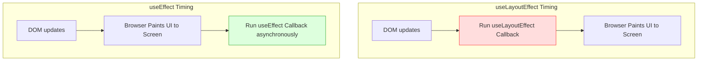
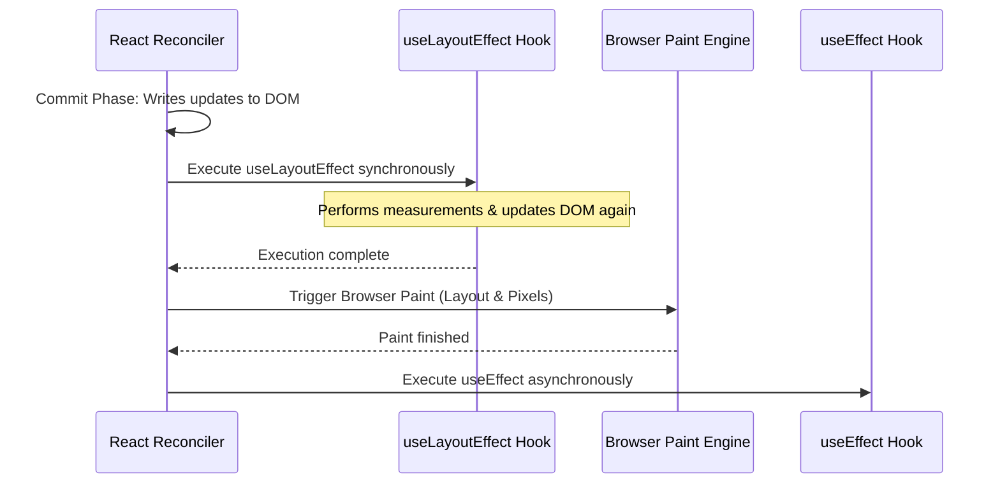
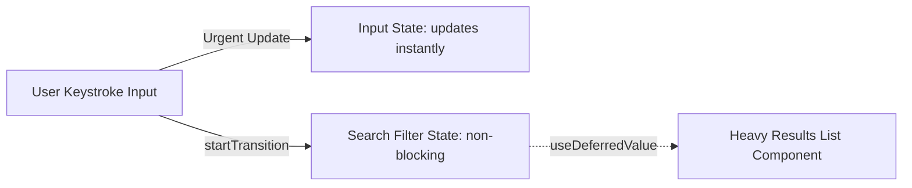

# Advanced & Edge Case Hooks

## Introduction

As applications scale and UI patterns grow more complex, standard hooks (like `useState` and `useEffect`) may fall short. To handle edge cases, React provides specialized hooks. This module covers **useLayoutEffect** (for synchronous DOM measurements), **useImperativeHandle** (to expose child control APIs to parents), **useId** (for generating stable accessibility IDs), and concurrent hooks: **useTransition**, **useDeferredValue**, and **useSyncExternalStore**.

---

## Why do we need this?

Standard asynchronous hooks can cause visual bugs or slow down the UI under specific conditions.

### Problem Statement
Consider a tooltip component that appears when hovering over a button.
1. The tooltip's position (above, below, left, right) depends on the button's position and the viewport boundaries.
2. If you measure coordinates inside `useEffect` (which runs asynchronously after the browser paints), the tooltip is rendered at a default position (e.g., `top: 0`), and then jumps to the correct position (e.g., `top: 150px`) after the measurement finishes.
3. This creates a visual flash (flicker) that degrades the user experience.

We need a hook that runs synchronously before the browser paints the screen, allowing us to perform DOM measurements and adjust layouts without visual glitches.

---

## Real World Story

In the early days of React, developers measured DOM nodes inside class components using the synchronous `componentDidMount` and `componentDidUpdate` lifecycles.

When hooks were introduced, React provided `useEffect` as the primary tool for side effects. However, developers quickly noticed that using `useEffect` for DOM measurements caused visual flickers. To solve this, React released `useLayoutEffect`, which runs synchronously in the same phase as the legacy lifecycles. Later, in React 18, the team introduced concurrent features to keep applications responsive during heavy computations. They added hooks like `useTransition` and `useDeferredValue` to split state updates into urgent and non-urgent phases, preventing input fields from freezing during heavy re-renders.

---

## Real World Analogy

Think of advanced hooks like a **Theater Stage Crew** compared to a **General Constructor**.

- **useEffect (General Constructor)**: The constructor builds a house, lets the paint dry, and then comes back later to measure the window frame sizes. If the frames are the wrong size, they rip them out and replace them, which is visible to passersby.
- **useLayoutEffect (Theater Stage Crew)**: Before the stage curtain rises (browser paint), the crew measures the props, adjusts the stage lighting, and places the actors in their exact positions. When the curtain rises, the audience sees a perfect, polished scene without seeing the crew work.
- **useTransition (Concert VIP Gate)**: A ticket collector sets up two lines: a VIP line (Urgent update: typing in an input box) and a general line (Non-urgent update: filtering a large data table). The collector processes the VIPs instantly, keeping the entrance responsive, while processing the general queue in the background.

---

## Visual Explanation

Below is a flowchart comparing the execution timing of `useLayoutEffect` vs. `useEffect`.

### useLayoutEffect Cycle (Blocks Paint)
```
[State Change] ──> [Virtual DOM Diff] ──> [DOM Patched] ──> [useLayoutEffect Runs] ──> [Browser Paints]
                                                                (Sync measurements)
```

### useEffect Cycle (Non-blocking)
```
[State Change] ──> [Virtual DOM Diff] ──> [DOM Patched] ──> [Browser Paints] ──> [useEffect Runs]
                                                                                   (Async API calls)
```



---

## Internal Working

React executes these specialized hooks in different phases of the reconciler pipeline:

- **`useLayoutEffect`**: Runs synchronously after React writes to the DOM but before the browser paints. It blocks browser painting, allowing you to perform DOM measurements and adjust layouts without visual flickers.
- **`useImperativeHandle`**: Works with `forwardRef` to customize the instance value exposed to parent components, allowing you to hide internal state and expose only specific control methods.
- **`useTransition`**: Returns an `isPending` boolean indicator and a `startTransition` function. Updates wrapped in `startTransition` are marked as non-urgent and can be interrupted if the user triggers an urgent update (like typing).
- **`useSyncExternalStore`**: Subscribes components directly to external state stores (like Redux, Zustand, or browser APIs), preventing rendering inconsistency issues (tearing) during concurrent rendering.



---

## Architecture

Concurrent hooks split application state updates. Urgent events (like text inputs) update state immediately, while non-urgent events (like chart filtering) are deferred, keeping the UI responsive.



---

## Step-by-Step Flow

When using `useTransition` to handle a heavy data-filtering task, the following steps occur:

```mermaid
flowchart TD
    Step1[1. User types in a search field, triggering onChange handler] --> Step2[2. Handler updates input text immediately (Urgent update)]
    Step2 --> Step3[3. Handler dispatches the search filter state update inside startTransition]
    Step3 --> Step4[4. React marks filter state as non-urgent, keeping the input responsive]
    Step4 --> Step5[5. React filters list in the background and renders updates when CPU is idle]
```

---

## Syntax

```javascript
// useLayoutEffect Syntax (runs synchronously before paint)
useLayoutEffect(() => {
  const rect = elementRef.current.getBoundingClientRect();
  // Adjust position prop synchronously
}, [dependencies]);

// useTransition Syntax
const [isPending, startTransition] = useTransition();

// useDeferredValue Syntax
const deferredValue = useDeferredValue(currentValue);
```

---

## Basic Example

Here is a basic component that uses `useId` to generate stable, unique IDs for binding labels to form inputs, ensuring accessibility controls work correctly in Server-Side Rendered (SSR) environments.

```jsx
import React, { useId } from 'react';

// Reusable Form Input Component
function AccessibleField({ label, type = 'text' }) {
  // Generates a stable unique ID safe for SSR environments
  const inputId = useId();

  return (
    <div style={{ margin: '12px 0' }}>
      <label htmlFor={inputId}>{label}</label>
      <input id={inputId} type={type} style={{ marginLeft: '8px', padding: '4px' }} />
    </div>
  );
}

export default function SignupConsole() {
  return (
    <div style={{ padding: '16px' }}>
      <h3>Accessibility Bind Panel</h3>
      <AccessibleField label="Full Name" />
      <AccessibleField label="Email Address" type="email" />
    </div>
  );
}
```

---

## Intermediate Example

An intermediate component showing the difference between `useEffect` and `useLayoutEffect`. In this example, `useLayoutEffect` is used to position a tooltip box synchronously, preventing the visual flicker that occurs when using `useEffect`.

```jsx
import React, { useState, useRef, useLayoutEffect } from 'react';

export default function TooltipLayout() {
  const [showTooltip, setShowTooltip] = useState(false);
  const [tooltipPos, setTooltipPos] = useState({ top: 0, left: 0 });
  const buttonRef = useRef(null);
  const tooltipRef = useRef(null);

  // useLayoutEffect runs synchronously before the browser paints the screen,
  // allowing us to measure the button and position the tooltip without visual flickers.
  useLayoutEffect(() => {
    if (!showTooltip || !buttonRef.current || !tooltipRef.current) return;

    const btnRect = buttonRef.current.getBoundingClientRect();
    const tooltipRect = tooltipRef.current.getBoundingClientRect();

    setTooltipPos({
      top: btnRect.top - tooltipRect.height - 8, // Position 8px above the button
      left: btnRect.left + (btnRect.width / 2) - (tooltipRect.width / 2)
    });
  }, [showTooltip]);

  return (
    <div style={{ padding: '100px 20px', textAlign: 'center' }}>
      <button
        ref={buttonRef}
        onMouseEnter={() => setShowTooltip(true)}
        onMouseLeave={() => setShowTooltip(false)}
      >
        Hover over me!
      </button>

      {showTooltip && (
        <div
          ref={tooltipRef}
          style={{
            position: 'fixed',
            top: `${tooltipPos.top}px`,
            left: `${tooltipPos.left}px`,
            backgroundColor: '#333',
            color: '#fff',
            padding: '6px 12px',
            borderRadius: '4px',
            pointerEvents: 'none',
            fontSize: '0.85rem'
          }}
        >
          Dynamic Tooltip Details
        </div>
      )}
    </div>
  );
}
```

---

## Advanced Example

An advanced component illustrating the use of `useImperativeHandle` combined with `forwardRef` to expose child control APIs (like opening and closing a custom drawer) directly to a parent component.

```jsx
import React, { useState, useRef, useImperativeHandle, forwardRef } from 'react';

// Child component wrapped in forwardRef to receive Ref pointer
const CustomDrawer = forwardRef(({ title }, ref) => {
  const [isOpen, setIsOpen] = useState(false);

  // Expose specific control methods to the parent component
  useImperativeHandle(ref, () => ({
    open: () => setIsOpen(true),
    close: () => setIsOpen(false),
    toggle: () => setIsOpen(prev => !prev),
    getIsOpenState: () => isOpen
  }));

  if (!isOpen) return null;

  return (
    <div style={{
      position: 'fixed', bottom: 0, left: 0, right: 0,
      height: '150px', backgroundColor: '#eef',
      borderTop: '2px solid blue', padding: '16px', zIndex: 1000
    }}>
      <h4>{title} Drawer Panel</h4>
      <p>This panel is controlled by the parent component using refs.</p>
      <button onClick={() => setIsOpen(false)}>Close Drawer</button>
    </div>
  );
});

export default function WorkspaceConsole() {
  const drawerRef = useRef(null);

  return (
    <div style={{ padding: '20px' }}>
      <h3>Enterprise Console</h3>
      <div style={{ display: 'flex', gap: '8px' }}>
        <button onClick={() => drawerRef.current?.open()}>Open Panel</button>
        <button onClick={() => drawerRef.current?.close()}>Force Close</button>
        <button onClick={() => drawerRef.current?.toggle()}>Toggle View</button>
      </div>
      <CustomDrawer ref={drawerRef} title="Analytics Logs" />
    </div>
  );
}
```

---

## Production Example

A production-ready search interface utilizing `useTransition` to handle heavy filtering tasks. This allows the search input field to remain responsive while filtering large amounts of data in the background.

```jsx
import React, { useState, useTransition, useMemo } from 'react';

// Large dataset representing catalog items
const HEAVY_DATABASE = Array.from({ length: 15000 }, (_, i) => ({
  id: `i-${i}`,
  label: `Product Inventory Item #${i + 1}`,
  rating: Math.floor(Math.random() * 100)
}));

export default function ConcurrentSearchApp() {
  const [query, setQuery] = useState('');
  const [filterQuery, setFilterQuery] = useState('');
  const [isPending, startTransition] = useTransition();

  // Handle typing inside the search input
  const handleChange = (e) => {
    // 1. URGENT: Update search input text instantly
    setQuery(e.target.value);

    // 2. NON-URGENT: Filter the database in the background using useTransition
    startTransition(() => {
      setFilterQuery(e.target.value);
    });
  };

  // Caches the heavy calculations
  const filteredProducts = useMemo(() => {
    if (!filterQuery) return HEAVY_DATABASE;
    return HEAVY_DATABASE.filter(item =>
      item.label.toLowerCase().includes(filterQuery.toLowerCase())
    );
  }, [filterQuery]);

  return (
    <div style={{ maxWidth: '500px', margin: '20px auto', padding: '16px', border: '1px solid #ccc', borderRadius: '8px' }}>
      <h3>Search Catalog (Concurrent Mode)</h3>
      <input
        type="text"
        value={query}
        onChange={handleChange}
        placeholder="Type to search items..."
        style={{ width: '100%', padding: '8px', fontSize: '1rem', boxSizing: 'border-box' }}
      />
      
      {/* Display loading indicator during background filter tasks */}
      {isPending && <p style={{ color: 'blue' }} role="status">Filtering inventory...</p>}

      <div style={{ marginTop: '12px', maxHeight: '200px', overflowY: 'auto', border: '1px solid #eee', padding: '8px' }}>
        <p>Matched Items: {filteredProducts.length}</p>
        <ul style={{ paddingLeft: '20px' }}>
          {filteredProducts.slice(0, 50).map(item => (
            <li key={item.id}>{item.label}</li>
          ))}
        </ul>
      </div>
    </div>
  );
}
```

---

## Folder Structure

```
advanced-hooks/
├── src/
│   ├── components/
│   │   ├── TooltipLayout.jsx
│   │   └── ConcurrentSearchApp.jsx
│   ├── App.jsx
│   └── main.jsx
├── package.json
└── vite.config.js
```

---

## Best Practices

💡 **Did You Know?**  
In React 18 Concurrent Mode, updates are categorized by priority. Standard state changes are urgent, while updates wrapped in `startTransition` can be paused or aborted if the user triggers a new urgent update, preventing the UI from freezing.

🚀 **Best Practices**
- Use `useEffect` for most side effects. Use `useLayoutEffect` only when performing DOM measurements that alter the visual layout of elements, preventing visual flickers.
- Use `useTransition` when a state update causes heavy computations that freeze the UI. Avoid wrapping input values in transitions.
- Expose child methods using `useImperativeHandle` sparingly. Try to use unidirectional props data flow where possible, and use refs only when managing focus, modals, or media playback.

---

## Common Mistakes

⚠ **Common Mistakes**

### Using useLayoutEffect in SSR Environments
Using `useLayoutEffect` on the server causes warnings in environments like Next.js because the server cannot run synchronous layout measurements without access to a real browser window DOM.

```jsx
// ❌ WRONG (Triggers Server Warning)
useLayoutEffect(() => {
  measureNode();
}, []);

//  RIGHT (Uses useEffect to run layout calculations on the client side only)
useEffect(() => {
  measureNode();
}, []);
```

### Wrapping Input Bindings in transitions
Wrapping the input field's `value` state setter in `startTransition` will cause typing input to feel laggy because the text rendering is delayed.

```jsx
// ❌ WRONG
const handleChange = (e) => {
  startTransition(() => {
    setQuery(e.target.value); // Input field lags on keystroke
  });
};

//  RIGHT
const handleChange = (e) => {
  setQuery(e.target.value); // Update input text immediately (Urgent)
  startTransition(() => {
    setFilter(e.target.value); // Filter in the background (Non-urgent)
  });
};
```

---

## Performance Notes

⚡ **Performance Tips**
`useLayoutEffect` blocks browser painting. Performing heavy calculations inside this hook will delay layout rendering, causing noticeable lag on page loads. Keep logic inside `useLayoutEffect` fast and focused on measurements.

---

## Accessibility Notes

♿ **Accessibility Tips**
- Generate form field IDs using `useId` to link label and input elements. This ensures labels are read correctly by screen readers.
- Ensure that dynamic loaders like `isPending` announce loading status using `aria-live="polite"` or `role="status"`.

---

## SEO Notes

Concurrent scheduling hooks optimize page loading responsiveness. Improving metrics like **Interaction to Next Paint (INP)** using concurrent features helps improve search engine rankings.

---

## Interview Questions

🎯 **Interview Tips**  
In an interview, explain that `useLayoutEffect` runs synchronously before the browser paints the screen, making it ideal for DOM measurements. Contrast this with `useEffect`, which runs asynchronously after the paint cycle, preventing rendering blocks.

### Q1: Compare `useEffect` and `useLayoutEffect`.
**Answer**: `useEffect` runs asynchronously after the browser has painted the DOM updates, ensuring it doesn't block page rendering. `useLayoutEffect` runs synchronously in the same phase as legacy lifecycle methods, after DOM writes but before browser paint. It blocks browser painting, allowing you to perform DOM measurements and adjust layouts without visual flickers.

### Q2: What is the purpose of the concurrent hook `useDeferredValue`?
**Answer**: `useDeferredValue` is a concurrent hook that accepts a value and returns a deferred version of it. The deferred value lags behind the current value during updates, allowing React to delay heavy re-renders based on that value while keeping user interactions (like typing) responsive.

---

## MCQs

1. **When does the `useLayoutEffect` hook execute?**
   - A) After the browser paints the screen.
   - B) Synchronously after React writes to the DOM but before the browser paints.
   - C) Inside the component constructor.
   - D) Only on mouse interactions.
   - *Answer: B*

2. **Why does using `useLayoutEffect` on the server trigger warnings?**
   - A) Because the server does not support JSX.
   - B) The server does not have access to a real browser window DOM to run synchronous layout measurements.
   - C) Because it requires a database connection.
   - D) It exposes environment variables.
   - *Answer: B*

3. **Which hook is used with `forwardRef` to expose child component control methods to parents?**
   - A) `useImperativeHandle`
   - B) `useId`
   - C) `useLayoutEffect`
   - D) `useMemo`
   - *Answer: A*

4. **What is the purpose of updates wrapped in the `startTransition` function?**
   - A) They run in background worker threads.
   - B) They are marked as non-urgent and can be interrupted if the user triggers urgent updates (like typing).
   - C) They automatically save values to localStorage.
   - D) They bypass JSX compilations.
   - *Answer: B*

5. **Which concurrent hook is used to subscribe components directly to third-party global state stores?**
   - A) `useDeferredValue`
   - B) `useTransition`
   - C) `useSyncExternalStore`
   - D) `useReducer`
   - *Answer: C*

---

## Practice Exercise

### Exercise 1: Form Label useId Binding
Bind this label to the input field using `useId` to make it accessible to screen readers:
```jsx
function MailInput() {
  return (
    <div>
      <label>Email Address</label>
      <input type="email" />
    </div>
  );
}
```

*Solution*:
```jsx
function MailInput() {
  const id = useId();
  return (
    <div>
      <label htmlFor={id}>Email Address</label>
      <input id={id} type="email" />
    </div>
  );
}
```

### Exercise 2: Expose Reset API via ref
Create a child component called `InputWidget` that exposes a `reset()` method to the parent using `useImperativeHandle`. The parent should be able to call this method to clear the input field's value.

### Exercise 3: useDeferredValue List Filtering
Create a list filtering component that uses `useDeferredValue` on a query state variable. Pass the deferred query to the list component, allowing the search input field to remain responsive during updates.

---

## Debugging Exercise

### The Flashing Box Position Bug
A developer wants to align a popup box next to a button on click. They measure coordinates inside `useEffect`, but notice that the popup box briefly appears at coordinates `(0, 0)` before jumping to the correct position. Identify the bug and write the fix.

```jsx
import React, { useState, useRef, useEffect } from 'react';

export default function SizablePopup() {
  const [isOpen, setIsOpen] = useState(false);
  const [coords, setCoords] = useState({ top: 0, left: 0 });
  const buttonRef = useRef(null);

  // BUG: Measurements inside useEffect occur AFTER the browser paints, causing a visual flash
  useEffect(() => {
    if (isOpen && buttonRef.current) {
      const rect = buttonRef.current.getBoundingClientRect();
      setCoords({ top: rect.bottom + 10, left: rect.left });
    }
  }, [isOpen]);

  return (
    <div>
      <button ref={buttonRef} onClick={() => setIsOpen(!isOpen)}>Toggle Popup</button>
      {isOpen && (
        <div style={{ position: 'absolute', top: coords.top, left: coords.left, background: '#ccc' }}>
          Floating Details Popup
        </div>
      )}
    </div>
  );
}
```

#### Solution
The measurements are performed inside `useEffect`, which runs after the browser paints. The popup is briefly rendered at its initial position before the new coordinates are applied, causing a visual flash. To fix this, change `useEffect` to `useLayoutEffect` to run measurements and update coordinates synchronously before the browser paints:

```jsx
import React, { useState, useRef, useLayoutEffect } from 'react'; // Import useLayoutEffect

// Corrected SizablePopup component
export default function SizablePopup() {
  const [isOpen, setIsOpen] = useState(false);
  const [coords, setCoords] = useState({ top: 0, left: 0 });
  const buttonRef = useRef(null);

  // useLayoutEffect runs synchronously before the browser paints the screen
  useLayoutEffect(() => {
    if (isOpen && buttonRef.current) {
      const rect = buttonRef.current.getBoundingClientRect();
      setCoords({ top: rect.bottom + 10, left: rect.left });
    }
  }, [isOpen]);

  return (
    <div>
      <button ref={buttonRef} onClick={() => setIsOpen(!isOpen)}>Toggle Popup</button>
      {isOpen && (
        <div style={{ position: 'absolute', top: coords.top, left: coords.left, background: '#ccc' }}>
          Floating Details Popup
        </div>
      )}
    </div>
  );
}
```

---

## Real-world Scenario

You are building a real-time multiplayer drawing whiteboard. When a user draws a line, coordinates are broadcast to all players via WebSockets. Sibling components must display these lines immediately. Explain how you would manage this connection and update state without lagging the application.
- **Design Strategy**: Store the drawing coordinates in an external state store. Use `useSyncExternalStore` inside the component to subscribe to coordinate updates, ensuring that updates are synchronized and rendered without causing layout lag or inconsistency issues.

---

## Interview Coding Question

### Problem Statement
Write a custom hook called `useLayoutDimensions` that measures the width and height of an element. The hook should:
- Accept a ref object pointing to the target element.
- Return an object with the width and height: `{ width, height }`.
- Perform measurements synchronously using `useLayoutEffect` to prevent visual flickers.

```jsx
import { useState, useLayoutEffect } from 'react';

export function useLayoutDimensions(ref) {
  const [dimensions, setDimensions] = useState({ width: 0, height: 0 });

  useLayoutEffect(() => {
    if (!ref.current) return;

    const measure = () => {
      const rect = ref.current.getBoundingClientRect();
      setDimensions({ width: rect.width, height: rect.height });
    };

    measure(); // Measure on mount and update

    window.addEventListener('resize', measure);
    return () => window.removeEventListener('resize', measure);
  }, [ref]);

  return dimensions;
}
```

---

## Mini Project

### Concurrent Dashboard Playground
Create a workspace dashboard demonstrating concurrent features:
- Generate a dataset of 20,000 inventory items.
- Provide a text input for query searches.
- Render the search results list, using `useTransition` to process the query search in the background.
- Display an active "Processing..." banner when `isPending` is true.
- Compare search performance with and without transitions side by side, logging render times and showing performance differences in real-time.

---

## Summary

🧠 **Memory Tricks**  
`useLayoutEffect = Visual adjustment, useTransition = Search filter`  
- Use `useLayoutEffect` to run DOM measurements synchronously and adjust elements before they paint on screen, preventing visual flickers.
- Use `useTransition` to mark heavy computations (like filtering large lists) as non-urgent, keeping the UI responsive.

📖 **Summary**  
React provides specialized hooks to handle advanced layout and rendering tasks. `useLayoutEffect` runs layout adjustments synchronously, `useImperativeHandle` exposes child control APIs to parents, `useId` generates stable accessibility IDs, and concurrent hooks keep applications responsive during heavy computations.

---

## Cheat Sheet

```javascript
// Synchronous DOM measurements
useLayoutEffect(() => {
  const height = ref.current.offsetHeight;
}, [deps]);

// Marking updates as non-blocking transitions
const [isPending, startTransition] = useTransition();
```

---

## Related Topics
- [React Hook Fundamentals](hook-fundamentals)
- [useEffect & Lifecycle Synchronization](useeffect-lifecycle)

---

## Further Reading
- [React Docs: useLayoutEffect Hook Reference](https://react.dev/reference/react/useLayoutEffect)
- [React Docs: useTransition Hook Reference](https://react.dev/reference/react/useTransition)
