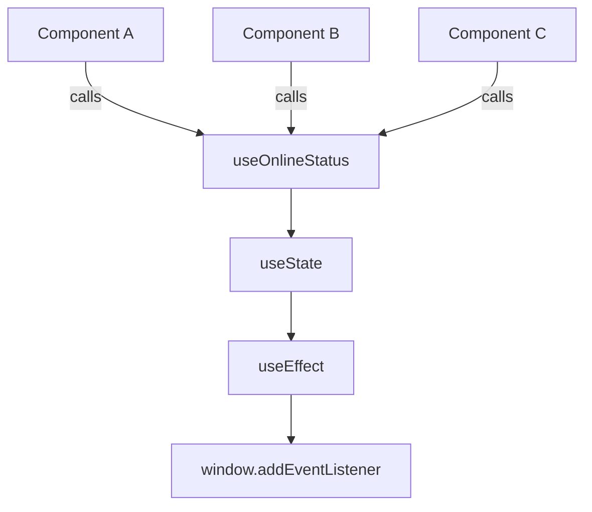

# Custom Hooks — Reusable Logic

## Introduction

Custom Hooks let you extract component logic into reusable functions. They are JavaScript functions that use other hooks and follow the `use` naming convention.

## Why do we need this?

When multiple components share logic (fetching, form handling, timers), you'd otherwise duplicate code. Custom Hooks let you share stateful logic, not just functions.

### Problem Statement

Three components need to track online status. Without custom hooks, you'd duplicate the `useState` + `useEffect` logic in each. Extract it into `useOnlineStatus`.

## Real World Story

Before hooks, sharing stateful logic required HOCs or Render Props — wrapper components that added nesting. Custom Hooks flatten this — just call a function.

## Real World Analogy

A **Tool Shed** — instead of building a new hammer for each house, you keep one in the shed and grab it when needed.

## Visual Explanation



## Rules

- Name must start with `use` (e.g., `useOnlineStatus`)
- Can call other hooks inside
- Follow the Rules of Hooks (top level, React functions only)

## Basic Example

```jsx
import { useState, useEffect } from 'react';

function useOnlineStatus() {
  const [isOnline, setIsOnline] = useState(navigator.onLine);

  useEffect(() => {
    const online = () => setIsOnline(true);
    const offline = () => setIsOnline(false);
    window.addEventListener('online', online);
    window.addEventListener('offline', offline);
    return () => {
      window.removeEventListener('online', online);
      window.removeEventListener('offline', offline);
    };
  }, []);

  return isOnline;
}

// Usage
function StatusBadge() {
  const isOnline = useOnlineStatus();
  return <span style={{ color: isOnline ? 'green' : 'red' }}>{isOnline ? 'Online' : 'Offline'}</span>;
}
```

## Intermediate Example

```jsx
import { useState, useEffect } from 'react';

function useDebounce(value, delay = 300) {
  const [debounced, setDebounced] = useState(value);

  useEffect(() => {
    const id = setTimeout(() => setDebounced(value), delay);
    return () => clearTimeout(id);
  }, [value, delay]);

  return debounced;
}

function Search() {
  const [query, setQuery] = useState('');
  const debouncedQuery = useDebounce(query, 500);

  useEffect(() => {
    if (debouncedQuery) fetch(`/api/search?q=${debouncedQuery}`);
  }, [debouncedQuery]);

  return <input value={query} onChange={e => setQuery(e.target.value)} />;
}
```

## Advanced Example

Composing multiple hooks:

```jsx
function useUser() {
  const [user, setUser] = useState(null);
  const [loading, setLoading] = useState(true);
  useEffect(() => { fetch('/api/me').then(r => r.json()).then(d => { setUser(d); setLoading(false); }); }, []);
  return { user, loading };
}

function useDocumentTitle(title) {
  useEffect(() => { document.title = title; }, [title]);
}

function Dashboard() {
  const { user, loading } = useUser();
  useDocumentTitle(user ? `${user.name} - Dashboard` : 'Dashboard');
  if (loading) return <p>Loading...</p>;
  return <h1>Welcome, {user.name}</h1>;
}
```

## Production Example

```jsx
function useLocalStorage(key, initialValue) {
  const [value, setValue] = useState(() => {
    try { const item = localStorage.getItem(key); return item ? JSON.parse(item) : initialValue; }
    catch { return initialValue; }
  });
  useEffect(() => { try { localStorage.setItem(key, JSON.stringify(value)); } catch {} }, [key, value]);
  return [value, setValue];
}
```

## Best Practices

💡 Custom Hooks share stateful logic, not state itself — each component gets its own state.

🚀 Start with `use` prefix. Return arrays for multiple values (like useState). Keep hooks focused.

## Common Mistakes

⚠ Naming without `use` — React won't detect hook rule violations.
⚠ Not returning cleanup — causes memory leaks.

## MCQs

1. **What must a custom hook name start with?** A) `use`  B) `hook`  C) `custom`  D) `react` → *A*
2. **Can custom hooks call other hooks?** A) Yes  B) No → *A*
3. **Do components sharing a custom hook share state?** A) Yes  B) No, each has own state → *B*
4. **What can custom hooks replace?** A) JSX  B) HOCs/Render Props  C) CSS  D) Routing → *B*
5. **Where can you call a custom hook?** A) Anywhere  B) React function  C) Class  D) Loop → *B*

## Practice Exercise

E1: `useWindowSize` — returns window dimensions. E2: `usePrevious` — returns previous value. E3: `useToggle` — boolean toggle.

## Mini Project

Create a `useForm` hook that manages form state, validation, and submission.

## Summary

🧠 `Custom Hook = Tool Shed` — grab reusable logic when you need it.

📖 Functions starting with `use` that use other hooks. Share logic, not state.

## Related Topics

[useEffect](use-effect) | [useRef](use-ref) | [Hook Fundamentals](../phase-4-hooks/hook-fundamentals)

## Further Reading

[React Docs: Custom Hooks](https://react.dev/learn/reusing-logic-with-custom-hooks)
