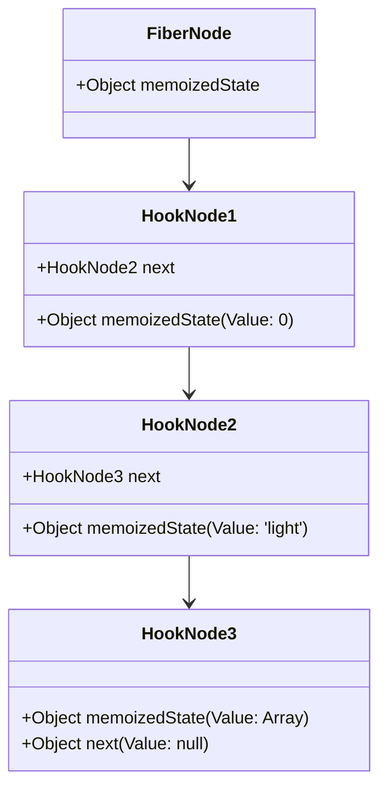
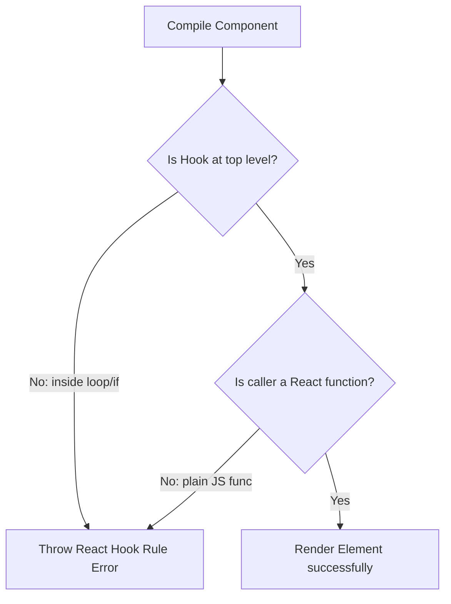
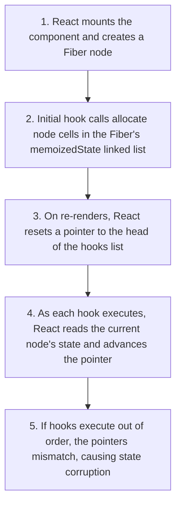

# React Hook Fundamentals

## Introduction

React Hooks were introduced in version 16.8 and transformed how we write React applications. By allowing functional components to use state, context, and lifecycle side effects, hooks removed the need for legacy class components. This module covers the motivation behind hooks, how React tracks them internally using a **Linked List** on Fiber nodes, and why the **Rules of Hooks** are necessary to prevent runtime bugs.

---

## Why do we need this?

In early React codebases, sharing stateful logic between components was difficult and required using complex patterns like Higher-Order Components (HOCs) or Render Props.

### Problem Statement
Consider an application where multiple components need to track if the user is online or offline.
- Using legacy class components, you write event listeners for `online` and `offline` inside `componentDidMount`, and clear them inside `componentWillUnmount`.
- If 5 different components need this network state, you must copy-paste the event listener logic into all 5 components, or wrap them in HOCs.
- Wrapping components in HOCs creates "Wrapper Bloat", nesting your component tree inside dozens of layers of wrapper nodes, which makes debugging difficult.

We need a way to extract stateful logic into simple, reusable functions without nesting components.

---

## Real World Story

In 2018, React creators Sophie Alpert, Dan Abramov, and team stood on the React Conf stage and introduced Hooks. They explained three main problems with React at the time:
1. **Reusing stateful logic was hard**: HOCs and Render Props caused wrapper bloat.
2. **Complex components were hard to understand**: Related code (like fetching data and setting up listeners) was split across different lifecycle methods (`componentDidMount`, `componentWillUnmount`), while unrelated code was grouped in the same method.
3. **Classes were confusing**: Managing the `this` context was difficult, classes did not minimize well, and hot reloading class components was unreliable.

By introducing Hooks, React solved all three problems at once: developers could share stateful logic using custom functions, group related logic in a single hook, and write entire applications using simple functional components.

---

## Real World Analogy

Think of React Hooks like **Standardized Utilities in a Hotel Room** compared to **Building a Custom House**.

- **Class Component (Custom House)**: To have water, light, and power, you must build a basement, wire the walls, connect the generator, and maintain the plumbing. If you want a new room, you have to build the same foundations again.
- **Hooks Approach (Hotel Room Utilities)**: You walk into a room and plug your phone into a socket (Hook). The socket provides electricity. If you need water, you turn on a faucet (Hook). You don't need to know where the pipes run in the walls or how the generator works; you simply call the standardized utility, and the room provides the service immediately.

---

## Visual Explanation

Below is a diagram showing the comparison of legacy wrapper bloat vs. the clean, modular structure of hooks.

### Legacy HOC Wrapper Bloat
```
[withAuth]
  └── [withTheme]
        └── [withRouter]
              └── [MyDashboardComponent]
```

### Modern Hooks Composition
```
[MyDashboardComponent]
  ├── useAuth()
  ├── useTheme()
  └── useRouter()
```

```mermaid
flowchart TD
    subgraph Wrapper Bloat (Legacy)
        Auth[withAuth] --> Theme[withTheme]
        Theme --> Router[withRouter]
        Router --> Comp[MyDashboardComponent]
    end
    subgraph Hooks Composition (Modern)
        Component[MyDashboardComponent] -.->|Calls| useAuth[useAuth Hook]
        Component -.->|Calls| useTheme[useTheme Hook]
        Component -.->|Calls| useRouter[useRouter Hook]
    end
```

---

## Internal Working

React tracks hooks based on their execution order. Every time a component renders, React expects hooks to run in the exact same sequence.

Behind the scenes, React stores hook states inside a **Linked List** attached to the component's Fiber node. The Fiber node has a `memoizedState` property that points to the first hook node. Each hook node holds its own state value and points to the next hook in the list.



If you wrap a hook inside an `if` condition:
- During the first render, React registers: `Hook 1 (useState) -> Hook 2 (useState) -> Hook 3 (useEffect)`.
- On the next render, if the condition is false, Hook 2 is skipped.
- React reads the second hook call in your code, but compares it with the state stored in Hook 2 of the linked list (which was for Hook 3). The hooks shift out of order, mapping states to the wrong hooks and crashing the application.

---

## Architecture

This linked list architecture is why you must follow the **Rules of Hooks**:
1. **Only Call Hooks at the Top Level**: Do not call hooks inside loops, conditions, or nested functions.
2. **Only Call Hooks from React Functions**: Call them only from functional components or custom hooks.



---

## Step-by-Step Flow

When React executes hooks during a component render, the following steps occur:



---

## Syntax

```javascript
// Rule 1: Always define hooks at the absolute top of the component scope
function MyComponent({ prop }) {
  //  CORRECT: Top level hook
  const [data, setData] = useState(null);

  if (!prop) {
    // ❌ WRONG: Hook placed inside a conditional branch
    // const [test, setTest] = useState(false);
    return null;
  }
}
```

---

## Basic Example

Here is a basic component showing how hooks are declared at the top level of a component.

```jsx
import React, { useState, useEffect } from 'react';

export default function SimpleTracker() {
  // Correct: Hooks declared at the top level, before any conditional return statements
  const [count, setCount] = useState(0);

  useEffect(() => {
    document.title = `Clicked ${count} times`;
  }, [count]);

  return (
    <div style={{ padding: '16px' }}>
      <h3>Click Tracker</h3>
      <button onClick={() => setCount(count + 1)}>
        Clicks: {count}
      </button>
    </div>
  );
}
```

---

## Intermediate Example

An intermediate component showing a hook violation. It demonstrates how placing hooks inside a conditional return statement causes the hooks list pointer to mismatch and throw an error.

```jsx
import React, { useState, useEffect } from 'react';

export default function ConditionalHookDemo({ shouldRender }) {
  // 1. First hook always executes
  const [name, setName] = useState('John');

  // ❌ WRONG: Conditional return placed BEFORE subsequent hook declarations
  if (!shouldRender) {
    return <p>Skipped rendering panel.</p>;
  }

  // ❌ VIOLATION: This hook will not run if shouldRender is false,
  // causing the hooks linked list index to mismatch on subsequent renders
  const [age, setAge] = useState(30);

  useEffect(() => {
    console.log(`Age is updated to: ${age}`);
  }, [age]);

  return (
    <div style={{ border: '1px solid #ccc', padding: '10px' }}>
      <p>Name: {name}</p>
      <p>Age: {age}</p>
      <button onClick={() => setAge(age + 1)}>Increase Age</button>
    </div>
  );
}
```

---

## Advanced Example

An advanced component showing the correct way to handle conditional logic with hooks. Instead of placing the hook inside a condition, we place the condition *inside* the hook, keeping the execution order of the hooks identical across all render cycles.

```jsx
import React, { useState, useEffect } from 'react';

export default function CorrectedConditionalDemo({ targetUserId }) {
  const [user, setUser] = useState(null);
  const [loading, setLoading] = useState(false);

  //  CORRECT: Hook runs on every render. The conditional logic is placed INSIDE the effect.
  useEffect(() => {
    if (!targetUserId) {
      setUser(null);
      return;
    }

    setLoading(true);
    fetch(`https://jsonplaceholder.typicode.com/users/${targetUserId}`)
      .then(res => res.json())
      .then(data => {
        setUser(data);
        setLoading(false);
      });
  }, [targetUserId]); // Hook executes on every render, but only fetches when targetUserId changes

  return (
    <div style={{ padding: '16px' }}>
      <h3>User Inspect Card</h3>
      {!targetUserId ? (
        <p>Please select a user to load details.</p>
      ) : loading ? (
        <p>Loading profile details...</p>
      ) : user ? (
        <div>
          <p>Name: {user.name}</p>
          <p>Email: {user.email}</p>
        </div>
      ) : (
        <p>No user data loaded.</p>
      )}
    </div>
  );
}
```

---

## Production Example

A production-grade React Hook validator. This wrapper is designed to catch and log hook errors, providing descriptive troubleshooting messages when hook anomalies occur.

```jsx
import React, { useRef } from 'react';

export default function HookOrderValidator({ children }) {
  const initialHooksCount = useRef(null);

  // Simple function to audit hook list count integrity
  const verifyHooksCount = (currentCount) => {
    if (initialHooksCount.current === null) {
      initialHooksCount.current = currentCount;
    } else if (initialHooksCount.current !== currentCount) {
      console.error(
        `[HOOK ERROR] Hook count mismatch detected!\n` +
        `Expected: ${initialHooksCount.current} hooks\n` +
        `Received: ${currentCount} hooks.\n` +
        `Check for hooks placed inside conditional branches or loops.`
      );
    }
  };

  return (
    <div style={{ border: '1px solid orange', padding: '12px' }}>
      <h4>Hook Order Validator</h4>
      {/* Pass validation audits directly into child components */}
      {React.Children.map(children, child => {
        if (React.isValidElement(child)) {
          return React.cloneElement(child, { onAuditHooks: verifyHooksCount });
        }
        return child;
      })}
    </div>
  );
}
```

---

## Folder Structure

```
hooks-fundamentals/
├── src/
│   ├── components/
│   │   ├── SimpleTracker.jsx
│   │   └── HookOrderValidator.jsx
│   ├── App.jsx
│   └── main.jsx
├── package.json
└── vite.config.js
```

---

## Best Practices

💡 **Did You Know?**  
React hooks are simple JavaScript functions, but they are not stateless. By storing hook values inside the Fiber node's linked list, React associates the hook call with the active component instance rendering on screen.

🚀 **Best Practices**
- Configure your build tools to run ESLint with the `eslint-plugin-react-hooks` plugin. This highlights hook violations (like calling a hook inside an `if` statement) inside your IDE during development.
- Always declare hooks at the absolute top of your functional components, before any return statements.
- Avoid using complex, nested helper functions to define state setters. Keep your state updates simple and easy to track.

---

## Common Mistakes

⚠ **Common Mistakes**

### Hooks inside Conditional return Branches
Placing a conditional return statement before your hook declarations will cause subsequent hooks to skip execution when the condition is met, shifting the hooks linked list out of order and breaking the application.

```jsx
// ❌ WRONG
function UserProfile({ id }) {
  if (!id) return <p>No ID selected</p>; // Conditional return

  // ❌ VIOLATION: Hook is skipped when ID is missing, shifting list order
  const [data, setData] = useState(null); 
  return <div>{data?.name}</div>;
}

//  RIGHT
function UserProfile({ id }) {
  const [data, setData] = useState(null); // Hook declared at the top

  // Conditional logic placed after hook declarations
  if (!id) return <p>No ID selected</p>;
  return <div>{data?.name}</div>;
}
```

---

## Performance Notes

⚡ **Performance Tips**
React's hook linked list is highly optimized. Traversing a short linked list of 10-15 hooks on every render takes less than a microsecond, ensuring component rendering remains fast.

### Performance Example
Using a custom hook to manage event listeners cleanly, ensuring listeners are registered and cleaned up correctly:

```jsx
import { useEffect } from 'react';

// Custom hook encapsulates listener registration and cleanup
export function useWindowEvent(event, handler) {
  useEffect(() => {
    window.addEventListener(event, handler);
    return () => window.removeEventListener(event, handler);
  }, [event, handler]);
}
```

---

## Accessibility Notes

♿ **Accessibility Tips**
When hooks toggle visibility state, make sure they update focus targets to guide screen reader users. You can manage focus transitions by combining state hooks with `useRef`.

---

## SEO Notes

Hooks run client-side on mount. Ensure that critical SEO tags and headers are defined statically in your HTML or server-side layout metadata so that search engines can index them immediately before client-side hooks execute.

---

## Interview Questions

🎯 **Interview Tips**  
In an interview, explain that React tracks hooks internally using a linked list on the component's Fiber node. This is why hooks must always execute in the exact same order on every render. If hooks ran out of order, the pointers in the linked list would mismatch, mapping state to the wrong hooks.

### Q1: What are the two main Rules of Hooks?
**Answer**: The two main rules are:
1. **Only Call Hooks at the Top Level**: Do not call hooks inside loops, conditions, or nested functions. This ensures hooks execute in the same order on every render.
2. **Only Call Hooks from React Functions**: Call them only from functional components or custom hooks, not from regular JavaScript helper functions.

### Q2: Why does React require hooks to be called in the same order on every render?
**Answer**: React stores hook states inside a linked list attached to the component's Fiber node. On every render, React matches the hook calls in your code with the state nodes in the linked list by traversing the list in order. If a hook call is skipped, the execution order shifts, causing subsequent hook calls to map to the wrong state nodes in the list, resulting in rendering bugs.

---

## MCQs

1. **In which version of React were Hooks introduced?**
   - A) v15.0
   - B) v16.3
   - C) v16.8
   - D) v18.0
   - *Answer: C*

2. **How does React track hook states internally?**
   - A) Using a global Map indexed by the component name.
   - B) Using a Linked List attached to the component's Fiber node.
   - C) By writing states to local storage.
   - D) Using direct browser DOM element attributes.
   - *Answer: B*

3. **What happens if a hook is placed inside an 'if' statement and is skipped on a render?**
   - A) React silently ignores the change.
   - B) The execution order of the hooks shifts, mapping state to the wrong hooks and crashing the application.
   - C) The browser window redirects.
   - D) React automatically resets the component's state to initial values.
   - *Answer: B*

4. **Which ESLint plugin is used to detect hook rule violations during compilation?**
   - A) `eslint-plugin-react-hooks`
   - B) `eslint-plugin-jsx-a11y`
   - C) `eslint-plugin-prettier`
   - D) `eslint-plugin-typescript`
   - *Answer: A*

5. **Where is it valid to call a React Hook?**
   - A) Inside a class component's constructor.
   - B) Within a plain JavaScript helper utility function.
   - C) At the top level of functional components or custom hooks.
   - D) Inside a conditional branch.
   - *Answer: C*

---

## Practice Exercise

### Exercise 1: Hook Violation Audit
Identify and fix the hook rule violation in the component below:
```jsx
export default function UserWidget({ showSettings }) {
  const [name, setName] = useState('Alice');
  if (showSettings) {
    const [theme, setTheme] = useState('dark');
  }
  return <div>{name}</div>;
}
```

*Solution*: Move the `theme` hook to the top level, alongside the `name` hook. Place the condition inside your rendering logic or use a single state object.

### Exercise 2: Hook Execution Counter
Create a wrapper component that uses a ref to track and print the total number of hook calls to the console on every render.

### Exercise 3: Window Resize Hook
Write a simple custom hook called `useWindowWidth` that tracks the window width. Ensure you declare the state and effect hooks at the top level of your custom hook.

---

## Debugging Exercise

### The Conditional Hook Crash
The component below crashes with a `Rendered fewer hooks than expected` error when the user logs out. Identify the bug and write the fix.

```jsx
import React, { useState, useEffect } from 'react';

export default function UserDashboard({ user }) {
  // If user is logged out, return early
  if (!user) {
    return <p>Access denied. Please log in.</p>;
  }

  // BUG: Hooks declared AFTER a conditional return statement
  const [profile, setProfile] = useState(null);
  
  useEffect(() => {
    fetch(`/api/user/${user.id}`)
      .then(res => res.json())
      .then(setProfile);
  }, [user.id]);

  return <div>Welcome back, {profile?.name}</div>;
}
```

#### Solution
The conditional return statement is placed before the hook declarations. When the user logs out, the component returns early, skipping the hooks and breaking the execution order. To fix this, move all hook declarations to the top level, before any conditional returns:

```jsx
// Corrected
export default function UserDashboard({ user }) {
  const [profile, setProfile] = useState(null);
  
  useEffect(() => {
    // Return early INSIDE the effect if user is missing
    if (!user) return;
    
    fetch(`/api/user/${user.id}`)
      .then(res => res.json())
      .then(setProfile);
  }, [user]); // Run effect when user updates

  // Conditional return placed AFTER all hook declarations
  if (!user) {
    return <p>Access denied. Please log in.</p>;
  }

  return <div>Welcome back, {profile?.name}</div>;
}
```

---

## Real-world Scenario

You are migrating a legacy class component to a functional component with hooks. The class component has over 500 lines of code, manages 10 different state variables, and uses 5 different lifecycle methods. Explain how you would structure your migration to avoid introducing bugs.
- **Migration Strategy**: Break down the class component into smaller, focused functional components. Extract related state and lifecycle logic (e.g., data fetching, window listeners) into custom hooks. Verify that hooks are declared at the top level, and verify the component behavior using automated tests before and after the migration.

---

## Interview Coding Question

### Problem Statement
Write a custom hook called `useDocumentTitle` that sets the browser document title to a passed string. Ensure:
- The hook runs only when the title changes.
- It restores the original document title when the component unmounts.

```jsx
import { useEffect, useRef } from 'react';

export function useDocumentTitle(title) {
  // Store the original document title on mount
  const originalTitle = useRef(document.title);

  useEffect(() => {
    document.title = title;
  }, [title]); // Update title only when it changes

  useEffect(() => {
    // Restore original title on unmount
    return () => {
      document.title = originalTitle.current;
    };
  }, []);
}
```

---

## Mini Project

### Hook Order Visualizer Dashboard
Create a visual dashboard that simulates how React's hook linked list works:
- Render a list of visual boxes on screen representing "Hook Nodes" inside the Fiber linked list.
- Provide options to add a state hook, add an effect hook, or toggle a conditional render.
- If a hook is placed inside a condition and is skipped, highlight the mismatching node index in red, displaying an error message that explains how the hooks list pointer fell out of sync.

---

## Summary

🧠 **Memory Tricks**  
`Hooks are train cars` - Think of hooks like train cars coupled together in a fixed order. If you remove a car from the middle of the train (skip a hook inside an `if` statement), the rest of the train splits, and the tracks crash.

📖 **Summary**  
React Hooks bring state and lifecycle features into functional components. By storing hook states inside a linked list on the Fiber node, React expects hooks to run in the same order on every render. Adhering to the Rules of Hooks prevents pointer mismatches and state corruption.

---

## Cheat Sheet

```javascript
// Rule 1: Call hooks at the top level
// ❌ Don't put hooks inside loops or if statements

// Rule 2: Call hooks from React functions
//  Call hooks from functional components or custom hooks
```

---

## Related Topics
- [The Virtual DOM & Reconciliation Engine](../phase-1-fundamentals/virtual-dom)
- [Managing Local State Basics](../phase-3-state-management/local-state-basics)

---

## Further Reading
- [React Docs: Rules of Hooks](https://react.dev/reference/rules/rules-of-hooks)
- [Sophie Alpert & Dan Abramov: Hooks Introduction Talk](https://reactjs.org/blog/2018/11/27/react-conf-2018-recap.html)
