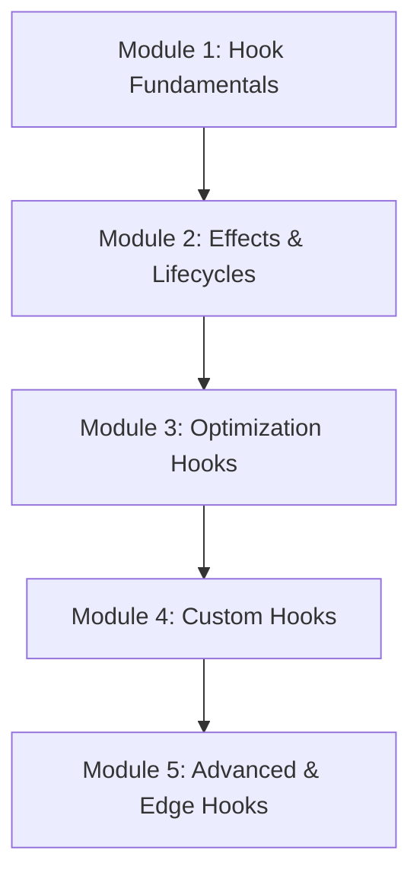

# Phase 4: React Hooks

Welcome to the **React Hooks** phase of the React Engineering Academy. This phase goes deep into the rules, mechanics, and usage of React Hooks, enabling you to manage side effects, optimize performance, and build custom reusable hooks.

## Why this topic exists

Historically, state and lifecycle methods were only available inside Class components. This led to complex codebases with constructor boilerplate, difficult event bindings, and struggles with the `this` context. 

**React Hooks** were introduced to solve this by bringing state, context, lifecycles, refs, and scheduling capabilities directly into functional components. Hooks allow you to split complex component logic into small, isolated, testable functions, enabling a highly modular frontend architecture.

---

## Learning Objectives

By the end of this phase, you will be able to:
- Explain why hooks exist and audit adherence to the Rules of Hooks.
- Master the `useState` queue and the `useEffect` render/cleanup cycle.
- Manage side effects, asynchronous event listeners, and API request cancellations.
- Prevent performance issues and stale closures using `useMemo` and `useCallback`.
- Leverage `useRef` for DOM access and storing mutable variables.
- Design, build, and test modular **Custom Hooks** to share logic.
- Implement advanced scheduling hooks like `useTransition` and `useDeferredValue`.
- Synchronize external data stores using `useSyncExternalStore`.
- Leverage layout adjustments using `useLayoutEffect` and `useImperativeHandle`.

---

## Prerequisites

Before starting this phase, you should have completed:
1. **[Phase 1: React Fundamentals](../phase-1-fundamentals)**
2. **[Phase 2: Components & JSX](../phase-2-components-jsx)**
3. **[Phase 3: State Management](../phase-3-state-management)**

---

## Learning Roadmap & Topics Covered

This phase is broken down into five comprehensive modules:

1. **[Module 1: Hook Fundamentals](hook-fundamentals)**  
   Motivation behind hooks, internal hook tracking using linked lists, and auditing the Rules of Hooks.
2. **[Module 2: Effects & Lifecycles](useeffect-lifecycle)**  
   Side effects, dependency array checking, cleanup callbacks, race conditions, and AbortController.
3. **[Module 3: Optimization Hooks](optimization-hooks)**  
   Caching computations with `useMemo`, preserving function references with `useCallback`, and mutating values without re-rendering using `useRef`.
4. **[Module 4: Custom Hooks](custom-hooks)**  
   Design guidelines, extracting stateful logic, composition patterns, and real-world custom hook recipes.
5. **[Module 5: Advanced & Edge Hooks](advanced-hooks)**  
   Synchronous layout timing with `useLayoutEffect`, parent-exposed refs using `useImperativeHandle`, `useId`, and concurrent hooks (`useTransition`, `useDeferredValue`, `useSyncExternalStore`).

---

## Estimated Learning Time

- **Total Time**: 12 - 15 Hours
- **Module 1**: 2 Hours
- **Module 2**: 3 Hours
- **Module 3**: 3 Hours
- **Module 4**: 3 Hours
- **Module 5**: 3 Hours
- **Exercises & Projects**: 1 Hour

---

## Real-World Applications

- **Modular Logic Sharing**: Writing hooks (like `useAuth` or `useTheme`) that can be dropped into any project to handle complex logic.
- **Concurrent UIs**: Marking slow operations (like search filtering) as transitions to keep the page responsive.
- **Third-Party State Sync**: Connecting React components to external stores (like Redux or Zustand) using `useSyncExternalStore`.

---

## Practice Exercises

- **Rules of Hooks Audit**: Locating and fixing hook violations inside loops and conditions.
- **Race Condition Prevention**: Implementing cleanup functions to handle out-of-order network responses.
- **Referential Equality Optimization**: Fixing re-rendering bugs by memoizing props and event callbacks.

---

## Mini Projects

- **An Advanced Real-Time Dashboard**: An application tracking window dimensions, geolocation coordinates, and keyboard keys, structured entirely as separate, reusable custom hooks.

---

## Related Topics

- [State Management Overview](../phase-3-state-management)
- [Performance Optimization Overview](../phase-6-performance)

---

## Further Reading

- [React.dev: Introducing Hooks](https://react.dev/reference/react/hooks)
- [Kent C. Dodds: React Hooks Deep Dive](https://epicreact.dev/)
