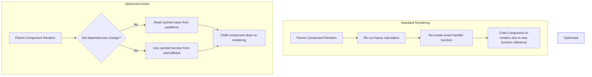
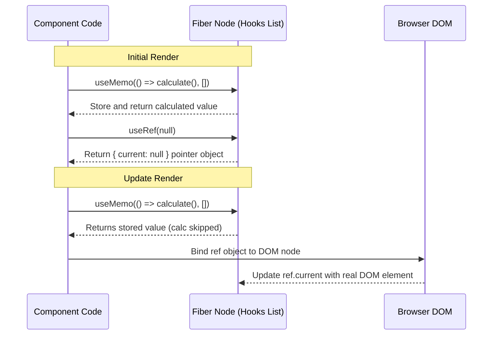
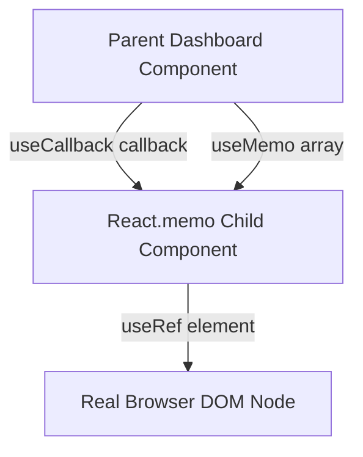
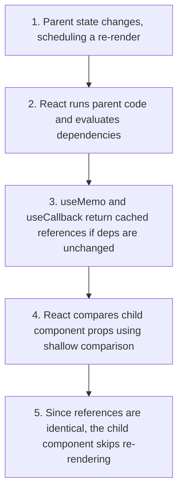

# Optimization Hooks: useMemo, useCallback & useRef

## Introduction

React's render cycle is fast, but on every render, all local calculations are re-computed, and all inline functions are re-created. This can trigger unnecessary layout re-renders in child components and slow down your application. To optimize performance, React provides three key hooks: **useMemo** (to cache expensive computations), **useCallback** (to preserve function references), and **useRef** (to access DOM nodes or store mutable variables without triggering re-renders). This module covers how and when to use these optimization tools.

---

## Why do we need this?

On every render cycle, React re-evaluates all variables and functions defined inside the component. This can lead to performance bottlenecks.

### Problem Statement
Consider an analytics dashboard that filters and sorts an array of 5,000 transaction records.
1. The user logs in and starts typing their profile name in a header input field.
2. Every time the user types a character, the parent component re-renders.
3. Because the parent re-renders, the heavy filter-and-sort operation runs again, freezing the UI for milliseconds.
4. The page lags even though the transactions array has not changed.

We need a way to cache computed values and function references so they are only re-computed when their dependencies actually change.

---

## Real World Story

In early versions of React, developers optimized class components using the `shouldComponentUpdate` lifecycle method or by extending `React.PureComponent`. This compared props and state using shallow comparisons to skip updates.

However, when developers passed inline arrays, objects, or functions (e.g., `<Button onClick={() => this.handleClick()} />`) as props to pure components, the components would still re-render on every cycle. This occurred because inline functions receive new memory references on every render, causing the shallow comparison to check them as changed. To bring referential equality controls and memoization to functional components, React introduced the `useMemo` and `useCallback` hooks, providing a clean way to control when child components update.

---

## Real World Analogy

Think of optimization hooks like a **Chef's Recipe Index Card** and a **Kitchen Storage Box**.

- **Without useMemo (Re-calculating Constantly)**: A customer orders a cake. Instead of using a recipe card, you recalculate the ratio of flour, sugar, and baking powder from scratch using complex mathematical models on every order.
- **useMemo (Recipe Index Card)**: You calculate the ingredient ratios once and write them on a recipe card (useMemo). On subsequent cake orders, you skip the math and read the ratios from the card, recalculating only if the cake size (Dependency) changes.
- **useCallback (Standard Cooking Guide)**: Instead of writing new instructions for the sous-chefs on every order, you print a single, standardized guide (useCallback) and hand it to them. Because the guide reference remains identical, the chefs don't need to relearn the steps on every order.
- **useRef (Kitchen Storage Box)**: A storage box where you keep a permanent pencil. You can write note notes, change the label, or grab the pencil (useRef) without having to repaint the kitchen walls (re-rendering the UI).

---

## Visual Explanation

Below is a diagram showing the comparison of how `useMemo` and `useCallback` prevent unnecessary operations when components update.

### Regular Variable Re-creation
```
[Parent Renders] ──> [Re-run Heavy Calculation] ──> [Re-create function (new reference)]
```

### Memoized Hook Caching
```
[Parent Renders] ──> [Read cached calculation from useMemo] ──> [Use cached function reference]
                       (Dependencies unchanged; execution skipped)
```



---

## Internal Working

React stores optimization hook references inside the Fiber node's linked list.

- **useMemo**: Stores both the computed value and the dependency array. On re-renders, if dependencies are unchanged, it returns the stored value.
- **useCallback**: Stores the function reference itself. It is shorthand for `useMemo(() => fn, deps)`.
- **useRef**: Returns a mutable object with a `.current` property: `{ current: value }`. React maintains this object reference across all renders, ensuring that modifying the `.current` property does not trigger a re-render.



---

## Architecture

Optimization hooks resolve referential equality issues, allowing child elements wrapped in `React.memo` to skip render loops.



---

## Step-by-Step Flow

When a parent component updates and renders an optimized child, the following steps occur:



---

## Syntax

```javascript
// useMemo Syntax
const memoizedValue = useMemo(() => computeExpensiveValue(a, b), [a, b]);

// useCallback Syntax
const memoizedCallback = useCallback(() => {
  doSomething(a);
}, [a]);

// useRef Syntax
const inputRef = useRef(initialValue);
// Access/mutate value using: inputRef.current
```

---

## Basic Example

Here is a basic component that uses `useRef` to focus an input field on mount.

```jsx
import React, { useRef, useEffect } from 'react';

export default function InputAutoFocus() {
  const inputRef = useRef(null);

  useEffect(() => {
    // Access the real DOM node using the ref and focus it
    if (inputRef.current) {
      inputRef.current.focus();
    }
  }, []);

  return (
    <div style={{ padding: '16px' }}>
      <h3>Ref Auto-Focus</h3>
      <input ref={inputRef} type="text" placeholder="Focused on load" />
    </div>
  );
}
```

---

## Intermediate Example

An intermediate component showing how `useMemo` caches filtered lists, preventing the calculation from re-running when the user types in an unrelated input field.

```jsx
import React, { useState, useMemo } from 'react';

const ITEM_LIST = Array.from({ length: 1000 }, (_, i) => `Product-${i + 1}`);

export default function MemoizedSearch() {
  const [searchTerm, setSearchTerm] = useState('');
  const [theme, setTheme] = useState('light');

  //  useMemo: Caches the filtered array list.
  // The filter operation will only run when searchTerm changes, skipping on theme updates.
  const filteredItems = useMemo(() => {
    console.log('Filtering items list (Calculated)...');
    return ITEM_LIST.filter(item => item.toLowerCase().includes(searchTerm.toLowerCase()));
  }, [searchTerm]);

  return (
    <div style={{
      padding: '20px',
      backgroundColor: theme === 'light' ? '#fff' : '#f0f0f0'
    }}>
      <h3>Product Catalog</h3>
      <button onClick={() => setTheme(t => t === 'light' ? 'dark' : 'light')}>
        Toggle Container Style ({theme})
      </button>
      <input
        type="text"
        placeholder="Search items..."
        value={searchTerm}
        onChange={e => setSearchTerm(e.target.value)}
        style={{ display: 'block', margin: '12px 0', padding: '6px' }}
      />
      <p>Results Count: {filteredItems.length}</p>
    </div>
  );
}
```

---

## Advanced Example

An advanced example showing how to combine `useCallback` with `React.memo` to prevent child components from re-rendering unnecessarily.

```jsx
import React, { useState, useCallback } from 'react';

// Optimized Child Component wrapped in React.memo
const ActionButton = React.memo(({ onAction, label }) => {
  console.log(`[RENDER] ActionButton: ${label}`);
  return (
    <button onClick={onAction} style={{ margin: '6px', padding: '8px' }}>
      {label}
    </button>
  );
});

export default function CallbackDemoPanel() {
  const [count, setCount] = useState(0);
  const [text, setText] = useState('');

  //  useCallback: Caches the function reference.
  // The function reference remains identical across renders, preventing ActionButton from re-rendering when text state updates.
  const handleAction = useCallback(() => {
    setCount(c => c + 1);
  }, []); // Empty dependency array ensures reference never changes

  return (
    <div style={{ padding: '20px', border: '1px solid #ccc' }}>
      <h3>Callback Board</h3>
      <p>Click Count: <strong>{count}</strong></p>
      
      {/* Typing here changes parent state and triggers re-renders, but ActionButton will skip updating */}
      <input
        type="text"
        value={text}
        onChange={e => setText(e.target.value)}
        placeholder="Type here to re-render parent..."
        style={{ padding: '6px', marginBottom: '12px', display: 'block' }}
      />

      <ActionButton label="Increment Counter" onAction={handleAction} />
    </div>
  );
}
```

---

## Production Example

A production-grade component demonstrating a grid dashboard that caches complex data mappings using `useMemo`, registers scroll container animations using `useCallback`, and measures layout updates using `useRef`.

```jsx
import React, { useState, useCallback, useMemo, useRef } from 'react';

// Generates a mock dataset
const DATA_STORE = Array.from({ length: 500 }, (_, i) => ({
  id: `i-${i}`,
  category: i % 2 === 0 ? 'finance' : 'ops',
  amount: Math.floor(Math.random() * 1000)
}));

export default function ProductionGridDashboard() {
  const [activeCategory, setActiveCategory] = useState('finance');
  const [sortOrder, setSortOrder] = useState('asc');
  const renderStats = useRef({ renders: 0, lastExecutionTime: 0 });

  renderStats.current.renders += 1;

  //  useMemo: Caches the filtered and sorted metrics array
  const processedMetrics = useMemo(() => {
    const start = performance.now();
    console.log(`[PERFORMANCE] Filtering and sorting ${DATA_STORE.length} items...`);
    
    const filtered = DATA_STORE.filter(item => item.category === activeCategory);
    const sorted = [...filtered].sort((a, b) =>
      sortOrder === 'asc' ? a.amount - b.amount : b.amount - a.amount
    );

    renderStats.current.lastExecutionTime = performance.now() - start;
    return sorted;
  }, [activeCategory, sortOrder]);

  //  useCallback: Caches the click handler callback reference
  const handleCategorySelect = useCallback((cat) => {
    setActiveCategory(cat);
  }, []);

  return (
    <div style={{ padding: '16px', border: '1px solid #bbb', borderRadius: '8px' }}>
      <h3>Performance Metrics Panel</h3>
      <p>Render Cycle: {renderStats.current.renders}</p>
      <p>Last calculations execution speed: {renderStats.current.lastExecutionTime.toFixed(4)}ms</p>
      
      <div style={{ marginBottom: '12px', display: 'flex', gap: '8px' }}>
        <button onClick={() => handleCategorySelect('finance')} disabled={activeCategory === 'finance'}>
          Finance
        </button>
        <button onClick={() => handleCategorySelect('ops')} disabled={activeCategory === 'ops'}>
          Operations
        </button>
        <button onClick={() => setSortOrder(o => o === 'asc' ? 'desc' : 'asc')}>
          Toggle Sort ({sortOrder.toUpperCase()})
        </button>
      </div>

      <div style={{ maxHeight: '200px', overflowY: 'auto', border: '1px solid #eee' }}>
        {processedMetrics.map(item => (
          <div key={item.id} style={{ padding: '4px', borderBottom: '1px solid #f9f9f9' }}>
            Item ID: {item.id} - Amount: ${item.amount}
          </div>
        ))}
      </div>
    </div>
  );
}
```

---

## Folder Structure

```
optimization-hooks/
├── src/
│   ├── components/
│   │   ├── CallbackDemoPanel.jsx
│   │   └── ProductionGridDashboard.jsx
│   ├── App.jsx
│   └── main.jsx
├── package.json
└── vite.config.js
```

---

## Best Practices

💡 **Did You Know?**  
`useCallback(fn, deps)` is identical to writing `useMemo(() => fn, deps)`. React provides `useCallback` to simplify the syntax when caching function references instead of return values.

🚀 **Best Practices**
- Avoid premature optimization. Do not wrap every variable in `useMemo` or every function in `useCallback`. Shallow checks have a small performance cost, and using them unnecessarily can slow down your app.
- Use `useMemo` only when performing heavy calculations (like filtering large arrays, mapping complex datasets, or run cryptographic processes).
- Use `useCallback` when passing functions as props to child components wrapped in `React.memo` to prevent child re-renders.

---

## Common Mistakes

⚠ **Common Mistakes**

### Empty Dependency Arrays with Outer Variables
Omitting variables read inside the hook from the dependency array will cause the hook callback to reference stale variables from previous renders (stale closures).

```jsx
// ❌ WRONG
const [count, setCount] = useState(0);
const logCount = useCallback(() => {
  console.log("Count value:", count); // count remains 0 because dependencies array is empty
}, []); // count omitted from dependencies list

//  RIGHT
const [count, setCount] = useState(0);
const logCount = useCallback(() => {
  console.log("Count value:", count);
}, [count]); // count added to dependencies list
```

### Mutating Ref values to Trigger Renders
Modifying the `.current` property of a Ref does not trigger a re-render. Do not use Refs to store variables that need to update the UI on change.

```jsx
// ❌ WRONG
const countRef = useRef(0);
const increment = () => {
  countRef.current += 1; // Mutates ref value, but does not trigger re-render
};
return <button onClick={increment}>Likes: {countRef.current}</button>;
```

---

## Performance Notes

⚡ **Performance Tips**
React reconciles elements in two main phases:
1. **Render Phase**: Compares virtual elements. This is fast and runs in memory.
2. **Commit Phase**: Writes updates to the DOM. This is slower because it triggers layout calculations.

### Performance Example
Using `useMemo` to skip re-rendering child elements:

```jsx
import React, { useMemo } from 'react';

export function Dashboard({ data }) {
  // Caches the JSX element reference, preventing child re-renders unless data changes
  const memoizedChild = useMemo(() => {
    return <HeavyChild data={data} />;
  }, [data]);

  return <div>{memoizedChild}</div>;
}
```

---

## Accessibility Notes

♿ **Accessibility Tips**
Use `useRef` to manage focus transitions. For example, when a modal dialog opens, use a Ref to move focus to the close button inside the modal, ensuring keyboard users can navigate the modal immediately.

```jsx
// Accessibility Example
export function ModalCloseButton({ onClose }) {
  const btnRef = useRef(null);

  useEffect(() => {
    if (btnRef.current) btnRef.current.focus();
  }, []);

  return <button ref={btnRef} onClick={onClose}>Close Dialog</button>;
}
```

---

## SEO Notes

Performance optimizations improve PageSpeed scores, which is an important ranking factor for SEO. Using `useMemo` to prevent layout lag on long lists improves the user experience and page index performance.

---

## Interview Questions

🎯 **Interview Tips**  
In an interview, explain that `useMemo` caches computed values, `useCallback` caches function references, and `useRef` accesses DOM elements or stores mutable variables without triggering re-renders.

### Q1: What is the difference between `useMemo` and `useCallback`?
**Answer**: `useMemo` executes the function passed to it and caches the **result** (which can be an array, object, or value), recalculating it only when dependencies change. `useCallback` caches the **function reference itself**, preventing the function from being recreated on every render cycle.

### Q2: Why does modifying a Ref's `.current` property fail to trigger a component re-render?
**Answer**: A Ref object is a plain JavaScript reference pointing to the same object across all renders: `{ current: value }`. Modifying the `.current` property is a mutation, and React's reconciler engine only detects updates and schedules re-renders when a component's state or props change.

---

## MCQs

1. **Which hook is used to cache the computed results of expensive computations?**
   - A) `useCallback`
   - B) `useRef`
   - C) `useMemo`
   - D) `useReducer`
   - *Answer: C*

2. **What does the `useCallback` hook return?**
   - A) The computed result value of the function.
   - B) The cached function reference itself.
   - C) A boolean indicating if dependencies changed.
   - D) A DOM element pointer.
   - *Answer: B*

3. **What is the default value of a Ref object's '.current' property?**
   - A) `undefined`
   - B) `null`
   - C) The initial value passed to the hook.
   - D) The component Fiber node.
   - *Answer: C*

4. **Which optimization occurs when wrapping a component in `React.memo`?**
   - A) The component is compiled into web assemblies.
   - B) The component skips re-rendering if its props are unchanged.
   - C) CSS rules are cached in the browser.
   - D) Local storage reads are automated.
   - *Answer: B*

5. **Why should you avoid using `useMemo` for simple, lightweight calculations?**
   - A) It throws runtime warnings.
   - B) Shallow checks and memory allocations have a small overhead that can outweigh the benefit for simple calculations.
   - C) It resets component state.
   - D) It locks variables in memory forever.
   - *Answer: B*

---

## Practice Exercise

### Exercise 1: useMemo list conversion
Complete the component below to cache the double value calculations using `useMemo`:
```jsx
function DoubleList({ numbers }) {
  // TODO: Cache doubled values calculation
  const doubled = numbers.map(n => n * 2);
  return <div>{doubled.join(', ')}</div>;
}
```

### Exercise 2: Play/Pause Video player ref
Write a component with a `<video>` tag. Use `useRef` to target the video element and add buttons to play and pause the video.

### Exercise 3: useCallback event handler
Create a component that passes a toggle theme callback to an optimized child button. Use `useCallback` to prevent the child button from re-rendering when other states change.

---

## Debugging Exercise

### The Infinitely Re-running Effect Bug
The component below fetches user details, but is stuck in an infinite render loop. Identify the bug and write the fix.

```jsx
import React, { useState, useEffect } from 'react';

export default function UserProfiler() {
  const [user, setUser] = useState(null);

  // BUG: options object is recreated on every render cycle, triggering the effect infinitely
  const options = { headers: { Authorization: 'Bearer token123' } };

  useEffect(() => {
    fetch('/api/user/active', options)
      .then(res => res.json())
      .then(setUser);
  }, [options]); // Triggered on every render

  return <div>Welcome, {user?.name}</div>;
}
```

#### Solution
The `options` object is defined in the component body and is recreated on every render. Because the reference is different on every render, the effect's dependency comparison checks it as changed, triggering the effect and updating state in an infinite loop. To fix this, wrap the `options` object in `useMemo` or move it outside the component body:

```jsx
// Corrected
const OPTIONS_STATIC = { headers: { Authorization: 'Bearer token123' } }; // Move outside component

export default function UserProfiler() {
  const [user, setUser] = useState(null);

  useEffect(() => {
    fetch('/api/user/active', OPTIONS_STATIC)
      .then(res => res.json())
      .then(setUser);
  }, []); // Run only once on mount

  return <div>Welcome, {user?.name}</div>;
}
```

---

## Real-world Scenario

You are building a real-time analytics chart that updates every 2 seconds. The chart has a drag-and-drop selector overlay. When dragging the selector overlay, the chart lags. Explain how you would address this.
- **Resolution Strategy**: Wrap the chart container in `React.memo` to skip re-renders. Cache the dataset mappings using `useMemo`, and wrap the drag-and-drop event handlers in `useCallback` to prevent overlay updates from triggering re-renders in the chart.

---

## Interview Coding Question

### Problem Statement
Write a custom hook called `usePrevious` that stores and returns the value of a prop or state variable from the previous render cycle, using `useRef`.

```jsx
import { useEffect, useRef } from 'react';

export function usePrevious(value) {
  // Store the previous value in a Ref
  const ref = useRef();

  useEffect(() => {
    // Update ref with the current value after the render cycle completes
    ref.current = value;
  }, [value]);

  // Return the ref value, which represents the value from the previous render
  return ref.current;
}
```

---

## Mini Project

### Performance Profiling Studio
Create an optimization profiling playground:
- Render a list of 2,000 random items.
- Provide inputs to: Filter items, change themes, and toggle search modes.
- Implement an on-screen logger using `useRef` that tracks and displays render counts and calculation execution speeds.
- Provide toggle switches to enable/disable `useMemo` and `useCallback` optimizations, showing the visual performance differences in real-time.

---

## Summary

🧠 **Memory Tricks**  
`useMemo = Math, useCallback = Function, useRef = Storage`  
- Use `useMemo` to cache a **computed value** (result of a calculation).
- Use `useCallback` to cache a **function reference**.
- Use `useRef` to store **mutable values** or DOM nodes without triggering re-renders.

📖 **Summary**  
Optimization hooks prevent unnecessary operations inside functional components. `useMemo` caches computed values, `useCallback` preserves function references to prevent child re-renders, and `useRef` stores mutable references and DOM nodes without triggering re-renders.

---

## Cheat Sheet

```javascript
// Caching calculation results
const filtered = useMemo(() => items.filter(fn), [items]);

// Caching function references
const callback = useCallback(() => handler(id), [id]);
```

---

## Related Topics
- [React Hook Fundamentals](hook-fundamentals)
- [useEffect & Lifecycle Synchronization](useeffect-lifecycle)

---

## Further Reading
- [React Docs: useMemo Hook Reference](https://react.dev/reference/react/useMemo)
- [React Docs: useCallback Hook Reference](https://react.dev/reference/react/useCallback)
