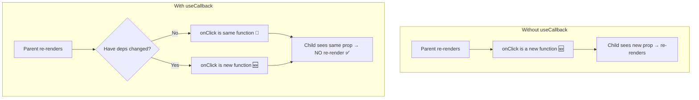
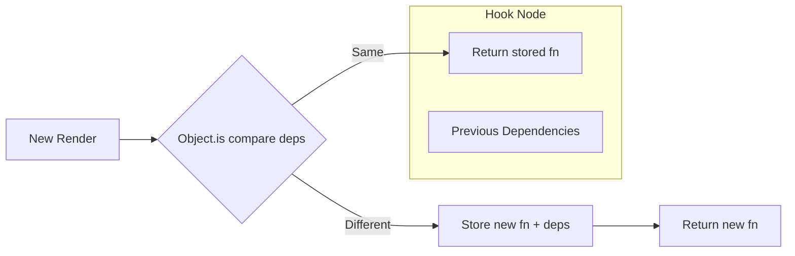

# useCallback — The Function Memoization Hook

## Introduction

`useCallback` memoizes a function so that it maintains the same reference across renders unless its dependencies change. This prevents child components wrapped in `React.memo` from re-rendering unnecessarily when the parent re-renders but the function hasn't changed.

---

## Why do we need this?

In JavaScript, functions are objects — every time a component renders, any functions defined inside it are recreated as new object references. If these functions are passed as props to child components, those children see a "new" function on every render and re-render accordingly, even if the logic hasn't changed.

### Problem Statement

You have a parent component with a button that toggles dark mode, and a child component that performs an expensive rendering operation. The child accepts an `onClick` handler. Without `useCallback`, every toggle of dark mode recreates the `onClick` function, causing the expensive child to re-render for no reason.

---

## Real World Story

Before hooks, developers used class methods that maintained stable references naturally (methods were bound once in the constructor). When functional components arrived, developers discovered that inline arrow functions created new references on every render. This caused unexpected re-renders in `PureComponent` and `React.memo`-wrapped children. `useCallback` was introduced to solve this specific problem.

---

## Real World Analogy

Think of `useCallback` like a **Business Card vs. A Sticky Note**.

- **Without useCallback (Sticky Note)**: Every time you meet someone, you scribble your number on a new sticky note and hand it to them. They think it's a new contact every time.
- **With useCallback (Business Card)**: You have a laminated business card. Every time you meet someone, you hand them the same card. They recognize it and say, "Oh, I already have this one."

---

## Visual Explanation



---

## Internal Working

`useCallback` internally wraps the function in a `useMemo`-like structure. It stores the function in the Fiber's hook linked list and compares dependencies using `Object.is`. When dependencies don't change, it returns the previously stored function reference.

```javascript
// Simplified internal implementation
function useCallback(fn, deps) {
  return useMemo(() => fn, deps);
}
```



---

## Syntax

```javascript
const memoizedCallback = useCallback(() => {
  // Function logic
  doSomething(a, b);
}, [a, b]); // Dependencies
```

| Part | Description |
|------|-------------|
| `useCallback(fn, deps)` | Creates a memoized version of `fn` |
| `fn` | The function to memoize |
| `deps` | Dependencies — the function is recreated when these change |

---

## Basic Example

Preventing unnecessary child re-renders:

```jsx
import { useState, useCallback, memo } from 'react';

// Memoized child: only re-renders when props change
const ExpensiveButton = memo(function ExpensiveButton({ onClick, label }) {
  console.log(`Button "${label}" re-rendered`);
  return (
    <button
      onClick={onClick}
      style={{ padding: '8px 16px', margin: '4px' }}
    >
      {label}
    </button>
  );
});

export default function Toolbar() {
  const [count, setCount] = useState(0);

  // useCallback: save function reference across renders
  const handleSave = useCallback(() => {
    console.log('Save clicked');
  }, []); // Empty deps = stable forever

  const handleDelete = useCallback(() => {
    console.log('Delete clicked');
  }, []);

  return (
    <div style={{ padding: '20px' }}>
      <h3>Toolbar Demo</h3>
      <p>Count: {count}</p>
      <button onClick={() => setCount(c => c + 1)}>Re-render Parent</button>
      <div style={{ marginTop: '12px' }}>
        <ExpensiveButton onClick={handleSave} label="Save" />
        <ExpensiveButton onClick={handleDelete} label="Delete" />
      </div>
    </div>
  );
}
```

**Explanation:**
- `ExpensiveButton` is wrapped in `React.memo` — it only re-renders when its `onClick` or `label` props change.
- Without `useCallback`, clicking "Re-render Parent" would recreate `handleSave` and `handleDelete` as new functions, causing both buttons to re-render.
- With `useCallback`, the functions maintain stable references, so the buttons don't re-render.

---

## Intermediate Example

Callbacks with state dependencies:

```jsx
import { useState, useCallback } from 'react';

export default function TodoList() {
  const [todos, setTodos] = useState(['Learn React', 'Build a project']);
  const [input, setInput] = useState('');

  // useCallback with dependency: function is recreated only when todos changes
  const addTodo = useCallback(() => {
    if (!input.trim()) return;
    setTodos(prev => [...prev, input.trim()]);
    setInput('');
  }, [input]); // Depends on input value

  // Stable callback: no dependencies needed
  const clearTodos = useCallback(() => {
    setTodos([]);
  }, []); // Empty deps = stable, uses functional update

  return (
    <div style={{ padding: '20px', maxWidth: '400px' }}>
      <h3>Todo List</h3>
      <input
        value={input}
        onChange={(e) => setInput(e.target.value)}
        placeholder="Add a todo..."
        style={{ padding: '8px', width: '200px' }}
      />
      <button onClick={addTodo} style={{ marginLeft: '8px' }}>Add</button>
      <button onClick={clearTodos} style={{ marginLeft: '8px' }}>Clear All</button>
      <ul>
        {todos.map((todo, i) => (
          <li key={i}>{todo}</li>
        ))}
      </ul>
    </div>
  );
}
```

**Explanation:**
- `addTodo` depends on `input` — it's recreated only when the input text changes.
- `clearTodos` has no dependencies — it's stable across all renders. It uses a functional update (`prev => []`) to avoid stale closure issues.
- This pattern is essential when passing callbacks to `React.memo` children that are expensive to render.

---

## Advanced Example

Custom hook with memoized callbacks:

```jsx
import { useState, useCallback } from 'react';

// Custom hook with memoized API
function useCounter(initialValue = 0) {
  const [count, setCount] = useState(initialValue);

  const increment = useCallback(() => {
    setCount(prev => prev + 1);
  }, []);

  const decrement = useCallback(() => {
    setCount(prev => prev - 1);
  }, []);

  const reset = useCallback(() => {
    setCount(initialValue);
  }, [initialValue]);

  return { count, increment, decrement, reset };
}

export default function CounterPanel() {
  const { count, increment, decrement, reset } = useCounter(10);

  return (
    <div style={{ padding: '20px', textAlign: 'center' }}>
      <h3>Counter: {count}</h3>
      <button onClick={decrement}>-</button>
      <span style={{ margin: '0 16px', fontSize: '24px' }}>{count}</span>
      <button onClick={increment}>+</button>
      <div style={{ marginTop: '12px' }}>
        <button onClick={reset}>Reset</button>
      </div>
    </div>
  );
}
```

**Explanation:**
- `increment` and `decrement` have no dependencies — they use functional updates, so they're created once and never change.
- `reset` depends on `initialValue` — it's recreated only if the initial value changes.
- This custom hook's return values are stable, making them safe to pass to `React.memo` children or include in effect dependency arrays.

---

## Production Example

A subscription manager with stable callbacks:

```jsx
import { useState, useCallback, useEffect } from 'react';

function useWebSocket(url) {
  const [messages, setMessages] = useState([]);
  const [isConnected, setIsConnected] = useState(false);

  // Stable callbacks for event handlers
  const sendMessage = useCallback((msg) => {
    if (ws.current?.readyState === WebSocket.OPEN) {
      ws.current.send(JSON.stringify(msg));
    }
  }, []);

  const disconnect = useCallback(() => {
    ws.current?.close();
  }, []);

  const reconnect = useCallback(() => {
    ws.current?.close();
    // Reconnection logic would go here
  }, []);

  // WebSocket setup with stable callbacks
  useEffect(() => {
    const ws = new WebSocket(url);

    ws.onopen = () => setIsConnected(true);
    ws.onclose = () => setIsConnected(false);
    ws.onmessage = (event) => {
      setMessages(prev => [...prev, JSON.parse(event.data)]);
    };

    return () => ws.close();
  }, [url]); // Only reconnect if URL changes

  return { messages, isConnected, sendMessage, disconnect, reconnect };
}

export default function ChatWidget() {
  const { messages, isConnected, sendMessage } = useWebSocket('wss://example.com/chat');
  const [input, setInput] = useState('');

  const handleSend = useCallback(() => {
    if (input.trim()) {
      sendMessage({ text: input.trim() });
      setInput('');
    }
  }, [input, sendMessage]);

  return (
    <div style={{ padding: '20px', maxWidth: '400px' }}>
      <h3>Live Chat</h3>
      <p>Status: {isConnected ? '🟢 Connected' : '🔴 Disconnected'}</p>
      <div style={{ height: '200px', overflow: 'auto', border: '1px solid #ccc', padding: '8px', marginBottom: '8px' }}>
        {messages.map((msg, i) => (
          <p key={i}>{msg.text}</p>
        ))}
      </div>
      <input
        value={input}
        onChange={(e) => setInput(e.target.value)}
        placeholder="Type a message..."
        style={{ padding: '8px', width: 'calc(100% - 90px)' }}
      />
      <button onClick={handleSend} style={{ padding: '8px 16px' }}>Send</button>
    </div>
  );
}
```

**Explanation:**
- `sendMessage`, `disconnect`, and `reconnect` are stable across renders (empty deps).
- `handleSend` depends on `input` (for the current text) and `sendMessage` (the stable function).
- This pattern is critical in production for WebSocket connections, event emitters, and subscription-based APIs where callback references must be stable to avoid infinite reconnection loops.

---

## Folder Structure

```
src/
├── hooks/
│   ├── useCounter.js
│   └── useWebSocket.js
├── components/
│   ├── Toolbar.jsx
│   ├── TodoList.jsx
│   └── ChatWidget.jsx
├── App.jsx
└── main.jsx
```

---

## Best Practices

💡 **Did You Know?**  
`useCallback` and `useMemo` are related: `useCallback(fn, deps)` is equivalent to `useMemo(() => fn, deps)`.

🚀 **Best Practices**
- Always pair `useCallback` with `React.memo` for the child component.
- Use functional updates (`setCount(prev => prev + 1)`) to minimize dependencies.
- Don't wrap every function in `useCallback` — the overhead can exceed the benefit for simple components.
- Include all values from the closure in the dependency array (use the ESLint plugin).

---

## Common Mistakes

⚠ **Common Mistakes**

### Overusing useCallback
```jsx
// ❌ WRONG — useCallback on a simple onClick with no memoized child
<button onClick={useCallback(() => handleClick(id), [id])}>Click</button>

// ✅ RIGHT — useCallback is unnecessary here unless button is memoized
<button onClick={() => handleClick(id)}>Click</button>
```

### Missing Dependencies
```jsx
// ❌ WRONG — id is used inside but missing from deps
const handleClick = useCallback(() => {
  fetch(`/api/items/${id}`); // Bug: stale id
}, []);

// ✅ RIGHT
const handleClick = useCallback(() => {
  fetch(`/api/items/${id}`);
}, [id]);
```

---

## Performance Notes

⚡ **Performance Tips**
- `useCallback` adds ~0 cost when the function is not recreated (amortized).
- The main benefit is preventing child re-renders, which saves the cost of diffing and creating new VDOM nodes.
- Profile first with React DevTools to identify re-render bottlenecks before adding `useCallback`.

---

## Accessibility Notes

♿ **Accessibility Tips**
- Stable callback references don't affect accessibility directly, but smoother rendering means focus management is more predictable.

---

## SEO Notes

`useCallback` is a client-side optimization and doesn't affect SEO.

---

## Interview Questions

🎯 **Interview Tips**  
Interviewers often ask about the difference between `useMemo` and `useCallback`, and when to use each.

### Q1: What is the difference between useCallback and useMemo?
**Answer**: `useCallback` memoizes a **function**. `useMemo` memoizes a **value** (the result of calling a function). `useCallback(fn, deps)` is equivalent to `useMemo(() => fn, deps)`.

### Q2: When would useCallback be unnecessary?
**Answer**: `useCallback` is unnecessary when: (1) the child component is not wrapped in `React.memo`, (2) the child is a cheap-to-render native DOM element like `<button>`, or (3) the function is called synchronously inside the parent (not passed as a prop).

---

## MCQs

1. **What does useCallback return?**
   - A) A memoized value
   - B) A memoized function
   - C) A ref object
   - D) A state variable
   - *Answer: B*

2. **When does useCallback recreate the function?**
   - A) On every render
   - B) Only when its dependencies change
   - C) Only on the first render
   - D) When the component unmounts
   - *Answer: B*

3. **Which hook is useCallback equivalent to?**
   - A) `useMemo(() => fn, deps)`
   - B) `useRef(fn)`
   - C) `useState(() => fn)`
   - D) `useEffect(() => fn, deps)`
   - *Answer: A*

4. **What must the child component use to benefit from useCallback?**
   - A) `React.memo` or `PureComponent`
   - B) `useState`
   - C) `useRef`
   - D) `forwardRef`
   - *Answer: A*

5. **How does useCallback compare dependencies?**
   - A) Deep equality
   - B) JSON serialization
   - C) `Object.is`
   - D) Strict equality `===`
   - *Answer: C*

---

## Practice Exercise

### Exercise 1: Memoized Search Handler
Create a search component where the search handler is memoized with useCallback. Pass it to a memoized `SearchResults` component.

### Exercise 2: Event Logger
Create a custom hook `useEventLog` that returns memoized `log`, `clear`, and `getLogs` functions.

### Exercise 3: API Client Hook
Build a `useApiClient` custom hook that returns memoized `get`, `post`, `put`, and `delete` functions with stable references.

---

## Debugging Exercise

### The Stale Closure
Why does the following component always show the initial `count` value in the alert?

```jsx
import { useState, useCallback } from 'react';

export default function StaleClosure() {
  const [count, setCount] = useState(0);

  const showCount = useCallback(() => {
    alert(count); // Always shows 0?
  }, []); // Bug: count is missing from deps

  return (
    <div>
      <p>Count: {count}</p>
      <button onClick={() => setCount(c => c + 1)}>Increment</button>
      <button onClick={showCount}>Show Count</button>
    </div>
  );
}
```

**Solution**: The `showCount` callback captures `count` from the first render only (when it was 0). Since `count` is not in the dependency array, the callback is never updated. Add `count` to the deps:
```jsx
const showCount = useCallback(() => {
  alert(count);
}, [count]);
```

---

## Real-world Scenario

You're building a form library where each field component receives an `onChange` handler. There are 50+ fields on the page, and typing in one field causes all fields to re-render. How do you fix this?

**Design Strategy**: Wrap each field component in `React.memo`. Memoize the `onChange` handler for each field using `useCallback`, with the field name as a dependency. For validation, use `useMemo` to compute errors only when field values change.

---

## Interview Coding Question

### Problem Statement
Write a custom hook called `useToggle` that returns a boolean state and two memoized functions: `toggle` and `setToggle`. `toggle` should flip the value, and `setToggle` should set it to a specific value.

```jsx
import { useState, useCallback } from 'react';

function useToggle(initialValue = false) {
  const [value, setValue] = useState(initialValue);

  const toggle = useCallback(() => {
    setValue(prev => !prev);
  }, []);

  const setToggle = useCallback((newValue) => {
    setValue(newValue);
  }, []);

  return [value, toggle, setToggle];
}
```

---

## Mini Project

### Performance Dashboard
Build a dashboard with:
- A parent component that re-renders every second (simulated live data).
- 10 child "widget" components (chart, table, stats card, etc.) wrapped in `React.memo`.
- Each widget receives memoized click handlers via `useCallback`.
- Show a counter of how many times each widget re-renders.

---

## Summary

🧠 **Memory Tricks**  
`useCallback = "Laminated Card"` — The same business card handed out every time, not a new sticky note each meeting.

📖 **Summary**
- `useCallback` memoizes functions so they maintain stable references.
- Use it with `React.memo` children to prevent unnecessary re-renders.
- Pair with functional updates to minimize dependencies.
- Don't overuse — only optimize when you've measured a performance problem.

---

## Cheat Sheet

```javascript
// Stable function (no deps)
const handleClick = useCallback(() => {
  doSomething();
}, []);

// Function with dependencies
const handleSubmit = useCallback((data) => {
  submitForm(data, userId);
}, [userId]);

// Custom hook with memoized functions
function useMyHook() {
  const action = useCallback(() => {
    // logic
  }, [dep]);
  return action;
}
```

---

## Related Topics
- [useMemo for Expensive Computations](use-memo)
- [useRef for Persistent Values](use-ref)
- [React.memo for Component Memoization](../phase-6-performance/rendering-optimization)

---

## Further Reading
- [React Docs: useCallback](https://react.dev/reference/react/useCallback)
- [Kent C. Dodds: When to useMemo and useCallback](https://kentcdodds.com/blog/usememo-and-usecallback)
- [React Docs: React.memo](https://react.dev/reference/react/memo)
