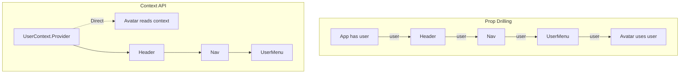
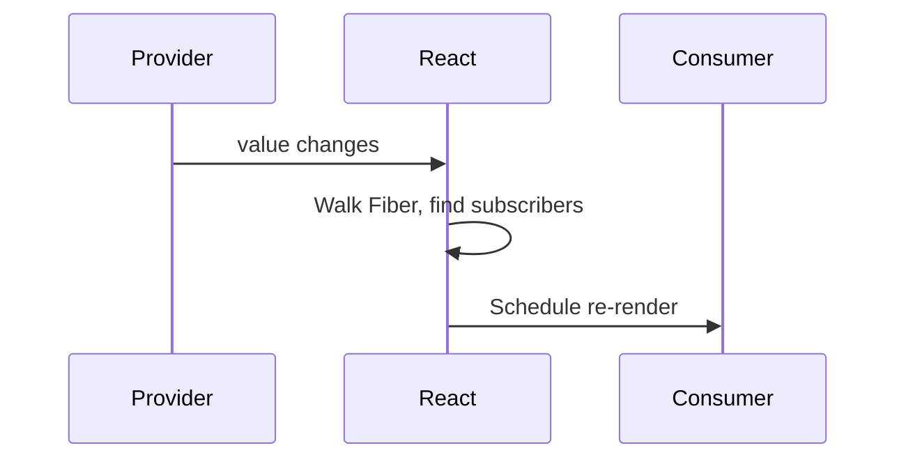

# useContext — The Context Consumer Hook

## Introduction

`useContext` lets you read and subscribe to a React Context from any component. It eliminates prop drilling by allowing deeply nested components to access shared data (themes, auth, locale) directly.

## Why do we need this?

Without Context, data flows top-down through props. A component at depth 5 needs data from the root — every intermediate component must forward that prop.

### Problem Statement

A navbar at depth 4 needs the user's avatar. Without Context, you pass `user` through App → Header → Nav → UserMenu → Avatar. Every intermediary couples to data it doesn't use.

## Real World Story

Before React 16.3, the legacy context API was unstable. Libraries like Redux filled the gap. React 16.3 shipped `createContext`, Provider, and Consumer. The `useContext` hook in 16.8 made it seamless.

## Real World Analogy

**Radio Broadcast** vs **Phone Calls**. Phone calls: call each person individually. Radio: broadcast once, anyone tuned in hears it.

## Visual Explanation



## Internal Working

React walks up the Fiber tree to find the nearest Provider. On value change, subscribers re-render.



## Architecture

```mermaid
flowchart TD
    Create[createContext(default)] --> P[.Provider]
    Create --> H[useContext]
    P --> Wrap[Wrap tree]
    H --> Read[Read value]
    H --> Sub[Auto-subscribe]
```

## Syntax

```javascript
const MyContext = createContext(defaultValue);
<MyContext.Provider value={data}>...</MyContext.Provider>
const data = useContext(MyContext);
```

## Basic Example

```jsx
import { createContext, useContext, useState } from 'react';

const ThemeContext = createContext('light');

function ThemedButton() {
  const theme = useContext(ThemeContext);
  return <button style={{ background: theme === 'dark' ? '#333' : '#eee' }}>{theme}</button>;
}

export default function App() {
  const [theme, setTheme] = useState('light');
  return (
    <ThemeContext.Provider value={theme}>
      <ThemedButton />
      <button onClick={() => setTheme(t => t === 'light' ? 'dark' : 'light')}>Toggle</button>
    </ThemeContext.Provider>
  );
}
```

## Intermediate Example

Auth context with custom hook:

```jsx
import { createContext, useContext, useState, useCallback } from 'react';

const AuthContext = createContext(null);

export function AuthProvider({ children }) {
  const [user, setUser] = useState(null);
  const login = useCallback((email) => setUser({ email }), []);
  const logout = useCallback(() => setUser(null), []);
  return <AuthContext.Provider value={{ user, login, logout }}>{children}</AuthContext.Provider>;
}

export function useAuth() {
  const ctx = useContext(AuthContext);
  if (!ctx) throw new Error('useAuth must be inside AuthProvider');
  return ctx;
}
```

## Advanced Example

Performance: split state and dispatch into separate contexts:

```jsx
const StateCtx = createContext(null);
const DispatchCtx = createContext(null);

function CounterProvider({ children }) {
  const [state, dispatch] = useReducer((s, a) => {
    switch (a.type) {
      case 'inc': return { count: s.count + 1 };
      default: return s;
    }
  }, { count: 0 });
  return (
    <StateCtx.Provider value={state}>
      <DispatchCtx.Provider value={dispatch}>{children}</DispatchCtx.Provider>
    </StateCtx.Provider>
  );
}

function Display() { const { count } = useContext(StateCtx); return <p>{count}</p>; }
function Buttons() { const dispatch = useContext(DispatchCtx); return <button onClick={() => dispatch({ type: 'inc' })}>+</button>; }
```

## Production Example

Multi-context AppProvider:

```jsx
function AppProvider({ children }) {
  return (
    <ThemeProvider>
      <AuthProvider>
        <NotificationProvider>
          {children}
        </NotificationProvider>
      </AuthProvider>
    </ThemeProvider>
  );
}
```

## Folder Structure

```
src/
├── context/AuthContext.jsx, ThemeContext.jsx
├── hooks/useAuth.js, useTheme.js
├── providers/AppProvider.jsx
└── components/Dashboard.jsx
```

## Best Practices

💡 Context is dependency injection, not state management.

🚀 Split contexts. Create custom hooks with safety checks. Use `useMemo` on values.

## Common Mistakes

⚠ Single context with everything → full-tree re-renders.
⚠ Missing safety check → cryptic errors.

## Performance Notes

⚡ All `useContext` consumers re-render on value change. Split state/dispatch. Use `useMemo`.

## Accessibility Notes

♿ Share accessibility preferences (font size, reduced motion) via context.

## Interview Questions

🎯 **Q1: Redux replacement?** Context + useReducer can replace Redux for medium apps. Redux offers middleware, devtools.

**Q2: Prevent re-renders?** Split state/dispatch contexts. Use `useMemo`.

## MCQs

1. **What does useContext return?** A) Setter  B) Current value  C) Ref  D) New context → *B*
2. **What problem does it solve?** A) Expensive compute  B) Prop drilling  C) Events  D) DOM → *B*
3. **On value change?** A) Full app re-renders  B) Subscribers only  C) Nothing → *B*
4. **Default if no Provider?** A) undefined  B) createContext default  C) null  D) Error → *B*
5. **Split contexts?** A) Required  B) Prevent dispatch-only re-renders  C) Bundle size → *B*

## Practice Exercise

E1: Locale context (en/es). E2: Permission context with `can()`. E3: Toast notification context.

## Debugging Exercise

Component outside Provider → crashes. Fix: wrap in Provider.

## Real-world Scenario

SaaS multi-tenant config + feature flags across 100s of components.

## Interview Coding Question

Theme provider with 3 modes (light/dark/high-contrast) + custom hook.

## Mini Project

Settings Dashboard: UserContext, ThemeContext, NotificationContext, composed provider.

## Summary

🧠 `useContext = Radio Broadcast` — one transmitter, any receiver.

📖 Consumes context directly. Pair with custom hook. Split contexts for perf.

## Cheat Sheet

```javascript
const Ctx = createContext(default);
<Ctx.Provider value={data}>{children}</Ctx.Provider>
const data = useContext(Ctx);
function useCtx() { const c = useContext(Ctx); if (!c) throw Error(); return c; }
```

## Related Topics

[useReducer](use-reducer) | [Hook Fundamentals](../phase-4-hooks/hook-fundamentals)

## Further Reading

[React Docs: useContext](https://react.dev/reference/react/useContext) | [Passing Data Deeply](https://react.dev/learn/passing-data-deeply-with-context)
