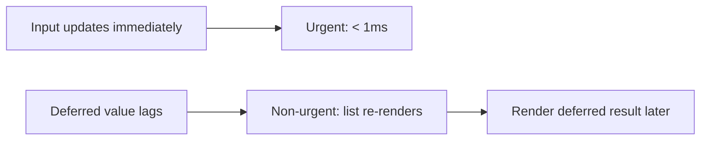

# useDeferredValue — The Deferred Value Hook

## Introduction

`useDeferredValue` lets you defer updating a part of the UI. It tells React: "This value can update later, after more urgent updates finish." It prevents jank in search results, lists, and expensive renders.

## Why do we need this?

When the user types in a search field, they expect the input to update immediately. But filtering a large list is slow. `useDeferredValue` lets the input update instantly while the results lag slightly.

### Problem Statement

A search input filters 10,000 items. Every keystroke causes a filter + re-render that blocks the UI for 100ms. `useDeferredValue` keeps the input responsive while deferring the filter to a lower-priority update.

## Visual Explanation



## Basic Example

```jsx
import { useState, useDeferredValue, useMemo } from 'react';

const LIST = Array.from({ length: 10000 }, (_, i) => `Item ${i + 1}`);

export default function Search() {
  const [query, setQuery] = useState('');
  const deferredQuery = useDeferredValue(query);

  const results = useMemo(() => {
    return LIST.filter(item => item.toLowerCase().includes(deferredQuery.toLowerCase()));
  }, [deferredQuery]);

  const isStale = query !== deferredQuery;

  return (
    <div>
      <input value={query} onChange={e => setQuery(e.target.value)} placeholder="Search..." />
      <p style={{ opacity: isStale ? 0.5 : 1 }}>
        {isStale ? 'Updating...' : `${results.length} results`}
      </p>
      <ul>{results.slice(0, 50).map(r => <li key={r}>{r}</li>)}</ul>
    </div>
  );
}
```

## Best Practices

💡 Use with `useMemo` to prevent the deferred value from re-running expensive computations.

🚀 Combine with `Suspense` for seamless deferred loading. Show stale indicator with opacity.

## MCQ

1. **What does useDeferredValue do?** A) Delays state update  B) Updates a value with lower priority  C) Caches values  D) Skips renders → *B*
2. **Difference from useTransition?** A) useDeferredValue wraps value, useTransition wraps setState  B) Same thing  C) Opposite → *A*

## Summary

📖 Defer non-urgent updates. Keep UI responsive. Use with useMemo for list filtering.

## Related Topics

[useTransition](use-transition) | [Performance Optimization](../phase-6-performance/rendering-optimization)

## Further Reading

[React Docs: useDeferredValue](https://react.dev/reference/react/useDeferredValue)
