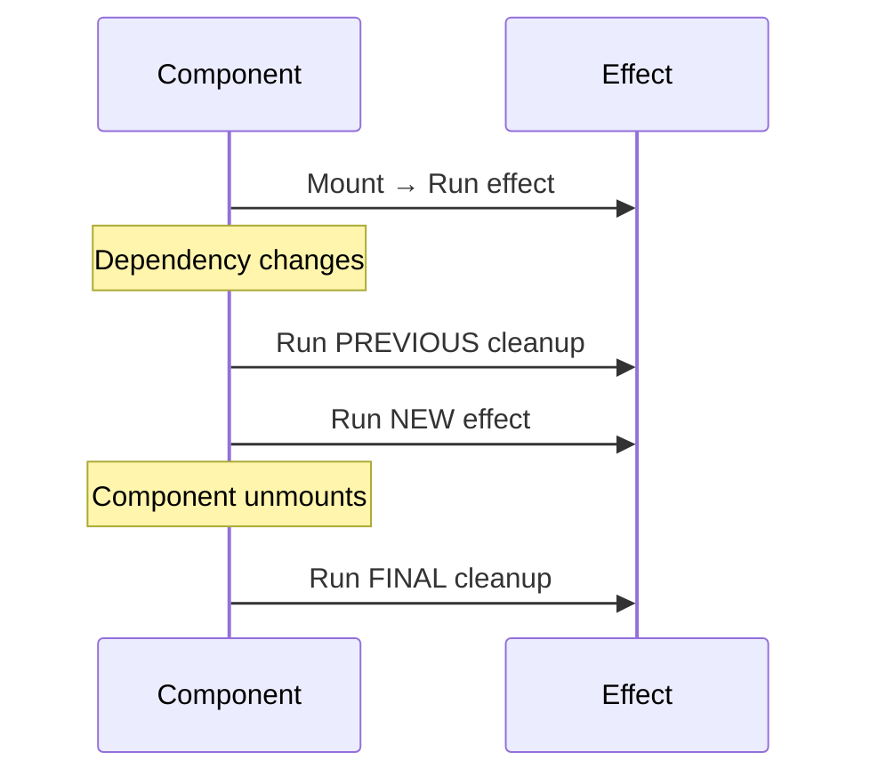

# useEffect Cleanup Functions

## Introduction

A cleanup function is returned from the effect callback. React calls it when the component unmounts **or** before re-running the effect due to dependency changes. Cleanup prevents memory leaks, cancels stale requests, and removes event listeners.

---

## When the Cleanup Runs



---

## Common Cleanup Patterns

### 1. Clearing Intervals

```jsx
useEffect(() => {
  const interval = setInterval(() => {
    setTime(Date.now());
  }, 1000);

  // Cleanup: clear the interval
  return () => clearInterval(interval);
}, []);
```

Without cleanup, the interval continues running after the component unmounts, calling `setTime` on unmounted state.

### 2. Removing Event Listeners

```jsx
function useWindowSize() {
  const [size, setSize] = useState({ width: window.innerWidth, height: window.innerHeight });

  useEffect(() => {
    const handleResize = () => {
      setSize({ width: window.innerWidth, height: window.innerHeight });
    };

    window.addEventListener('resize', handleResize);

    // Cleanup: remove the event listener
    return () => window.removeEventListener('resize', handleResize);
  }, []);
}
```

Without cleanup, event listeners accumulate with every re-render, causing memory leaks and stale closures.

### 3. Aborting Network Requests

```jsx
useEffect(() => {
  const controller = new AbortController();

  fetch(`/api/user/${userId}`, { signal: controller.signal })
    .then(res => res.json())
    .then(setUser)
    .catch(err => {
      if (err.name !== 'AbortError') {
        setError(err.message);
      }
    });

  // Cleanup: abort the fetch if component unmounts or userId changes
  return () => controller.abort();
}, [userId]);
```

Without cleanup, a slow response from a previous `userId` could overwrite the data for the new `userId`.

### 4. Unsubscribing from Observables / WebSockets

```jsx
useEffect(() => {
  const socket = new WebSocket('wss://example.com/chat');
  socket.onmessage = (event) => {
    setMessages(prev => [...prev, JSON.parse(event.data)]);
  };

  // Cleanup: close the WebSocket connection
  return () => socket.close();
}, []);
```

### 5. Resetting State

```jsx
useEffect(() => {
  // Start loading
  setLoading(true);

  return () => {
    // Cleanup: reset loading state on unmount (prevents state-update-on-unmounted warning)
    setLoading(false);
  };
}, [userId]);
```

---

## StrictMode Double-Invocation

In development, React StrictMode intentionally invokes effects **twice** (mount → cleanup → mount) to help you catch missing cleanup functions. If your effect runs twice in development but once in production, a missing cleanup is the likely cause.

```jsx
useEffect(() => {
  console.log('Effect runs'); // Logs twice in StrictMode — intentional!
  return () => console.log('Cleanup runs');
}, []);
```

If you see "Effect runs" twice in the console but only expect it once, your effect is working correctly. The double-run exposes bugs where effects leave behind stale subscriptions or listeners.

---

## Best Practices

💡 If you're setting up a subscription or listener in an effect, you almost always need a cleanup function. If you're fetching data, you should abort stale requests.

🚀 **Always clean up** intervals, event listeners, subscriptions, and fetch requests. Even if the component never unmounts in your test scenario, cleanup ensures correctness.

---

## Common Mistakes

⚠ **Forgetting to return the cleanup**: Without `return`, the cleanup function is never executed.

```jsx
// ❌ BAD — interval leaks forever
useEffect(() => {
  const id = setInterval(tick, 1000);
  // Missing: return () => clearInterval(id);
}, []);

// ✅ GOOD
useEffect(() => {
  const id = setInterval(tick, 1000);
  return () => clearInterval(id);
}, []);
```

⚠ **Cleanup reference mismatch**: The cleanup must reference the same timer/subscription it created.

```jsx
// ❌ BAD — `id` is not accessible in the cleanup scope
useEffect(() => {
  const id = setInterval(tick, 1000);
  return () => clearInterval(id); // ✅ This is correct — id is in the closure
}, []);
```

---

## Summary

- The cleanup function runs on unmount **and** before re-running the effect.
- Use cleanup to clear intervals, remove listeners, abort fetches, and close connections.
- React StrictMode double-invokes effects in development to catch missing cleanup.
- Every `setInterval`, `addEventListener`, `new WebSocket`, and `new AbortController` should have a corresponding cleanup.

## Related Topics

- [useEffect Overview](index)
- [Dependency Arrays](dependency-array)
- [Race Conditions with useEffect](race-conditions)

## Further Reading

- [React Docs: Cleaning Up an Effect](https://react.dev/learn/synchronizing-with-effects#step-3-add-cleanup-if-needed)
- [React Docs: Lifecycle of Reactive Effects](https://react.dev/learn/lifecycle-of-reactive-effects)
