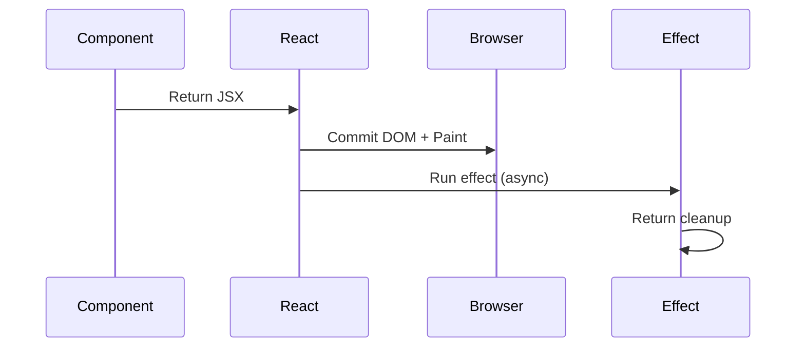
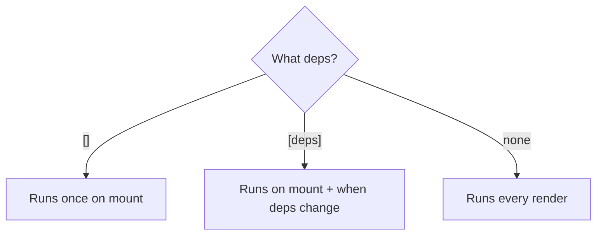
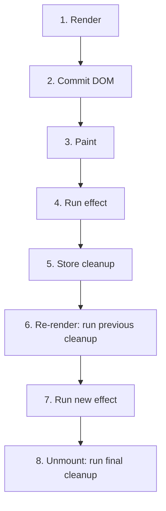

# useEffect — The Side Effect Hook

## Introduction

`useEffect` performs side effects in functional components — fetching data, subscribing to events, setting timers. It runs **after** React has committed the output to the DOM.

## Why do we need this?

Components must be pure — they can't fetch or do I/O during rendering. `useEffect` runs after render, responds to dep changes, and supports cleanup.

### Problem Statement

Fetch data on mount: must run after render, need to clean up if component unmounts before response.

## Real World Story

Before hooks, side effects were split across `componentDidMount`, `componentDidUpdate`, `componentWillUnmount`. Related logic was scattered. `useEffect` colocated setup and teardown.

## Real World Analogy

A **Cleanup Crew** — the chef cooks (renders), then calls "Clean up!" The crew works and leaves. When they leave, they clean up after themselves.

## Visual Explanation

```mermaid
flowchart TD
    subgraph "Class Lifecycle"
        Mount[componentDidMount] --> Update[componentDidUpdate]
        Update --> Unmount[componentWillUnmount]
    end
    subgraph "useEffect"
        Effect[useEffect with []] --> EffectDeps[useEffect with [dep]]
        EffectDeps --> Cleanup[Cleanup on unmount]
    end
```

## Internal Working

Render (return JSX) → Commit (update DOM) → Browser paints → Effects run asynchronously.



## Architecture



## Step-by-Step Flow



## Syntax

```javascript
useEffect(() => {
  // Side effect
  return () => { /* Cleanup */ };
}, [dependencies]);
```

## Basic Example

```jsx
import { useState, useEffect } from 'react';

export default function UserList() {
  const [users, setUsers] = useState([]);
  useEffect(() => {
    fetch('https://jsonplaceholder.typicode.com/users')
      .then(r => r.json())
      .then(setUsers);
  }, []);
  return <ul>{users.map(u => <li key={u.id}>{u.name}</li>)}</ul>;
}
```

## Intermediate Example

```jsx
import { useState, useEffect } from 'react';

export default function WindowSize() {
  const [size, setSize] = useState({ w: window.innerWidth, h: window.innerHeight });
  useEffect(() => {
    const handler = () => setSize({ w: window.innerWidth, h: window.innerHeight });
    window.addEventListener('resize', handler);
    return () => window.removeEventListener('resize', handler);
  }, []);
  return <p>{size.w} x {size.h}</p>;
}
```

## Advanced Example

```jsx
import { useState, useEffect } from 'react';

export default function SearchResults({ query }) {
  const [results, setResults] = useState([]);
  useEffect(() => {
    const controller = new AbortController();
    fetch(`https://api.example.com/search?q=${query}`, { signal: controller.signal })
      .then(r => r.json()).then(d => setResults(d.results))
      .catch(e => { if (e.name !== 'AbortError') throw e; });
    return () => controller.abort();
  }, [query]);
  return <ul>{results.map(r => <li key={r.id}>{r.title}</li>)}</ul>;
}
```

## Production Example

```jsx
import { useState, useEffect, useRef } from 'react';

function useFetch(url) {
  const [data, setData] = useState(null);
  const [loading, setLoading] = useState(true);
  const [error, setError] = useState(null);
  const cache = useRef(new Map());

  useEffect(() => {
    if (!url) { setData(null); setLoading(false); return; }
    if (cache.current.has(url)) { setData(cache.current.get(url)); setLoading(false); return; }
    const controller = new AbortController();
    let cancelled = false;
    fetch(url, { signal: controller.signal })
      .then(r => { if (!r.ok) throw new Error(`HTTP ${r.status}`); return r.json(); })
      .then(d => { if (!cancelled) { cache.current.set(url, d); setData(d); } })
      .catch(e => { if (!cancelled && e.name !== 'AbortError') setError(e.message); })
      .finally(() => { if (!cancelled) setLoading(false); });
    return () => { cancelled = true; controller.abort(); };
  }, [url]);

  return { data, loading, error };
}
```

## Folder Structure

```
src/
├── hooks/useFetch.js
├── components/UserProfile.jsx
└── App.jsx
```

## Best Practices

💡 StrictMode double-invokes effects in dev to catch missing cleanup.

🚀 Always clean up. Include all deps. Use AbortController. Split unrelated logic.

## Common Mistakes

⚠ Missing deps: `useEffect(() => { document.title = count; }, [])` — stale title.
⚠ Infinite loop: `useEffect(() => { setCount(c+1); })` — no deps.

## Performance Notes

⚡ Effects run after paint, don't block visuals. For pre-paint, use `useLayoutEffect`.

## Accessibility Notes

♿ Use `aria-live="polite"` for dynamic content. `role="alert"` for errors. `aria-busy="true"` for loading.

## Interview Questions

🎯 **Q1: Lifecycle mapping?** `[]` → mount. `[dep]` → didUpdate. Cleanup → willUnmount.

**Q2: Omit deps?** Runs every render — usually a bug.

## MCQs

1. **When does useEffect run?** A) During render  B) After commit + paint  C) Before render  D) On unmount → *B*
2. **Empty array means?** A) Every render  B) Once on mount  C) Never  D) On prop change → *B*
3. **When does cleanup run?** A) Before first effect  B) Before re-run + unmount  C) Only unmount → *B*
4. **Race condition prevention?** A) setTimeout  B) useState  C) AbortController  D) useMemo → *C*
5. **Why StrictMode runs twice?** A) Slow dev  B) Catch missing cleanup  C) Performance → *B*

## Practice Exercise

E1: Countdown 10–0 with setInterval. E2: Online/offline status. E3: Debounced search.

## Debugging Exercise

Memory leak: setInterval without cleanup. Fix: `return () => clearInterval(id)`.

## Real-world Scenario

Crypto dash WebSocket — close on unmount, pause on tab switch. Use cleanup + visibilitychange.

## Interview Coding Question

`useInterval(callback, delay)` — null delay pauses.

## Mini Project

Live Polling Dashboard — fetch every 3s, display, pause/resume.

## Summary

🧠 `useEffect = "After Paint"` — runs after UI is on screen.

📖 Effects run after commit. Deps control re-runs. Always clean up. Use AbortController.

## Cheat Sheet

```javascript
useEffect(() => { fetch(url); }, []);                     // mount
useEffect(() => { }, [dep]);                               // deps
useEffect(() => { const id = setInterval(fn, d); return () => clearInterval(id); }, []);
useEffect(() => { const c = new AbortController(); fetch(url, {signal: c.signal}); return () => c.abort(); }, [url]);
```

## Related Topics

[useRef](../use-ref) | [Custom Hooks](../custom-hooks) | [useCallback](../use-callback)

## Further Reading

[React Docs: useEffect](https://react.dev/reference/react/useEffect) | [Synchronizing with Effects](https://react.dev/learn/synchronizing-with-effects)
