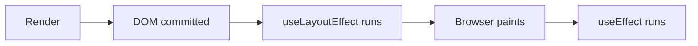

# useLayoutEffect — The Synchronous Effect Hook

## Introduction

`useLayoutEffect` runs synchronously **after DOM mutations but before the browser paints**. Use it for DOM measurements (getBoundingClientRect), scroll position adjustments, and animations that must appear seamless.

## Why do we need this?

`useEffect` runs after paint — the user sees a flash if you need to measure and adjust layout. `useLayoutEffect` runs before paint, so adjustments are invisible.

### Problem Statement

A tooltip needs to position itself based on button dimensions. If positioned in `useEffect`, the user sees the tooltip jump from default position to correct position. `useLayoutEffect` calculates the position before paint, so it appears correctly immediately.

## Visual Explanation



## Internal Working

`useLayoutEffect` uses the same API as `useEffect` but fires synchronously in the commit phase, before the browser repaints.

## Syntax

```javascript
useLayoutEffect(() => {
  // Measure DOM, adjust layout
  return () => { /* cleanup */ };
}, [dependencies]);
```

## Basic Example

```jsx
import { useState, useLayoutEffect, useRef } from 'react';

export default function Measurer() {
  const ref = useRef(null);
  const [height, setHeight] = useState(0);

  useLayoutEffect(() => {
    setHeight(ref.current?.offsetHeight ?? 0);
  }, []);

  return (
    <div>
      <div ref={ref} style={{ padding: '20px', border: '1px solid #ccc' }}>
        Resize me!
      </div>
      <p>Height: {height}px</p>
    </div>
  );
}
```

## Advanced Example

Tooltip positioning without flicker:

```jsx
useLayoutEffect(() => {
  const tooltip = tooltipRef.current;
  const button = buttonRef.current;
  if (!tooltip || !button) return;

  const btnRect = button.getBoundingClientRect();
  tooltip.style.left = `${btnRect.left + btnRect.width / 2 - tooltip.offsetWidth / 2}px`;
  tooltip.style.top = `${btnRect.bottom + 8}px`;
}, [visible]);
```

## When to Use

- DOM measurements (getBoundingClientRect, offsetHeight/Width)
- Scroll position adjustments
- Animations that must not flicker
- Synchronous DOM mutations

## When Not to Use

- Data fetching (blocks painting)
- Non-visual side effects (logging, analytics)
- Event subscriptions

## Best Practices

💡 `useLayoutEffect` blocks painting — use sparingly. Prefer `useEffect` for most cases.

🚀 Only use when you must read/update DOM before the user sees it.

## MCQ

1. **When does useLayoutEffect run?** A) Before render  B) After DOM, before paint  C) After paint  D) Async → *B*
2. **What happens if it's heavy?** A) Blocks paint, degrades perf  B) No impact  C) Defers to useEffect → *A*
3. **Preferred for fetching?** A) useEffect  B) useLayoutEffect → *A*

## Summary

🧠 `useLayoutEffect = Pre-paint` — measure and adjust before the user sees anything.

📖 Synchronous, runs before paint. Use for DOM measurements. Blocks painting — be careful.

## Related Topics

[useEffect](use-effect) | [useRef](use-ref)

## Further Reading

[React Docs: useLayoutEffect](https://react.dev/reference/react/useLayoutEffect)
