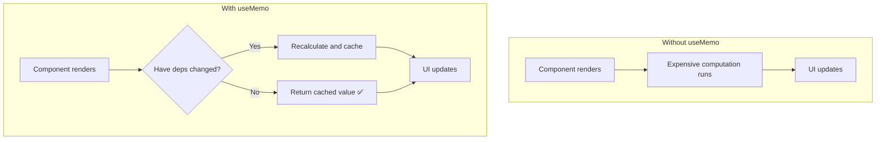
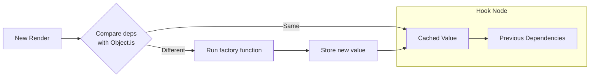
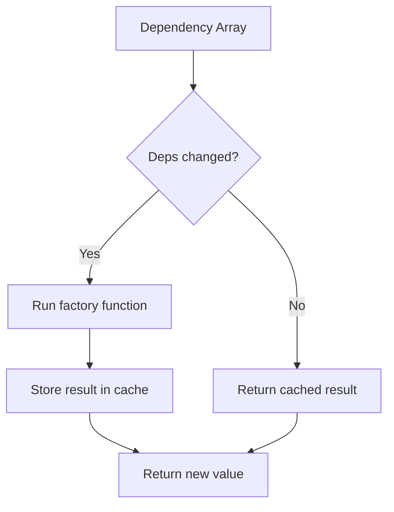

# useMemo — The Memoization Hook

## Introduction

`useMemo` is a React hook that **remembers the result of an expensive computation** across renders. It recalculates only when its dependencies change, preventing wasteful recalculations on every render cycle.

---

## Why do we need this?

React components re-render frequently — when state changes, when parent components re-render, when context updates. If a component performs an expensive operation (sorting a large array, filtering data, computing derived values) on every render, performance degrades.

### Problem Statement

Imagine a component that displays a list of users sorted by name. If the list has 10,000 items, sorting takes 50ms. The parent component re-renders every time a button is hovered. Without memoization, the sort runs on every hover, causing UI jank. `useMemo` ensures the sort only runs when the user list actually changes.

---

## Real World Story

Before React 16.8, class components used `shouldComponentUpdate` or `PureComponent` to optimize rendering. But these only prevented re-renders — they didn't help with expensive computations inside the render method. Developers had to manually cache results using instance properties, which was error-prone. `useMemo` provided a clean, declarative way to memoize computed values.

---

## Real World Analogy

Think of `useMemo` like a **Whiteboard with a Complex Math Problem** vs. **A Calculator That Shows the Last Answer**.

- **Without useMemo**: Every time someone walks past the whiteboard (re-render), you erase the math solution and solve it again from scratch.
- **With useMemo**: You write the answer on the board and only recalculate if the numbers in the problem change. If someone walks past, the answer stays visible.

---

## Visual Explanation



---

## Internal Working

`useMemo` stores the computed value in the Fiber node's hook linked list. On subsequent renders, it compares the previous dependencies (stored in the hook node) with the new dependencies. If they're the same (using `Object.is` comparison), it returns the cached value. If they differ, it calls the factory function and stores the new result.



---

## Architecture



---

## Syntax

```javascript
const memoizedValue = useMemo(() => {
  // Expensive computation
  return computedResult;
}, [dependency1, dependency2]);
```

- **Factory function**: Runs when dependencies change. Must return the computed value.
- **Dependency array**: List of values the computation depends on.
- **Return value**: The memoized (cached) result.

---

## Basic Example

Filtering a list without unnecessary recalculations:

```jsx
import { useState, useMemo } from 'react';

export default function FilteredList() {
  const [search, setSearch] = useState('');
  const [darkMode, setDarkMode] = useState(false);

  // Large dataset (simulated)
  const items = Array.from({ length: 10000 }, (_, i) => `Item ${i + 1}`);

  // Memoized: only recalculates when search changes, not when darkMode changes
  const filteredItems = useMemo(() => {
    console.log('Filtering... (expensive operation)');
    return items.filter(item =>
      item.toLowerCase().includes(search.toLowerCase())
    );
  }, [search]); // Only depends on search

  return (
    <div style={{ padding: '20px', backgroundColor: darkMode ? '#333' : '#fff', color: darkMode ? '#fff' : '#333' }}>
      <h3>Filtered List ({filteredItems.length} results)</h3>
      <input
        value={search}
        onChange={(e) => setSearch(e.target.value)}
        placeholder="Search items..."
        style={{ padding: '8px', width: '300px' }}
      />
      <button onClick={() => setDarkMode(!darkMode)} style={{ marginLeft: '8px' }}>
        Toggle Theme
      </button>
      <ul style={{ maxHeight: '200px', overflow: 'auto' }}>
        {filteredItems.slice(0, 50).map(item => (
          <li key={item}>{item}</li>
        ))}
      </ul>
    </div>
  );
}
```

**Explanation:**
- `items` is an array of 10,000 items. Filtering is expensive.
- `useMemo` ensures the filter only runs when `search` changes.
- Clicking "Toggle Theme" changes `darkMode`, causing a re-render — but the filter doesn't re-run. The cached result is used instantly.

---

## Intermediate Example

Memoizing derived data with multiple dependencies:

```jsx
import { useState, useMemo } from 'react';

export default function ShoppingCart() {
  const [items, setItems] = useState([
    { id: 1, name: 'Laptop', price: 999, quantity: 1 },
    { id: 2, name: 'Mouse', price: 25, quantity: 2 },
    { id: 3, name: 'Keyboard', price: 75, quantity: 1 },
  ]);
  const [discountPercent, setDiscountPercent] = useState(0);

  // Memoized: Only recalculates when items or discount changes
  const totals = useMemo(() => {
    console.log('Calculating totals...');
    const subtotal = items.reduce((sum, item) => sum + item.price * item.quantity, 0);
    const discount = subtotal * (discountPercent / 100);
    const tax = (subtotal - discount) * 0.08;
    const total = subtotal - discount + tax;

    return { subtotal, discount, tax, total };
  }, [items, discountPercent]);

  return (
    <div style={{ padding: '20px', maxWidth: '500px' }}>
      <h3>Shopping Cart</h3>
      {items.map(item => (
        <div key={item.id} style={{ display: 'flex', justifyContent: 'space-between', margin: '8px 0' }}>
          <span>{item.name} × {item.quantity}</span>
          <span>${(item.price * item.quantity).toFixed(2)}</span>
        </div>
      ))}
      <hr />
      <label>
        Discount: {discountPercent}%
        <input
          type="range"
          min="0"
          max="50"
          value={discountPercent}
          onChange={(e) => setDiscountPercent(Number(e.target.value))}
          style={{ width: '100%' }}
        />
      </label>
      <div style={{ marginTop: '12px' }}>
        <p>Subtotal: ${totals.subtotal.toFixed(2)}</p>
        <p>Discount: -${totals.discount.toFixed(2)}</p>
        <p>Tax (8%): ${totals.tax.toFixed(2)}</p>
        <p><strong>Total: ${totals.total.toFixed(2)}</strong></p>
      </div>
    </div>
  );
}
```

**Explanation:**
- The totals calculation depends on both `items` and `discountPercent`.
- Changing the discount slider recalculates only the totals — not any other part of the component.
- Without `useMemo`, every re-render (even unrelated ones) would recalculate totals.

---

## Advanced Example

Preventing unnecessary child re-renders with `useMemo` + `React.memo`:

```jsx
import { useState, useMemo, memo } from 'react';

// Memoized child component: only re-renders when its props change
const ExpensiveChart = memo(function ExpensiveChart({ data, label }) {
  console.log(`Chart "${label}" re-rendered`);
  return (
    <div style={{
      padding: '16px', margin: '8px', border: '1px solid #ccc',
      backgroundColor: '#f9f9f9', borderRadius: '8px'
    }}>
      <h4>{label}</h4>
      <p>Data points: {data.length}</p>
      <div style={{ display: 'flex', gap: '2px', height: '100px', alignItems: 'flex-end' }}>
        {data.map((value, i) => (
          <div key={i} style={{
            width: '20px',
            height: `${value}%`,
            backgroundColor: '#4f46e5',
            borderRadius: '2px'
          }} />
        ))}
      </div>
    </div>
  );
});

export default function Dashboard() {
  const [refresh, setRefresh] = useState(0);
  const [filter, setFilter] = useState('all');

  // Memoize data so it doesn't recreate on every render
  const salesData = useMemo(() => {
    console.log('Generating sales data...');
    return Array.from({ length: 20 }, () => Math.floor(Math.random() * 80 + 20));
  }, [refresh]);

  const userData = useMemo(() => {
    console.log('Generating user data...');
    return Array.from({ length: 20 }, () => Math.floor(Math.random() * 50 + 10));
  }, [refresh]);

  return (
    <div style={{ padding: '20px' }}>
      <h3>Analytics Dashboard</h3>
      <button onClick={() => setRefresh(r => r + 1)} style={{ marginRight: '8px' }}>
        Refresh Data
      </button>
      <select value={filter} onChange={(e) => setFilter(e.target.value)}>
        <option value="all">All</option>
        <option value="today">Today</option>
        <option value="week">This Week</option>
      </select>
      <div style={{ display: 'flex', marginTop: '16px' }}>
        <ExpensiveChart data={salesData} label="Sales" />
        <ExpensiveChart data={userData} label="Users" />
      </div>
    </div>
  );
}
```

**Explanation:**
- `salesData` and `userData` are memoized with `useMemo` — they only change when `refresh` changes.
- `ExpensiveChart` is wrapped in `React.memo` — it only re-renders when its props (`data`, `label`) change.
- Changing the filter dropdown re-renders the parent but not the charts, because the memoized data arrays maintain the same reference.

---

## Production Example

Memoizing form validation and derived state:

```jsx
import { useState, useMemo } from 'react';

export default function RegistrationForm() {
  const [form, setForm] = useState({
    username: '',
    email: '',
    password: '',
    confirmPassword: ''
  });

  // Memoize validation results — only recompute when form fields change
  const validation = useMemo(() => {
    const errors = {};

    if (!form.username || form.username.length < 3) {
      errors.username = 'Username must be at least 3 characters';
    }
    if (!form.email || !/^[^\s@]+@[^\s@]+\.[^\s@]+$/.test(form.email)) {
      errors.email = 'Please enter a valid email address';
    }
    if (!form.password || form.password.length < 8) {
      errors.password = 'Password must be at least 8 characters';
    }
    if (form.password !== form.confirmPassword) {
      errors.confirmPassword = 'Passwords do not match';
    }

    return {
      errors,
      isValid: Object.keys(errors).length === 0,
      strength: form.password.length > 12 ? 'strong' : form.password.length > 8 ? 'medium' : 'weak'
    };
  }, [form.username, form.email, form.password, form.confirmPassword]);

  const updateField = (field) => (e) => {
    setForm(prev => ({ ...prev, [field]: e.target.value }));
  };

  return (
    <div style={{ padding: '20px', maxWidth: '400px' }}>
      <h3>Registration</h3>
      {Object.entries({ username: 'Username', email: 'Email', password: 'Password', confirmPassword: 'Confirm Password' }).map(([field, label]) => (
        <div key={field} style={{ marginBottom: '12px' }}>
          <label>{label}:</label>
          <input
            type={field.includes('password') ? 'password' : 'text'}
            value={form[field]}
            onChange={updateField(field)}
            style={{
              width: '100%', padding: '8px',
              border: validation.errors[field] ? '2px solid red' : '1px solid #ccc'
            }}
            aria-invalid={!!validation.errors[field]}
          />
          {validation.errors[field] && (
            <p style={{ color: 'red', fontSize: '12px' }} role="alert">
              {validation.errors[field]}
            </p>
          )}
        </div>
      ))}
      <p>Password strength: <strong>{validation.strength}</strong></p>
      <button
        disabled={!validation.isValid}
        style={{
          padding: '10px 20px',
          opacity: validation.isValid ? 1 : 0.5
        }}
      >
        {validation.isValid ? 'Submit' : 'Fix errors to submit'}
      </button>
    </div>
  );
}
```

**Explanation:**
- Validation logic runs only when form fields change, not on every keystroke's re-render.
- `aria-invalid` attributes are bound to validation state for accessibility.
- The "strength" metric is derived alongside validation in a single `useMemo` call.

---

## Folder Structure

```
src/
├── components/
│   ├── FilteredList.jsx
│   ├── ShoppingCart.jsx
│   ├── Dashboard.jsx
│   └── RegistrationForm.jsx
├── App.jsx
└── main.jsx
```

---

## Best Practices

💡 **Did You Know?**  
`useMemo` is not always needed. React is already fast for most operations. Only add `useMemo` when you measure a performance problem — premature optimization adds complexity without benefit.

🚀 **Best Practices**
- Use `useMemo` for expensive computations (sorting, filtering, complex math).
- Use `useMemo` to stabilize object/array references passed to memoized children.
- Always include all values used inside the factory function in the dependency array.
- Add `console.log` inside the factory function during development to verify it's not re-running unnecessarily.

---

## Common Mistakes

⚠ **Common Mistakes**

### Over-Memoizing Simple Values
```jsx
// ❌ WRONG — primitive values are already fast
const double = useMemo(() => count * 2, [count]);

// ✅ RIGHT — simple arithmetic doesn't need memoization
const double = count * 2;
```

### Forgetting Dependencies
```jsx
// ❌ WRONG — items is used inside but missing from deps
const total = useMemo(() => {
  return items.reduce((sum, i) => sum + i.price, 0);
}, []); // Bug: stale closure on items

// ✅ RIGHT
const total = useMemo(() => {
  return items.reduce((sum, i) => sum + i.price, 0);
}, [items]);
```

---

## Performance Notes

⚡ **Performance Tips**
- `useMemo` itself has overhead (storing values, comparing deps). Only use it when the computation is noticeably expensive (>1ms).
- For small calculations like `items.filter(x => x.active)`, `useMemo` overhead may exceed the computation cost.
- Use React DevTools profiler to identify performance bottlenecks before adding memoization.

---

## Accessibility Notes

♿ **Accessibility Tips**
- Memoization doesn't directly affect accessibility, but faster rendering means smoother focus management and fewer visual jumps.

---

## SEO Notes

`useMemo` is a client-side optimization and doesn't affect SEO.

---

## Interview Questions

🎯 **Interview Tips**  
Interviewers often ask about the difference between `useMemo` and `useCallback`. Remember: `useMemo` memoizes values, `useCallback` memoizes functions.

### Q1: What is the difference between useMemo and useCallback?
**Answer**: `useMemo` memoizes the **result** of a function. `useCallback` memoizes the **function itself**. `useMemo(() => fn, deps)` is equivalent to `useCallback(fn, deps)` if the function returns nothing meaningful.

### Q2: When should you NOT use useMemo?
**Answer**: Don't use `useMemo` for simple calculations, primitive values, or values that change on every render (like `Math.random()`). The overhead of memoization (storing and comparing) can exceed the computation cost for trivial operations.

---

## MCQs

1. **What does useMemo return?**
   - A) A memoized function
   - B) A memoized value
   - C) A ref object
   - D) A state setter
   - *Answer: B*

2. **When does useMemo recompute the value?**
   - A) On every render
   - B) Only when the component mounts
   - C) Only when its dependencies change
   - D) Only when a parent re-renders
   - *Answer: C*

3. **How does useMemo compare dependencies?**
   - A) Deep equality (recursive comparison)
   - B) Shallow equality (===)
   - C) `Object.is` comparison
   - D) By serializing to JSON
   - *Answer: C*

4. **Which is a valid reason to use useMemo?**
   - A) Storing a counter value
   - B) Optimizing an expensive array sort
   - C) Accessing DOM elements
   - D) Managing form input values
   - *Answer: B*

5. **What happens if you pass an empty array `[]` as dependencies?**
   - A) The value is computed once and never recomputed
   - B) The value is recomputed on every render
   - C) An error is thrown
   - D) React ignores the memoization
   - *Answer: A*

---

## Practice Exercise

### Exercise 1: Prime Number Finder
Create a component that finds all prime numbers up to `n`. Use `useMemo` to avoid recalculating when the theme toggles.

### Exercise 2: Transaction Summary
Given an array of transactions, use `useMemo` to compute total income, total expenses, and balance. Only recalculate when the transactions array changes.

### Exercise 3: Search Suggestions
Build a search bar that shows autocomplete suggestions from a large dataset. Use `useMemo` to filter suggestions based on the search term.

---

## Debugging Exercise

### The Redundant Recalculation
Why does the following component log "Computing..." on every button click, even though `data` hasn't changed?

```jsx
import { useState, useMemo } from 'react';

export default function BrokenMemo() {
  const [count, setCount] = useState(0);
  const data = [1, 2, 3, 4, 5]; // New array on every render!

  const doubled = useMemo(() => {
    console.log('Computing...');
    return data.map(x => x * 2);
  }, [data]); // data is a new reference every render!

  return (
    <div>
      <p>Doubled: {doubled.join(', ')}</p>
      <button onClick={() => setCount(c => c + 1)}>Re-render ({count})</button>
    </div>
  );
}
```

**Solution**: The `data` array is created fresh on every render, so it's always a new reference. Fix by moving it outside the component or using `useMemo` on data too:
```jsx
const data = useMemo(() => [1, 2, 3, 4, 5], []);
```

---

## Real-world Scenario

You're building a data grid with 50,000 rows. The grid supports sorting, filtering, and pagination. Each operation reads from the source data and produces a new view. How would you structure your useMemo calls?

**Design Strategy**: Chain multiple `useMemo` calls: (1) filter the full dataset, (2) sort the filtered data, (3) slice the sorted data for the current page. Each step only recalculates when its specific dependency changes.

---

## Interview Coding Question

### Problem Statement
Write a custom hook called `useSorted` that accepts an array and a compare function, and returns a memoized sorted copy of the array.

```jsx
import { useMemo } from 'react';

function useSorted(array, compareFn) {
  return useMemo(() => {
    if (!array) return [];
    return [...array].sort(compareFn);
  }, [array, compareFn]);
}
```

---

## Mini Project

### Expense Dashboard
Build a dashboard that:
- Accepts a list of expenses (id, amount, category, date).
- Shows total by category (useMemo).
- Shows monthly trends (useMemo).
- Highlights the largest expense (useMemo).
- Has a theme toggle that doesn't trigger recalculations.

---

## Summary

🧠 **Memory Tricks**  
`useMemo = "Cache Result"` — Like a calculator showing "Ans" that only recalculates when you enter new numbers.

📖 **Summary**
- `useMemo` caches expensive computation results across renders.
- Only recalculates when dependencies change.
- Use for sorting, filtering, data transformation, and stabilizing references.
- Don't overuse — measure first, then optimize.

---

## Cheat Sheet

```javascript
// Expensive computation
const sorted = useMemo(() => {
  return [...data].sort(compareFn);
}, [data]);

// Stabilizing reference
const config = useMemo(() => ({
  theme: 'dark',
  pageSize: 20
}), []);

// Derived state
const totals = useMemo(() => {
  return items.reduce((sum, i) => sum + i.price, 0);
}, [items]);
```

---

## Related Topics
- [useCallback for Stable Functions](use-callback)
- [useRef for Persistent Values](use-ref)
- [Performance Optimization](../phase-6-performance/rendering-optimization)

---

## Further Reading
- [React Docs: useMemo](https://react.dev/reference/react/useMemo)
- [React Docs: Skipping Expensive Recalculation](https://react.dev/learn/skipping-expensive-recalculation)
- [Kent C. Dodds: When to useMemo and useCallback](https://kentcdodds.com/blog/usememo-and-usecallback)
