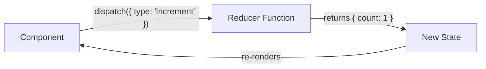
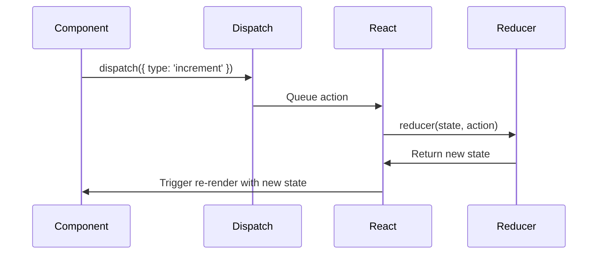
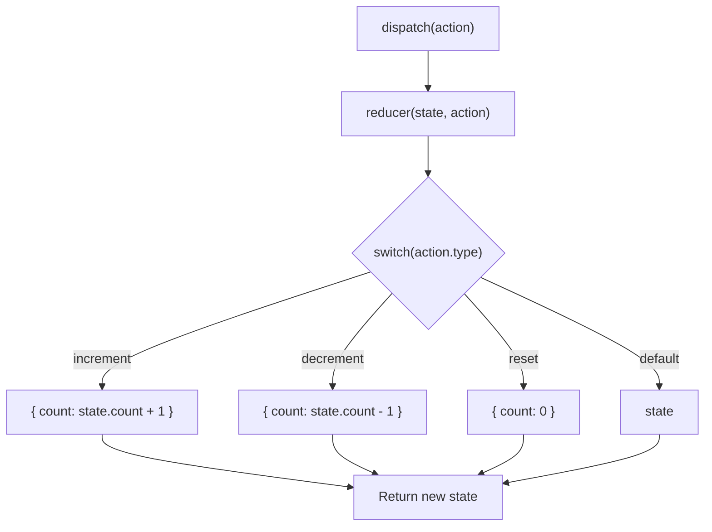

# useReducer — The State Reducer Hook

## Introduction

`useReducer` is an alternative to `useState` for managing complex state logic. It's ideal when state transitions depend on multiple conditions, when the next state depends on the previous state in complex ways, or when you want to centralize state update logic in a single reducer function.

---

## Why do we need this?

When a component has multiple state variables that change together, or when updating state requires complex logic, `useState` with multiple setters becomes messy and error-prone. `useReducer` centralizes all state transitions into a single pure function.

### Problem Statement

A shopping cart component needs to: add items, remove items, update quantities, apply coupons, calculate taxes, and clear the cart. With `useState`, you'd have multiple state variables and scattered update logic. With `useReducer`, all update logic lives in a single reducer function, making the code predictable and testable.

---

## Real World Story

The reducer pattern comes from Redux, which popularized the concept of unidirectional data flow and pure reducer functions. When React introduced `useReducer` in 16.8, it brought this proven pattern directly into the framework, allowing developers to manage complex state without adding external dependencies.

---

## Real World Analogy

Think of `useReducer` like a **Restaurant Order System** vs. **Individual Customer Requests**.

- **useState (Individual Requests)**: Each customer (component) walks into the kitchen and tells each chef what to do. Requests can conflict, overlap, or get lost. The kitchen becomes chaotic.
- **useReducer (Order System)**: Customers write orders (actions) on a slip and give it to the order counter (dispatch). A single chef (reducer) reads each order slip and updates the kitchen state accordingly. The process is orderly, predictable, and trackable.

---

## Visual Explanation



---

## Internal Working

`useReducer` stores the state and reducer function in the Fiber's hook linked list. When `dispatch` is called, React enqueues the action. During the next render, React calls the reducer with the current state and the action to produce the new state. If the state changed, the component re-renders.



---

## Architecture



---

## Syntax

```javascript
const [state, dispatch] = useReducer(reducer, initialState, initFunction?);
```

| Part | Description |
|------|-------------|
| `reducer(state, action)` | Pure function that returns the new state |
| `initialState` | The initial state value |
| `initFunction` | Optional lazy initializer (receives initialState) |
| `state` | Current state value |
| `dispatch` | Function to send actions to the reducer |

---

## Basic Example

Simple counter with useReducer:

```jsx
import { useReducer } from 'react';

// Reducer function: pure, takes state and action, returns new state
function counterReducer(state, action) {
  switch (action.type) {
    case 'increment':
      return { count: state.count + 1 };
    case 'decrement':
      return { count: state.count - 1 };
    case 'reset':
      return { count: 0 };
    default:
      return state;
  }
}

export default function Counter() {
  const [state, dispatch] = useReducer(counterReducer, { count: 0 });

  return (
    <div style={{ padding: '20px', textAlign: 'center' }}>
      <h3>Reducer Counter</h3>
      <p>Count: <strong>{state.count}</strong></p>
      <button onClick={() => dispatch({ type: 'decrement' })}>-</button>
      <button onClick={() => dispatch({ type: 'reset' })} style={{ margin: '0 8px' }}>
        Reset
      </button>
      <button onClick={() => dispatch({ type: 'increment' })}>+</button>
    </div>
  );
}
```

**Explanation:**
- The `reducer` function is a pure function — it takes the current `state` and an `action`, and returns the new state.
- `dispatch` sends actions to the reducer. The action is an object with a `type` property.
- The reducer uses a `switch` statement to determine how to update the state based on the action type.

---

## Intermediate Example

Todo list with add, toggle, and delete actions:

```jsx
import { useReducer, useState } from 'react';

const initialState = { todos: [], nextId: 1 };

function todoReducer(state, action) {
  switch (action.type) {
    case 'add':
      return {
        ...state,
        todos: [...state.todos, { id: state.nextId, text: action.text, completed: false }],
        nextId: state.nextId + 1
      };
    case 'toggle':
      return {
        ...state,
        todos: state.todos.map(todo =>
          todo.id === action.id ? { ...todo, completed: !todo.completed } : todo
        )
      };
    case 'delete':
      return {
        ...state,
        todos: state.todos.filter(todo => todo.id !== action.id)
      };
    case 'clear':
      return { ...state, todos: [] };
    default:
      return state;
  }
}

export default function TodoApp() {
  const [state, dispatch] = useReducer(todoReducer, initialState);
  const [input, setInput] = useState('');

  const handleAdd = () => {
    if (input.trim()) {
      dispatch({ type: 'add', text: input.trim() });
      setInput('');
    }
  };

  return (
    <div style={{ padding: '20px', maxWidth: '400px' }}>
      <h3>Reducer Todo</h3>
      <div>
        <input
          value={input}
          onChange={(e) => setInput(e.target.value)}
          onKeyDown={(e) => e.key === 'Enter' && handleAdd()}
          placeholder="Add todo..."
          style={{ padding: '8px', width: '200px' }}
        />
        <button onClick={handleAdd} style={{ marginLeft: '8px' }}>Add</button>
        <button onClick={() => dispatch({ type: 'clear' })} style={{ marginLeft: '4px' }}>
          Clear
        </button>
      </div>
      <ul style={{ marginTop: '12px' }}>
        {state.todos.map(todo => (
          <li key={todo.id} style={{ margin: '8px 0' }}>
            <span
              onClick={() => dispatch({ type: 'toggle', id: todo.id })}
              style={{
                textDecoration: todo.completed ? 'line-through' : 'none',
                cursor: 'pointer',
                marginRight: '8px'
              }}
            >
              {todo.text}
            </span>
            <button
              onClick={() => dispatch({ type: 'delete', id: todo.id })}
              style={{ color: 'red', border: 'none', background: 'none', cursor: 'pointer' }}
            >
              ✕
            </button>
          </li>
        ))}
      </ul>
      <p>{state.todos.filter(t => !t.completed).length} items remaining</p>
    </div>
  );
}
```

**Explanation:**
- The reducer handles four action types: `add`, `toggle`, `delete`, and `clear`.
- Actions can carry payload data: `{ type: 'add', text: '...' }` and `{ type: 'toggle', id: 1 }`.
- Adding todo text comes from local `useState` (`input`), demonstrating how `useState` and `useReducer` can coexist.

---

## Advanced Example

Form state management with useReducer:

```jsx
import { useReducer } from 'react';

const initialFormState = {
  values: { username: '', email: '', password: '' },
  errors: {},
  touched: {},
  isSubmitting: false
};

function formReducer(state, action) {
  switch (action.type) {
    case 'field_change':
      return {
        ...state,
        values: { ...state.values, [action.field]: action.value },
        touched: { ...state.touched, [action.field]: true }
      };
    case 'set_errors':
      return { ...state, errors: action.errors };
    case 'submitting':
      return { ...state, isSubmitting: true, errors: {} };
    case 'submit_success':
      return { ...initialFormState, isSubmitting: false };
    case 'submit_error':
      return {
        ...state,
        isSubmitting: false,
        errors: action.errors
      };
    case 'reset':
      return initialFormState;
    default:
      return state;
  }
}

function validate(values) {
  const errors = {};
  if (!values.username || values.username.length < 3) {
    errors.username = 'Username must be at least 3 characters';
  }
  if (!values.email || !/^[^\s@]+@[^\s@]+\.[^\s@]+$/.test(values.email)) {
    errors.email = 'Valid email required';
  }
  if (!values.password || values.password.length < 6) {
    errors.password = 'Password must be at least 6 characters';
  }
  return errors;
}

export default function FormWithReducer() {
  const [state, dispatch] = useReducer(formReducer, initialFormState);
  const { values, errors, touched, isSubmitting } = state;

  const handleSubmit = async (e) => {
    e.preventDefault();
    const validationErrors = validate(values);
    if (Object.keys(validationErrors).length > 0) {
      dispatch({ type: 'set_errors', errors: validationErrors });
      return;
    }

    dispatch({ type: 'submitting' });
    try {
      // Simulate API call
      await new Promise((_, reject) => setTimeout(reject, 1000));
    } catch {
      dispatch({ type: 'submit_error', errors: { general: 'Submission failed. Try again.' } });
    }
  };

  const updateField = (field) => (e) => {
    dispatch({ type: 'field_change', field, value: e.target.value });
  };

  return (
    <form onSubmit={handleSubmit} style={{ padding: '20px', maxWidth: '400px' }}>
      <h3>Form with Reducer</h3>
      {errors.general && <p style={{ color: 'red' }} role="alert">{errors.general}</p>}

      {['username', 'email', 'password'].map(field => (
        <div key={field} style={{ marginBottom: '12px' }}>
          <label style={{ display: 'block', marginBottom: '4px' }}>
            {field.charAt(0).toUpperCase() + field.slice(1)}:
          </label>
          <input
            type={field === 'password' ? 'password' : 'text'}
            value={values[field]}
            onChange={updateField(field)}
            style={{
              width: '100%', padding: '8px',
              border: errors[field] && touched[field] ? '2px solid red' : '1px solid #ccc'
            }}
            aria-invalid={!!(errors[field] && touched[field])}
            disabled={isSubmitting}
          />
          {errors[field] && touched[field] && (
            <p style={{ color: 'red', fontSize: '12px' }} role="alert">{errors[field]}</p>
          )}
        </div>
      ))}

      <button type="submit" disabled={isSubmitting} style={{ padding: '10px 20px' }}>
        {isSubmitting ? 'Submitting...' : 'Submit'}
      </button>
      <button type="button" onClick={() => dispatch({ type: 'reset' })} style={{ marginLeft: '8px' }}>
        Reset
      </button>
    </form>
  );
}
```

**Explanation:**
- The reducer manages `values`, `errors`, `touched`, and `isSubmitting` as a single state object.
- Form validation runs on submit, dispatching either `set_errors` or `submitting`.
- The reducer pattern keeps all state transition logic in one place, making it easy to reason about and test.

---

## Production Example

Shopping cart with useReducer and localStorage:

```jsx
import { useReducer, useEffect } from 'react';

const STORAGE_KEY = 'shopping-cart';

function loadCart() {
  try {
    const saved = localStorage.getItem(STORAGE_KEY);
    return saved ? JSON.parse(saved) : { items: [], discountCode: null };
  } catch {
    return { items: [], discountCode: null };
  }
}

function cartReducer(state, action) {
  switch (action.type) {
    case 'add_item': {
      const existing = state.items.find(i => i.id === action.item.id);
      if (existing) {
        return {
          ...state,
          items: state.items.map(i =>
            i.id === action.item.id ? { ...i, quantity: i.quantity + 1 } : i
          )
        };
      }
      return {
        ...state,
        items: [...state.items, { ...action.item, quantity: 1 }]
      };
    }
    case 'remove_item':
      return {
        ...state,
        items: state.items.filter(i => i.id !== action.id)
      };
    case 'update_quantity':
      return {
        ...state,
        items: state.items.map(i =>
          i.id === action.id ? { ...i, quantity: Math.max(1, action.quantity) } : i
        )
      };
    case 'apply_discount':
      return { ...state, discountCode: action.code };
    case 'clear_cart':
      return { items: [], discountCode: null };
    default:
      return state;
  }
}

export default function ShoppingCart() {
  const [cart, dispatch] = useReducer(cartReducer, null, loadCart);

  // Persist to localStorage
  useEffect(() => {
    localStorage.setItem(STORAGE_KEY, JSON.stringify(cart));
  }, [cart]);

  const total = cart.items.reduce((sum, i) => sum + i.price * i.quantity, 0);
  const discount = cart.discountCode === 'SAVE10' ? total * 0.1 : 0;

  return (
    <div style={{ padding: '20px', maxWidth: '500px' }}>
      <h3>Shopping Cart</h3>
      {cart.items.map(item => (
        <div key={item.id} style={{ display: 'flex', justifyContent: 'space-between', alignItems: 'center', margin: '8px 0', padding: '8px', border: '1px solid #eee' }}>
          <div>
            <strong>{item.name}</strong>
            <div>${item.price} each</div>
          </div>
          <div style={{ display: 'flex', alignItems: 'center', gap: '8px' }}>
            <button onClick={() => dispatch({ type: 'update_quantity', id: item.id, quantity: item.quantity - 1 })}>-</button>
            <span>{item.quantity}</span>
            <button onClick={() => dispatch({ type: 'update_quantity', id: item.id, quantity: item.quantity + 1 })}>+</button>
            <button onClick={() => dispatch({ type: 'remove_item', id: item.id })} style={{ color: 'red', border: 'none', background: 'none' }}>✕</button>
          </div>
        </div>
      ))}
      <hr />
      <p>Subtotal: <strong>${total.toFixed(2)}</strong></p>
      {discount > 0 && <p>Discount: -${discount.toFixed(2)}</p>}
      <p>Total: <strong>${(total - discount).toFixed(2)}</strong></p>
      <button onClick={() => dispatch({ type: 'clear_cart' })}>Clear Cart</button>
    </div>
  );
}
```

**Explanation:**
- `loadCart` is passed as the lazy initializer to `useReducer` — it reads from localStorage only once.
- Every state change auto-persists to localStorage via `useEffect`.
- Actions carry typed payloads that the reducer processes predictably.

---

## Folder Structure

```
src/
├── reducers/
│   ├── counterReducer.js
│   ├── todoReducer.js
│   ├── formReducer.js
│   └── cartReducer.js
├── components/
│   ├── Counter.jsx
│   ├── TodoApp.jsx
│   ├── FormWithReducer.jsx
│   └── ShoppingCart.jsx
├── App.jsx
└── main.jsx
```

---

## Best Practices

💡 **Did You Know?**  
`useReducer` + Context is a common Redux alternative. Create a context for state and a context for dispatch to prevent unnecessary re-renders.

🚀 **Best Practices**
- Reducers must be **pure functions** — no side effects, no async, no Date.now() or Math.random().
- Always handle the `default` case in the switch statement, returning the current state.
- Use action type constants instead of string literals to prevent typos.
- Keep reducers focused — create separate reducers for different domains.

---

## Common Mistakes

⚠ **Common Mistakes**

### Mutating State Directly in Reducer
```jsx
// ❌ WRONG — mutating state
function reducer(state, action) {
  state.count += 1; // Mutation!
  return state;
}

// ✅ RIGHT — returning new state
function reducer(state, action) {
  return { ...state, count: state.count + 1 };
}
```

### Side Effects in Reducer
```jsx
// ❌ WRONG — side effects in reducer
function reducer(state, action) {
  localStorage.setItem('count', state.count + 1); // Side effect!
  return { count: state.count + 1 };
}

// ✅ RIGHT — side effects go in useEffect or event handlers
// Reducer only computes new state
function reducer(state, action) {
  return { count: state.count + 1 };
}
```

---

## Performance Notes

⚡ **Performance Tips**
- `useReducer` has minimal overhead — the reducer is just a function call.
- For very complex state, consider normalizing the state shape to reduce the cost of updates.
- Combine `useReducer` with `useContext` for global state without Redux.

---

## Accessibility Notes

♿ **Accessibility Tips**
- When form validation is handled by a reducer, ensure error messages use `role="alert"`.
- Disable submit buttons during `isSubmitting` state to prevent double submissions.

---

## SEO Notes

`useReducer` operates client-side. For SEO-critical content, pre-render data on the server.

---

## Interview Questions

🎯 **Interview Tips**  
Interviewers love comparing `useState` vs `useReducer`. Know the rule of thumb: use `useReducer` when state updates involve multiple sub-values or depend on complex logic.

### Q1: When should you choose useReducer over useState?
**Answer**: Use `useReducer` when: (1) state has multiple sub-values that change together, (2) the next state depends on the previous state in complex ways, (3) you want to centralize update logic for testability, or (4) you're using Context for global state and want to optimize re-renders by splitting state/dispatch.

### Q2: What is the difference between useReducer and Redux?
**Answer**: `useReducer` is a React hook for local component state. Redux is a global state management library with middleware, devtools, and a normalized store. They share the reducer pattern, but Redux provides infrastructure for cross-component state synchronization, async actions, and time-travel debugging.

---

## MCQs

1. **What does useReducer return?**
   - A) A state value and a setter function
   - B) A state value and a dispatch function
   - C) A reducer function and initial state
   - D) A context provider
   - *Answer: B*

2. **What must a reducer function always be?**
   - A) Asynchronous
   - B) Pure (no side effects)
   - C) A class method
   - D) Arrow function
   - *Answer: B*

3. **What should be returned if the reducer receives an unknown action type?**
   - A) `null`
   - B) The current state unchanged
   - C) An error object
   - D) The initial state
   - *Answer: B*

4. **What happens when dispatch is called?**
   - A) The reducer runs immediately and synchronously
   - B) React queues the action and processes it during the next render
   - C) The browser refreshes
   - D) The state is saved to localStorage
   - *Answer: B*

5. **Which is a valid action object?**
   - A) `dispatch('increment')`
   - B) `dispatch({ type: 'increment' })`
   - C) `dispatch(increment)`
   - D) `dispatch()` 
   - *Answer: B*

---

## Practice Exercise

### Exercise 1: Counter with History
Create a reducer-based counter that tracks change history. Dispatch actions: `increment`, `decrement`, `reset`, `undo`.

### Exercise 2: Tabs Component
Create a tabs component using useReducer. State tracks the active tab and tab history. Actions: `select_tab`, `go_back`.

### Exercise 3: Quiz App
Create a quiz reducer that manages: current question index, score, selected answers, and quiz completion state.

---

## Debugging Exercise

### The Bad Reducer
Why does the following counter not work correctly?

```jsx
import { useReducer } from 'react';

function reducer(state, action) {
  switch (action.type) {
    case 'increment':
      state.count += 1; // Bug!
      return state;
    default:
      return state;
  }
}

export default function Broken() {
  const [state, dispatch] = useReducer(reducer, { count: 0 });
  return <button onClick={() => dispatch({ type: 'increment' })}>{state.count}</button>;
}
```

**Solution**: The reducer **mutates** `state.count` directly instead of returning a new object. React compares the old and new state by reference — since it's the same object, it doesn't detect the change. Fix: `return { count: state.count + 1 }`.

---

## Real-world Scenario

You're building a booking system where the user selects a date, time slot, number of guests, and special requests. Selections have interdependencies (certain slots are unavailable on certain dates). How would you structure this?

**Design Strategy**: Create a `bookingReducer` that manages the entire booking form state. Use validation within the reducer to enforce business rules. Use action payloads that include the proposed value and the current state to compute derived state (available slots for the selected date).

---

## Interview Coding Question

### Problem Statement
Write a custom hook called `useUndo` that wraps `useReducer` to add undo capability. It should track a history of states and provide `undo` and `redo` functions.

```jsx
import { useReducer, useCallback } from 'react';

function undoReducer(state, action) {
  switch (action.type) {
    case 'set':
      return {
        ...state,
        present: action.newPresent,
        past: [...state.past, state.present],
        future: []
      };
    case 'undo':
      if (state.past.length === 0) return state;
      return {
        past: state.past.slice(0, -1),
        present: state.past[state.past.length - 1],
        future: [state.present, ...state.future]
      };
    case 'redo':
      if (state.future.length === 0) return state;
      return {
        past: [...state.past, state.present],
        present: state.future[0],
        future: state.future.slice(1)
      };
    default:
      return state;
  }
}

function useUndo(initialPresent) {
  const [state, dispatch] = useReducer(undoReducer, {
    past: [],
    present: initialPresent,
    future: []
  });

  const set = useCallback((newPresent) => {
    dispatch({ type: 'set', newPresent });
  }, []);

  const undo = useCallback(() => dispatch({ type: 'undo' }), []);
  const redo = useCallback(() => dispatch({ type: 'redo' }), []);

  return {
    state: state.present,
    set,
    undo,
    redo,
    canUndo: state.past.length > 0,
    canRedo: state.future.length > 0
  };
}
```

---

## Mini Project

### Kanban Board
Build a simple Kanban board using useReducer:
- Columns: "To Do", "In Progress", "Done"
- Actions: `add_task`, `move_task` (with target column), `delete_task`, `reorder`
- Reducer manages tasks as an object keyed by column
- Persist state to localStorage

---

## Summary

🧠 **Memory Tricks**  
`useReducer = "Order Slip System"` — One chef reads order slips (actions) and updates the kitchen state. No chaos, no confusion.

📖 **Summary**
- `useReducer` centralizes complex state logic in a pure reducer function.
- Reducers receive the current state and an action, and return the new state.
- Reducers must be pure — no side effects, no mutations.
- Combine with Context for global state, or use standalone for local complex state.

---

## Cheat Sheet

```javascript
// Reducer pattern
const initialState = { count: 0 };

function reducer(state, action) {
  switch (action.type) {
    case 'increment':
      return { count: state.count + 1 };
    case 'decrement':
      return { count: state.count - 1 };
    default:
      return state;
  }
}

const [state, dispatch] = useReducer(reducer, initialState);
dispatch({ type: 'increment' });

// With lazy initialization
const [state, dispatch] = useReducer(reducer, null, loadInitialState);
```

---

## Related Topics
- [useState Basics](use-state)
- [useContext for Global State](use-context)
- [Advanced State with Reducers](../phase-3-state-management/advanced-local-state)

---

## Further Reading
- [React Docs: useReducer](https://react.dev/reference/react/useReducer)
- [React Docs: Scaling Up with Reducer and Context](https://react.dev/learn/scaling-up-with-reducer-and-context)
- [React Docs: Extracting State Logic into a Reducer](https://react.dev/learn/extracting-state-logic-into-a-reducer)
