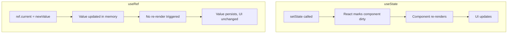

# useRef — The Reference Hook

## Introduction

`useRef` serves two distinct purposes in React: it provides a way to **access DOM elements directly** and a way to **store mutable values that persist across renders without causing re-renders**. Unlike `useState`, changing a ref's value does not trigger a component update.

---

## Why do we need this?

Sometimes you need to interact with the DOM directly — focusing an input, measuring an element's size, or integrating with a third-party library that expects a DOM node. `useState` can't do this because it's tied to React's declarative rendering cycle.

### Problem Statement

You want to auto-focus a search input when a page loads. With `useState`, you'd have to set a state flag, wait for the re-render, and then query the DOM imperatively. With `useRef`, you get a direct reference to the input element and call `.focus()` on it immediately after mount.

---

## Real World Story

Before React 16.3, developers used callback refs or string refs (now deprecated) to access DOM nodes. These approaches were inconsistent and error-prone. The `createRef` API in class components required you to link the ref in the constructor, then pass it to the element. `useRef` simplified this to a single hook call in functional components.

---

## Real World Analogy

Think of `useRef` like a **Locker** that survives between renders vs. `useState` which is like a **Bulletin Board**.

- **useState (Bulletin Board)**: You pin a note, everyone looks at it, and if you change it, everyone re-reads the board (re-renders).
- **useRef (Locker)**: You put a value in your personal locker. You can open the locker, change the contents, and close it — nobody knows or re-reads the board. It's just there, persistent, between shifts (renders).

---

## Visual Explanation



---

## Internal Working

React stores ref values inside the Fiber node's hook linked list, just like `useState`. The difference is that `useRef` returns a **mutable object** (`{ current: initialValue }`) that React does **not** track for changes. The same ref object is returned on every render.

```mermaid
flowchart LR
    subgraph "First Render"
        Ref1[useRef(initialValue)] --> Obj1["{ current: initialValue }"]
    end
    subgraph "Second Render"
        Ref2[useRef(initialValue)] --> Obj2["{ current: sameObject }"]
    end
    Obj1 -.->|"Same reference"| Obj2
    style Obj1 fill:#059669,color:#fff
    style Obj2 fill:#059669,color:#fff
```

---

## Architecture

```mermaid
flowchart TD
    useRef[useRef(initialValue)] --> Object["{ current: initialValue }"]
    Object --> DOM["DOM Ref: <div ref={myRef}/>"]
    Object --> Storage["Storage Ref: mutableValue.current"]
    DOM --> Access["Access input.value, .focus(), .offsetHeight"]
    Storage --> NoReRender["Changes without re-render"]
```

---

## Step-by-Step Flow

```mermaid
sequenceDiagram
    participant Component
    participant useRef
    participant DOM

    Component->>useRef: const inputRef = useRef(null)
    Component->>DOM: <input ref={inputRef} />
    DOM->>inputRef: Sets inputRef.current = <input> element
    Component->>inputRef: inputRef.current.focus()
    Note over inputRef: No re-render needed!
```



---

## Syntax

```javascript
const ref = useRef(initialValue);
// ref.current === initialValue (persists across renders)
// ref.current = newValue (does NOT trigger re-render)
```

---

## Basic Example

Auto-focusing an input on mount:

```jsx
import { useRef, useEffect } from 'react';

export default function AutoFocusInput() {
  const inputRef = useRef(null);

  useEffect(() => {
    // Focus the input element after the component mounts
    inputRef.current.focus();
  }, []);

  return (
    <div style={{ padding: '20px' }}>
      <h3>Auto-Focused Search</h3>
      <input
        ref={inputRef}
        type="text"
        placeholder="Type to search..."
        style={{ padding: '8px', width: '300px' }}
      />
    </div>
  );
}
```

**Explanation:**
- `useRef(null)` creates a ref object with `current` set to `null`.
- The `ref={inputRef}` prop tells React to set `inputRef.current` to the actual DOM node after rendering.
- After mount, `useEffect` runs and calls `inputRef.current.focus()`, moving focus to the input.

---

## Intermediate Example

Tracking previous value without causing re-renders:

```jsx
import { useState, useEffect, useRef } from 'react';

export default function PreviousValueTracker() {
  const [count, setCount] = useState(0);
  const prevCountRef = useRef(null);

  useEffect(() => {
    // Store the current count into ref BEFORE the next render
    prevCountRef.current = count;
  });

  const prevCount = prevCountRef.current;

  return (
    <div style={{ padding: '20px' }}>
      <h3>Previous Value Tracker</h3>
      <p>Current: <strong>{count}</strong></p>
      <p>Previous: <strong>{prevCount ?? '—'}</strong></p>
      <button onClick={() => setCount(c => c + 1)}>Increment</button>
    </div>
  );
}
```

**Explanation:**
- The ref stores the previous `count` value. Because `useEffect` runs after every render, it captures the value **before** the next render updates it.
- The ref never causes a re-render — it silently holds the value for the next render to read.

---

## Advanced Example

Measuring DOM element size with ResizeObserver:

```jsx
import { useState, useEffect, useRef } from 'react';

export default function ElementSizeMeasurer() {
  const [size, setSize] = useState({ width: 0, height: 0 });
  const elementRef = useRef(null);

  useEffect(() => {
    const element = elementRef.current;
    if (!element) return;

    // Measure the element
    const rect = element.getBoundingClientRect();
    setSize({ width: rect.width, height: rect.height });

    // Observe size changes
    const observer = new ResizeObserver((entries) => {
      const { width, height } = entries[0].contentRect;
      setSize({ width, height });
    });

    observer.observe(element);
    return () => observer.disconnect();
  }, []);

  return (
    <div style={{ padding: '20px' }}>
      <h3>Element Size Tracker</h3>
      <div
        ref={elementRef}
        style={{
          padding: '20px',
          border: '2px solid #4f46e5',
          resize: 'both',
          overflow: 'auto',
          minWidth: '100px',
          minHeight: '100px'
        }}
      >
        <p>Resize me! (Drag bottom-right corner)</p>
        <p>Width: <strong>{size.width.toFixed(0)}px</strong></p>
        <p>Height: <strong>{size.height.toFixed(0)}px</strong></p>
      </div>
    </div>
  );
}
```

**Explanation:**
- The ref captures the DOM element, then `ResizeObserver` tracks size changes.
- Unlike `useState`, setting `ref.current` does not cause re-renders — we only call `setSize` when the measured value actually changes.

---

## Production Example

A custom `usePrevious` hook and `forwardRef` pattern for reusable components:

```jsx
import { useRef, useEffect, forwardRef } from 'react';

// Custom hook: usePrevious
function usePrevious(value) {
  const ref = useRef();
  useEffect(() => {
    ref.current = value;
  });
  return ref.current;
}

// forwardRef component: passes ref through to the DOM element
const FancyInput = forwardRef(function FancyInput(props, ref) {
  return (
    <div style={{ margin: '8px 0' }}>
      <label>{props.label}</label>
      <input
        ref={ref}
        {...props}
        style={{
          padding: '10px',
          border: '2px solid #6366f1',
          borderRadius: '6px',
          width: '100%'
        }}
      />
    </div>
  );
});

// Parent component using both patterns
export default function LoginForm() {
  const inputRef = useRef(null);
  const [email, setEmail] = useState('');
  const prevEmail = usePrevious(email);

  useEffect(() => {
    // Focus the email input on mount
    inputRef.current?.focus();
  }, []);

  return (
    <div style={{ padding: '20px', maxWidth: '400px' }}>
      <h3>Login Form</h3>
      <FancyInput
        ref={inputRef}
        label="Email"
        value={email}
        onChange={(e) => setEmail(e.target.value)}
      />
      {prevEmail !== undefined && (
        <p>Previous email: <em>{prevEmail}</em></p>
      )}
    </div>
  );
}
```

**Explanation:**
- `usePrevious` stores the last value in a ref, allowing comparison with the current value.
- `forwardRef` lets parent components pass refs through to child components' DOM nodes.
- Ref changes don't cause re-renders — they're a side channel for data that React doesn't need to track.

---

## Folder Structure

```
src/
├── hooks/
│   └── usePrevious.js
├── components/
│   ├── FancyInput.jsx
│   └── LoginForm.jsx
├── App.jsx
└── main.jsx
```

---

## Best Practices

💡 **Did You Know?**  
Refs are often called an "escape hatch" — they let you step outside React's declarative paradigm and interact with the imperative DOM API directly. Use them sparingly.

🚀 **Best Practices**
- Use refs for DOM access (focus, measurements, media playback).
- Use refs to store mutable values that shouldn't trigger re-renders.
- Avoid using refs to store data that should be displayed in the UI — use `useState` instead.
- Always access `ref.current` inside effects or event handlers, not during render.

---

## Common Mistakes

⚠ **Common Mistakes**

### Reading ref.current During Render
```jsx
// ❌ WRONG — ref might not be set yet
const [width, setWidth] = useState(elementRef.current?.offsetWidth);

// ✅ RIGHT — read in useEffect after DOM is ready
useEffect(() => {
  setWidth(elementRef.current?.offsetWidth);
}, []);
```

### Using useRef Where useState Should Be Used
```jsx
// ❌ WRONG — UI won't update when value changes
const count = useRef(0);
count.current += 1;  // Value changes but component doesn't re-render

// ✅ RIGHT — use useState when UI needs to reflect the value
const [count, setCount] = useState(0);
```

---

## Performance Notes

⚡ **Performance Tips**
- `useRef` is extremely lightweight — creating a ref is just creating a `{ current: value }` object.
- Since refs don't trigger re-renders, they're ideal for storing interval IDs, subscription handles, and cached computations.

---

## Accessibility Notes

♿ **Accessibility Tips**
- Use `ref` to manage focus transitions — when a modal opens, focus the first focusable element inside it.
- Never use refs to bypass semantic HTML. Always use `<button>` for buttons, not `<div ref={...}>`.

---

## SEO Notes

Refs are a client-side concept and don't affect SEO.

---

## Interview Questions

🎯 **Interview Tips**  
Interviewers often ask about the difference between `useRef` and `useState`, and when you'd choose one over the other.

### Q1: What is the difference between useRef and useState?
**Answer**: `useState` returns a value and a setter that triggers a re-render. `useRef` returns a mutable object whose `current` property can be changed without causing a re-render. Use `useState` for data that the UI needs to display. Use `useRef` for DOM access, intervals, and values that need to persist but don't affect the UI.

### Q2: When would you use useRef with forwardRef?
**Answer**: When building a reusable component library, `forwardRef` allows parent components to pass a ref through to the child's underlying DOM node. This is useful for focusing inputs, measuring elements, or integrating with imperative animation libraries.

---

## MCQs

1. **Does changing `ref.current` cause a re-render?**
   - A) Yes, always
   - B) No, never
   - C) Only if the ref was created with `useState`
   - D) Only in development mode
   - *Answer: B*

2. **What is the initial value of `ref.current` if you write `const ref = useRef()`?**
   - A) `undefined`
   - B) `null`
   - C) `0`
   - D) `{}`
   - *Answer: A*

3. **What does `forwardRef` do?**
   - A) Creates a ref automatically
   - B) Forwards a ref from a parent to a child component's DOM node
   - C) Converts a class component ref to a hook
   - D) Prevents refs from being mutated
   - *Answer: B*

4. **When is it safe to read `ref.current` for a DOM element?**
   - A) During render
   - B) Inside useEffect or event handlers (after mount)
   - C) Before the component returns JSX
   - D) In the component's parameter list
   - *Answer: B*

5. **Which is a valid use case for useRef?**
   - A) Storing a counter that the UI displays
   - B) Storing an interval ID for cleanup
   - C) Managing form validation state
   - D) Passing data between sibling components
   - *Answer: B*

---

## Practice Exercise

### Exercise 1: Click Counter (No Re-render)
Create a component that counts clicks using `useRef` instead of `useState`. Log the count to the console, but don't display it on screen.

### Exercise 2: Video Player Controls
Create a component with a `<video>` element and play/pause buttons that use a ref to control playback.

### Exercise 3: Auto-Resize Textarea
Create a textarea that auto-resizes its height as the user types, using a ref to measure scrollHeight.

---

## Debugging Exercise

### The Stale Counter Bug
The following component logs `0` to the console every time the button is clicked, even though `count` should be increasing. Fix the bug.

```jsx
import { useRef } from 'react';

export default function BrokenRefCounter() {
  const countRef = useRef(0);

  const handleClick = () => {
    countRef.current += 1;
    console.log(countRef.current); // Always logs 0?
  };

  return <button onClick={handleClick}>Click me</button>;
}
```

**Solution**: The code actually works correctly — `countRef.current` will increment on each click. A common mistake is to expect the UI to update, which it won't. If the component re-renders for another reason, `countRef.current` will still show the correct accumulated value.

---

## Real-world Scenario

You're building a drawing canvas app that integrates with Canvas API. The user draws lines on a `<canvas>` element. You need to:
1. Get the canvas DOM node to draw on.
2. Store the current drawing state (color, brush size) without re-renders.
3. Expose a "Clear Canvas" function.

**Design Strategy**: Use one ref for the canvas DOM node, one ref for the drawing config (color, size), and expose a `clearCanvas` function using `useImperativeHandle`.

---

## Interview Coding Question

### Problem Statement
Write a custom hook called `useInterval` that accepts a callback and a delay. The interval should be pausable — passing `null` as delay should stop it.

```jsx
import { useEffect, useRef } from 'react';

export function useInterval(callback, delay) {
  const savedCallback = useRef(callback);

  // Remember the latest callback
  useEffect(() => {
    savedCallback.current = callback;
  }, [callback]);

  // Set up the interval
  useEffect(() => {
    if (delay === null && delay !== 0) return;

    const id = setInterval(() => savedCallback.current(), delay);
    return () => clearInterval(id);
  }, [delay]);
}
```

---

## Mini Project

### Drawing Canvas App
Build a simple drawing app with:
- A `<canvas>` element accessed via ref.
- Brush color and size controls (stored in refs — no re-renders needed).
- Clear canvas button.
- Mouse event handlers that draw on the canvas using the ref.

---

## Summary

🧠 **Memory Tricks**  
`useRef = "Locker"` — A personal locker that persists across shifts. You can open it, change the contents, and close it without anyone noticing. Perfect for DOM elements and mutable data.

📖 **Summary**
- `useRef` returns a mutable `{ current: initialValue }` object.
- Changing `ref.current` does NOT trigger a re-render.
- Use refs for DOM access (focus, measurements) and storage (interval IDs, previous values).
- Use `forwardRef` to pass refs through to child components.

---

## Cheat Sheet

```javascript
// Create ref
const ref = useRef(initialValue);

// Attach to DOM
<div ref={ref}>...</div>

// Read value
ref.current

// Update value (no re-render)
ref.current = newValue;

// forwardRef pattern
const Child = forwardRef((props, ref) => (
  <input ref={ref} {...props} />
));
```

---

## Related Topics
- [useEffect & Lifecycle](../use-effect/)
- [Custom Hooks for Reusable Logic](../custom-hooks)
- [useCallback for Stable Functions](../use-callback)

---

## Further Reading
- [React Docs: useRef](https://react.dev/reference/react/useRef)
- [React Docs: forwardRef](https://react.dev/reference/react/forwardRef)
- [React Docs: Manipulating the DOM with Refs](https://react.dev/learn/manipulating-the-dom-with-refs)
