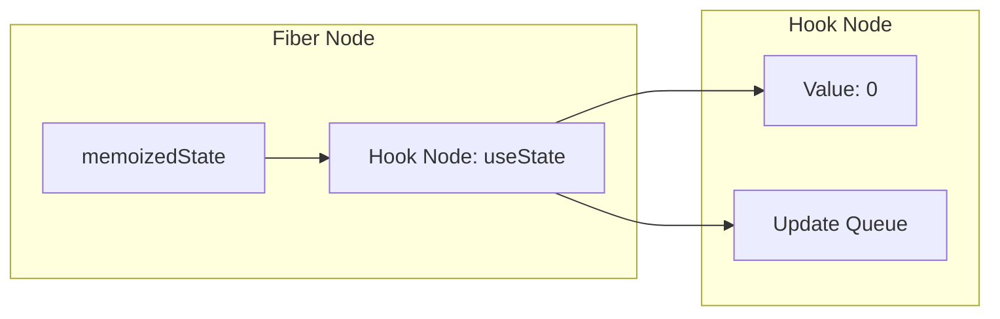
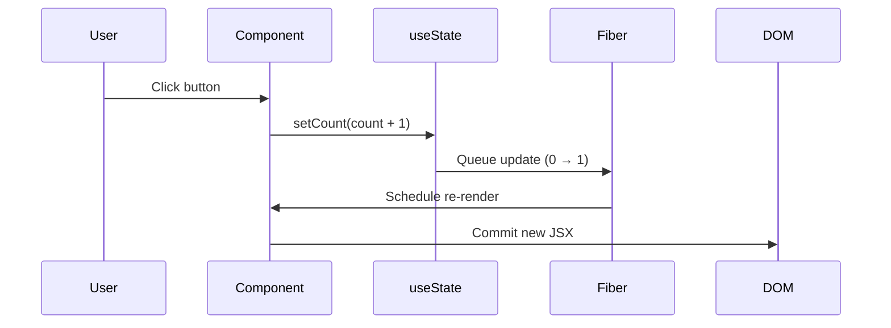

# useState — The Memory Hook

## Introduction

`useState` is React's most fundamental hook. It gives functional components the ability to **remember values across renders** and **trigger re-renders** when those values change. Without it, components would be static.

## Why do we need this?

Variables reset every time a function runs. Components re-render frequently, so we need persistence across renders and a way to notify React of changes.

### Problem Statement

A counter button shows click count. A plain variable fails because it resets to 0 on every render. We need a mechanism that persists between renders and triggers updates.

## Real World Story

Before React 16.8, state required class components with `this.state` and `this.setState()`. Developers had to understand classes, bind event handlers, and manage `this`. `useState` replaced all that boilerplate with a single function call.

## Real World Analogy

A **Post-it Note** vs a **Whiteboard**. The whiteboard gets erased every render. The post-it note survives. The setter is the pen that writes new values.

## Visual Explanation

```mermaid
flowchart TD
    subgraph "Plain Variable"
        A1[Render 1: count = 0] --> A2[count + 1 = 1]
        A2 --> A3[Render 2: count resets to 0]
    end
    subgraph "useState"
        B1[Render 1: useState(0)] --> B2[Call setCount(1)]
        B2 --> B3[React stores in Fiber]
        B3 --> B4[Render 2: returns 1]
    end
```

## Internal Working

React stores state values in a hook node attached to the component's Fiber. Each node stores the current value and a queue of pending updates.



## Architecture

```mermaid
flowchart TD
    Call[useState(initialValue)] --> Destructure[[Destructure]]
    Destructure --> State[State: current value]
    Destructure --> Setter[Setter: setState]
    Setter --> React[React schedules re-render]
```

## Step-by-Step Flow



## Syntax

```javascript
const [state, setState] = useState(initialValue);
```

## Basic Example

```jsx
import { useState } from 'react';

export default function ClickCounter() {
  const [count, setCount] = useState(0);
  return (
    <div>
      <p>You've clicked {count} times</p>
      <button onClick={() => setCount(count + 1)}>Click Me</button>
    </div>
  );
}
```

## Intermediate Example

Form with multiple state variables:

```jsx
import { useState } from 'react';

export default function RegistrationForm() {
  const [name, setName] = useState('');
  const [email, setEmail] = useState('');
  const [submitted, setSubmitted] = useState(false);

  const handleSubmit = (e) => {
    e.preventDefault();
    if (!name || !email) { alert('Fill all fields'); return; }
    setSubmitted(true);
  };

  if (submitted) return (
    <div>
      <p>Registered: {name} ({email})</p>
      <button onClick={() => { setName(''); setEmail(''); setSubmitted(false); }}>Reset</button>
    </div>
  );

  return (
    <form onSubmit={handleSubmit}>
      <input value={name} onChange={e => setName(e.target.value)} placeholder="Name" />
      <input value={email} onChange={e => setEmail(e.target.value)} placeholder="Email" />
      <button type="submit">Submit</button>
    </form>
  );
}
```

## Advanced Example

Functional updates and lazy initialization:

```jsx
import { useState } from 'react';

export default function CounterPanel() {
  const [count, setCount] = useState(0);

  const wrongIncrement = () => {
    setCount(count + 1); setCount(count + 1); setCount(count + 1);
    // Result: 1 (all use stale count)
  };

  const correctIncrement = () => {
    setCount(prev => prev + 1); setCount(prev => prev + 1); setCount(prev => prev + 1);
    // Result: 3 ✅
  };

  const [data] = useState(() => {
    const saved = localStorage.getItem('data');
    return saved ? JSON.parse(saved) : null;
  });

  return (
    <div>
      <p>Count: {count}</p>
      <button onClick={wrongIncrement}>Wrong +3</button>
      <button onClick={correctIncrement}>Correct +3</button>
    </div>
  );
}
```

## Production Example

Theme toggle with localStorage persistence:

```jsx
import { useState, useEffect } from 'react';

function useLocalStorage(key, initialValue) {
  const [value, setValue] = useState(() => {
    try { const item = localStorage.getItem(key); return item ? JSON.parse(item) : initialValue; }
    catch { return initialValue; }
  });
  useEffect(() => { try { localStorage.setItem(key, JSON.stringify(value)); } catch {} }, [key, value]);
  return [value, setValue];
}

export default function ThemeToggle() {
  const [theme, setTheme] = useLocalStorage('theme', 'light');
  return (
    <div style={{ padding: '20px', background: theme === 'dark' ? '#1a1a2e' : '#fff', color: theme === 'dark' ? '#e0e0e0' : '#333' }}>
      <h3>Theme: {theme}</h3>
      <button onClick={() => setTheme(prev => prev === 'light' ? 'dark' : 'light')}>Toggle</button>
    </div>
  );
}
```

## Folder Structure

```
src/
├── components/ClickCounter.jsx
├── components/ThemeToggle.jsx
├── hooks/useLocalStorage.js
└── App.jsx
```

## Best Practices

💡 **Did You Know?** React batches state updates in event handlers — multiple `setState` calls cause only one re-render.

🚀 Use multiple `useState` for unrelated values. Use functional updates when new state depends on previous. Use lazy init for expensive computations.

## Common Mistakes

⚠ **Direct mutation**: `user.name = 'Bob'; setUser(user);` — same reference, no detect. Use `setUser({ ...user, name: 'Bob' })`.

⚠ **Stale closure**: `setTimeout(() => setCount(count + 1), 1000)` — stale count. Use `setCount(prev => prev + 1)`.

## Performance Notes

⚡ Batched updates. Don't store derived values. Use `useMemo` only for truly expensive computations.

## Accessibility Notes

♿ Use `aria-live` for dynamic content. Use semantic HTML for toggles.

## SEO Notes

State renders client-side. Use SSR for SEO-critical content.

## Interview Questions

🎯 **Q1: Why not a plain variable?** Plain variables don't persist across renders. `useState` stores in the Fiber node and triggers re-renders.

**Q2: Functional updates?** Passing a function to the setter that receives the latest pending state. Essential for batched updates.

## MCQs

1. **What does useState return?** A) Single value  B) Array [state, setter]  C) Object  D) Promise → *B*
2. **What happens on setter call?** A) Sync re-render  B) Schedules re-render  C) Page refresh  D) Nothing → *B*
3. **When does lazy initializer run?** A) Every render  B) Only initial render  C) On unmount  D) On state change → *B*
4. **Why does `setCount(c+1)` x3 only +1?** A) Ignores dupes  B) Stale snapshot  C) Throttled  D) Only last runs → *B*
5. **Correct update based on previous?** A) `setCount(c+1)`  B) `setCount(prev => prev+1)`  C) `count++`  D) `state.count++` → *B*

## Practice Exercise

E1: Text input live display. E2: Toggle visibility. E3: Character counter with 100 char red warning.

## Debugging Exercise

Counter always shows 1. Fix: use functional updates.

## Real-world Scenario

Flight booking: 4 independent fields. Use separate `useState` for each.

## Interview Coding Question

Character limit component: 100 char max, red warning, clear button.

## Mini Project

Interactive Poll Creator — question, add options, vote count, highlight leader.

## Summary

🧠 `useState = Sticky Note` — persists between renders.

📖 State persists. Setter triggers re-render. Use functional updates. Use lazy init.

## Cheat Sheet

```javascript
const [s, setS] = useState(init);
setS(prev => prev + 1);
const [s, setS] = useState(() => expensive());
setS(prev => ({ ...prev, key: val }));
setS(prev => [...prev, item]);
```

## Related Topics

[useEffect](../use-effect/) | [useReducer](../use-reducer) | [Hook Fundamentals](../hook-fundamentals)

## Further Reading

[React Docs: useState](https://react.dev/reference/react/useState) | [Queueing Updates](https://react.dev/learn/queueing-a-series-of-state-updates)
