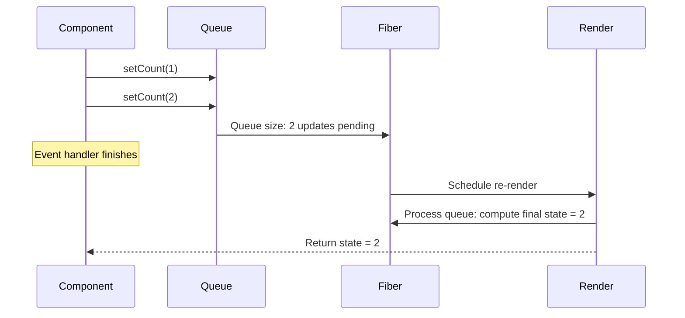

# State Queue & Batching

## Introduction

When you call a state setter (e.g., `setCount(5)`), React does **not** update state immediately. Instead, it queues the update and schedules a re-render. This queue mechanism enables **batching** — grouping multiple state updates into a single re-render for performance.

---

## How the Queue Works

Each `useState` hook has an internal **update queue** stored in the Fiber node. When you call the setter, React adds the update to the queue. During the next render, React processes the queue in order to compute the new state.



---

## Automatic Batching

React 18+ batches **all** state updates by default — inside event handlers, effects, timeouts, and promises. Before React 18, batching only happened inside event handlers.

```jsx
function BatchDemo() {
  const [count, setCount] = useState(0);
  const [flag, setFlag] = useState(false);

  const handleClick = () => {
    // Both updates are batched — only ONE re-render
    setCount(c => c + 1);
    setFlag(f => !f);
  };

  // In React 18+, this ALSO batches
  useEffect(() => {
    setTimeout(() => {
      setCount(c => c + 1);
      setFlag(f => !f);
      // Only ONE re-render
    }, 1000);
  }, []);

  return (
    <button onClick={handleClick}>
      {count} — {flag ? 'On' : 'Off'}
    </button>
  );
}
```

**Before React 18:** Updates inside `setTimeout`, `Promise`, and native events each triggered a separate re-render. React 18 unified batching for all cases.

---

## Functional Updates vs. Regular Updates

```jsx
function Counter() {
  const [count, setCount] = useState(0);

  const handleClick = () => {
    // Regular updates — each uses the same stale snapshot
    setCount(count + 1); // Queues: 0 + 1 = 1
    setCount(count + 1); // Queues: 0 + 1 = 1
    setCount(count + 1); // Queues: 0 + 1 = 1
    // Final result: 1 (not 3!)
  };

  const handleCorrectClick = () => {
    // Functional updates — each receives the latest pending state
    setCount(prev => prev + 1); // Queues: 0 → 1
    setCount(prev => prev + 1); // Queues: 1 → 2
    setCount(prev => prev + 1); // Queues: 2 → 3
    // Final result: 3 ✅
  };

  return (
    <div>
      <p>Count: {count}</p>
      <button onClick={handleClick}>Wrong +1 (should be +3)</button>
      <button onClick={handleCorrectClick}>Correct +3</button>
    </div>
  );
}
```

**Why:** Regular updates (`count + 1`) capture the value of `count` at the time the handler was called — all three see the same `count`. Functional updates (`prev => prev + 1`) are queued in order; each one receives the result of the previous update.

---

## Flushing the Queue Manually

You can force React to flush the queue by reading state inside `flushSync` (React 18+):

```jsx
import { flushSync } from 'react-dom';

flushSync(() => {
  setCount(c => c + 1);
});
// DOM is updated synchronously here
flushSync(() => {
  setFlag(f => !f);
});
// Two separate re-renders (not batched)
```

**Use sparingly:** `flushSync` bypasses batching and forces synchronous DOM updates, which can harm performance. Only use it when you need the DOM updated immediately (e.g., measuring elements).

---

## Summary

- State updates are queued, not applied immediately.
- React batches updates inside event handlers, effects, timeouts, and promises (React 18+).
- Functional updates read from the queue's pending state; regular updates read from the current render's state.
- Use `flushSync` only when you need synchronous DOM updates.

## Related Topics

- [useState Overview](index)
- [Functional Updates](functional-updates)
- [Lazy Initialization](lazy-initialization)

## Further Reading

- [React Docs: Queueing State Updates](https://react.dev/learn/queueing-a-series-of-state-updates)
- [React 18: Automatic Batching](https://react.dev/blog/2022/03/29/react-v18#new-feature-automatic-batching)
