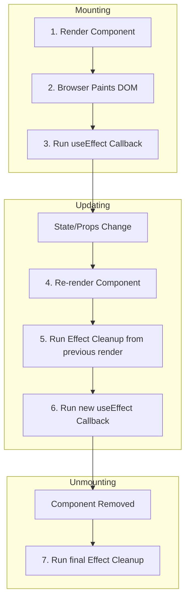
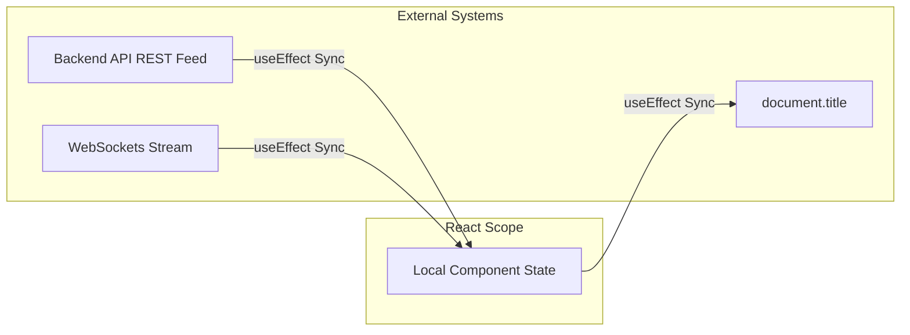
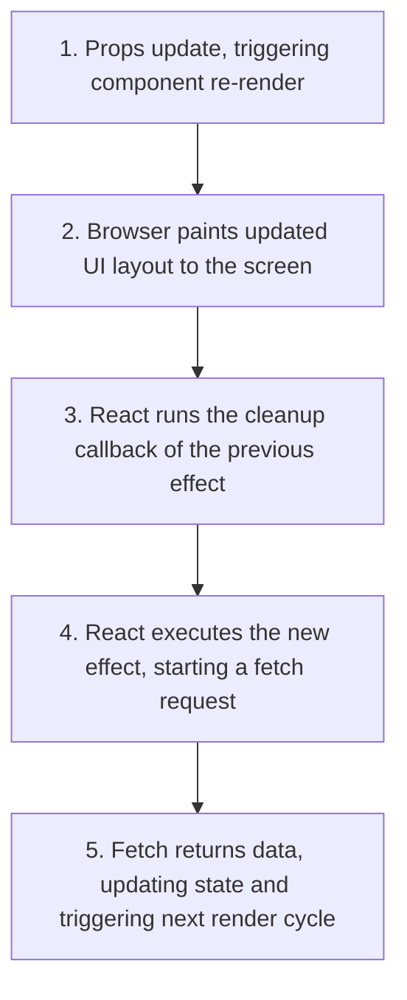

# useEffect & Lifecycle Synchronization

## Introduction

React components should be pure functions that compute JSX based on current props and state, without side effects. However, real-world applications need to perform operations outside this rendering pipeline: fetching data from APIs, subscribing to event listeners, manually editing browser DOM nodes, and starting intervals. In functional components, these operations are called **Side Effects** and are managed using the **useEffect** hook. This module covers side effects, dependency array behavior, cleanup functions, race conditions, and how to avoid infinite render loops.

---

## Why do we need this?

If side effects were executed directly inside the component's main render body, they would run on every render cycle, slowing down the application and causing bugs.

### Problem Statement
Consider a component that fetches user details from an API whenever the user's ID prop changes. If you write the fetch request directly in the render body:

```javascript
export default function UserCard({ userId }) {
  // ❌ Fetch runs on every single render!
  fetch(`/api/users/${userId}`)
    .then(res => res.json())
    .then(data => setUser(data)); // Triggers state change, causing a re-render!
}
```

This creates an **Infinite Loop**:
1. The component renders and starts the fetch request.
2. The fetch finishes and updates the user state.
3. Updating state triggers a re-render.
4. The component renders again and starts a new fetch request.

We need a way to schedule side effects to run only when specific dependencies (like the `userId` prop) change, outside the main render cycle.

---

## Real World Story

In legacy class components, developers managed side effects across different lifecycle methods: data fetching in `componentDidMount`, synchronization updates in `componentDidUpdate`, and clearing event listeners in `componentWillUnmount`.

This split logic caused bugs. A developer would start an interval in `componentDidMount`, but forget to clear it in `componentWillUnmount`, leaking memory. Alternatively, they would fetch data on mount, but forget to write a matching fetch handler in `componentDidUpdate` to check when props changed, leaving the screen showing outdated details. `useEffect` solved this by consolidating related mounting, updating, and unmounting logic into a single hook, making it easier to sync state and manage side effects.

---

## Real World Analogy

Think of `useEffect` like subscribing to a **Magazine Delivery Service** compared to **Checking the Newsstand constantly**.

- **Without useEffect (Checking Constantly)**: Every few minutes, you walk out of your house, drive to the newsstand, buy the newspaper, read the headline, and walk back. If you do this in a loop, you consume all your time and energy, ignoring other tasks.
- **With useEffect (Magazine Subscription)**: You fill out a subscription form once (Mounting). You specify your interest categories (Dependency Array). The service delivers a new magazine to your mailbox only when a new edition matching your categories is published (Updating). When you move out of your house, you cancel the subscription (Cleanup) so magazines stop pile up on your porch (Memory Leak).

---

## Visual Explanation

Below is a diagram showing the rendering cycle of `useEffect` from mount to updates and unmounting.

### useEffect Rendering Lifecycle
```
[Mount: Render Component] ──> [DOM Painted] ──> [Run Effect Callback]
                                                        │
[Update: Props Change] ──> [Run Effect Cleanup] ──> [Run New Effect Callback]
                                                        │
[Unmount: Node Removed] ──> [Run final Effect Cleanup]
```



---

## Internal Working

React executes `useEffect` callbacks asynchronously after the browser has completed the layout paint cycle. This prevents the hook from blocking page rendering, keeping your application responsive.

During rendering:
1. React registers the hook and stores the dependency array in memory.
2. React compares the dependencies from the current render with the dependencies from the previous render.
3. If the dependencies are identical (using `Object.is` check), React skips the effect.
4. If the dependencies have changed (or if no dependency array was provided), React schedules the effect to run after the browser paints the DOM.

```mermaid
sequenceDiagram
    participant Component as Component Code
    participant Reconciler as React Reconciler
    participant Browser as Web Browser DOM

    Component->>Reconciler: Render with deps: [userId]
    Reconciler->>Reconciler: Check if userId changed (Object.is)
    Note over Reconciler: Yes, userId changed
    Reconciler->>Browser: Update DOM nodes
    Browser-->>Browser: Paints layout to screen
    Note over Reconciler: Paint finished; run scheduled effect
    Reconciler->>Component: Execute useEffect cleanup callback
    Reconciler->>Component: Execute new useEffect callback
```

---

## Architecture

Effects are synchronizers. They align your component's state with external systems: document headers, socket connections, network streams, and browser events.



---

## Step-by-Step Flow

When fetching data inside `useEffect` with cleanups, the following steps occur:



---

## Syntax

```javascript
// Dependency Array Variations
useEffect(() => {
  // Runs on EVERY single render cycle
});

useEffect(() => {
  // Runs ONLY ONCE on mount, cleanup runs on unmount
}, []);

useEffect(() => {
  // Runs on mount, and whenever dependency variables change
}, [dependencyA, dependencyB]);
```

---

## Basic Example

Here is a basic component that synchronizes the browser document title with a local state variable using `useEffect`.

```jsx
import React, { useState, useEffect } from 'react';

export default function DocumentTitleSync() {
  const [clickCount, setClickCount] = useState(0);

  // Sync document title with the count state
  useEffect(() => {
    document.title = `Likes: ${clickCount}`;
    console.log(`Document title updated to: Likes: ${clickCount}`);
  }, [clickCount]); // Re-runs only when clickCount changes

  return (
    <div style={{ padding: '16px' }}>
      <h3>Sync Document Title</h3>
      <button onClick={() => setClickCount(clickCount + 1)}>
        Like Post ({clickCount})
      </button>
    </div>
  );
}
```

---

## Intermediate Example

An intermediate component showing how to register window event listeners inside `useEffect`. It returns a cleanup function to remove the listener, preventing memory leaks when the component unmounts.

```jsx
import React, { useState, useEffect } from 'react';

export default function WindowResizeListener() {
  const [windowSize, setWindowSize] = useState({
    width: window.innerWidth,
    height: window.innerHeight
  });

  useEffect(() => {
    const handleResize = () => {
      setWindowSize({
        width: window.innerWidth,
        height: window.innerHeight
      });
      console.log('Window resized: updating state...');
    };

    // Register event listener on mount
    window.addEventListener('resize', handleResize);

    //  CLEANUP: Remove event listener on unmount
    return () => {
      console.log('Unmounting component: clearing resize listener...');
      window.removeEventListener('resize', handleResize);
    };
  }, []); // Empty array ensures listener is registered only once on mount

  return (
    <div style={{ padding: '16px', background: '#eaeaea' }}>
      <h3>Resize Monitor</h3>
      <p>Width: <strong>{windowSize.width}px</strong></p>
      <p>Height: <strong>{windowSize.height}px</strong></p>
    </div>
  );
}
```

---

## Advanced Example

An advanced example showing how to fetch data using `useEffect` while handling **Race Conditions**. If the user clicks multiple user profiles in rapid succession, responses may return out of order. We use a boolean flag (`isCurrentFetch`) to ignore stale network responses.

```jsx
import React, { useState, useEffect } from 'react';

export default function StaleFetchAvoidance({ activeProfileId }) {
  const [profileData, setProfileData] = useState(null);
  const [loading, setLoading] = useState(false);

  useEffect(() => {
    let isCurrentFetch = true; // Boolean flag protects against race conditions
    setLoading(true);

    console.log(`Starting fetch request for profile ID: ${activeProfileId}`);
    fetch(`https://jsonplaceholder.typicode.com/users/${activeProfileId}`)
      .then(res => res.json())
      .then(data => {
        // Only update state if this is still the active fetch request
        if (isCurrentFetch) {
          setProfileData(data);
          setLoading(false);
          console.log(`Successfully loaded profile data for ID: ${activeProfileId}`);
        } else {
          console.warn(`Ignored stale fetch response for profile ID: ${activeProfileId}`);
        }
      });

    //  CLEANUP: Mark this fetch as stale when activeProfileId changes or component unmounts
    return () => {
      isCurrentFetch = false;
    };
  }, [activeProfileId]); // Re-runs when activeProfileId changes

  return (
    <div style={{ padding: '16px', border: '1px solid #ccc' }}>
      <h3>Profile Explorer</h3>
      {loading ? (
        <p>Fetching profile details...</p>
      ) : profileData ? (
        <div>
          <p>Name: <strong>{profileData.name}</strong></p>
          <p>Email: {profileData.email}</p>
        </div>
      ) : (
        <p>No profile data loaded.</p>
      )}
    </div>
  );
}
```

---

## Production Example

A production-ready data-fetching component utilizing an **AbortController** to cancel ongoing HTTP requests when the component unmounts or updates, and handling loading and error states.

```jsx
import React, { useState, useEffect } from 'react';

export default function ProductionProfilePanel({ userId }) {
  const [user, setUser] = useState(null);
  const [loading, setLoading] = useState(false);
  const [error, setError] = useState(null);

  useEffect(() => {
    // 1. Create AbortController instance
    const controller = new AbortController();
    const { signal } = controller;

    async function fetchUser() {
      setLoading(true);
      setError(null);
      try {
        const response = await fetch(`https://jsonplaceholder.typicode.com/users/${userId}`, { signal });
        if (!response.ok) {
          throw new Error(`HTTP error! Status: ${response.status}`);
        }
        const data = await response.json();
        setUser(data);
      } catch (err) {
        // Ignore errors triggered by aborting the request
        if (err.name !== 'AbortError') {
          setError(err.message || 'An error occurred during fetching.');
        }
      } finally {
        setLoading(false);
      }
    }

    fetchUser();

    //  CLEANUP: Cancel the HTTP request if component updates or unmounts before response finishes
    return () => {
      console.log(`Cancelling pending request for User ID: ${userId}`);
      controller.abort();
    };
  }, [userId]);

  if (loading) return <div aria-live="polite">Loading details...</div>;
  if (error) return <div role="alert" style={{ color: 'red' }}>Error: {error}</div>;

  return (
    <div>
      {user ? (
        <div>
          <h4>Team Member Profile</h4>
          <p>User: {user.name}</p>
          <p>Company: {user.company?.name}</p>
        </div>
      ) : (
        <p>No profile selected.</p>
      )}
    </div>
  );
}
```

---

## Folder Structure

```
useeffect-lifecycle/
├── src/
│   ├── components/
│   │   ├── StaleFetchAvoidance.jsx
│   │   └── ProductionProfilePanel.jsx
│   ├── App.jsx
│   └── main.jsx
├── package.json
└── vite.config.js
```

---

## Best Practices

💡 **Did You Know?**  
React's `useEffect` hook runs asynchronously after the browser paints the DOM, ensuring page updates are not blocked. If you need to perform DOM measurements before the browser paints, use the synchronous `useLayoutEffect` hook instead.

🚀 **Best Practices**
- Keep effects focused on a single synchronization task. Avoid combining unrelated logic into a single `useEffect`.
- Include all variables read inside the effect that change over time (like props and state) in the dependency array. Use ESLint rules to enforce this.
- Always return a cleanup function to clean up intervals, timers, event listeners, and socket subscriptions.

---

## Common Mistakes

⚠ **Common Mistakes**

### Forgetting the Dependency Array
Forgetting to provide a dependency array inside `useEffect` causes the effect callback to run on **every single render cycle**, resulting in slow rendering performance and infinite loops.

```jsx
// ❌ WRONG
useEffect(() => {
  fetchData();
}); // Runs on every single render!

//  RIGHT
useEffect(() => {
  fetchData();
}, []); // Runs only once on mount
```

### Stale Closures inside Effects
If you omit variables read inside the effect from the dependency array, the effect callback will reference stale state values from previous render cycles (stale closures).

```jsx
// ❌ WRONG
useEffect(() => {
  const timer = setInterval(() => {
    console.log("Current count value:", count); // count remains 0 because it's missing from deps
  }, 1000);
  return () => clearInterval(timer);
}, []); // count omitted from dependencies array

//  RIGHT
useEffect(() => {
  const timer = setInterval(() => {
    console.log("Current count value:", count);
  }, 1000);
  return () => clearInterval(timer);
}, [count]); // count added to dependencies list
```

---

## Performance Notes

⚡ **Performance Tips**
Updating local state inside `useEffect` triggers a re-render of the component. To optimize performance and avoid unnecessary re-renders, try to calculate values directly during rendering instead of storing them in state via effects.

### Performance Example
Avoid storing derived values in state. Calculate them during rendering instead:

```jsx
// ❌ Performance Anti-pattern: state updates trigger a redundant re-render
const [fullName, setFullName] = useState('');
useEffect(() => {
  setFullName(`${firstName} ${lastName}`);
}, [firstName, lastName]);

//  Performance Optimization: calculate derived value during rendering
const fullName = `${firstName} ${lastName}`; // No re-render triggered
```

---

## Accessibility Notes

♿ **Accessibility Tips**
When updating content dynamically inside `useEffect` (like loading profiles or search results), use `aria-live="polite"` on the container element so that screen reader users are notified of the updates.

---

## SEO Notes

Ensure that your initial HTML layout contains semantic structure. If search engine crawlers index the page before client-side `useEffect` data loads, they can still index the page layout and semantic headers correctly.

---

## Interview Questions

🎯 **Interview Tips**  
In an interview, explain that the dependency array determines when the effect executes (React checks dependencies using `Object.is` check). If dependencies change, React runs the cleanup callback from the previous render, and then runs the new effect.

### Q1: Why do we need a cleanup function in `useEffect`?
**Answer**: A cleanup function is used to clean up side effects before the component unmounts or before re-running the effect due to dependency updates. It clears intervals, timers, event listeners, and socket subscriptions, preventing memory leaks in the browser.

### Q2: What are Race Conditions in data fetching, and how do you solve them?
**Answer**: Race conditions occur when multiple fetch requests are sent in rapid succession, and their responses return out of order. This can cause a slower response to overwrite a newer response, displaying outdated data on screen. This can be resolved by using a boolean flag inside the effect that is set to false in the cleanup callback, or by using `AbortController` to cancel ongoing requests when dependencies change.

---

## MCQs

1. **When does the `useEffect` callback execute?**
   - A) Synchronously before the DOM is compiled.
   - B) Asynchronously after the browser has completed the layout paint cycle.
   - C) Inside the component's constructor.
   - D) Only on user clicks.
   - *Answer: B*

2. **How does React determine if a `useEffect` callback should run after an update?**
   - A) By checking if the DOM has updated.
   - B) By comparing the current dependency array values with the previous ones using `Object.is` checks.
   - C) By checking local storage keys.
   - D) By measuring the CPU temperature.
   - *Answer: B*

3. **What happens if you provide an empty dependency array (`[]`) to `useEffect`?**
   - A) The effect callback runs on every render.
   - B) The effect callback runs only once on mount, and its cleanup runs on unmount.
   - C) The effect is ignored.
   - D) The browser throws compilation errors.
   - *Answer: B*

4. **Which browser API is used to cancel active network requests inside effects?**
   - A) WebSockets
   - B) AbortController
   - C) serviceWorker
   - D) localStorage
   - *Answer: B*

5. **How can you avoid infinite render loops inside `useEffect`?**
   - A) By removing all state setters from the effect callback.
   - B) By specifying a correct dependency array, ensuring any state variables updated inside the effect are omitted or checked carefully.
   - C) By wrapping the hook inside an `if` condition.
   - D) By disabling React Strict Mode.
   - *Answer: B*

---

## Practice Exercise

### Exercise 1: Cleanup interval builder
Write a component that uses `useEffect` to start an interval that increments a counter every second. Return a cleanup function that clears the interval when the component unmounts.

### Exercise 2: Geolocation Tracker
Create a component that tracks the user's geolocation coordinates (`navigator.geolocation.watchPosition`) inside an effect. Ensure that you clear the geolocation watch handler in the cleanup callback.

### Exercise 3: Dynamic Image Fetcher
Create a component that fetches a random puppy image from `https://dog.ceo/api/breeds/image/random` whenever a category prop changes. Use `AbortController` to handle user navigation changes.

---

## Debugging Exercise

### The Keyboard Listener Leak
A developer is registering a keyboard shortcut listener in their component, but when they navigate to other pages and back, keyboard events trigger multiple times. Identify the bug and write the fix.

```jsx
import React, { useState, useEffect } from 'react';

export default function KeyboardShortcutPanel() {
  const [lastKey, setLastKey] = useState('');

  useEffect(() => {
    const handleKeyDown = (e) => {
      console.log("Key pressed:", e.key);
      setLastKey(e.key);
    };

    // BUG: Missing cleanup function to remove the event listener
    window.addEventListener('keydown', handleKeyDown);
  }, []); // Registered only once on mount

  return <div>Last key pressed: {lastKey}</div>;
}
```

#### Solution
The event listener is registered on mount, but is not removed when the component unmounts. When the user navigates away and returns, duplicate event listeners are registered, leaking memory and triggering multiple times. To fix this, return a cleanup function that removes the event listener:

```jsx
// Corrected
useEffect(() => {
  const handleKeyDown = (e) => {
    console.log("Key pressed:", e.key);
    setLastKey(e.key);
  };

  window.addEventListener('keydown', handleKeyDown);

  // Return cleanup callback to remove the event listener
  return () => {
    window.removeEventListener('keydown', handleKeyDown);
  };
}, []);
```

---

## Real-world Scenario

You are building a dynamic chat application. When the user selects a chat room, the component joins the room using a WebSocket connection and fetches historical messages. Sibling components must be notified of updates. Explain how you would manage this connection and cleanups using effects.
- **Design Strategy**: Create a `useEffect` hook that depends on the `roomId` prop. When the `roomId` changes, close the previous WebSocket connection and open a new connection to the selected room. Return a cleanup callback that safely closes the active WebSocket connection to prevent background leaks when the user leaves the chat.

---

## Interview Coding Question

### Problem Statement
Write a component that auto-saves input field text to `localStorage` 1 second after the user stops typing (implementing a **Debounce** function). Ensure:
- The save timer is reset if the user types another character before the 1 second completes.
- You print a message when saving data, demonstrating that auto-saves are debounced correctly.

```jsx
import React, { useState, useEffect } from 'react';

export default function DebouncedAutoSaveForm() {
  const [text, setText] = useState('');
  const [status, setStatus] = useState('Idle');

  useEffect(() => {
    // Skip saving empty text on initial mount
    if (!text) return;

    setStatus('Typing...');
    const timer = setTimeout(() => {
      localStorage.setItem('autosave_draft_text', text);
      setStatus('Draft Saved!');
      console.log('Saved draft: ', text);
    }, 1000); // 1 second debounce delay

    //  CLEANUP: Clears the timeout if the user types a new character before 1 second completes
    return () => {
      clearTimeout(timer);
    };
  }, [text]);

  return (
    <div style={{ padding: '16px' }}>
      <h3>Debounced Auto-Save Draft</h3>
      <textarea
        value={text}
        onChange={e => setText(e.target.value)}
        placeholder="Type comments here..."
        style={{ width: '100%', height: '80px' }}
      />
      <p>Status: <strong>{status}</strong></p>
    </div>
  );
}
```

---

## Mini Project

### API Sandbox Dashboard
Create an interactive API dashboard panel:
- Renders selectors for multiple mock endpoints (e.g., `/users`, `/posts`, `/comments`).
- Use `useEffect` to fetch details from the selected endpoint when it changes.
- Display a loading indicator, clean up pending requests using `AbortController` if the user changes selections mid-fetch, and render the JSON output inside a styled scroll panel on screen.

---

## Summary

🧠 **Memory Tricks**  
`Cleanup stops leaks` - Faucets (event listeners, connections, intervals) opened inside an effect must be closed inside the cleanup return callback, preventing background memory leaks in the browser.

📖 **Summary**  
`useEffect` synchronizes components with external systems. By checking dependencies using `Object.is` and running cleanup callbacks before re-running effects or unmounting components, React keeps side effects optimized and prevents memory leaks.

---

## Cheat Sheet

```javascript
// Synchronizing effects with cleanup callbacks
useEffect(() => {
  const socket = openConnection();

  return () => {
    closeConnection(socket); // Safely close connection on cleanup
  };
}, [dependencyId]);
```

---

## Related Topics
- [React Hook Fundamentals](hook-fundamentals)
- [Optimization Hooks (useRef)](optimization-hooks)

---

## Further Reading
- [React Docs: Synchronizing with Effects](https://react.dev/learn/synchronizing-with-effects)
- [React Docs: You Might Not Need an Effect](https://react.dev/learn/you-might-not-need-an-effect)
