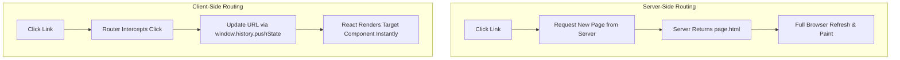
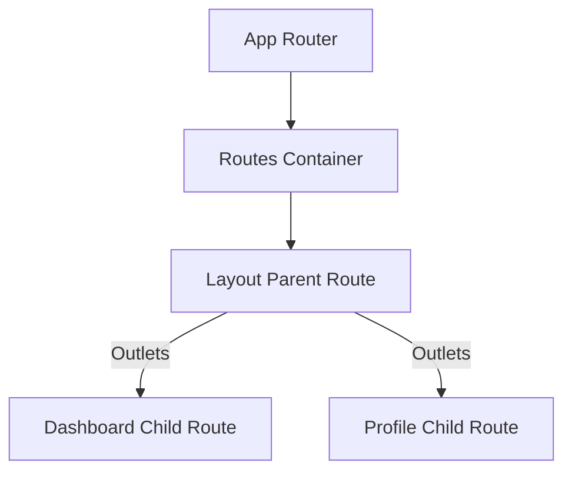
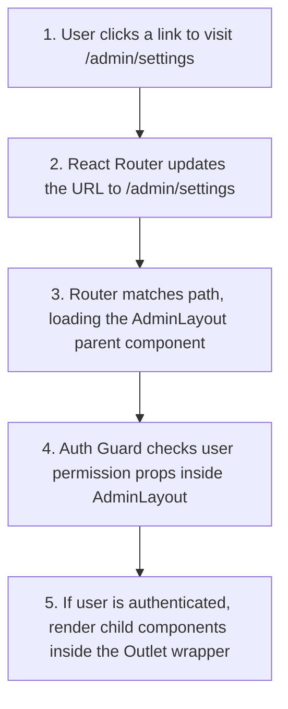

# Client-Side Routing with React Router

## Introduction

In traditional web applications, navigating between pages requires the browser to request a new HTML page from the server, causing a slow and jarring page reload. In Single Page Applications (SPAs), we use **Client-Side Routing** to transition between pages instantly. Client-side routers intercept click events on links, update the browser URL using the HTML5 History APIs, and update the UI by rendering the corresponding components without reloading the browser. This module covers setting up, configuring, and optimizing routes using **React Router (v6+)**.

---

## Why do we need this?

Without client-side routing, users cannot bookmark specific page links, share URLs with friends, or navigate the application using the browser's Back and Forward buttons.

### Problem Statement
Consider an application that displays a dashboard, a user profile, and a settings page. If you manage navigation using a simple state variable:

```jsx
export default function App() {
  const [currentPage, setCurrentPage] = useState('dashboard');
  
  // Changing tabs updates state but doesn't change the browser URL
  return (
    <div>
      <Navbar onNavigate={setCurrentPage} />
      {currentPage === 'dashboard' && <Dashboard />}
      {currentPage === 'profile' && <Profile />}
    </div>
  );
}
```

When the user navigates to the Profile page, the browser URL remains `yoursite.com/`. If the user refreshes the page, the application resets and loads the Dashboard page, losing the user's active page. Sibling components cannot bookmark the profile page, and the browser's Back button is disabled because no URL navigation occurred.

---

## Real World Story

In the early days of React, developers built routing systems by writing custom hash listener scripts (`window.addEventListener('hashchange')`). 

In 2014, Michael Jackson and Ryan Florence created React Router. It quickly became the industry standard routing system because it integrated cleanly with React's component model. Over the years, the library went through major updates. Version 4 introduced dynamic routing, while version 6 restructured the API, replacing `<Switch>` with `<Routes>`, introducing index routes, and adding support for data loading loaders. Today, React Router powers the routing systems of large-scale production applications and serves as the foundation for the Remix full-stack framework.

---

## Real World Analogy

Think of client-side routing like an **Interactive Museum Information Desk** compared to **Exiting and Re-entering the Building**.

- **Traditional Server Routing (Re-entering the Building)**: To visit the Egyptian gallery after viewing the paintings, you must walk out the front entrance of the museum, walk down the street to the ticket office, buy a ticket, enter the Egyptian building, and walk to the gallery. It is slow and disruptive.
- **Client-Side Routing (Information Desk)**: You stand inside the museum lobby. When you want to visit the Egyptian gallery, you read the map directory, turn a corner, and walk down a hallway (Client-side routing). You remain inside the building, the journey is instant, and the museum lobby updates the signage automatically to guide you.

---

## Visual Explanation

Below is a diagram comparing traditional server-side navigation with client-side navigation.

### Traditional Server Routing
```
[User Clicks Link] ──> [Browser Requests page.html] ──> [Server returns html] ──> [Full Page Reload]
```

### Client-Side Routing (React Router)
```
[User Clicks Link] ──> [Router intercepts click] ──> [Update URL via History API] ──> [Render Component]
```



---

## Internal Working

React Router uses the HTML5 **History API** (`window.history.pushState` and `window.history.replaceState`) to update the browser URL without triggering a page reload.

When a user clicks a `<Link to="/profile">` component:
1. The component intercepts the browser's default click navigation event (`event.preventDefault()`).
2. The router updates the browser's URL path using `window.history.pushState`.
3. The router notifies its internal path listeners that the URL has changed.
4. The router compares the new URL path with your route configuration rules, identifies the matching component, and renders it on screen.

```mermaid
sequenceDiagram
    participant User as User
    participant Link as Link Component
    participant Router as React Router Engine
    participant History as Browser History API
    participant DOM as Browser DOM

    User->>Link: Click link to "/profile"
    Link->>Link: Prevent default click navigation
    Link->>History: pushState(null, '', '/profile')
    History-->>Router: Trigger path change listener
    Router->>Router: Match '/profile' to ProfileComponent
    Router->>DOM: Render ProfileComponent in place of Dashboard
```

---

## Architecture

React Router v6 uses a nested component structure to manage layout hierarchies. Sibling route components render inside their parent component's `<Outlet />` wrapper.



---

## Step-by-Step Flow

When a user navigates to a nested, protected route, the following steps occur:



---

## Syntax

```jsx
// React Router v6 setup syntax
import { BrowserRouter, Routes, Route } from 'react-router-dom';

function App() {
  return (
    <BrowserRouter>
      <Routes>
        <Route path="/" element={<Home />} />
        <Route path="about" element={<About />} />
      </Routes>
    </BrowserRouter>
  );
}
```

---

## Basic Example

Here is a basic routed application with navigation links and route definitions.

```jsx
import React from 'react';
import { BrowserRouter, Routes, Route, Link } from 'react-router-dom';

function Home() { return <h2>Home Page</h2>; }
function Features() { return <h2>Features Page</h2>; }

export default function BasicRouterApp() {
  return (
    <BrowserRouter>
      <nav style={{ padding: '10px', borderBottom: '1px solid #ccc' }}>
        {/* Use Link instead of standard anchor tags to prevent page reloads */}
        <Link to="/" style={{ marginRight: '12px' }}>Home</Link>
        <Link to="/features">Features</Link>
      </nav>
      
      <div style={{ padding: '20px' }}>
        <Routes>
          <Route path="/" element={<Home />} />
          <Route path="/features" element={<Features />} />
        </Routes>
      </div>
    </BrowserRouter>
  );
}
```

---

## Intermediate Example

An intermediate component showing **Nested Routes** and **Layout Outlets**. It uses the `<Outlet />` component to render child route components inside a shared navigation layout structure.

```jsx
import React from 'react';
import { BrowserRouter, Routes, Route, Link, Outlet } from 'react-router-dom';

// Parent Layout Component
function DashboardLayout() {
  return (
    <div style={{ display: 'flex', minHeight: '300px' }}>
      <aside style={{ width: '150px', background: '#f0f0f0', padding: '16px' }}>
        <h4>Menu</h4>
        <ul style={{ paddingLeft: '20px' }}>
          <li><Link to="/dashboard">Stats</Link></li>
          <li><Link to="/dashboard/users">Users</Link></li>
        </ul>
      </aside>
      <main style={{ flexGrow: 1, padding: '16px' }}>
        <h3>Dashboard Panel</h3>
        {/* Child route components are rendered inside the Outlet wrapper */}
        <Outlet />
      </main>
    </div>
  );
}

function Stats() { return <p>Global Stats: 98% Active</p>; }
function Users() { return <p>Users Registry: 1,420 Users Loaded</p>; }

export default function NestedRouterApp() {
  return (
    <BrowserRouter>
      <Routes>
        <Route path="/dashboard" element={<DashboardLayout />}>
          {/* Index route is rendered at the parent path "/dashboard" */}
          <Route index element={<Stats />} />
          <Route path="users" element={<Users />} />
        </Route>
      </Routes>
    </BrowserRouter>
  );
}
```

---

## Advanced Example

An advanced component illustrating **Dynamic Route Parameters** (`useParams`) and **Query Parameters** (`useSearchParams`). It reads dynamic IDs from the URL and applies search filters using query strings.

```jsx
import React from 'react';
import { BrowserRouter, Routes, Route, Link, useParams, useSearchParams } from 'react-router-dom';

// Product Details Component: reads dynamic ID parameter from the URL
function ProductDetails() {
  const { productId } = useParams(); // Hook parses dynamic path: /products/:productId
  return (
    <div>
      <h4>Product Inspector</h4>
      <p>Viewing product details for ID: <strong>{productId}</strong></p>
      <Link to="/products">Back to list</Link>
    </div>
  );
}

// Catalog Component: reads and updates query string search parameters
function ProductsCatalog() {
  const [searchParams, setSearchParams] = useSearchParams();
  const filterQuery = searchParams.get('filter') || '';

  const products = ['Laptop', 'Smartphone', 'Tablet', 'Headphones'];
  const filteredProducts = products.filter(p => p.toLowerCase().includes(filterQuery.toLowerCase()));

  return (
    <div>
      <h4>Products Directory</h4>
      <input
        type="text"
        placeholder="Filter products..."
        value={filterQuery}
        onChange={e => setSearchParams({ filter: e.target.value })}
        style={{ padding: '6px', marginBottom: '12px' }}
      />
      <ul>
        {filteredProducts.map(p => (
          <li key={p}>
            {p} - <Link to={`/products/${p.toLowerCase()}`}>View Info</Link>
          </li>
        ))}
      </ul>
    </div>
  );
}

export default function DirectoryRouterApp() {
  return (
    <BrowserRouter>
      <div style={{ padding: '20px' }}>
        <Routes>
          <Route path="/products" element={<ProductsCatalog />} />
          <Route path="/products/:productId" element={<ProductDetails />} />
        </Routes>
      </div>
    </BrowserRouter>
  );
}
```

---

## Production Example

A production-grade routed setup demonstrating **Protected Routes (Auth Guards)**, programmatic redirection, and fallback layouts for unrecognized paths (404 pages).

```jsx
import React, { useState } from 'react';
import { BrowserRouter, Routes, Route, Link, Navigate, useNavigate, Outlet } from 'react-router-dom';

// Protected Route Wrapper Component
function ProtectedRoute({ isAuthenticated, redirectPath = '/login' }) {
  if (!isAuthenticated) {
    // Redirect unauthenticated users to the Login page
    return <Navigate to={redirectPath} replace />;
  }
  // Render child routes inside the Outlet
  return <Outlet />;
}

function AdminPanel() {
  const navigate = useNavigate(); // Hook for programmatic navigation
  
  const handleLogout = () => {
    alert('Logging out...');
    // Redirect user to the login page programmatically
    navigate('/login');
  };

  return (
    <div style={{ border: '2px solid red', padding: '16px' }}>
      <h2>Secure Admin Panel</h2>
      <p>Sensitive settings drawer active.</p>
      <button onClick={handleLogout}>Log Out</button>
    </div>
  );
}

function LoginPage({ onLogin }) {
  const navigate = useNavigate();
  const handleLoginSubmit = () => {
    onLogin();
    navigate('/admin'); // Redirect to admin panel on login
  };

  return (
    <div>
      <h2>Login Portal</h2>
      <button onClick={handleLoginSubmit}>Sign In</button>
    </div>
  );
}

function PageNotFound() {
  return (
    <div style={{ textAlign: 'center', padding: '40px' }}>
      <h2>404 - Page Not Found</h2>
      <p>The page URL path does not match any route rules.</p>
      <Link to="/login">Go to Login</Link>
    </div>
  );
}

export default function SecureRouterConsole() {
  const [authed, setAuthed] = useState(false);

  return (
    <BrowserRouter>
      <div style={{ padding: '20px' }}>
        <Routes>
          <Route path="/login" element={<LoginPage onLogin={() => setAuthed(true)} />} />
          
          {/* Wrap secure routes inside the ProtectedRoute container */}
          <Route element={<ProtectedRoute isAuthenticated={authed} />}>
            <Route path="/admin" element={<AdminPanel />} />
          </Route>

          {/* Catch-all route renders 404 page for unmatched paths */}
          <Route path="*" element={<PageNotFound />} />
        </Routes>
      </div>
    </BrowserRouter>
  );
}
```

---

## Folder Structure

```
client-side-routing/
├── src/
│   ├── components/
│   │   ├── ProtectedRoute.jsx
│   │   └── PageNotFound.jsx
│   ├── App.jsx
│   └── main.jsx
├── package.json
└── vite.config.js
```

---

## Best Practices

💡 **Did You Know?**  
React Router v6 provides a `<NavLink>` component. Unlike the standard `<Link>`, `<NavLink>` automatically adds an `"active"` CSS class to the link element when its route matches the current URL path, making it easy to style active navigation tabs.

🚀 **Best Practices**
- Use `<Link>` or `<NavLink>` instead of standard anchor tags (`<a>`) to navigate between pages. Anchor tags trigger a full page reload, losing your application's state.
- Keep route structures nested to share layouts (like navbars or sidebars) across routes without rebuilding them on every page transition.
- Define a catch-all route (`path="*"`) at the end of your routes list to handle invalid paths and render a helpful 404 page.

---

## Common Mistakes

⚠ **Common Mistakes**

### Using Anchor Tags for Navigation
Using standard anchor tags (`<a href="/profile">`) inside a React application triggers a full page reload. This resets React's state in memory, losing all unsaved state data.

```jsx
// ❌ WRONG
function Navbar() {
  return <a href="/dashboard">Dashboard</a>; // Triggers full page reload, losing state
}

//  RIGHT
function Navbar() {
  return <Link to="/dashboard">Dashboard</Link>; // Smooth client-side navigation
}
```

### Missing Outlet in Parent Layouts
Creating a nested route structure but forgetting to place the `<Outlet />` component in the parent component's layout will prevent the child components from rendering on screen.

```jsx
// ❌ WRONG
function Layout() {
  return (
    <div className="layout">
      <Navbar />
      {/* Child components will not render because Outlet is missing */}
    </div>
  );
}

//  RIGHT
function Layout() {
  return (
    <div className="layout">
      <Navbar />
      <Outlet /> {/* Renders child route components here */}
    </div>
  );
}
```

---

## Performance Notes

⚡ **Performance Tips**
Webpack or Vite bundles all route components into a single large JavaScript file. For large applications, this increases the initial page load time. Optimize performance by using **Lazy Loading** (`React.lazy` and `Suspense`) to split route bundles, loading page components only when the user navigates to them.

### Performance Example
Using lazy loading to split route bundles:

```jsx
import React, { lazy, Suspense } from 'react';
import { BrowserRouter, Routes, Route } from 'react-router-dom';

// Dynamically load the AdminPanel page component only when requested
const AdminPanel = lazy(() => import('./pages/AdminPanel.jsx'));

export function App() {
  return (
    <BrowserRouter>
      <Suspense fallback={<div>Loading page...</div>}>
        <Routes>
          <Route path="/admin" element={<AdminPanel />} />
        </Routes>
      </Suspense>
    </BrowserRouter>
  );
}
```

---

## Accessibility Notes

♿ **Accessibility Tips**
- Screen reader users may not notice client-side page transitions because the browser doesn't trigger a reload. Use aria-live announcers or focus managers to guide focus to the page's main heading when a new page loads.
- Ensure all navigation links have descriptive text content. Use `aria-label` attributes for icon-only navigation links.

---

## SEO Notes

Client-side routers depend on JavaScript to render layouts. To optimize your application's SEO search engine indexing, configure pre-rendering steps or use SSR frameworks like Next.js or Remix.

---

## Interview Questions

🎯 **Interview Tips**  
In an interview, explain client-side routing as "updating the browser URL using the HTML5 History API without triggering a full page reload." Contrast this with server-side routing, which requests a new page from the server on every transition.

### Q1: What is the difference between client-side routing and server-side routing?
**Answer**: Server-side routing requests a new HTML page from the server on every navigation link click, causing a full page reload and losing application state. Client-side routing intercepts click events, updates the browser URL using the HTML5 History API (`pushState`), and updates the UI by rendering the corresponding component instantly, preserving application state.

### Q2: What is the role of the `<Outlet />` component in React Router v6?
**Answer**: The `<Outlet />` component acts as a placeholder inside parent layout components. It tells React Router exactly where to render child route components when a nested URL path is matched.

---

## MCQs

1. **Which browser API is used by client-side routers to update the URL without page reloads?**
   - A) Fetch API
   - B) HTML5 History API (`window.history.pushState`)
   - C) DOM Element attributes
   - D) LocalStorage API
   - *Answer: B*

2. **Why should you use the `<Link>` component instead of standard anchor tags (`<a>`) in React?**
   - A) Anchor tags are not supported in CSS.
   - B) `<Link>` intercepts navigation clicks, preventing full page reloads and preserving application state.
   - C) Anchor tags cannot resolve paths.
   - D) `<Link>` runs in WebAssembly.
   - *Answer: B*

3. **What does the `<Outlet />` component do in React Router v6?**
   - A) It defines path links for navigation.
   - B) It acts as a placeholder that renders child route components inside a parent layout.
   - C) It cancels active API requests.
   - D) It imports environmental configurations.
   - *Answer: B*

4. **Which hook is used to access dynamic URL parameters (like ID values in `/users/:id`)?**
   - A) `useSearchParams`
   - B) `useLocation`
   - C) `useParams`
   - D) `useNavigate`
   - *Answer: C*

5. **How do you define a catch-all route to handle 404 page layouts in React Router?**
   - A) `<Route path="404" element={<NotFound />} />`
   - B) `<Route path="*" element={<NotFound />} />`
   - C) `<Route path="error" element={<NotFound />} />`
   - D) `<Route path="?" element={<NotFound />} />`
   - *Answer: B*

---

## Practice Exercise

### Exercise 1: Dynamic Profile Link Binding
Define a route path rule that accepts a dynamic username parameter (`:username`) and renders a `<UserProfile>` component.

*Solution*:
```jsx
<Route path="/user/:username" element={<UserProfile />} />
```

### Exercise 2: Programmatic Go Back Button
Create a component with a button. Clicking the button should navigate the user back to the previous page in the browser history using the `useNavigate` hook.

### Exercise 3: NavLink Active Highlight
Build a navigation menu using `<NavLink>`. Apply a bold red text style dynamically to the active link element.

---

## Debugging Exercise

### The Missing Router Wrapper Error
A developer is setting up a page navigation bar, but the application crashes immediately on load, throwing an error: `useHref() may be used only in the context of a <Router> component`. Identify the bug and write the fix.

```jsx
// Navbar.jsx
import { Link } from 'react-router-dom';
export default function Navbar() {
  return <nav><Link to="/dashboard">Dashboard</Link></nav>;
}

// App.jsx
import React from 'react';
import Navbar from './Navbar.jsx';

export function App() {
  // BUG: Rendered Link components outside of the BrowserRouter context
  return (
    <div>
      <Navbar />
      <main>Main Content Panels</main>
    </div>
  );
}
```

#### Solution
The `<Link>` and `<NavLink>` components rely on React Router context. Rendering them outside a `<BrowserRouter>` wrapper triggers a context error. To fix this, wrap the root layout in a `<BrowserRouter>` component:

```jsx
// Corrected App component layout
import { BrowserRouter } from 'react-router-dom'; // Import BrowserRouter

export function App() {
  return (
    <BrowserRouter> {/* Wrap layout in BrowserRouter */}
      <div>
        <Navbar />
        <main>Main Content Panels</main>
      </div>
    </BrowserRouter>
  );
}
```

---

## Real-world Scenario

You are building a dynamic analytics portal where users select filters from dropdown menus (e.g., date ranges, categories). Sibling components need to react to these selections. Explain how you would manage this using URL query parameters instead of local state.
- **Design Strategy**: Use the `useSearchParams` hook. When the user selects a filter, update the URL query string using `setSearchParams({ category: 'finance', days: 30 })`. Sibling components read the search parameters from the URL, synchronizing their data displays dynamically and allowing users to share pre-filtered links.

---

## Interview Coding Question

### Problem Statement
Write a React component structure that creates a basic protected layout:
- Sibling routes `/dashboard` and `/profile` are nested inside a shared layout with a sidebar.
- Redirect the user to `/login` if `isAuthenticated` is false.
- Protect both sibling routes using a single `ProtectedRoute` layout element.

```jsx
import React from 'react';
import { BrowserRouter, Routes, Route, Link, Navigate, Outlet } from 'react-router-dom';

// 1. Shared Layout Parent Component
function DashboardLayout() {
  return (
    <div style={{ display: 'flex' }}>
      <nav style={{ width: '200px', background: '#ccc', padding: '16px' }}>
        <Link to="/dashboard">Dashboard Home</Link><br />
        <Link to="/profile">My Profile</Link>
      </nav>
      <main style={{ padding: '16px', flexGrow: 1 }}>
        <Outlet />
      </main>
    </div>
  );
}

// 2. Auth Guard Component
function AuthGuard({ isAuthed }) {
  return isAuthed ? <Outlet /> : <Navigate to="/login" replace />;
}

// 3. Main App setup
export default function App({ isAuthed }) {
  return (
    <BrowserRouter>
      <Routes>
        <Route path="/login" element={<h2>Login Page Portal</h2>} />
        
        {/* Protected layout routes */}
        <Route element={<AuthGuard isAuthed={isAuthed} />}>
          <Route path="/" element={<DashboardLayout />}>
            <Route path="dashboard" element={<p>Stats Panel</p>} />
            <Route path="profile" element={<p>Profile details</p>} />
          </Route>
        </Route>
      </Routes>
    </BrowserRouter>
  );
}
```

---

## Mini Project

### routed Multi-Step Form Wizard
Create a checkout form wizard using routing:
- Break the checkout form into three routed pages: `/checkout/shipping`, `/checkout/payment`, and `/checkout/confirm`.
- Provide "Back" and "Next" buttons on each page to navigate between steps programmatically using the `useNavigate` hook.
- Store input data in a shared parent context and display a final summary on the confirmation page.

---

## Summary

🧠 **Memory Tricks**  
`Links don't reload` - Standard anchor tags `<a>` reload the browser, destroying state. React Router's `<Link>` component updates the URL and renders components without reloading the browser.

📖 **Summary**  
Client-side routing enables instant transitions in single-page applications. By updating the browser URL using the History API and matching paths to component layout trees, React Router keeps user navigation fast and booklable.

---

## Cheat Sheet

```javascript
// Programmatic routing redirect
const navigate = useNavigate();
navigate('/target-path', { replace: true });
```

---

## Related Topics
- [Component Fundamentals & Lifecycles](../phase-2-components-jsx/component-fundamentals)
- [Managing Global State with Context API](../phase-3-state-management/context-api)

---

## Further Reading
- [React Router Docs: Tutorial](https://reactrouter.com/en/main/start/tutorial)
- [MDN Web Docs: History API](https://developer.mozilla.org/en-US/docs/Web/API/History_API)
