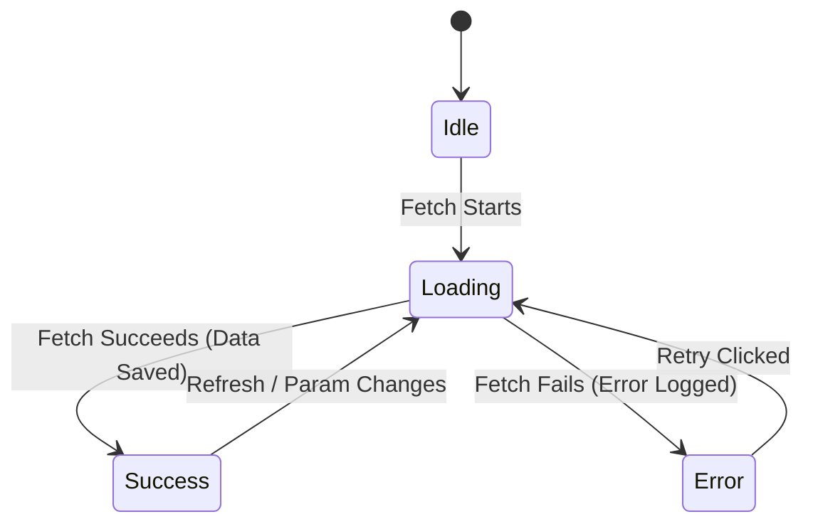
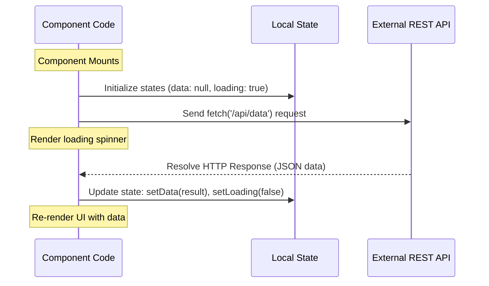
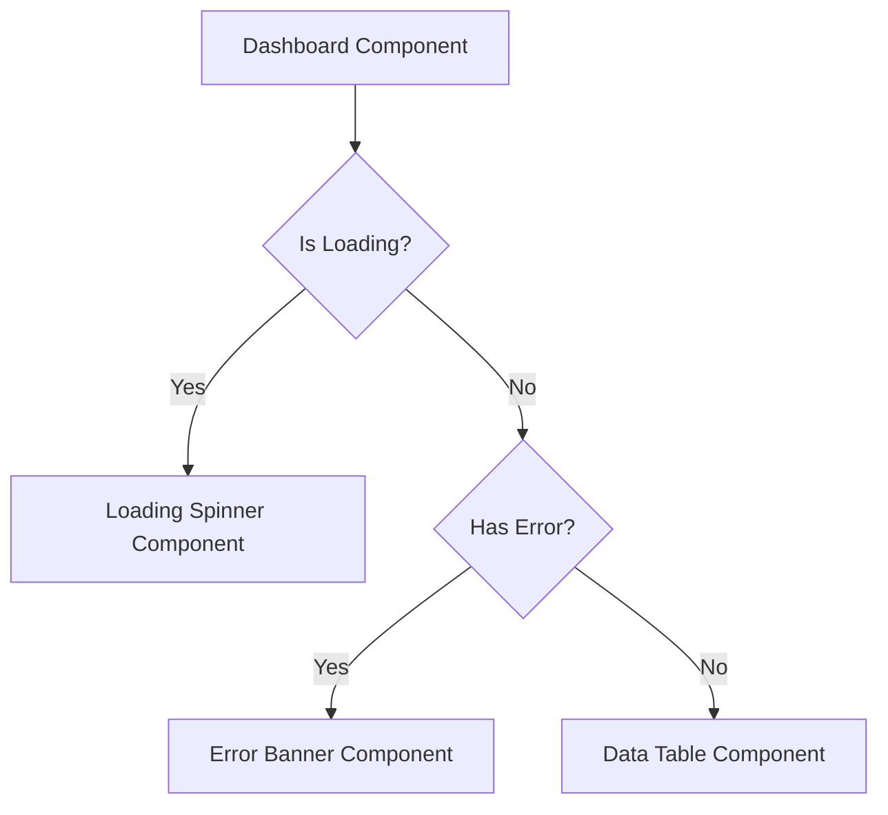
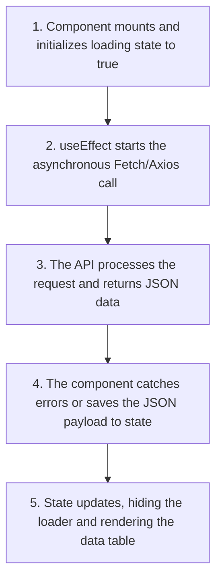

# Data Fetching Basics in React

## Introduction

React components are pure view functions that describe user interfaces. To display actual data, they must connect with external web servers using HTTP APIs. This process of loading data over the network is called **Data Fetching**. This module covers the fundamentals of client-side data fetching using the native **Fetch API** and the **Axios** library inside `useEffect` hooks, managing loading and error states, and preventing race conditions.

---

## Why do we need this?

Without a structured way to handle network requests, applications display blank screens, hang during slow connections, or crash when network errors occur.

### Problem Statement
Consider an application that displays a list of users fetched from a backend API.
1. When the page first loads, the network request takes 2 seconds to complete. During this time, the users list is empty, and the screen is blank.
2. If the user's internet connection is offline, the fetch request fails, and the application throws a JavaScript exception, crashing the UI.
3. If the user quickly toggles between different user filters, multiple fetch requests are sent in parallel. If the responses return out of order, the UI displays the wrong data list.

We need a structured way to manage loading indicators, catch and handle network errors, and prevent race conditions.

---

## Real World Story

In early React applications, developers fetched data inside class components using the `componentDidMount` lifecycle method.

Because React lacked built-in data fetching utilities, developers wrote custom fetching logic inside every component. As applications grew, this led to duplicate fetching code and inconsistent error handling. If a server returned a 500 error, some components displayed empty lists, while others crashed. When React Hooks were introduced, developers moved their fetching logic into `useEffect` hooks. This allowed them to reuse fetching code using custom hooks, but managing loading, error, and cached states manually was still complex, paving the way for data-fetching libraries like TanStack Query.

---

## Real World Analogy

Think of client-side data fetching like a **Waiter Fetching Food from a Kitchen** compared to **Cooking Food Yourself**.

- **Without Fetching (Cooking Yourself)**: The customer (component) has to know how to bake bread, grill meat, and source ingredients (hardcoded data). If a customer wants a burger, they must build a kitchen in their booth, which is slow and impractical.
- **With Fetching (Waiter)**: The customer reads the menu (props) and places an order. The waiter (Fetch/Axios) takes the request, walks to the kitchen (Backend API), and fetches the food. While the food is cooking, the waiter places a "Cooking..." card on the table (Loading state). If the kitchen runs out of ingredients, the waiter informs the customer (Error state). If the food is ready, the waiter serves it (Data state).

---

## Visual Explanation

Below is a diagram showing the state transitions that occur during client-side data fetching.

### Data Fetching State Transitions
```
              ┌───(Fetch Starts)───> [LOADING]
              │                         │
[INITIAL] ────┤                  (Fetch Succeeds) ───> [SUCCESS (Data)]
              │                         │
              └───(Fetch Fails) ────> [ERROR]
```



---

## Internal Working

Client-side data fetching relies on asynchronous JavaScript requests running outside the main render cycle.

When a component fetches data:
1. The component mounts and triggers a `useEffect` hook.
2. The hook starts an asynchronous network request (e.g., using `fetch()`).
3. The component renders immediately with its initial state (e.g., `loading: true`).
4. When the network request completes, the promise resolves, and the callback updates the component's state.
5. Updating state triggers a re-render, displaying the fetched data on screen.



---

## Architecture

Data fetching components are structured to separate the network layer from the UI presentation layer, ensuring loading and error boundaries wrap data tables cleanly.



---

## Step-by-Step Flow

When fetching data and rendering it inside a component, the following steps occur:



---

## Syntax

```javascript
// Basic fetch configuration inside useEffect
useEffect(() => {
  let isCurrent = true;
  setLoading(true);

  fetch(url)
    .then(res => {
      if (!res.ok) throw new Error('HTTP error');
      return res.json();
    })
    .then(data => {
      if (isCurrent) {
        setData(data);
        setLoading(false);
      }
    })
    .catch(err => {
      if (isCurrent) {
        setError(err.message);
        setLoading(false);
      }
    });

  return () => { isCurrent = false; };
}, [url]);
```

---

## Basic Example

Here is a basic component that fetches a list of users on mount using the native Fetch API.

```jsx
import React, { useState, useEffect } from 'react';

export default function UserList() {
  const [users, setUsers] = useState([]);
  const [loading, setLoading] = useState(true);

  useEffect(() => {
    fetch('https://jsonplaceholder.typicode.com/users')
      .then(res => res.json())
      .then(data => {
        setUsers(data);
        setLoading(false); // Hide spinner on success
      });
  }, []); // Run once on mount

  if (loading) return <p>Loading users...</p>;

  return (
    <div style={{ padding: '16px' }}>
      <h3>Users Directory</h3>
      <ul>
        {users.map(user => <li key={user.id}>{user.name}</li>)}
      </ul>
    </div>
  );
}
```

---

## Intermediate Example

An intermediate component showing data fetching using the **Axios** library. It handles HTTP errors (like 404 or 500) and displays a retry button if the request fails.

```jsx
import React, { useState, useEffect } from 'react';
import axios from 'axios';

export default function AxiosProfilePanel({ username }) {
  const [user, setUser] = useState(null);
  const [loading, setLoading] = useState(false);
  const [error, setError] = useState(null);

  const fetchProfile = () => {
    if (!username) return;
    setLoading(true);
    setError(null);

    axios.get(`https://api.github.com/users/${username}`)
      .then(response => {
        setUser(response.data);
        setLoading(false);
      })
      .catch(err => {
        setError(err.response?.data?.message || err.message || 'Failed to load profile.');
        setLoading(false);
      });
  };

  useEffect(() => {
    fetchProfile();
  }, [username]); // Re-fetch profile when username prop changes

  if (loading) return <p>Loading profile details...</p>;
  if (error) {
    return (
      <div style={{ padding: '16px', color: 'red' }}>
        <p>Error: {error}</p>
        <button onClick={fetchProfile}>Retry Fetch</button>
      </div>
    );
  }

  return (
    <div style={{ padding: '16px', border: '1px solid #ccc' }}>
      {user ? (
        <div>
          <h4>GitHub Profile</h4>
          
          <p>Username: <strong>{user.name || user.login}</strong></p>
          <p>Public Repos: {user.public_repos}</p>
        </div>
      ) : (
        <p>Please enter a GitHub username to load details.</p>
      )}
    </div>
  );
}
```

---

## Advanced Example

An advanced CRUD component illustrating form submissions (POST requests) alongside list rendering. It manages state validation and refreshes the list upon successful item creation.

```jsx
import React, { useState, useEffect } from 'react';
import axios from 'axios';

export default function TodoListConsole() {
  const [todos, setTodos] = useState([]);
  const [newTitle, setNewTitle] = useState('');
  const [loading, setLoading] = useState(false);
  const [submitPending, setSubmitPending] = useState(false);

  useEffect(() => {
    setLoading(true);
    axios.get('https://jsonplaceholder.typicode.com/todos?_limit=5')
      .then(res => {
        setTodos(res.data);
        setLoading(false);
      });
  }, []);

  const handleAddTodo = (e) => {
    e.preventDefault();
    if (!newTitle.trim()) return;

    setSubmitPending(true);
    // Send POST request to add item
    axios.post('https://jsonplaceholder.typicode.com/todos', {
      title: newTitle,
      completed: false,
      userId: 1
    })
      .then(res => {
        // Mock successful addition locally
        setTodos(prev => [res.data, ...prev]);
        setNewTitle('');
        setSubmitPending(false);
      })
      .catch(() => setSubmitPending(false));
  };

  return (
    <div style={{ padding: '20px', maxWidth: '400px' }}>
      <h3>Tasks Console</h3>
      
      <form onSubmit={handleAddTodo} style={{ display: 'flex', gap: '8px', marginBottom: '12px' }}>
        <input
          type="text"
          value={newTitle}
          onChange={e => setNewTitle(e.target.value)}
          placeholder="Enter new task..."
          style={{ flexGrow: 1, padding: '6px' }}
        />
        <button type="submit" disabled={submitPending || !newTitle.trim()}>
          {submitPending ? 'Adding...' : 'Add'}
        </button>
      </form>

      {loading ? (
        <p>Loading catalog items...</p>
      ) : (
        <ul>
          {todos.map(todo => (
            <li key={todo.id} style={{ padding: '4px 0' }}>
              {todo.title}
            </li>
          ))}
        </ul>
      )}
    </div>
  );
}
```

---

## Production Example

A production-grade fetch hook implementation that handles requests cancellation using **AbortController**, ignores stale responses using local flags, and manages loading, data, and error boundaries safely.

```jsx
import React, { useState, useEffect } from 'react';

export default function ProductionDataPanel({ userId }) {
  const [data, setData] = useState(null);
  const [loading, setLoading] = useState(false);
  const [error, setError] = useState(null);

  useEffect(() => {
    const controller = new AbortController();
    const { signal } = controller;
    
    let isCurrentRequest = true;

    async function fetchData() {
      setLoading(true);
      setError(null);
      try {
        const response = await fetch(`https://jsonplaceholder.typicode.com/users/${userId}`, { signal });
        if (!response.ok) {
          throw new Error(`HTTP error! Status: ${response.status}`);
        }
        const json = await response.json();
        if (isCurrentRequest) {
          setData(json);
        }
      } catch (err) {
        if (err.name !== 'AbortError' && isCurrentRequest) {
          setError(err.message || 'An error occurred during fetch.');
        }
      } finally {
        if (isCurrentRequest) {
          setLoading(false);
        }
      }
    }

    fetchData();

    //  CLEANUP: Cancel the HTTP request and set flag to false on unmount/update
    return () => {
      isCurrentRequest = false;
      controller.abort();
      console.log(`Aborted fetch request for User ID: ${userId}`);
    };
  }, [userId]);

  if (loading) return <div aria-live="polite">Loading profile details...</div>;
  if (error) return <div role="alert" style={{ color: 'red' }}>Error: {error}</div>;

  return (
    <div style={{ padding: '16px', border: '1px solid #ddd' }}>
      {data ? (
        <div>
          <h4>Contact Information</h4>
          <p>Name: {data.name}</p>
          <p>Phone: {data.phone}</p>
        </div>
      ) : (
        <p>No user selected.</p>
      )}
    </div>
  );
}
```

---

## Folder Structure

```
data-fetching-basics/
├── src/
│   ├── components/
│   │   ├── AxiosProfilePanel.jsx
│   │   └── ProductionDataPanel.jsx
│   ├── App.jsx
│   └── main.jsx
├── package.json
└── vite.config.js
```

---

## Best Practices

💡 **Did You Know?**  
Native `fetch()` only rejects its promise on network failures (like being completely offline). If the server returns a 404 or 500 error, `fetch()` resolves the promise successfully. You must check the `response.ok` property manually to verify if the request succeeded.

🚀 **Best Practices**
- Always return a cleanup function inside `useEffect` to abort pending requests using `AbortController` or ignore stale data using boolean flags.
- Check the `response.ok` property inside your `fetch()` chains to detect and catch HTTP errors (like 404 or 500).
- Encapsulate your data-fetching logic inside custom hooks to keep your layout components clean.

---

## Common Mistakes

⚠ **Common Mistakes**

### Not Checking response.ok
Assuming that `fetch()` will throw an error when a server returns a 404 or 500 status code is a common mistake. The `fetch()` promise only rejects on network failures, meaning HTTP errors will resolve successfully and display incorrect states.

```jsx
// ❌ WRONG
fetch('/api/missing')
  .then(res => res.json()) // Crashes here if response is not JSON (e.g. returns a 404 HTML page)
  .catch(err => setError(err));

//  RIGHT
fetch('/api/missing')
  .then(res => {
    if (!res.ok) throw new Error(`HTTP error: ${res.status}`); // Detect HTTP error manually
    return res.json();
  })
  .then(data => setData(data))
  .catch(err => setError(err.message));
```

---

## Performance Notes

⚡ **Performance Tips**
Fetching data inside nested child components can lead to a performance issue called **Network Waterfalls**. If Parent component A awaits its fetch before rendering Child component B, and Child B then starts its own fetch, the requests execute sequentially instead of in parallel, slowing down the page load.

### Performance Example
Avoid waterfalls by fetching data in parallel at the top level or pre-loading requests:

```javascript
// ❌ Waterfall Anti-pattern (sequential fetches)
const user = await fetchUser(); // Awaits user details
const posts = await fetchPosts(user.id); // Stale delay

//  Performance Optimization (parallel fetches)
const [userRes, postsRes] = await Promise.all([
  fetch('/api/user'),
  fetch('/api/posts')
]);
```

---

## Accessibility Notes

♿ **Accessibility Tips**
- Display loading indicators using `aria-live="polite"` or `role="status"` to inform screen reader users that content is updating.
- Use `role="alert"` on error banners to announce failures immediately.

---

## SEO Notes

To optimize single-page applications for search engine indexing, configure Server-Side Rendering (SSR) so that crawlers can index the page content immediately on load, without waiting for client-side JavaScript fetches to complete.

---

## Interview Questions

🎯 **Interview Tips**  
In an interview, explain that the native `fetch()` promise only rejects on network failures. If the server returns a 404 or 500 error, `fetch()` resolves successfully. You must verify the `response.ok` property manually to catch HTTP errors.

### Q1: Why does `fetch()` not reject its promise on a 500 Server Error?
**Answer**: The native `fetch()` promise only rejects on network failures (like being completely offline, DNS failures, or CORS blocks). If the server responds with a 500 error, the network connection succeeded, so `fetch()` resolves the promise successfully. You must check the `response.ok` or `response.status` properties manually to catch HTTP errors.

### Q2: How do you prevent race conditions when fetching data in React?
**Answer**: Race conditions occur when multiple requests are sent in rapid succession, and their responses return out of order. This can be resolved by using a boolean flag inside the `useEffect` hook that is set to false in the cleanup callback, or by using `AbortController` to abort pending requests when dependencies change.

---

## MCQs

1. **On which event does the native `fetch()` promise reject?**
   - A) 404 Not Found error.
   - B) 500 Internal Server error.
   - C) Network failures (e.g., DNS error, offline connection).
   - D) 403 Forbidden error.
   - *Answer: C*

2. **Why should you return a cleanup function when fetching data in `useEffect`?**
   - A) To delete data from local storage.
   - B) To cancel pending requests or ignore stale responses, preventing race conditions.
   - C) To reset the component state.
   - D) To close the browser window.
   - *Answer: B*

3. **Which Axios property is used to access the status code of a failed HTTP request?**
   - A) `error.status`
   - B) `error.response.status`
   - C) `error.code`
   - D) `error.statusCode`
   - *Answer: B*

4. **What is a "Network Waterfall"?**
   - A) A library for animating charts.
   - B) A performance bottleneck where nested components fetch data sequentially instead of in parallel, slowing down page loads.
   - C) A type of database backup.
   - D) A network protocol.
   - *Answer: B*

5. **Which HTML5 attribute informs screen readers that a section's content is updating?**
   - A) `aria-live="polite"`
   - B) `aria-busy="true"`
   - C) `role="status"`
   - D) All of the above
   - *Answer: D*

---

## Practice Exercise

### Exercise 1: response.ok Validator
Complete the fetch chain below to validate the response and throw an error on failure:
```javascript
fetch('/api/data')
  // TODO: Check response status ok
  .then(res => res.json())
  .catch(err => console.error(err));
```

*Solution*:
```javascript
fetch('/api/data')
  .then(res => {
    if (!res.ok) throw new Error(`HTTP error: ${res.status}`);
    return res.json();
  })
  .then(data => console.log(data))
  .catch(err => console.error(err));
```

### Exercise 2: Axios Cancel Token setup
Write a component that fetches data using Axios. Use Axios `CancelToken` or `AbortController` to cancel pending requests when the component unmounts.

### Exercise 3: CRUD Delete Row button
Create a component displaying a list of comments. Add a "Delete" button next to each comment that sends a DELETE request to the API, removing the comment from local state on success.

---

## Debugging Exercise

### The Flashing Loading State Bug
A developer notice that their loading spinner flashes briefly on screen even when data is already cached. Identify the cause and explain how to optimize it.

```jsx
import React, { useState, useEffect } from 'react';

let localCache = null;

export default function CacheApp() {
  const [data, setData] = useState(localCache);
  const [loading, setLoading] = useState(false);

  useEffect(() => {
    // BUG: Setting loading to true even if data is already cached locally
    setLoading(true);
    fetch('/api/info')
      .then(res => res.json())
      .then(result => {
        localCache = result;
        setData(result);
        setLoading(false);
      });
  }, []);

  if (loading && !data) return <p>Loading details...</p>;
  return <div>Loaded Data: {data?.title}</div>;
}
```

#### Solution
The developer sets the `loading` state to true on mount, even if the data has already been loaded and cached. To fix this, only set loading to true if the cache is empty:

```jsx
// Corrected
useEffect(() => {
  if (localCache) {
    setData(localCache);
    return; // Skip fetch if data is already cached
  }

  setLoading(true);
  fetch('/api/info')
    .then(res => res.json())
    .then(result => {
      localCache = result;
      setData(result);
      setLoading(false);
    });
}, []);
```

---

## Real-world Scenario

You are building a real-time tracking panel displaying the locations of active delivery vehicles. The panel makes API calls every 3 seconds to get vehicle coordinates. During updates, the map markers flicker. Explain how you would optimize this.
- **Optimization Strategy**: Cache coordinate data. When a new update returns, compare coordinates and only update the positions of vehicles that have moved. Use CSS transitions on markers to smooth movement animations and prevent flickering.

---

## Interview Coding Question

### Problem Statement
Write a React component that fetches a list of posts from `https://jsonplaceholder.typicode.com/posts?_limit=5` on mount. Ensure:
- The component displays a loading spinner during the fetch.
- If the fetch fails, display a red error message.
- Provide a button to manual trigger a re-fetch, which should show the loading spinner again during the request.

```jsx
import React, { useState, useEffect } from 'react';

export default function PostsExplorer() {
  const [posts, setPosts] = useState([]);
  const [loading, setLoading] = useState(false);
  const [error, setError] = useState(null);

  async function loadPosts() {
    setLoading(true);
    setError(null);
    try {
      const response = await fetch('https://jsonplaceholder.typicode.com/posts?_limit=5');
      if (!response.ok) {
        throw new Error(`Server returned status code: ${response.status}`);
      }
      const data = await response.json();
      setPosts(data);
    } catch (e) {
      setError(e.message || 'An error occurred.');
    } finally {
      setLoading(false);
    }
  }

  useEffect(() => {
    loadPosts();
  }, []);

  return (
    <div style={{ padding: '16px' }}>
      <h3>Recent Posts</h3>
      <button onClick={loadPosts} disabled={loading}>
        {loading ? 'Refreshing...' : 'Refresh Posts'}
      </button>

      {loading ? (
        <p>Loading posts...</p>
      ) : error ? (
        <p style={{ color: 'red' }} role="alert">Error: {error}</p>
      ) : (
        <ul style={{ marginTop: '12px' }}>
          {posts.map(post => (
            <li key={post.id} style={{ margin: '8px 0' }}>
              <strong>{post.title}</strong>
            </li>
          ))}
        </ul>
      )}
    </div>
  );
}
```

---

## Mini Project

### API CRUD console
Create an interactive API sandbox explorer:
- Fetch dynamic lists from a public API.
- Provide input text areas and form buttons to POST new items to the list.
- Provide dynamic "Delete" actions to send DELETE requests for specific items.
- Render visual indicators on the items to show loading, pending, success, and error states.

---

## Summary

🧠 **Memory Tricks**  
`Fetch ignores 500s` - Fec (fetch) ignores 500 error codes. Remember that the `fetch()` promise only rejects on network failures, so you must always check the `response.ok` property manually to catch server errors.

📖 **Summary**  
Data fetching connects React components to external server APIs. By using Fetch or Axios inside `useEffect` hooks, checking the `response.ok` property, managing loading and error states, and returning cleanups, React keeps network data synchronized and pages responsive.

---

## Cheat Sheet

```javascript
// Axios fetch configuration inside useEffect
useEffect(() => {
  axios.get(url)
    .then(res => setData(res.data))
    .catch(err => setError(err.response?.data?.message || err.message));
}, [url]);
```

---

## Related Topics
- [useEffect & Lifecycle Synchronization](../phase-4-hooks/useeffect-lifecycle)
- [Query Libraries & Caching (Next Module)](query-libraries)

---

## Further Reading
- [MDN: Using the Fetch API](https://developer.mozilla.org/en-US/docs/Web/API/Fetch_API/Using_Fetch)
- [Axios: Getting Started Guide](https://axios-http.com/docs/intro)
