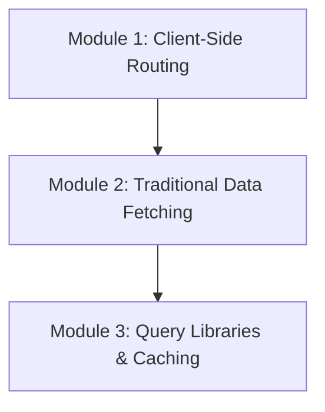

# Phase 5: Routing & Data Fetching

Welcome to the **Routing & Data Fetching** phase of the React Engineering Academy. This phase covers how to build multi-page single-page applications (SPAs) using React Router and synchronizes your frontend components with server-side data models using efficient fetching and caching strategies.

## Why this topic exists

By default, React is a local view library. It does not know about browser URL paths or backend databases.
- If you build an application without client-side routing, users cannot bookmark specific pages or use the browser's Back and Forward buttons to navigate your app.
- If you fetch data without a cache management strategy (like using simple `useEffect` fetches everywhere), your application will make redundant network requests, display stale data, and suffer from loading lag.

Consolidating client-side routing and cache data fetching is critical for building fast, intuitive, and production-grade applications.

---

## Learning Objectives

By the end of this phase, you will be able to:
- Explain the difference between client-side routing and traditional server-side routing.
- Set up, configure, and optimize routes using React Router (v6+).
- Manage dynamic route parameters, query parameters, and search filters.
- Construct nested routes and share layouts using the `<Outlet />` component.
- Build protected routes and navigation auth guards.
- Fetch data from REST APIs using standard Fetch and Axios inside components.
- Implement loading states, error boundaries, and empty indicators for network calls.
- Master declarative query caching and mutations using **TanStack Query** (React Query).
- Optimize network performance using queries caching, staleness, pagination, and optimistic UI updates.

---

## Prerequisites

Before starting this phase, you should have completed:
1. **[Phase 1: React Fundamentals](../phase-1-fundamentals)**
2. **[Phase 2: Components & JSX](../phase-2-components-jsx)**
3. **[Phase 3: State Management](../phase-3-state-management)**
4. **[Phase 4: React Hooks](../phase-4-hooks)**

---

## Learning Roadmap & Topics Covered

This phase is broken down into three comprehensive modules:

1. **[Module 1: Client-Side Routing](client-side-routing)**  
   Client vs. server routing, configuring React Router, nested layouts, programmatic navigation, and auth guards.
2. **[Module 2: Traditional Data Fetching](data-fetching-basics)**  
   Fetch and Axios in useEffect, loading/error states, race condition handling, and basic CRUD forms.
3. **[Module 3: Query Libraries & Caching](query-libraries)**  
   Introduction to TanStack Query, query caching, staleness, refetching, mutations, pagination, and optimistic updates.

---

## Estimated Learning Time

- **Total Time**: 10 - 12 Hours
- **Module 1**: 4 Hours
- **Module 2**: 3 Hours
- **Module 3**: 5 Hours
- **Exercises & Projects**: 1 Hour

---

## Real-World Applications

- **SaaS E-Commerce Apps**: Creating dashboard portals with nested page directories, clean query parameters, and instant checkout pages.
- **Dynamic Content Platforms**: Building blogs or news sites with clean URLs, client-side pagination, and offline page query caching.
- **Admin Panels**: Constructing secure dashboards displaying transaction logs synced in real-time with server databases.

---

## Practice Exercises

- **Custom Protected Route**: Writing a layout route that redirects unauthenticated users to the Login page.
- **Fetch Abort validation**: Writing a dynamic search input that aborts pending fetch requests when the search query changes.
- **Cache optimistic toggle**: Writing a React Query mutation that updates local UI items instantly, reverting changes if the server update fails.

---

## Mini Projects

- **An Interactive E-Commerce Dashboard**: A fully routed application displaying product catalogs, cart checkouts, and dynamic user invoices, with pages synchronized with live APIs using TanStack Query.

---

## Related Topics

- [State Management Overview](../phase-3-state-management)
- [Performance Optimization Overview](../phase-6-performance)

---

## Further Reading

- [React Router: Main Guide](https://reactrouter.com/)
- [TanStack Query: Official Documentation](https://tanstack.com/query/latest)
