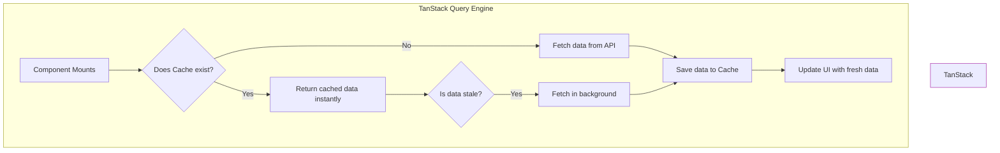
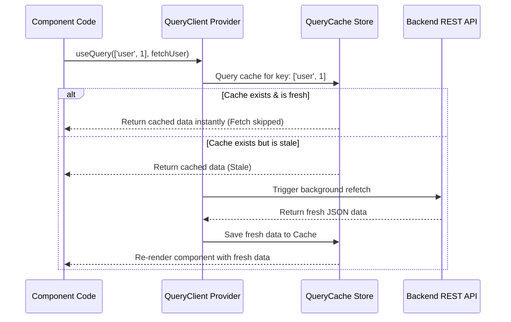
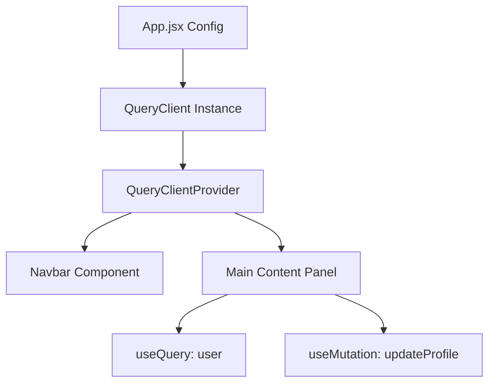

# TanStack Query & Data Caching

## Introduction

Managing server state manually in React applications requires writing boilerplate code for every network request: tracking loading spinners, catching errors, returning cleanups, and avoiding race conditions. Furthermore, standard state hooks (like `useState` and `useEffect`) lack caching capabilities. If the user navigates away and back, the app sends a new HTTP request, displaying loading spinners repeatedly. To solve this, we use **TanStack Query** (formerly React Query). This module covers declarative data fetching, cache synchronization, queries caching, mutations, and optimistic updates.

---

## Why do we need this?

Client state (like themes or modales) is different from server state. Server state is owned by a remote server, requires network requests to read or write, and can be modified by other users in the background.

### Problem Statement
Consider an application that displays a user's dashboard notifications.
1. When the user navigates to the Settings page and back, the app re-fetches the notifications list, showing a loading spinner again.
2. If another user sends a message, the active user doesn't see the new notification until they refresh the browser tab.
3. If the user is offline, the app displays a blank screen, instead of loading the cached notifications from memory.

We need a query manager that caches server data in memory, handles background updates, and synchronizes state automatically.

---

## Real World Story

Before TanStack Query was created in 2019 by Tanner Linsley, React developers managed server data by storing API responses inside global state libraries like Redux or Context.

This created complex architectures. Developers had to write custom "Actions", "Reducers", and "Middlewares" (like Redux-Saga or Thunk) just to fetch and cache a list of items. If they wanted background refetching or request deduplication, they had to write custom interval logic. TanStack Query solved this by introducing a declarative query manager. By defining **Query Keys** and **Query Functions**, developers could cache and sync server data automatically, removing thousands of lines of redundant state code from modern codebases.

---

## Real World Analogy

Think of TanStack Query like a **Smart Office Desk Drawer Cache** compared to **Requesting Files from a Remote Archive constantly**.

- **Without Caching (Requesting Files Constantly)**: Every time you need a user report, you walk out of your office, take the elevator, walk to the basement file archive (API), find the file, and walk back. If you need the same report 5 minutes later, you walk to the basement archive again. You spend all day in the elevator.
- **With TanStack Query (Desk Drawer Cache)**: The first time you request a user report, you walk to the basement archive, read it, and place a copy in your desk drawer (Cache). The next time you need it, you open your drawer and read it instantly (Cached data). While you read the copy, you send an assistant to check if the basement archive has been updated (Background refetch). If there's a new version, the assistant updates your drawer copy (Sync).

---

## Visual Explanation

Below is a diagram showing the query lifecycle and caching states inside TanStack Query.

### Query Cache Lifecycle
```
[Query Active] ──> [Fresh data in Cache]
                         │
                  (staleTime Expires)
                         │
                         ▼
[Stale data in Cache] ──(User focuses window)──> [Background Refetch]
                                                        │
                                                 (Cache Synced)
```



---

## Internal Working

TanStack Query is built on a query coordinator that manages the lifecycle of server requests.

When you call the `useQuery` hook:
1. You provide a unique **Query Key** (e.g., `['user', userId]`) and a **Query Function** (an asynchronous function that fetches data).
2. The hook registers the query in the global **QueryCache**.
3. If the data is already cached and marked as fresh (determined by `staleTime`), the hook returns the cached data instantly without fetching.
4. If the data is marked as stale, the hook returns the cached data instantly (to keep the UI responsive) and triggers a background refetch.
5. When the refetch resolves, TanStack Query updates the cache and re-renders the component with the fresh data.



---

## Architecture

The `QueryClientProvider` wraps your application at the root, making the `QueryClient` store instance available to all nested hooks.



---

## Step-by-Step Flow

When modifying data using a TanStack Query mutation with optimistic updates, the following steps occur:

```mermaid
flowchart TD
    Step1[1. User clicks Add to Cart, triggering a mutation] --> Step2[2. onMutate callback updates local cache data instantly (Optimistic UI)]
    Step2 --> Step3[3. Mutation sends POST request to the API in the background]
    Step3 --> Step4[4. If the POST succeeds, invalidate query key to sync with database]
    Step4 --> Step5[5. If the POST fails, rollback local cache data to the previous state]
```

---

## Syntax

```javascript
// useQuery Configuration Syntax
const { data, isLoading, error } = useQuery({
  queryKey: ['posts', categoryId],
  queryFn: () => fetchPosts(categoryId),
  staleTime: 1000 * 60 * 5, // Data is fresh for 5 minutes
  gcTime: 1000 * 60 * 10,   // Cache is garbage collected after 10 minutes
});
```

---

## Basic Example

Here is a basic routed application with TanStack Query set up at the root, fetching posts from an API.

```jsx
import React from 'react';
import { QueryClient, QueryClientProvider, useQuery } from '@tanstack/react-query';

// 1. Create QueryClient instance
const queryClient = new QueryClient();

async function fetchPosts() {
  const res = await fetch('https://jsonplaceholder.typicode.com/posts?_limit=5');
  if (!res.ok) throw new Error('Network error');
  return res.json();
}

function PostsList() {
  // 3. Consume useQuery inside child component
  const { data: posts, isLoading, error } = useQuery({
    queryKey: ['posts'],
    queryFn: fetchPosts
  });

  if (isLoading) return <p>Loading posts list...</p>;
  if (error) return <p style={{ color: 'red' }}>Error: {error.message}</p>;

  return (
    <ul>
      {posts.map(post => (
        <li key={post.id}><strong>{post.title}</strong></li>
      ))}
    </ul>
  );
}

export default function BasicQueryApp() {
  return (
    // 2. Wrap layout in QueryClientProvider
    <QueryClientProvider client={queryClient}>
      <div style={{ padding: '20px' }}>
        <h3>TanStack Query Explorer</h3>
        <PostsList />
      </div>
    </QueryClientProvider>
  );
}
```

---

## Intermediate Example

An intermediate component showing data mutations using the `useMutation` hook. When a user submits the form, we trigger a POST request to add a new comment and invalidate the query cache to refresh the comments list.

```jsx
import React, { useState } from 'react';
import { useQuery, useMutation, useQueryClient } from '@tanstack/react-query';
import axios from 'axios';

// Fetch Function
const fetchComments = () => axios.get('https://jsonplaceholder.typicode.com/comments?_limit=5').then(res => res.data);

// POST Function
const postComment = (newComment) => axios.post('https://jsonplaceholder.typicode.com/comments', newComment).then(res => res.data);

export default function CommentsConsole() {
  const queryClient = useQueryClient();
  const [text, setText] = useState('');

  // 1. Fetch Comments Query
  const { data: comments, isLoading } = useQuery({
    queryKey: ['comments'],
    queryFn: fetchComments
  });

  // 2. Add Comment Mutation
  const mutation = useMutation({
    mutationFn: postComment,
    onSuccess: () => {
      // Invalidate the cache for the 'comments' query key to trigger a refetch
      queryClient.invalidateQueries({ queryKey: ['comments'] });
      setText('');
    }
  });

  const handleSubmit = (e) => {
    e.preventDefault();
    if (!text.trim()) return;
    mutation.mutate({ name: 'Guest User', body: text });
  };

  return (
    <div style={{ padding: '16px', maxWidth: '400px' }}>
      <h3>Comments panel</h3>
      
      <form onSubmit={handleSubmit} style={{ display: 'flex', gap: '8px', marginBottom: '12px' }}>
        <input
          type="text"
          value={text}
          onChange={e => setText(e.target.value)}
          placeholder="Write comment..."
          style={{ flexGrow: 1, padding: '6px' }}
        />
        <button type="submit" disabled={mutation.isPending}>
          {mutation.isPending ? 'Sending...' : 'Send'}
        </button>
      </form>

      {isLoading ? (
        <p>Loading comments...</p>
      ) : (
        <ul>
          {comments?.map(c => (
            <li key={c.id} style={{ padding: '4px 0' }}>
              <strong>{c.name}</strong>: {c.body}
            </li>
          ))}
        </ul>
      )}
    </div>
  );
}
```

---

## Advanced Example

An advanced component illustrating **Optimistic UI Updates**. When a user adds an item to the list, we update the local cache instantly before the API request completes. If the server request fails, we roll back the cache to the previous state.

```jsx
import React, { useState } from 'react';
import { useQuery, useMutation, useQueryClient } from '@tanstack/react-query';

async function fetchTodos() {
  const res = await fetch('https://jsonplaceholder.typicode.com/todos?_limit=5');
  return res.json();
}

async function postTodo(newTodo) {
  const res = await fetch('https://jsonplaceholder.typicode.com/todos', {
    method: 'POST',
    body: JSON.stringify(newTodo),
    headers: { 'Content-type': 'application/json' }
  });
  if (!res.ok) throw new Error('Post failed');
  return res.json();
}

export default function OptimisticTodoBoard() {
  const queryClient = useQueryClient();
  const [title, setTitle] = useState('');

  const { data: todos, isLoading } = useQuery({
    queryKey: ['todos'],
    queryFn: fetchTodos
  });

  const mutation = useMutation({
    mutationFn: postTodo,
    
    // 1. Triggered before the API request starts
    onMutate: async (newTodo) => {
      // Cancel ongoing queries for the 'todos' key to avoid overwriting our optimistic update
      await queryClient.cancelQueries({ queryKey: ['todos'] });

      // Save the previous state copy for fallback rollback
      const previousTodos = queryClient.getQueryData(['todos']);

      // Optimistically update the cache with the new item
      queryClient.setQueryData(['todos'], (old) => [
        { id: `optimistic-${Date.now()}`, title: newTodo.title, completed: false },
        ...(old || [])
      ]);

      // Return context containing previous state
      return { previousTodos };
    },

    // 2. Triggered if the mutation request fails
    onError: (err, newTodo, context) => {
      // Rollback cache to the previous state
      if (context?.previousTodos) {
        queryClient.setQueryData(['todos'], context.previousTodos);
      }
      alert('Failed to add item. Rolled back changes.');
    },

    // 3. Triggered after success or failure
    onSettled: () => {
      // Refetch from server to ensure cache matches the database
      queryClient.invalidateQueries({ queryKey: ['todos'] });
    }
  });

  const handleAdd = (e) => {
    e.preventDefault();
    if (!title.trim()) return;
    mutation.mutate({ title, completed: false });
    setTitle('');
  };

  return (
    <div style={{ padding: '20px', maxWidth: '400px' }}>
      <h3>Optimistic Todo Console</h3>
      <form onSubmit={handleAdd} style={{ display: 'flex', gap: '8px', marginBottom: '12px' }}>
        <input
          type="text"
          value={title}
          onChange={e => setTitle(e.target.value)}
          placeholder="New task..."
          style={{ flexGrow: 1 }}
        />
        <button type="submit">Add Task</button>
      </form>

      {isLoading ? (
        <p>Loading tasks...</p>
      ) : (
        <ul>
          {todos?.map(todo => (
            <li key={todo.id}>{todo.title}</li>
          ))}
        </ul>
      )}
    </div>
  );
}
```

---

## Production Example

A production-grade query client configuration setting up global cache defaults, stale time periods, automatic background refetching triggers, and error logging.

```jsx
import React from 'react';
import { QueryClient, QueryClientProvider } from '@tanstack/react-query';
import { ReactQueryDevtools } from '@tanstack/react-query-devtools';

// 1. Configure the global QueryClient instance with production defaults
export const productionQueryClient = new QueryClient({
  defaultOptions: {
    queries: {
      staleTime: 1000 * 60 * 5, // Data is considered fresh for 5 minutes
      gcTime: 1000 * 60 * 15,    // Cache garbage collection runs after 15 minutes
      retry: 2,                  // Retry failed requests 2 times before showing error
      refetchOnWindowFocus: true,// Auto-refetch stale data when user focuses window
      refetchOnReconnect: true,  // Auto-refetch when user comes back online
    },
    mutations: {
      onError: (error) => {
        console.error(`[MUTATION ERROR LOG] Global Logger: ${error.message}`);
        // Log errors to monitoring services like Sentry here
      }
    }
  }
});

export function ProductionQueryProvider({ children }) {
  return (
    <QueryClientProvider client={productionQueryClient}>
      {children}
      {/* Devtools helper panel visible only in development mode */}
      <ReactQueryDevtools initialIsOpen={false} />
    </QueryClientProvider>
  );
}
```

---

## Folder Structure

```
query-libraries/
├── src/
│   ├── config/
│   │   └── queryClient.js
│   ├── components/
│   │   ├── CommentsConsole.jsx
│   │   └── OptimisticTodoBoard.jsx
│   ├── App.jsx
│   └── main.jsx
├── package.json
└── vite.config.js
```

---

## Best Practices

💡 **Did You Know?**  
TanStack Query checks window focus events. When a user switches tabs and returns to your application, TanStack Query automatically refetches any stale queries in the background, keeping your data synced without requiring manual page refreshes.

🚀 **Best Practices**
- Structure query keys hierarchically, using array formats (e.g., `['posts', categoryId]` or `['user', userId]`). This allows you to invalidate related queries efficiently.
- Set a sensible `staleTime` (e.g., 1-5 minutes) to prevent TanStack Query from triggering redundant background refetch requests.
- Wrap mutation actions in `useMutation` to handle loading indicators and cache invalidations cleanly.

---

## Common Mistakes

⚠ **Common Mistakes**

### Inline queryFn References triggering infinite loops
Defining a dynamic query function inline inside `useQuery` but omitting the dependency parameters from the query key will cause TanStack Query to read stale parameters or fail to refetch when parameters change.

```jsx
// ❌ WRONG
const { data } = useQuery({
  queryKey: ['posts'], // Missing activeCategoryId dependency in the key!
  queryFn: () => fetchPosts(activeCategoryId)
});

//  RIGHT
const { data } = useQuery({
  queryKey: ['posts', activeCategoryId], // Key correctly includes the parameter dependency
  queryFn: () => fetchPosts(activeCategoryId)
});
```

---

## Performance Notes

⚡ **Performance Tips**
TanStack Query deduplicates multiple requests for the same query key. If three different components request the same query key `['user', 1]` at the same time, TanStack Query triggers a single network request in the background and shares the result, optimizing network bandwidth.

---

## Accessibility Notes

♿ **Accessibility Tips**
- Display loading indicators using `aria-live="polite"` or `role="status"` to inform screen reader users that content is updating.
- Use `role="alert"` on error banners to announce failures immediately.

---

## SEO Notes

Data fetched via TanStack Query is client-side rendered by default. If your project requires high SEO visibility, configure pre-rendering steps or migrate to SSR frameworks like Next.js or Remix.

---

## Interview Questions

🎯 **Interview Tips**  
In an interview, define TanStack Query as a server state manager that simplifies caching, background refetching, and error handling. Explain that query keys act as cache identifiers, allowing you to update or invalidate specific cache segments.

### Q1: What is the difference between `staleTime` and `gcTime` (formerly `cacheTime`)?
**Answer**: `staleTime` is the duration in milliseconds that fetched data is considered fresh. During this time, TanStack Query will read data directly from the cache without fetching. `gcTime` is the duration in milliseconds that inactive query data is kept in memory. When a component unmounts, its query data becomes inactive; after the `gcTime` expires, the query data is garbage collected from memory.

### Q2: What is Query Invalidation, and how do you trigger it?
**Answer**: Query Invalidation is the process of marking cached query data as stale to trigger an automatic background refetch. It is typically triggered inside the `onSuccess` callback of a mutation using `queryClient.invalidateQueries({ queryKey })`, ensuring the UI updates to match the updated database.

---

## MCQs

1. **What does a Query Key do in TanStack Query?**
   - A) It defines path links for navigation.
   - B) It acts as a unique cache identifier to locate, update, or invalidate specific query data.
   - C) It secures client-side API keys.
   - D) It compiles components into web assemblies.
   - *Answer: B*

2. **When does TanStack Query consider data to be 'stale'?**
   - A) Immediately after fetching, unless a custom `staleTime` is configured.
   - B) After the gcTime has expired.
   - C) Only on browser restarts.
   - D) When the user clicks reload.
   - *Answer: A*

3. **Which hook is used to send POST/PUT/DELETE write requests to an API?**
   - A) `useQuery`
   - B) `useMutation`
   - C) `useReducer`
   - D) `useSyncExternalStore`
   - *Answer: B*

4. **What is an Optimistic Update?**
   - A) Fetching all pages at once.
   - B) Updating the local query cache instantly before the API request completes, rolling back changes if the server request fails.
   - C) Disabling all loading spinners.
   - D) Running queries on background worker threads.
   - *Answer: B*

5. **Which component makes the query cache store available to all child hooks?**
   - A) `BrowserRouter`
   - B) `QueryClientProvider`
   - C) `React.StrictMode`
   - D) `AuthProvider`
   - *Answer: B*

---

## Practice Exercise

### Exercise 1: Query Key Dependency Setup
Configure a query key for a search list that depends on both `queryText` and `pageNumber`:
```javascript
// TODO: Define queryKey array
queryKey: ['search']
```

*Solution*:
```javascript
queryKey: ['search', queryText, pageNumber]
```

### Exercise 2: Mutations Cache Invalidation
Create a component that uses `useMutation` to send a POST request. In the `onSuccess` callback, invalidate the cache for the `['posts']` query key.

### Exercise 3: staleTime Default Configuration
Modify the global `QueryClient` settings to configure a default `staleTime` of 10 minutes for all queries.

---

## Debugging Exercise

### The Stale Refetch Loop Bug
A developer wants to keep their dashboard feed fresh, so they configure a refetch interval of 2 seconds. However, the app fetches data endlessly and slows down the browser. Identify the bug and write the fix.

```jsx
import React from 'react';
import { useQuery } from '@tanstack/react-query';

export default function HeavyFeed() {
  const { data } = useQuery({
    queryKey: ['feed'],
    queryFn: () => fetch('/api/feed').then(res => res.json()),
    refetchInterval: 2000,
    // BUG: Missing staleTime configuration causes data to be marked as stale immediately on fetch,
    // triggering redundant refetch requests during background updates.
  });

  return <div>Feed Loaded</div>;
}
```

#### Solution
The developer configured a refetch interval of 2 seconds, but omitted the `staleTime` configuration. By default, `staleTime` is 0, meaning the data is marked as stale immediately on fetch. This causes TanStack Query to trigger background refetch requests endlessly. To fix this, set `staleTime` to match or exceed the refetch interval:

```jsx
// Corrected
const { data } = useQuery({
  queryKey: ['feed'],
  queryFn: () => fetch('/api/feed').then(res => res.json()),
  refetchInterval: 2000, // Check for updates every 2 seconds
  staleTime: 2000 // Keep data fresh for 2 seconds to prevent redundant refetches
});
```

---

## Real-world Scenario

You are building a dynamic e-commerce catalog displaying thousands of products. When a user filters categories, the page lags due to network waterfalls. Explain how you would optimize data fetching using TanStack Query.
- **Optimization Strategy**: Use query keys that include the category filters (`['products', category]`). Pre-fetch the product list for neighboring categories using `queryClient.prefetchQuery`, allowing the page to load instantly when the user selects a new category filter.

---

## Interview Coding Question

### Problem Statement
Write a React component that displays a product list using TanStack Query. The component should:
- Fetch data from `https://jsonplaceholder.typicode.com/posts?_limit=5`.
- Display a loading spinner during the fetch.
- If the fetch fails, display a red error message.
- Provide a manual refetch button that invalidates the query cache to trigger a fresh fetch.

```jsx
import React from 'react';
import { useQuery, useQueryClient } from '@tanstack/react-query';

async function fetchProducts() {
  const res = await fetch('https://jsonplaceholder.typicode.com/posts?_limit=5');
  if (!res.ok) throw new Error('Failed to load products');
  return res.json();
}

export default function ProductExplorer() {
  const queryClient = useQueryClient();

  const { data: products, isLoading, error } = useQuery({
    queryKey: ['products-list'],
    queryFn: fetchProducts
  });

  const handleRefetch = () => {
    // Invalidate the cache to trigger a fresh background refetch
    queryClient.invalidateQueries({ queryKey: ['products-list'] });
  };

  return (
    <div style={{ padding: '16px' }}>
      <h3>Product Explorer</h3>
      <button onClick={handleRefetch} disabled={isLoading}>
        {isLoading ? 'Loading...' : 'Force Refetch'}
      </button>

      {isLoading ? (
        <p>Loading products list...</p>
      ) : error ? (
        <p style={{ color: 'red' }} role="alert">Error: {error.message}</p>
      ) : (
        <ul style={{ marginTop: '12px' }}>
          {products?.map(p => (
            <li key={p.id}>{p.title}</li>
          ))}
        </ul>
      )}
    </div>
  );
}
```

---

## Mini Project

### E-Commerce Cart Manager Studio
Create a shopping cart application using TanStack Query:
- Fetch the products list using `useQuery`.
- Build an "Add to Cart" button that updates the cart using `useMutation` with optimistic updates.
- If the server request fails, rollback the cart state and display a notification alert.
- Display a final summary of cart items and total prices on the checkout page.

---

## Summary

🧠 **Memory Tricks**  
`useQuery = Read, useMutation = Write`  
- Use `useQuery` to fetch and read server state.
- Use `useMutation` to post and write data changes to the server.

📖 **Summary**  
TanStack Query manages server state in React applications. By defining query keys and functions, it caches server data in memory, handles background updates, and synchronizes state automatically, removing the need for boilerplate state code.

---

## Cheat Sheet

```javascript
// Invalidate cache for a query key
queryClient.invalidateQueries({ queryKey: ['posts'] });

// Read data directly from cache
const cachedData = queryClient.getQueryData(['posts']);
```

---

## Related Topics
- [Data Fetching Basics in React](data-fetching-basics)
- [Performance Optimization Overview](../phase-6-performance)

---

## Further Reading
- [TanStack Query Docs: Overview Guide](https://tanstack.com/query/latest/docs/framework/react/overview)
- [Tanner Linsley: Client State vs Server State](https://tanstack.com/query/latest/docs/framework/react/guides/comparison)
