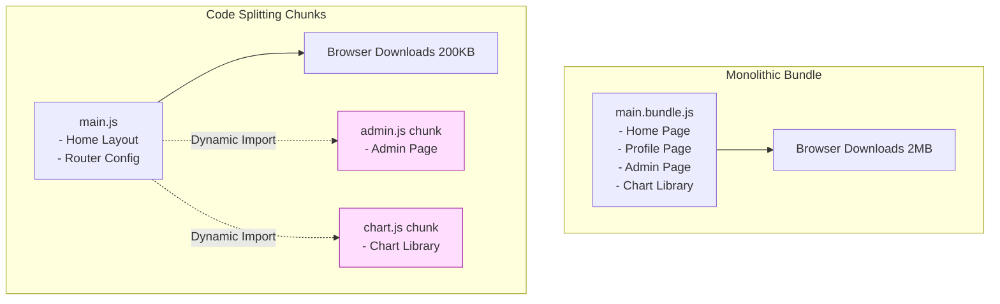
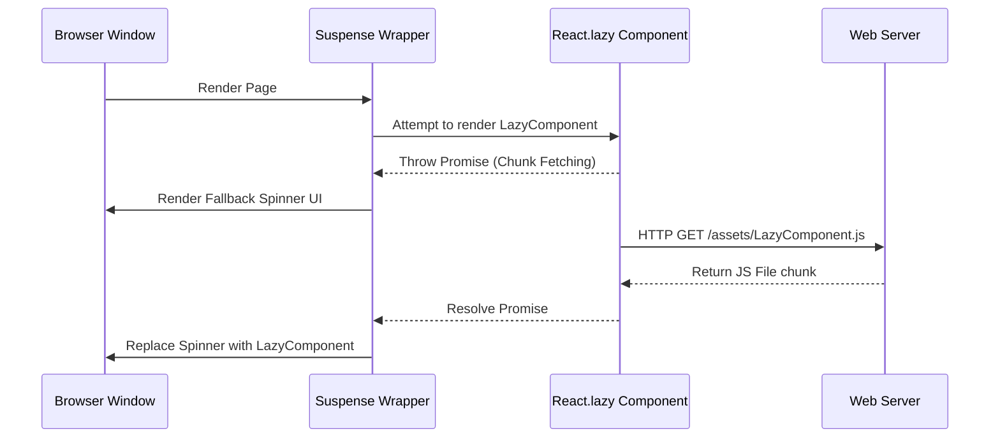
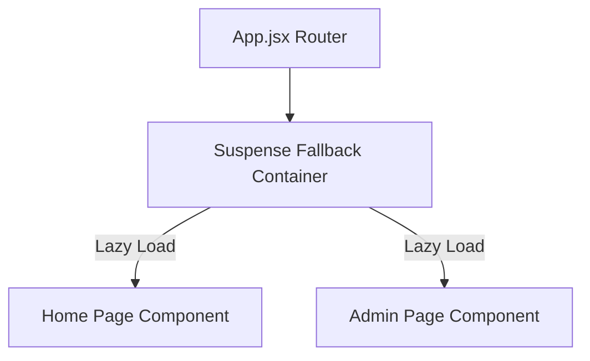
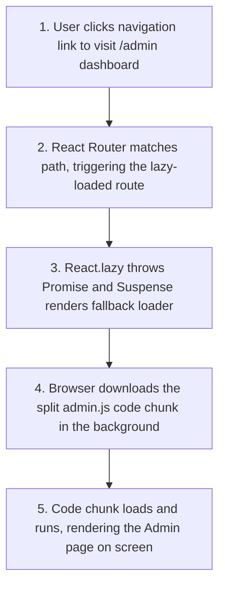

# Code Splitting & Lazy Loading

## Introduction

By default, modern build tools bundle all of your application's JavaScript files into a single bundle file. While this works well for small websites, larger applications can grow to megabytes of code, increasing page load and initial render times. To solve this, we use **Code Splitting** and **Lazy Loading**. This pattern splits your application into smaller code chunks, loading them dynamically only when the user needs them. This module covers dynamic imports, **React.lazy**, and using the **Suspense** fallback container to build fast loading applications.

---

## Why do we need this?

Loading unused code (like an admin dashboard or a heavy charting library) on the home page slows down initial page load and consumes user bandwidth.

### Problem Statement
Consider an application that has a Home page, a Profile page, and a heavy Admin dashboard featuring rich charts and data grids.
1. The Admin page imports a 500KB chart library.
2. If the application is bundled into a single file, a regular user visiting the Home page must download the entire bundle, including the 500KB chart library, even though they don't have access to the Admin page.
3. This delays the initial page load, resulting in a poor user experience, especially on slower mobile networks.

We need a way to split the chart library and the Admin page into a separate bundle chunk that is downloaded only when an administrator navigates to the Admin page.

---

## Real World Story

In the early days of single-page applications, developers shipped monolithic bundles.

As libraries grew, pages became slow to load. Webpack introduced "Code Splitting" to allow developers to split their bundles manually using complex configuration files. In 2018, React simplified this by releasing `React.lazy` and `<Suspense>` in version 16.6. This brought code splitting directly into the component model: by replacing standard imports with dynamic imports, developers could lazy-load entire components and route pages, reducing bundle sizes and improving page load speeds without complex Webpack setups.

---

## Real World Analogy

Think of code splitting like a **Hotel Menu** compared to **Delivering Every Dish to the Table at Once**.

- **Monolithic Bundling (Delivering Everything at Once)**: You sit down at a restaurant table. The waiter immediately brings out a soup, salad, steak, burger, ice cream, and coffee, crowding the table. By the time you are ready for dessert, the ice cream has melted and the coffee is cold. You pay for all the dishes, even if you only wanted a salad.
- **Code Splitting (Ordering from a Menu)**: You sit down and the waiter hands you a menu. You order a salad (Home page). The kitchen prepares and delivers only the salad. When you are finished, you order the dessert (lazy-loading the Admin page). The kitchen prepares and delivers the dessert on demand, keeping your table clean and ensuring you only pay for what you eat.

---

## Visual Explanation

Below is a diagram comparing monolithic bundling with code-splitting chunks served on demand.

### Monolithic Bundle Load
```
[Browser Request] ──> [Downloads main.bundle.js (2MB)] ──> [Loads all pages] ──> [Interactive]
```

### Code Splitting Chunk Load
```
[Browser Request] ──> [Downloads main.js (200KB)] ──> [Home page Interactive]
                          │
                   (User clicks Profile link)
                          │
                          ▼
                      [Downloads profile.js chunk (50KB) in background] ──> [Profile rendered]
```



---

## Internal Working

Code splitting uses standard JavaScript dynamic imports: `import('./module')`. This returns a Promise that resolves to the loaded module.

When you use `React.lazy(() => import('./MyComponent'))`:
1. During compile time, the bundler (like Vite or Webpack) identifies the dynamic import and splits the target component into a separate file chunk.
2. During runtime, when the component is rendered, `React.lazy` intercepts the render phase and throws a Promise to the nearest parent `<Suspense>` component.
3. The `<Suspense>` component catches the Promise, stops rendering the child tree, and displays your fallback loader component (e.g., a spinner).
4. When the browser finishes downloading the file chunk, the Promise resolves, and `<Suspense>` replaces the loader with the fully rendered component.



---

## Architecture

Code-split modules are organized cleanly. The router wraps page components in Suspense containers to handle loading boundaries.



---

## Step-by-Step Flow

When navigating to a lazy-loaded route page, the following steps occur:



---

## Syntax

```javascript
import React, { lazy, Suspense } from 'react';

// 1. Declare dynamic import using React.lazy
const LazyComponent = lazy(() => import('./MyComponent.jsx'));

function App() {
  return (
    // 2. Wrap component in a Suspense boundary with a fallback loader
    <Suspense fallback={<div>Loading component...</div>}>
      <LazyComponent />
    </Suspense>
  );
}
```

---

## Basic Example

Here is a basic component showing how to lazy-load a dialog box on demand, downloading its code only when the user clicks the open button.

```jsx
import React, { useState, lazy, Suspense } from 'react';

// Lazy load the DialogBox component dynamically
const LazyDialog = lazy(() => import('./components/DialogBox.jsx'));

export default function App() {
  const [isOpen, setIsOpen] = useState(false);

  return (
    <div style={{ padding: '20px', textAlign: 'center' }}>
      <h3>On-Demand Component Loading</h3>
      <button onClick={() => setIsOpen(true)}>Open Modal Drawer</button>

      {isOpen && (
        // Wrap in Suspense to show fallback loader while download is in progress
        <Suspense fallback={<div>Loading modal window...</div>}>
          <LazyDialog onClose={() => setIsOpen(false)} />
        </Suspense>
      )}
    </div>
  );
}
```

---

## Intermediate Example

An intermediate component showing **Route-Based Code Splitting**. This splits each page of your application into separate code chunks, loading them dynamically as the user navigates between routes.

```jsx
import React, { lazy, Suspense } from 'react';
import { BrowserRouter, Routes, Route, Link } from 'react-router-dom';

// Lazy-load page components dynamically
const Home = lazy(() => import('./pages/Home.jsx'));
const Analytics = lazy(() => import('./pages/Analytics.jsx'));
const Settings = lazy(() => import('./pages/Settings.jsx'));

export default function RoutedApp() {
  return (
    <BrowserRouter>
      <nav style={{ padding: '10px', borderBottom: '1px solid #ccc' }}>
        <Link to="/" style={{ marginRight: '12px' }}>Home</Link>
        <Link to="/analytics" style={{ marginRight: '12px' }}>Analytics</Link>
        <Link to="/settings">Settings</Link>
      </nav>

      <div style={{ padding: '20px' }}>
        {/* Wrap all lazy routes in a single Suspense container to handle fallbacks */}
        <Suspense fallback={<div>Loading page layout...</div>}>
          <Routes>
            <Route path="/" element={<Home />} />
            <Route path="/analytics" element={<Analytics />} />
            <Route path="/settings" element={<Settings />} />
          </Routes>
        </Suspense>
      </div>
    </BrowserRouter>
  );
}
```

---

## Advanced Example

An advanced example showing how to preload lazy components in the background before the user interacts with them (e.g., preloading a page when the user hovers over a navigation link).

```jsx
import React, { useState, lazy, Suspense } from 'react';

// Declare dynamic import function
const loadReportComponent = () => import('./components/HeavyReport.jsx');
const LazyReport = lazy(loadReportComponent);

export default function PreloadDashboard() {
  const [showReport, setShowReport] = useState(false);

  // Preload component in the background when user hovers over the button
  const handleMouseEnter = () => {
    console.log('[PRELOAD] Preloading HeavyReport component chunk in background...');
    loadReportComponent(); // Starts downloading the file chunk
  };

  return (
    <div style={{ padding: '20px' }}>
      <h3>Preload Panel</h3>
      <button
        onMouseEnter={handleMouseEnter} // Trigger preload on hover
        onClick={() => setShowReport(true)}
        style={{ padding: '10px', cursor: 'pointer' }}
      >
        View Analytics Report (Hover to Preload)
      </button>

      {showReport && (
        <Suspense fallback={<div>Generating report layout...</div>}>
          <LazyReport />
        </Suspense>
      )}
    </div>
  );
}
```

---

## Production Example

A production-ready code-splitting configuration setting up nested Suspense boundaries to catch chunk loading failures. If a network error occurs or a chunk fails to load, we catch it using an Error Boundary and display a friendly reload message.

```jsx
import React, { Component, lazy, Suspense } from 'react';

// 1. Error Boundary Component to catch chunk loading failures
class ChunkErrorBoundary extends Component {
  state = { hasError: false };

  static getDerivedStateFromError() {
    return { hasError: true };
  }

  componentDidCatch(error) {
    console.error('[CHUNK ERROR] Failed to load module chunk:', error);
  }

  render() {
    if (this.state.hasError) {
      return (
        <div role="alert" style={{ padding: '16px', border: '1px solid red', color: 'red' }}>
          <h4>Load Failure</h4>
          <p>Failed to download application components. This could be due to a network connection issue.</p>
          <button onClick={() => window.location.reload()}>Reload Page</button>
        </div>
      );
    }
    return this.props.children;
  }
}

// Lazy load the admin component
const LazyAdminDashboard = lazy(() => import('./components/AdminDashboard.jsx'));

export default function ProductionApp() {
  return (
    <div>
      <h3>Production Portal</h3>
      {/* Wrap lazy components in both an Error Boundary and a Suspense container */}
      <ChunkErrorBoundary>
        <Suspense fallback={<div>Downloading secure bundle...</div>}>
          <LazyAdminDashboard />
        </Suspense>
      </ChunkErrorBoundary>
    </div>
  );
}
```

---

## Folder Structure

```
code-splitting/
├── src/
│   ├── components/
│   │   ├── ChunkErrorBoundary.jsx
│   │   └── PreloadDashboard.jsx
│   ├── App.jsx
│   └── main.jsx
├── package.json
└── vite.config.js
```

---

## Best Practices

💡 **Did You Know?**  
React's `lazy` function only supports **default exports**. If the component you want to lazy-load is exported as a named export, you must create an intermediate file that re-exports it as a default export, or resolve the named export inside the import Promise:

```javascript
// Lazy loading named exports
const LazyComponent = lazy(() => 
  import('./MyComponent.jsx').then(module => ({ default: module.MyComponent }))
);
```

🚀 **Best Practices**
- Use route-based code splitting to split major pages into separate chunks, ensuring users only download the code for the page they are visiting.
- Wrap lazy components in both an **Error Boundary** and a **Suspense** container to catch and handle network failures gracefully.
- Preload lazy components in the background when the user hovers over a link or button, keeping page transitions feeling instant.

---

## Common Mistakes

⚠ **Common Mistakes**

### Forgetting the Suspense Wrapper
Forgetting to wrap lazy components in a `<Suspense>` container will cause the application to crash immediately during rendering, throwing a runtime error.

```jsx
// ❌ WRONG (App crashes on render)
const LazyChild = lazy(() => import('./LazyChild.jsx'));
function App() {
  return <LazyChild />; // Crashes: Component suspended but no fallback was provided
}

//  RIGHT
const LazyChild = lazy(() => import('./LazyChild.jsx'));
function App() {
  return (
    <Suspense fallback={<p>Loading...</p>}>
      <LazyChild />
    </Suspense>
  );
}
```

---

## Performance Notes

⚡ **Performance Tips**
Code splitting reduces initial bundle sizes, improving key Core Web Vitals metrics like **Largest Contentful Paint (LCP)** and **First Input Delay (FID)**, directly improving page load performance.

---

## Accessibility Notes

♿ **Accessibility Tips**
Display loading indicators inside Suspense fallback components with `aria-live="polite"` or `role="status"` to inform screen reader users that content is loading.

---

## SEO Notes

Search engines like Google index lazy-loaded content, but they may time out before all file chunks finish downloading. Pre-render initial page layouts to ensure crawlers index the page content immediately.

---

## Interview Questions

🎯 **Interview Tips**  
In an interview, explain code splitting as dividing a monolithic bundle into smaller chunks that are loaded dynamically using `React.lazy` and `Suspense` fallback containers, improving page load speeds.

### Q1: What is the role of `<Suspense>` in code splitting?
**Answer**: `<Suspense>` is a React component that acts as a boundary wrapper for lazy-loaded components. When a child component is suspended (loading its code chunk), `<Suspense>` catches the Promise, stops rendering the child tree, and displays a fallback loader component (e.g., a spinner) until the code finishes downloading.

### Q2: How do you lazy-load named exports?
**Answer**: `React.lazy` only supports components exported as default exports. To lazy-load a named export, resolve the named export inside the import Promise:

```javascript
const LazyComponent = lazy(() => 
  import('./MyComponent.jsx').then(module => ({ default: module.MyComponent }))
);
```

---

## MCQs

1. **Which JavaScript feature is used to implement code splitting?**
   - A) Promises
   - B) Dynamic imports (`import()`)
   - C) Generator functions
   - D) Arrow functions
   - *Answer: B*

2. **What does `React.lazy` return?**
   - A) A standard HTML DOM node.
   - B) A Promise that resolves to a React component.
   - C) A specialized lazy component wrapper.
   - D) An environment variable.
   - *Answer: C*

3. **What happens if a lazy component is rendered without a `<Suspense>` wrapper?**
   - A) The component renders with standard fallback styles.
   - B) The application crashes, throwing a runtime error.
   - C) React redirects to the home page.
   - D) The browser downloads the chunk synchronously.
   - *Answer: B*

4. **When is route-based code splitting recommended?**
   - A) For every small utility function.
   - B) For major page views and routes, ensuring users only download the code for the page they visit.
   - C) Inside class component constructors.
   - D) Only on mobile browsers.
   - *Answer: B*

5. **How does preloading improve the user experience?**
   - A) It prevents CSS styling issues.
   - B) It downloads code chunks in the background before the user clicks, keeping page transitions feeling instant.
   - C) It disables all page animations.
   - D) It bypasses network permissions.
   - *Answer: B*

---

## Practice Exercise

### Exercise 1: Lazy Named Export Setup
Lazy-load a component called `AnalyticsTable` exported as a named export from `./Analytics.jsx`:
```javascript
// TODO: Setup lazy named import
const LazyTable = null;
```

*Solution*:
```javascript
const LazyTable = lazy(() => 
  import('./Analytics.jsx').then(m => ({ default: m.AnalyticsTable }))
);
```

### Exercise 2: Suspense Fallback Spinner
Create a component that lazy-loads a heavy component on button click. Wrap it in a Suspense container that displays a progress bar component while loading.

### Exercise 3: Preload Link component
Build a custom navigation link component that preloads the target page component chunk in the background when the user hovers over the link.

---

## Debugging Exercise

### The Missing Suspense Crash
A developer is splitting their router bundle using `React.lazy`, but when they navigate to the `/admin` path, the screen goes blank and the console displays an error: `A component suspended while responding to an update...`. Identify the bug and write the fix.

```jsx
// App.jsx
import React, { lazy } from 'react';
import { BrowserRouter, Routes, Route } from 'react-router-dom';

const AdminPanel = lazy(() => import('./pages/AdminPanel.jsx'));

export default function App() {
  return (
    <BrowserRouter>
      {/* BUG: Routes contain lazy components but lack a Suspense wrapper */}
      <Routes>
        <Route path="/admin" element={<AdminPanel />} />
      </Routes>
    </BrowserRouter>
  );
}
```

#### Solution
Lazy-loaded components must be wrapped in a `<Suspense>` container to handle fallback states while the browser downloads the code chunk. To fix this, wrap the `<Routes>` container or individual route elements in a `<Suspense>` wrapper:

```jsx
// Corrected
import React, { lazy, Suspense } from 'react'; // Import Suspense
import { BrowserRouter, Routes, Route } from 'react-router-dom';

const AdminPanel = lazy(() => import('./pages/AdminPanel.jsx'));

export default function App() {
  return (
    <BrowserRouter>
      {/* Wrap routes in a Suspense boundary with a fallback loader */}
      <Suspense fallback={<div>Loading admin assets...</div>}>
        <Routes>
          <Route path="/admin" element={<AdminPanel />} />
        </Routes>
      </Suspense>
    </BrowserRouter>
  );
}
```

---

## Real-world Scenario

You are maintaining a SaaS analytics platform. The application imports three heavy chart libraries. When users load the dashboard, the page freezes for 3 seconds. Explain how you would optimize the page.
- **Optimization Strategy**: Use `React.lazy` to lazy-load the chart page components dynamically. Wrap the page components in a `<Suspense>` boundary that displays a loading spinner, and preload the chart libraries in the background when the user hovers over the navigation link.

---

## Interview Coding Question

### Problem Statement
Write a custom lazy loader component that wraps a lazy-loaded component in both a fallback loader and an Error Boundary, catching chunk loading errors and displaying a reload button.

```jsx
import React, { Component, Suspense } from 'react';

// 1. Error Boundary
class SafeLoader extends Component {
  state = { hasError: false };
  static getDerivedStateFromError() { return { hasError: true }; }

  render() {
    if (this.state.hasError) {
      return (
        <div>
          <p>Failed to load assets.</p>
          <button onClick={() => window.location.reload()}>Retry</button>
        </div>
      );
    }
    return this.props.children;
  }
}

// 2. High-level wrapper function
export function createLazyComponent(ImportFunc, fallback = <p>Loading...</p>) {
  const LazyComponent = React.lazy(ImportFunc);

  return function SafeLazyWrapper(props) {
    return (
      <SafeLoader>
        <Suspense fallback={fallback}>
          <LazyComponent {...props} />
        </Suspense>
      </SafeLoader>
    );
  };
}
```

---

## Mini Project

### routed Sandbox Studio
Build a routed dashboard demonstrating code splitting:
- Create three different subpages with mock layouts.
- Lazy-load each page component dynamically using `React.lazy`.
- Wrap pages in a single `<Suspense>` boundary with a custom loading progress bar.
- Verify in your browser's Network tab that separate JavaScript file chunks (e.g., `Home.js`, `Analytics.js`) are downloaded only when navigating to their respective pages.

---

## Summary

🧠 **Memory Tricks**  
`Lazy loads chunks` - `React.lazy` splits your code into smaller chunks. The browser downloads these chunks in the background only when requested, saving bandwidth and improving page load speeds.

📖 **Summary**  
Code splitting divides monolithic bundles into smaller chunks. By replacing standard imports with dynamic imports, using `React.lazy` to load components on demand, and using `<Suspense>` fallback boundaries, React keeps initial page loads fast.

---

## Cheat Sheet

```javascript
// Lazy loading route components
const LazyPanel = lazy(() => import('./Panel.jsx'));
```

---

## Related Topics
- [Component Rendering Optimization](rendering-optimization)
- [State & List Optimization (Next Module)](state-optimization)

---

## Further Reading
- [React Docs: Code Splitting & Suspense](https://react.dev/reference/react/Suspense)
- [Vite Docs: Code Splitting Guide](https://vite.dev/guide/build.html#chunking-strategy)
