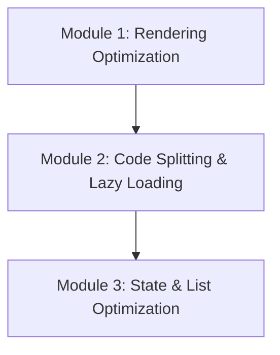

# Phase 6: Performance Optimization

Welcome to the **Performance Optimization** phase of the React Engineering Academy. This phase covers how to build fast, responsive React applications by diagnosing rendering bottlenecks, optimizing child updates, splitting bundle files using code splitting, and designing efficient state update pathways.

## Why this topic exists

React is fast out of the box, but as applications grow, redundant re-renders can slow down the user interface.
- If parent components re-render on every state change, all of their children re-render by default. In complex layouts, this can cause input fields to feel laggy and freeze browser threads.
- If the entire application is bundled into a single JavaScript file, users must download megabytes of code before the page can load, resulting in long startup times.

Understanding how to measure rendering performance, split bundles, and optimize state is critical for building production-grade web applications.

---

## Learning Objectives

By the end of this phase, you will be able to:
- Diagnose and debug rendering performance issues using the React DevTools Profiler.
- Optimize component rendering using `React.memo`, `useMemo`, and `useCallback`.
- Identify when memoization helps performance and when it adds unnecessary overhead.
- Split bundle files using dynamic imports, `React.lazy`, and `<Suspense>`.
- Optimize state structures to minimize re-renders (state colocation).
- Implement list virtualization using libraries like `react-window` or `react-virtualized`.
- Benchmark metrics like Interaction to Next Paint (INP) and Cumulative Layout Shift (CLS).

---

## Prerequisites

Before starting this phase, you should have completed:
1. **[Phase 1: React Fundamentals](../phase-1-fundamentals)**
2. **[Phase 2: Components & JSX](../phase-2-components-jsx)**
3. **[Phase 3: State Management](../phase-3-state-management)**
4. **[Phase 4: React Hooks](../phase-4-hooks)**
5. **[Phase 5: Routing & Data Fetching](../phase-5-routing-fetching)**

---

## Learning Roadmap & Topics Covered

This phase is broken down into three comprehensive modules:

1. **[Module 1: Rendering Optimization](rendering-optimization)**  
   The rendering process under the hood, how React.memo works, and when memoization optimizations are useful.
2. **[Module 2: Code Splitting & Lazy Loading](code-splitting)**  
   Dynamic imports, route-based code splitting using React.lazy, Suspense configurations, and resource pre-loading.
3. **[Module 3: State & List Optimization](state-optimization)**  
   State colocation, context splitting, optimizing scroll events, and list virtualization (rendering large datasets).

---

## Estimated Learning Time

- **Total Time**: 10 - 12 Hours
- **Module 1**: 4 Hours
- **Module 2**: 3 Hours
- **Module 3**: 4 Hours
- **Exercises & Projects**: 1 Hour

---

## Real-World Applications

- **Heavy Data Dashboards**: Building analytics portals that render charts and logs instantly without lag.
- **Large E-Commerce Catalogs**: Rendering lists of thousands of products with filters, sorting, and pagination without lag.
- **High-Performance SaaS Tools**: Optimizing input response times to keep typing and page transitions feeling instant.

---

## Practice Exercises

- **Render bottleneck analysis**: Using the Profiler to identify which component is triggering slow renders.
- **Route chunk validation**: Configuring Vite to split route bundles into separate chunks.
- **Virtual list builder**: Implementing a scrollable list of 10,000 items that only renders visible rows.

---

## Mini Projects

- **An Optimized Inventory Board**: A dashboard displaying thousands of metrics, utilizing lazy loading, list virtualization, and memoization to keep interactions and page loading fast.

---

## Related Topics

- [React Hooks Deep Dive](../phase-4-hooks)
- [Advanced React Architecture](../phase-7-advanced)

---

## Further Reading

- [React Docs: Profiling Component Performance](https://react.dev/reference/react/profiling)
- [Kent C. Dodds: React Performance Guide](https://epicreact.dev/)
