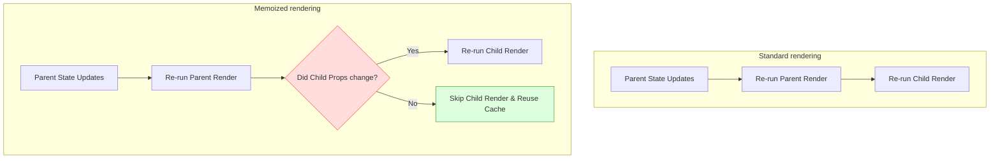
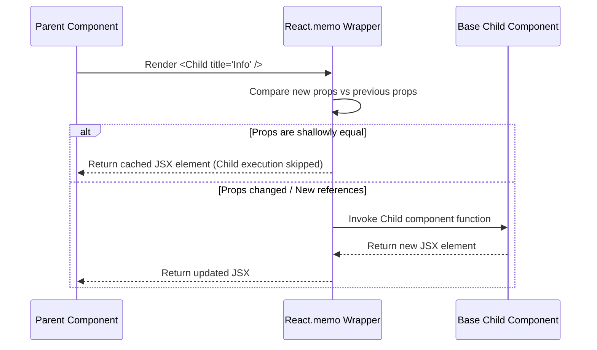
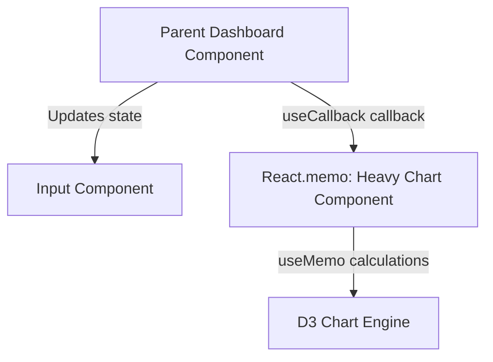

# Component Rendering Optimization

## Introduction

React's render cycle is fast, but on every update, React re-runs the component function and all of its children by default. In large applications, this can trigger unnecessary rendering cycles that slow down the user interface. This module covers the rendering pipeline, how **React.memo** checks props using shallow comparisons, and how to identify and debug rendering bottlenecks using the **React DevTools Profiler**.

---

## Why do we need this?

If parent components trigger updates, all nested children will re-render, even if their props are unchanged.

### Problem Statement
Consider a dashboard component containing a user search input field and a heavy metrics chart display.
1. When the user types a character in the search input, the dashboard's local state updates, triggering a re-render.
2. React re-runs the dashboard component function.
3. React re-runs the heavy metrics chart component function by default, even though the chart's data props are unchanged.
4. The chart re-evaluates its layout, freezing the browser thread for milliseconds and causing the input field to lag.

We need a way to tell React to skip re-rendering child components when their props have not changed.

---

## Real World Story

In early versions of React, developers optimized class components using the `shouldComponentUpdate` lifecycle method or by extending `React.PureComponent`. This compared props and state using shallow comparisons to skip updates.

When functional components became popular, React introduced `React.memo` as a Higher-Order Component wrapper. It checks if the incoming props match the previous props using a shallow comparison. If they match, React skips re-running the component and reuses the last rendered output. However, developers quickly ran into the "new reference" issue: passing inline arrays, objects, or functions as props created new memory references on every render, causing the shallow comparison to fail and components to re-render anyway. This led to the introduction of `useMemo` and `useCallback` to cache these references.

---

## Real World Analogy

Think of component rendering like **Checking Out a Library Book** compared to **Reprinting the Book**.

- **Without Optimization (Reprinting)**: Every time a student asks for a book, you print a fresh copy, bind it, paint the cover, and hand it to them. Even if 10 students ask for the same book, you print it 10 times, consuming time and resources.
- **With Optimization (Library Check-out)**: The first student asks for the book. You print it once and place it on a shelf (Memoization cache). When the next student asks for the same book, you verify if the content has changed. If the content is identical, you hand them the cached copy immediately, skipping the printing press completely.

---

## Visual Explanation

Below is a diagram showing the comparison of standard re-rendering vs. optimized rendering using `React.memo`.

### Standard Re-rendering (Slow)
```
[Parent State Changes] ──> [Re-run Parent Code] ──> [Re-run Child Code (Always)]
```

### Memoized Rendering (Fast)
```
[Parent State Changes] ──> [Re-run Parent Code] ──> [React.memo Shallow Check]
                                                          ├── (Props Changed) ──> [Re-run Child]
                                                          └── (Props Unchanged) ─> [Skip Render]
```



---

## Internal Working

React compares component props using a **Shallow Comparison** (`Object.is`).

```javascript
// Shallow Comparison checks values for primitives, and references for objects
const prevProps = { title: "Stats", items: [1, 2] };
const nextProps = { title: "Stats", items: [1, 2] };

// Shallow comparison fails because prevProps.items !== nextProps.items (different memory references)
```

When you wrap a component in `React.memo(MyComponent)`:
1. When the parent component renders, React checks the props passed to the child.
2. It performs a shallow comparison between the new props and the previous props.
3. If all props are identical (primitives have the same value, objects/functions have the same memory reference), React skips re-running the component.
4. You can also pass a custom comparison function as a second argument to customize this behavior.



---

## Architecture

Optimized component structures separate static nodes from active state pathways, allowing heavy layouts to skip render loops.



---

## Step-by-Step Flow

When React renders a memoized component structure, the following steps occur:

```mermaid
flowchart TD
    Step1[1. Parent state updates, triggering parent render] --> Step2[2. React evaluates props passed to the child component]
    Step2 --> Step3[3. React.memo runs a shallow comparison between new and old props]
    Step3 --> Step4[4. If references match, child rendering is skipped (Render Phase ends)]
    Step4 --> Step5[5. React commits parent updates to the browser DOM without touching the child]
```

---

## Syntax

```javascript
import React from 'react';

// Wraps the component with React.memo to skip updates if props are identical
const MyComponent = React.memo(function MyComponent(props) {
  return <div>{props.content}</div>;
});

// Custom comparison signature
const CustomMemoComponent = React.memo(MyComponent, (prevProps, nextProps) => {
  return prevProps.id === nextProps.id; // Return true to skip rendering
});
```

---

## Basic Example

Here is a basic component showing how `React.memo` prevents child components from re-rendering when parent state updates.

```jsx
import React, { useState } from 'react';

// Optimized child component: skips rendering unless count changes
const CounterDisplay = React.memo(({ count }) => {
  console.log('Rendering CounterDisplay...');
  return <p>Current Count: {count}</p>;
});

export default function SimpleCounterDashboard() {
  const [count, setCount] = useState(0);
  const [text, setText] = useState('');

  return (
    <div style={{ padding: '16px' }}>
      <h3>Memoized Dashboard</h3>
      {/* Typing in the input updates the text state and re-renders the dashboard,
          but the CounterDisplay component skips re-rendering */}
      <input
        type="text"
        value={text}
        onChange={e => setText(e.target.value)}
        placeholder="Type here..."
        style={{ display: 'block', marginBottom: '12px' }}
      />
      <CounterDisplay count={count} />
      <button onClick={() => setCount(count + 1)}>Increment Count</button>
    </div>
  );
}
```

---

## Intermediate Example

An intermediate component showing the "new reference" issue. In this example, the parent passes an inline array prop. Because inline arrays are recreated on every render, the shallow comparison fails, and the child component re-renders anyway. We fix this by wrapping the array in `useMemo`.

```jsx
import React, { useState, useMemo } from 'react';

// Memoized child component
const ListWidget = React.memo(({ items }) => {
  console.log('Rendering ListWidget...');
  return (
    <ul>
      {items.map(item => <li key={item}>{item}</li>)}
    </ul>
  );
});

export default function CatalogDashboard() {
  const [query, setQuery] = useState('');
  
  // ❌ WRONG: Recreated on every render (new reference), causing ListWidget to re-render anyway
  // const productList = ['Laptop', 'Phone', 'Tablet'];

  //  RIGHT: Caches the array reference, preventing ListWidget from re-rendering
  const productList = useMemo(() => ['Laptop', 'Phone', 'Tablet'], []);

  return (
    <div style={{ padding: '20px' }}>
      <h3>Product Catalog</h3>
      <input
        type="text"
        value={query}
        onChange={e => setQuery(e.target.value)}
        placeholder="Search..."
        style={{ display: 'block', marginBottom: '12px' }}
      />
      <ListWidget items={productList} />
    </div>
  );
}
```

---

## Advanced Example

An advanced example showing how to use a custom comparison function with `React.memo` to skip updates based on specific property checks, ignoring other prop changes.

```jsx
import React, { useState } from 'react';

// Component displays user profile details
function ProfileCard({ user, onEdit }) {
  console.log(`[RENDER] ProfileCard: ${user.name}`);
  return (
    <div style={{ border: '1px solid #ccc', padding: '16px', margin: '8px 0' }}>
      <h4>User Profile</h4>
      <p>Name: <strong>{user.name}</strong></p>
      <p>Status: {user.status}</p>
      <button onClick={() => onEdit(user.id)}>Edit Profile</button>
    </div>
  );
}

//  Custom Comparison Function: skips rendering if the user name and status are identical
const MemoizedProfileCard = React.memo(ProfileCard, (prevProps, nextProps) => {
  return (
    prevProps.user.name === nextProps.user.name &&
    prevProps.user.status === nextProps.user.status
  );
});

export default function TeamPanel() {
  const [users, setUsers] = useState([
    { id: '1', name: 'Alice', status: 'Active' },
    { id: '2', name: 'Bob', status: 'Inactive' }
  ]);
  const [refreshCount, setRefreshCount] = useState(0);

  const toggleStatus = (id) => {
    setUsers(prev => prev.map(u => u.id === id ? { ...u, status: u.status === 'Active' ? 'Inactive' : 'Active' } : u));
  };

  return (
    <div style={{ padding: '20px' }}>
      <h3>Team Dashboard</h3>
      <button onClick={() => setRefreshCount(c => c + 1)}>
        Force Panel Render ({refreshCount})
      </button>

      <div>
        {users.map(user => (
          // Wrapped component skips re-rendering when Parent count updates,
          // but updates correctly when its own status changes
          <MemoizedProfileCard key={user.id} user={user} onEdit={toggleStatus} />
        ))}
      </div>
    </div>
  );
}
```

---

## Production Example

A production-ready list component that displays thousands of rows. It memoizes row items, uses stable ID keys, and uses a custom comparison function to ensure only the updated row re-renders.

```jsx
import React, { useState, useCallback } from 'react';

// Memoized Row Component
const ItemRow = React.memo(({ item, onSelect }) => {
  console.log(`[RENDER ROW] ID: ${item.id}`);
  return (
    <div
      onClick={() => onSelect(item.id)}
      style={{
        display: 'flex',
        justifyContent: 'space-between',
        padding: '8px',
        borderBottom: '1px solid #eee',
        backgroundColor: item.selected ? '#e3f2fd' : 'transparent',
        cursor: 'pointer'
      }}
    >
      <span>Item #{item.id}</span>
      <span>Amount: ${item.amount}</span>
    </div>
  );
}, (prev, next) => {
  // Only re-render if the item's selection status or amount changes
  return prev.item.selected === next.item.selected && prev.item.amount === next.item.amount;
});

export default function ProductionGrid() {
  const [grid, setGrid] = useState(() =>
    Array.from({ length: 100 }, (_, i) => ({
      id: `i-${i}`,
      amount: Math.floor(Math.random() * 1000),
      selected: false
    }))
  );

  // Memoized selection handler callback
  const handleSelect = useCallback((id) => {
    setGrid(prev => prev.map(item =>
      item.id === id ? { ...item, selected: !item.selected } : item
    ));
  }, []);

  return (
    <div style={{ padding: '16px', border: '1px solid #ddd', borderRadius: '8px' }}>
      <h3>Performance Grid Panel</h3>
      <p>Only the clicked row re-renders in the console.</p>
      
      <div style={{ maxHeight: '250px', overflowY: 'auto' }}>
        {grid.map(item => (
          <ItemRow key={item.id} item={item} onSelect={handleSelect} />
        ))}
      </div>
    </div>
  );
}
```

---

## Folder Structure

```
rendering-optimization/
├── src/
│   ├── components/
│   │   ├── CatalogDashboard.jsx
│   │   └── ProductionGrid.jsx
│   ├── App.jsx
│   └── main.jsx
├── package.json
└── vite.config.js
```

---

## Best Practices

💡 **Did You Know?**  
React's shallow comparison checks primitive values (like strings or booleans) by value, and reference types (like arrays, objects, or functions) by memory reference. Passing an inline function like `onClick={() => doSomething()}` creates a new memory reference on every render, causing `React.memo` shallow checks to fail.

🚀 **Best Practices**
- Avoid premature optimization. Do not wrap every component in `React.memo`. Simple components render quickly, and the overhead of running shallow comparisons on every update can exceed the rendering cost.
- Wrap components in `React.memo` when:
  1. The component renders often with identical props.
  2. The component contains heavy rendering logic (like complex SVG drawing or large data mapping).
- Always use `useMemo` and `useCallback` to cache arrays, objects, and functions passed as props to memoized components.

---

## Common Mistakes

⚠ **Common Mistakes**

### Passing Inline Objects to Memoized Components
Passing inline objects or arrays as props to components wrapped in `React.memo` is a common mistake. Since inline objects are recreated on every render, they receive new memory references, causing the shallow comparison to fail and components to re-render anyway.

```jsx
// ❌ WRONG
// options object is recreated on every render, causing Child to re-render anyway
<MemoizedChild options={{ theme: 'dark' }} />

//  RIGHT
const STATIC_OPTIONS = { theme: 'dark' }; // Define outside component body
// ...
<MemoizedChild options={STATIC_OPTIONS} />
```

---

## Performance Notes

⚡ **Performance Tips**
Use the **React DevTools Profiler** tab to identify rendering bottlenecks:
1. Start recording and interact with your application (e.g., type in a search input).
2. Stop recording and analyze the Flamegraph.
3. Hover over bars to see how long components took to render and identify which components re-rendered unnecessarily.

---

## Accessibility Notes

♿ **Accessibility Tips**
When components skip rendering, ensure that layout shifts do not occur. Elements should maintain stable sizes and positions, preventing Cumulative Layout Shift (CLS) issues that can disorient keyboard and screen reader users.

---

## SEO Notes

Performance optimizations improve Core Web Vitals scores (like Interaction to Next Paint - INP), which are important Google search ranking factors. Keeping pages responsive under user interactions directly improves search SEO results.

---

## Interview Questions

🎯 **Interview Tips**  
In an interview, explain that `React.memo` is a Higher-Order Component wrapper that checks if props have changed using a shallow comparison. Explain that inline arrays, objects, and functions receive new references on every render, and must be cached using `useMemo` and `useCallback` to prevent optimization failures.

### Q1: What is the difference between `React.memo` and `useMemo`?
**Answer**: `React.memo` is a Higher-Order Component wrapper used to memoize entire **components**, preventing them from re-rendering if their props are unchanged. `useMemo` is a hook used inside components to memoize **values** or results of expensive calculations, preventing them from being re-computed on every render cycle.

### Q2: How does React compare props inside `React.memo`?
**Answer**: React compares props using a **Shallow Comparison** (`Object.is`). It checks primitive values (like strings, numbers, booleans) by value, and reference values (like arrays, objects, functions) by memory reference. If you pass a new object or function reference, the shallow comparison checks it as changed, triggering a re-render.

---

## MCQs

1. **Which mechanism is used by default by `React.memo` to compare props?**
   - A) Deep comparison (recursive keys check)
   - B) Shallow comparison (`Object.is` check)
   - C) JSON string comparison
   - D) Direct DOM node measurement
   - *Answer: B*

2. **What does `React.memo` do when it detects props are unchanged?**
   - A) It compiles the component into web assemblies.
   - B) It skips re-rendering the component and reuses the last rendered output.
   - C) It resets local state.
   - D) It redirects the browser page.
   - *Answer: B*

3. **Why does passing an inline function `onClick={() => {}}` as a prop bypass `React.memo` optimizations?**
   - A) Because inline functions are read-only.
   - B) Inline functions are recreated on every render, receiving new memory references and causing the shallow comparison check to fail.
   - C) It triggers compilation errors.
   - D) It exposes secret API keys.
   - *Answer: B*

4. **Which tool is used to analyze rendering bottlenecks and flamegraphs in React?**
   - A) Babel CLI
   - B) React DevTools Profiler tab
   - C) ESLint compiler
   - D) Vite config manager
   - *Answer: B*

5. **When is wrapping a component in `React.memo` discouraged?**
   - A) When the component contains heavy layout trees.
   - B) For simple, lightweight components that receive constantly changing props, as the shallow comparison check adds unnecessary overhead.
   - C) In mobile browsers.
   - D) On route components.
   - *Answer: B*

---

## Practice Exercise

### Exercise 1: Custom comparison setup
Configure `React.memo` on this component to only trigger re-renders when the `activeId` property changes, ignoring other prop updates:
```jsx
function DetailsCard({ activeId, analyticsData }) {
  return <div>Card ID: {activeId}</div>;
}
// TODO: Wrap in React.memo with custom comparison
```

*Solution*:
```jsx
const MemoizedDetailsCard = React.memo(DetailsCard, (prev, next) => {
  return prev.activeId === next.activeId;
});
```

### Exercise 2: Static props optimization
Create a component that passes a static theme object to a memoized child component. Verify in the console that the child skips rendering when parent state changes.

### Exercise 3: useCallback function sync
Create a component with an input field and a memoized child list. Use `useCallback` to cache the click handler passed to the child, preventing it from re-rendering when the user types in the input.

---

## Debugging Exercise

### The Mismatching References Bug
A developer wants to prevent their expensive sidebar component from re-rendering, so they wrapped it in `React.memo`. However, the sidebar still re-renders on every parent update. Identify the bug and write the fix.

```jsx
import React, { useState } from 'react';

// Memoized Sidebar
const OptimizedSidebar = React.memo(({ config }) => {
  console.log("Sidebar Rendered!");
  return <aside>Theme: {config.theme}</aside>;
});

export default function Dashboard() {
  const [count, setCount] = useState(0);

  // BUG: config object is recreated on every render, causing the sidebar to re-render anyway
  const config = { theme: 'dark' };

  return (
    <div>
      <button onClick={() => setCount(count + 1)}>Update Count ({count})</button>
      <OptimizedSidebar config={config} />
    </div>
  );
}
```

#### Solution
The `config` object is defined in the component body and is recreated on every render, receiving a new memory reference and causing `React.memo` to fail. To fix this, move the `config` object outside the component body (since it doesn't depend on any internal variables) or wrap it in `useMemo`:

```jsx
// Corrected
const STATIC_CONFIG = { theme: 'dark' }; // Define outside component body

export default function Dashboard() {
  const [count, setCount] = useState(0);

  return (
    <div>
      <button onClick={() => setCount(count + 1)}>Update Count ({count})</button>
      <OptimizedSidebar config={STATIC_CONFIG} /> {/* Reference remains identical */}
    </div>
  );
}
```

---

## Real-world Scenario

You are building an interactive trading desk displaying live prices of 500 stocks. Updates arrive every 500ms. Clicking a row highlights the stock. When price feeds arrive in rapid succession, user clicks on rows are delayed. Explain how you would optimize this.
- **Optimization Strategy**: Wrap the stock row component in `React.memo` with a custom comparison function that only re-renders the row if the stock's price or selection status changes. Cache selection callbacks using `useCallback` to ensure row elements skip unnecessary re-renders.

---

## Interview Coding Question

### Problem Statement
Write a component structure where:
- `Parent`: Renders a text input and a list of items.
- `ChildList`: A component wrapped in `React.memo` that renders the list of items.
- Ensure that typing in the parent's input field does not trigger the `ChildList` component to re-render, logging messages to the console to verify the behavior.

```jsx
import React, { useState, useMemo } from 'react';

// 1. Memoized Child List
const ChildList = React.memo(({ items }) => {
  console.log('[RENDER] ChildList component executed');
  return (
    <ul>
      {items.map(item => <li key={item}>{item}</li>)}
    </ul>
  );
});

// 2. Parent Component
export default function FilterPanel() {
  const [text, setText] = useState('');
  
  // Cache the array list reference to prevent child re-renders
  const items = useMemo(() => ['Apple', 'Banana', 'Orange'], []);

  return (
    <div>
      <h3>Optimized Filter List</h3>
      <input
        type="text"
        value={text}
        onChange={e => setText(e.target.value)}
        placeholder="Type search..."
      />
      <ChildList items={items} />
    </div>
  );
}
```

---

## Mini Project

### Render Metrics Benchmarker
Build a rendering profiling dashboard:
- Create a list of 100 components.
- Provide inputs that trigger state updates.
- Wrap components in toggleable `React.memo` wrappers.
- Track render cycles using a ref and display a visual indicator showing render counts and execution speeds live on screen.

---

## Summary

🧠 **Memory Tricks**  
`Shallow checks memory` - Shallow comparison checks memory references. If you create a new array `[]` or object `{}` inside a render method, it gets a new memory reference, causing `React.memo` to fail.

📖 **Summary**  
`React.memo` optimizes component rendering by skipping updates when props are unchanged. By using shallow comparisons and combining it with `useMemo` and `useCallback` to cache references, React keeps layout rendering fast and responsive.

---

## Cheat Sheet

```javascript
// Wrap component to optimize rendering
export const MemoizedCard = React.memo(MyCard);
```

---

## Related Topics
- [Optimization Hooks (useMemo)](../phase-4-hooks/optimization-hooks)
- [Code Splitting & Lazy Loading (Next Module)](code-splitting)

---

## Further Reading
- [React Docs: React.memo](https://react.dev/reference/react/memo)
- [Dan Abramov: Over-memoizing React Components](https://overreacted.io/before-you-memo/)
