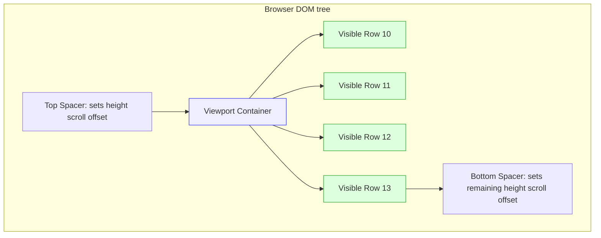
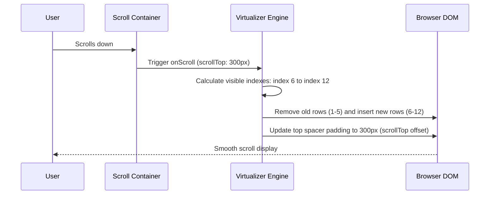
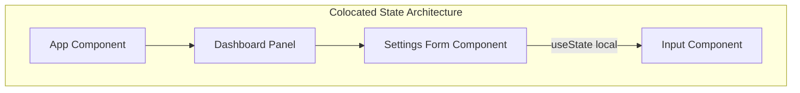
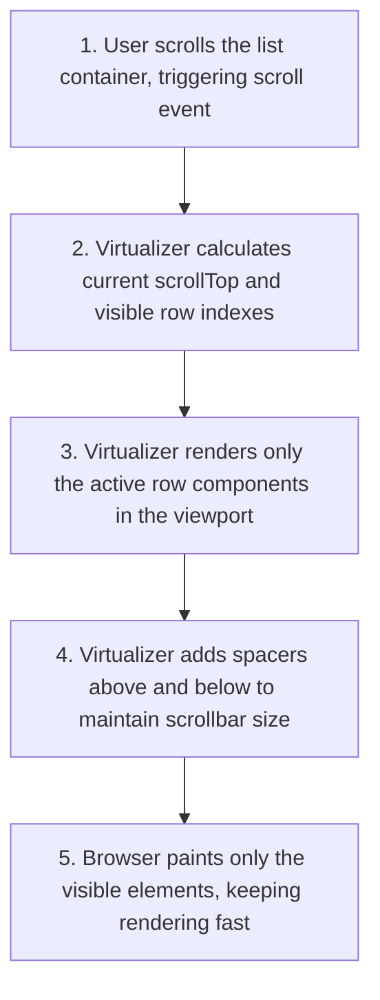

# State & List Optimization

## Introduction

As applications scale, how you structure state and render lists determines the responsiveness and speed of your user interface. Storing state globally when it is only used locally, or attempting to render thousands of DOM nodes at once, will slow down rendering performance and freeze the browser thread. This module covers **State Colocation** (moving state closer to where it is used), **Context Splitting**, event throttling, and **List Virtualization** (rendering only visible list rows to handle large datasets).

---

## Why do we need this?

Attempting to render thousands of DOM elements at once will cause significant performance issues.

### Problem Statement
Consider an application that displays a scrollable list of 5,000 inventory items.
1. Each list item has text descriptions, inputs, status badges, and edit buttons.
2. The browser's DOM is not designed to hold tens of thousands of complex nodes at once.
3. When the page loads, the browser must run style calculations, layout calculations, and paint operations for all 5,000 items, taking seconds to render.
4. When the user scrolls, the page stutters and lags because the browser struggles to paint the large DOM tree.

We need a way to keep the DOM tree small by rendering only the list rows that are currently visible within the user's viewport, swapping them dynamically as the user scrolls.

---

## Real World Story

In early versions of React, developers built infinite scroll lists by appending new items to the DOM.

As lists grew, pages became slow and consumed massive amounts of memory. In 2018, React core team member Brian Vaughn created `react-window` and `react-virtualized`. These libraries introduced **List Virtualization** (windowing) to the React ecosystem. By measuring scroll offsets and rendering only the rows visible inside the viewport, they reduced DOM node counts from thousands to dozens, allowing applications to display infinite lists of items without lag or memory leaks.

---

## Real World Analogy

Think of list virtualization like a **Scrolling Film Strip Projector** compared to **Hanging Every Frame on the Wall**.

- **Without Virtualization (Hanging on the Wall)**: To show a 2-hour movie containing 150,000 frames, you print every single frame on a piece of paper and hang them side-by-side along a 10-mile gallery wall. The viewer must walk along the wall to see the movie. It is extremely slow to set up, takes massive space, and tires the viewer.
- **With Virtualization (Projector)**: You use a single projector screen (Viewport). You mount the film strip on a scroll wheel. As the film rolls, only a single frame is projected onto the screen at any moment (Visible rows). The frames are loaded and discarded on the fly, keeping the theater compact and the movie playback smooth.

---

## Visual Explanation

Below is a diagram showing how list virtualization renders only the elements visible inside the viewport box, placing spacers above and below to maintain the correct scroll height.

### List Virtualization Model
```
[Hidden Scroll Space (1500px height)] ──> Renders nothing (Spacers only)
────────────────────────────────────────────────
[Active Viewport (400px height)]      ──> Renders Row 10, Row 11, Row 12, Row 13
────────────────────────────────────────────────
[Hidden Scroll Space (3000px height)] ──> Renders nothing (Spacers only)
```



---

## Internal Working

List virtualization (windowing) works by placing a wrapper element with `position: relative` inside a scrollable container.

When the user scrolls:
1. The container's `onScroll` event listener fires.
2. The virtualizer calculates the current scroll offset: `scrollTop`.
3. It determines the index of the first visible item: `Math.floor(scrollTop / rowHeight)`.
4. It determines the index of the last visible item based on the viewport height.
5. It renders only the items between the first and last indexes, positioning them absolutely inside the wrapper using their computed offset: `top: index * rowHeight`.
6. Spacers or padding are added above and below the items to maintain the correct scroll height, keeping scrollbar behavior normal.



---

## Architecture

Optimized state management keeps state local to where it is used (state colocation). This prevents parent components from re-rendering when local UI elements update.



---

## Step-by-Step Flow

When rendering a virtualized list of items, the following steps occur:



---

## Syntax

Here is the basic syntax for using the `react-window` library to render a virtualized list of items.

```jsx
import { FixedSizeList as List } from 'react-window';

const Row = ({ index, style }) => (
  <div style={style}>Row {index}</div> // Style prop positions the row absolutely
);

const MyList = () => (
  <List
    height={400}
    itemCount={1000}
    itemSize={35}
    width={300}
  >
    {Row}
  </List>
);
```

---

## Basic Example

Here is a basic component showing **State Colocation**. By moving the text state into a local `<SearchInput>` component, typing in the input field does not trigger the parent dashboard or heavy child components to re-render.

```jsx
import React, { useState } from 'react';

// Heavy component: should not render on parent keystrokes
const HeavyLayout = React.memo(() => {
  console.log('Rendering HeavyLayout...');
  return <div style={{ padding: '20px', background: '#ccc' }}>Heavy Chart Display</div>;
});

// Colocated state component
function SearchInput() {
  const [query, setQuery] = useState('');
  return (
    <div>
      <input
        type="text"
        value={query}
        onChange={e => setQuery(e.target.value)}
        placeholder="Type query..."
      />
      <span style={{ marginLeft: '8px' }}>Active query: {query}</span>
    </div>
  );
}

export default function Dashboard() {
  return (
    <div style={{ padding: '20px' }}>
      <h3>State Colocation Demo</h3>
      {/* Search state is local to SearchInput, so typing does not re-render Dashboard or HeavyLayout */}
      <SearchInput />
      <hr style={{ margin: '16px 0' }} />
      <HeavyLayout />
    </div>
  );
}
```

---

## Intermediate Example

An intermediate component showing how to throttle high-frequency events (like window scrolling) to prevent layouts from lagging due to excessive state updates.

```jsx
import React, { useState, useEffect, useRef } from 'react';

export default function ScrollPositionPanel() {
  const [scrollPos, setScrollPos] = useState(0);
  const isThrottling = useRef(false);

  useEffect(() => {
    const handleScroll = () => {
      // Throttle event updates using a flag and requestAnimationFrame
      if (isThrottling.current) return;
      isThrottling.current = true;

      requestAnimationFrame(() => {
        setScrollPos(window.scrollY);
        isThrottling.current = false;
      });
    };

    window.addEventListener('scroll', handleScroll);
    return () => window.removeEventListener('scroll', handleScroll);
  }, []);

  return (
    <div style={{
      position: 'fixed',
      top: '10px',
      right: '10px',
      padding: '8px',
      background: 'rgba(0,0,0,0.8)',
      color: '#fff',
      borderRadius: '4px'
    }}>
      Scroll Offset: <strong>{scrollPos}px</strong>
    </div>
  );
}
```

---

## Advanced Example

An advanced example showing how to build a simple custom virtualized list from scratch using pure React. This illustrates the math and styles behind list virtualization without using external libraries.

```jsx
import React, { useState, useRef } from 'react';

const ITEMS = Array.from({ length: 5000 }, (_, i) => `List Item #${i + 1}`);
const ROW_HEIGHT = 40; // Fixed row height in pixels
const VIEWPORT_HEIGHT = 300; // Visible container height

export default function CustomVirtualList() {
  const [scrollTop, setScrollTop] = useState(0);
  const containerRef = useRef(null);

  const handleScroll = (e) => {
    setScrollTop(e.currentTarget.scrollTop);
  };

  // Math calculations
  const totalHeight = ITEMS.length * ROW_HEIGHT;
  const startIndex = Math.max(0, Math.floor(scrollTop / ROW_HEIGHT) - 2); // Buffer of 2 items
  const endIndex = Math.min(ITEMS.length - 1, Math.floor((scrollTop + VIEWPORT_HEIGHT) / ROW_HEIGHT) + 2);

  const visibleItems = [];
  for (let i = startIndex; i <= endIndex; i++) {
    visibleItems.push({
      index: i,
      data: ITEMS[i],
      style: {
        position: 'absolute',
        top: `${i * ROW_HEIGHT}px`, // Position absolutely inside relative wrapper
        height: `${ROW_HEIGHT}px`,
        width: '100%',
        boxSizing: 'border-box',
        borderBottom: '1px solid #eee',
        padding: '8px'
      }
    });
  }

  return (
    <div style={{ padding: '20px' }}>
      <h3>Custom Virtual List (5,000 items)</h3>
      <p>Active items in DOM: {visibleItems.length}</p>

      {/* Scrollable Container */}
      <div
        ref={containerRef}
        onScroll={handleScroll}
        style={{
          height: `${VIEWPORT_HEIGHT}px`,
          overflowY: 'auto',
          border: '1px solid #ccc',
          position: 'relative'
        }}
      >
        {/* Relative wrapper sets total scroll height */}
        <div style={{ height: `${totalHeight}px`, width: '100%', position: 'relative' }}>
          {visibleItems.map(item => (
            <div key={item.index} style={item.style}>
              {item.data}
            </div>
          ))}
        </div>
      </div>
    </div>
  );
}
```

---

## Production Example

A production-ready virtualized list component utilizing the `react-window` library, handling click events, showing item details, and logging render metrics.

```jsx
import React, { useState, useCallback } from 'react';
import { FixedSizeList as List } from 'react-window';

const DATALIST = Array.from({ length: 15000 }, (_, i) => ({
  id: `id-${i}`,
  label: `Customer Record #${i + 1}`,
  rating: Math.floor(Math.random() * 100)
}));

export default function ProductionVirtualList() {
  const [selectedId, setSelectedId] = useState(null);

  const handleSelect = useCallback((id) => {
    setSelectedId(id);
    console.log(`Selected record ID: ${id}`);
  }, []);

  // Row Component
  const Row = useCallback(({ index, style }) => {
    const item = DATALIST[index];
    const isSelected = selectedId === item.id;

    return (
      <div
        style={{
          ...style, // Style is absolutely required to position row
          display: 'flex',
          justifyContent: 'space-between',
          alignItems: 'center',
          padding: '0 12px',
          borderBottom: '1px solid #eee',
          backgroundColor: isSelected ? '#bbdefb' : '#fff',
          cursor: 'pointer',
          boxSizing: 'border-box'
        }}
        onClick={() => handleSelect(item.id)}
      >
        <span>{item.label}</span>
        <span>Rating: {item.rating}%</span>
      </div>
    );
  }, [selectedId, handleSelect]);

  return (
    <div style={{ padding: '16px', border: '1px solid #ddd', borderRadius: '8px', maxWidth: '500px' }}>
      <h3>Customer Database Registry</h3>
      <p>Database size: 15,000 items (rendering only 10 rows in DOM)</p>

      {/* Render virtualized list */}
      <List
        height={350} // Viewport height in pixels
        itemCount={DATALIST.length}
        itemSize={40} // Fixed height of each row in pixels
        width="100%"
      >
        {Row}
      </List>
      
      {selectedId && (
        <p style={{ marginTop: '12px' }}>
          Active ID: <strong>{selectedId}</strong>
        </p>
      )}
    </div>
  );
}
```

---

## Folder Structure

```
state-list-optimization/
├── src/
│   ├── components/
│   │   ├── CustomVirtualList.jsx
│   │   └── ProductionVirtualList.jsx
│   ├── App.jsx
│   └── main.jsx
├── package.json
└── vite.config.js
```

---

## Best Practices

💡 **Did You Know?**  
List virtualization does not just improve rendering speeds. By reducing DOM node counts, it also significantly reduces browser memory usage, keeping your page responsive on low-end mobile devices.

🚀 **Best Practices**
- Colocate state: keep state local to where it is used. Do not lift state up to global contexts if it is only used within a single component.
- Use list virtualization (windowing) when rendering scrollable lists of more than 500 items, keeping the DOM tree small and scrolling smooth.
- Throttle high-frequency event handlers (like scroll or mousemove events) using `requestAnimationFrame` or lodash throttle to prevent layout lag.

---

## Common Mistakes

⚠ **Common Mistakes**

### Lifting State Too High
Lifting state too high up the component tree causes unnecessary re-renders in sibling components that do not care about the updated state.

```jsx
// ❌ WRONG
// Parent dashboard re-renders and updates all child panels on every input keystroke
function Dashboard() {
  const [inputText, setInputText] = useState('');
  return (
    <div>
      <Navbar text={inputText} />
      <HeavyDashboardBody /> {/* Re-renders unnecessarily */}
    </div>
  );
}
```

---

## Performance Notes

⚡ **Performance Tips**
React's concurrent feature `useDeferredValue` helps keep input fields responsive during heavy re-renders. Use it to defer updates for search lists while keeping the text input field updating instantly on keystrokes.

---

## Accessibility Notes

♿ **Accessibility Tips**
When lists are virtualized, rows are constantly added and removed from the DOM as the user scrolls, which can confuse screen reader users. Add proper ARIA list attributes (`role="list"`, `role="listitem"`) to the virtualized items, and provide keyboard page scroll controls.

---

## SEO Notes

Virtualized content is only loaded when visible within the viewport container. Since search engine crawlers do not scroll pages, they cannot see or index virtualized list rows. Ensure critical content is loaded statically or pre-rendered.

---

## Interview Questions

🎯 **Interview Tips**  
In an interview, define list virtualization as "rendering only the visible list rows inside the viewport container, dynamically swapping them as the user scrolls." Explain that it improves page speed by keeping the DOM tree small and reducing memory usage.

### Q1: What is State Colocation?
**Answer**: State Colocation is the design pattern of moving state variables closer to the components that read and write them. Instead of lifting all state to the root parent component, keep state local to the child component that manages it. This prevents parent and sibling components from re-rendering unnecessarily on every state update, improving performance.

### Q2: How does List Virtualization improve scrolling performance?
**Answer**: List Virtualization improves scrolling performance by keeping the browser's DOM tree small. Instead of rendering thousands of list elements (which triggers expensive style calculations, reflows, and repaints), the virtualizer renders only the rows visible inside the viewport container, positioning them absolutely and updating them dynamically as the user scrolls.

---

## MCQs

1. **What is the primary goal of List Virtualization?**
   - A) Running CSS animations on separate threads.
   - B) Keeping the DOM tree small and rendering only the visible list rows inside the viewport, optimizing scrolling performance.
   - C) Saving API response data to localStorage.
   - D) Translating layouts into mobile apps.
   - *Answer: B*

2. **What occurs when state is colocated?**
   - A) The entire app state is merged into a single context.
   - B) State variables are moved closer to the components that read and write them, reducing unnecessary re-renders in parents and siblings.
   - C) Data is pre-fetched from APIs.
   - D) CSS files are compiled on the fly.
   - *Answer: B*

3. **Which CSS property is used by list virtualizers to place row elements correctly?**
   - A) `position: absolute`
   - B) `float: left`
   - C) `display: inline-block`
   - D) `visibility: hidden`
   - *Answer: A*

4. **Which browser API is used to throttle high-frequency events inside scroll listeners?**
   - A) `AbortController`
   - B) `requestAnimationFrame`
   - C) `ServiceWorker`
   - D) `localStorage`
   - *Answer: B*

5. **Why can virtualized list rows be difficult for search engine crawlers to index?**
   - A) Scrapers cannot parse inline CSS.
   - B) Crawlers do not scroll page containers, meaning they only see the few initial visible rows loaded in the DOM.
   - C) Because rows contain dynamic keys.
   - D) Crawlers ignore elements styled with absolute positioning.
   - *Answer: B*

---

## Practice Exercise

### Exercise 1: State Colocation Setup
Refactor this layout to colocate the toggle state inside the modal wrapper, preventing the dashboard header from re-rendering:
```jsx
function Dashboard() {
  const [isOpen, setIsOpen] = useState(false);
  return (
    <div>
      <Header />
      <button onClick={() => setIsOpen(true)}>Open Modal</button>
      {isOpen && <Modal onClose={() => setIsOpen(false)} />}
    </div>
  );
}
```

*Solution*:
```jsx
function ModalButton() {
  const [isOpen, setIsOpen] = useState(false);
  return (
    <>
      <button onClick={() => setIsOpen(true)}>Open Modal</button>
      {isOpen && <Modal onClose={() => setIsOpen(false)} />}
    </>
  );
}

function Dashboard() {
  return (
    <div>
      <Header />
      <ModalButton />
    </div>
  );
}
```

### Exercise 2: requestAnimationFrame Scroll Log
Create a component that listens to the window scroll event and logs the scroll position. Throttle the event callback using `requestAnimationFrame`.

### Exercise 3: react-window List Rendering
Set up a list of 1,000 items using the `react-window` library. Configure each row height to be `45px` and the viewport height to be `400px`.

---

## Debugging Exercise

### The Laggy Scroll List Bug
A developer builds an infinite scroll directory rendering 10,000 profile rows, but when users scroll, the page freezes and lags. Identify the bug and write the fix.

```jsx
import React, { useState } from 'react';

export default function ProfileScrollList() {
  const [profiles] = useState(() =>
    Array.from({ length: 10000 }, (_, i) => `Profile User #${i + 1}`)
  );

  return (
    // BUG: Attempting to render all 10,000 complex DOM nodes at once, causing layout lag
    <div style={{ height: '300px', overflowY: 'scroll', border: '1px solid #ccc' }}>
      {profiles.map((profile, index) => (
        <div key={index} style={{ padding: '8px', borderBottom: '1px solid #eee' }}>
          {profile}
        </div>
      ))}
    </div>
  );
}
```

#### Solution
The list attempts to render all 10,000 items in the DOM at once, causing severe style and layout reflow lags during scrolling. To fix this, implement list virtualization using the `react-window` library to render only the visible rows:

```jsx
import React, { useState } from 'react';
import { FixedSizeList as List } from 'react-window'; // Import react-window List

// Corrected ProfileScrollList component
export default function ProfileScrollList() {
  const [profiles] = useState(() =>
    Array.from({ length: 10000 }, (_, i) => `Profile User #${i + 1}`)
  );

  // Row Component to render individual items
  const Row = ({ index, style }) => (
    <div style={{ ...style, padding: '8px', borderBottom: '1px solid #eee', boxSizing: 'border-box' }}>
      {profiles[index]}
    </div>
  );

  return (
    <div style={{ border: '1px solid #ccc', maxWidth: '300px' }}>
      {/* Render virtualized list container */}
      <List
        height={300} // Viewport height in pixels
        itemCount={profiles.length}
        itemSize={40} // Height of each row in pixels
        width="100%"
      >
        {Row}
      </List>
    </div>
  );
}
```

---

## Real-world Scenario

You are building an autocomplete search bar that queries a database of 100,000 movies. When the user types, the input freezes for split seconds. Explain how you would address this.
- **Design Strategy**: Use state colocation to keep the search text input state local. Implement a debounce function to delay API queries, and use list virtualization on the movie results dropdown list to render only the visible movie suggestions.

---

## Interview Coding Question

### Problem Statement
Write a custom react-window style Row component that displays an item record.
- Accept: `index`, `style`, and an `onRowClick` callback.
- Highlight the active selected index by applying a green background.
- Ensure the Row component is memoized using `React.memo` to skip re-renders if selection indices do not match.

```jsx
import React from 'react';

// Memoized Row Component
export const PerformanceRow = React.memo(({ index, style, selectedIndex, onRowClick }) => {
  const isSelected = selectedIndex === index;
  console.log(`[RENDER PERFORMANCE ROW] Index: ${index}`);

  return (
    <div
      style={{
        ...style,
        backgroundColor: isSelected ? 'lightgreen' : 'white',
        cursor: 'pointer',
        padding: '8px',
        boxSizing: 'border-box',
        borderBottom: '1px solid #ddd'
      }}
      onClick={() => onRowClick(index)}
    >
      Dynamic Row Record #{index + 1}
    </div>
  );
}, (prev, next) => {
  // Skip re-render if selection state for this row is unchanged
  const wasSelected = prev.selectedIndex === prev.index;
  const isSelected = next.selectedIndex === next.index;
  return wasSelected === isSelected;
});
```

---

## Mini Project

### Virtualized Grid Explorer
Create an interactive virtual grid dashboard:
- Generate a matrix of 10,000 grid cells.
- Build a custom virtual list wrapper that positions elements absolutely.
- Provide toggle switches to enable/disable virtualization, letting users inspect DOM node counts and compare scrolling performance in real-time.

---

## Summary

🧠 **Memory Tricks**  
`Colocate and Virtualize`  
- Colocate state: keep state local to prevent parent re-renders.
- Virtualize lists: render only visible rows to keep the DOM tree small and scrolling smooth.

📖 **Summary**  
State colocation keeps state close to where it is used, reducing unnecessary re-renders. List virtualization (windowing) keeps the DOM tree small by rendering only visible rows, optimizing scrolling performance and memory usage.

---

## Cheat Sheet

```javascript
// List virtualization with react-window
<List height={300} itemCount={1000} itemSize={35} width="100%">
  {RowComponent}
</List>
```

---

## Related Topics
- [Component Rendering Optimization](rendering-optimization)
- [Advanced React Architecture](../phase-7-advanced)

---

## Further Reading
- [react-window Github Repository](https://github.com/bvaughn/react-window)
- [React Docs: State Colocation](https://react.dev/learn/sharing-state-between-components#controlled-and-uncontrolled-components)
