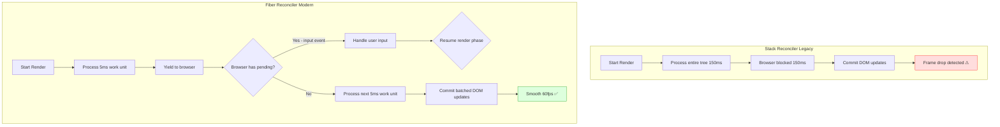
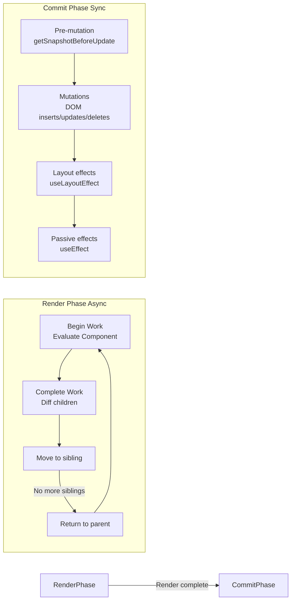
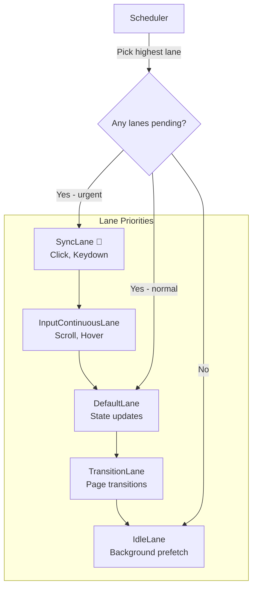
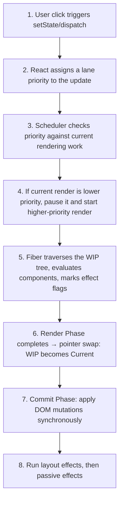

# Fiber Architecture & Concurrent Rendering

## Introduction

React Fiber is the complete rewrite of React's reconciliation engine, released in React 16. Unlike the legacy stack reconciler, which processed updates synchronously to completion and blocked the browser main thread, Fiber introduces an incremental rendering model. It breaks rendering work into small, interruptible units called **Fibers**, organizes them into a linked list tree, assigns priority levels via **Lanes**, and can pause, resume, or abort work to keep the browser responsive. This module covers the Fiber architecture in depth, the scheduler internals, lane-based prioritization, and the concurrent rendering features available in React 18+.

---

## Why do we need this?

Browser frames must complete layout, paint, and JavaScript execution within 16ms (60fps) to feel responsive. If JavaScript blocks the main thread for more than this window, the browser drops frames, causing jank and unresponsive UIs.

### Problem Statement

Consider a large product listing page. When a user selects a filter checkbox:

1. The filter changes state, triggering a re-render.
2. React begins reconciling the new Virtual DOM tree, diffing thousands of elements.
3. The legacy stack reconciler would process all of this work synchronously.
4. During this processing, the browser cannot handle any other task — user clicks on buttons, typing in search fields, or the pending animation all freeze.
5. Once reconciling finishes (potentially taking 100-200ms on large trees), the browser updates the UI. The user perceives a noticeable delay and jank.

We need a rendering engine that can prioritize urgent updates (like text input) over less urgent ones (like list filtering), pause work to let the browser handle input events, and resume work once the user is done interacting.

---

## Real World Story

Before React 16, the reconciliation algorithm (called the Stack Reconciler) was synchronous and recursive. When React started rendering, it would traverse the entire tree recursively and could not be interrupted. As Facebook's applications grew (Facebook Feed, Ads Manager, Instagram), the synchronous render caused UI freezes when complex components updated.

In 2016, the React core team (led by Sebastian Markbåge, Andrew Clark, and others) began rewriting the reconciler from scratch. They named it **React Fiber**, after the computer science concept of fibers — lightweight threads that cooperate with the scheduler. The rewrite took over two years, with React 16.0 shipping the new Fiber architecture in September 2017. Fiber enabled incremental rendering, error boundaries, fragments, portals, and laid the foundation for Suspense and Concurrent Mode. React 18 later shipped the concurrent rendering features on top of this Fiber infrastructure.

---

## Real World Analogy

Think of React Fiber like a **Modern Airport Control Tower** compared to an **Old Single-Runway Airport**.

- **Stack Reconciler (Single-Runway Airport)**: When a flight (render update) starts landing, the control tower clears the entire runway, grounds all other planes, and focuses entirely on landing that one flight. If the flight takes 10 minutes to land (large render work), all other planes (user clicks, animations) must wait in a holding pattern, burning fuel (frame drops and jank).

- **Fiber Reconciler (Modern Control Tower)**: The tower monitors multiple runways (concurrent lanes). An urgent flight (user typing) is assigned a high-priority lane and lands immediately. A cargo flight (background data sync) is assigned a low-priority lane. If a high-priority flight needs to land, the tower can pause the cargo flight's approach, let the urgent flight land, and resume the cargo flight's landing sequence afterward. No plane is blocked, and passengers are never kept waiting.

---

## Visual Explanation

Below is a comparison of the synchronous stack reconciler vs. React Fiber's incremental work-loop.

### Stack Reconciler (Synchronous)
```
[Render Start] ──> [Traverse Entire Tree] ──> [Blocked for 150ms] ──> [Commit to DOM] ──> [Browser Responds]
```

### Fiber Reconciler (Incremental)
```
[Render Start] ──> [Process Unit 1] ──> [Yield to Browser] ──> [Process Unit 2] ──> [Yield] ──> [Commit]
```



---

## Internal Working

React Fiber represents the component tree as a **linked list of Fiber Nodes**. Each Fiber node corresponds to a Virtual DOM element and carries pointers to traverse the tree efficiently.

### Fiber Node Structure

```javascript
// Simplified Fiber Node Structure
const fiberNode = {
  // Identification
  tag: 1,              // Component type (FunctionComponent, ClassComponent, HostComponent, etc.)
  key: 'unique-key',   // Key prop from user
  elementType: 'div',  // The element type the user wrote
  type: 'div',         // The resolved element type

  // Tree Traversal Pointers (Linked List)
  child: null,         // First child Fiber
  sibling: null,       // Next sibling Fiber
  return: null,        // Parent Fiber (points back up the tree)
  index: 0,            // Index among siblings

  // State & Effects
  pendingProps: {},    // New props from the current render
  memoizedProps: {},   // Props from the previous render
  memoizedState: null, // State from the previous render (hooks linked list)
  updateQueue: null,   // State updates, effects, and callbacks queue
  flags: 8,            // Side-effect flags (Placement, Update, Deletion, etc.)

  // Work Loop
  lanes: 0b0010,       // Which lane this work belongs to
  childLanes: 0b0000,  // Lanes of child fibers
  alternate: null,     // Link to the Work-in-Progress (WIP) copy
};
```

### The Work Loop

Fiber renders in two phases:

1. **Render Phase (Reconciliation)**: React walks the Fiber tree in a depth-first loop, executing components, diffing props, and marking Fiber nodes with effect flags (flags). This phase is asynchronous and interruptible. React can pause after processing a Fiber unit, check if higher-priority work arrived, and either continue or restart from a higher-priority lane.

2. **Commit Phase**: Once the Render Phase completes, React enters the Commit Phase. It walks the Fiber tree again, this time applying the flagged effects to the real DOM. This phase is synchronous and cannot be interrupted because mutations to the DOM must happen atomically.



---

## Architecture

### Fiber Tree & Work-in-Progress Tree

React maintains two Fiber trees in memory:

1. **Current Tree**: Represents the UI that is currently rendered on screen.
2. **Work-in-Progress (WIP) Tree**: A draft tree built during the Render Phase. Each Fiber node's `alternate` property points to its corresponding node in the other tree.

When the Render Phase completes, the WIP tree becomes the new Current tree in a pointer swap called **double buffering**. This ensures users never see an incomplete UI.

### Lane Prioritization

React 18+ assigns updates to **Lanes** (bitmask priorities). Higher-priority lanes are processed first:

| Lane | Priority | Example |
|------|----------|---------|
| SyncLane | Highest | Discrete events (clicks, keydowns) |
| InputContinuousLane | High | Continuous events (scroll, hover) |
| DefaultLane | Normal | useState updates, fetch callbacks |
| TransitionLane | Low | useTransition wrapped updates |
| IdleLane | Lowest | Prefetching, background data sync |



---

## Step-by-Step Flow

When React receives a state update and processes it through the Fiber architecture, the following steps occur:



---

## Syntax

```javascript
// There is no direct API for Fiber manipulation in user code.
// However, concurrent features are exposed through hooks and APIs:

// 1. Mark an update as non-urgent (Transition)
import { useTransition } from 'react';
const [isPending, startTransition] = useTransition();
startTransition(() => {
  setSearchQuery(input); // This update can be interrupted
});

// 2. Defer a value to stay responsive during heavy re-renders
import { useDeferredValue } from 'react';
const deferredQuery = useDeferredValue(searchQuery);

// 3. Opt into concurrent features in React 18+
// Root creation (index.js)
import { createRoot } from 'react-dom/client';
const root = createRoot(document.getElementById('root'));
root.render(<App />); // Concurrent features enabled by default
```

---

## Basic Example

Here is a basic demonstration of the **work-loop yield** concept. Even though this user code doesn't touch Fiber directly, it shows how React batches updates within microtasks, allowing the browser to process events between renders.

```jsx
import React, { useState, useTransition } from 'react';

export default function FiberDemo() {
  const [count, setCount] = useState(0);
  const [isPending, startTransition] = useTransition();

  const handleUrgentClick = () => {
    // High priority: SyncLane — processed immediately
    setCount(c => c + 1);
    console.log('Urgent lane: sync update');
  };

  const handleNonUrgentClick = () => {
    // Low priority: TransitionLane — can be interrupted by user input
    startTransition(() => {
      setCount(c => c + 100);
      console.log('Transition lane: deferred work');
    });
  };

  return (
    <div style={{ padding: '16px' }}>
      <h3>Fiber Lane Priority Demo</h3>
      <p>Counter: {count}</p>
      <button onClick={handleUrgentClick}>Urgent +1 (Sync Lane)</button>
      <button onClick={handleNonUrgentClick} style={{ marginLeft: '8px' }}>
        Non-Urgent +100 (Transition Lane)
      </button>
      {isPending && <p>⚠ Rendering transition...</p>}
    </div>
  );
}
```

---

## Intermediate Example

An intermediate component illustrating **Automatic Batching** — a feature enabled by the Fiber architecture. React 18+ batches all state updates within event handlers, timeouts, and promise callbacks into a single re-render, regardless of where they occur.

```jsx
import React, { useState } from 'react';

export default function AutomaticBatchingDemo() {
  const [count, setCount] = useState(0);
  const [flag, setFlag] = useState(false);

  const handleBatchedClick = () => {
    // Before React 18: This would cause 2 re-renders
    // With Fiber + createRoot: Both updates are batched into 1 render
    setCount(c => c + 1);
    setFlag(f => !f);
    console.log('Both state updates batched into single render via Fiber');
  };

  const handleAsyncBatchedClick = () => {
    // Before React 18: setTimeout callbacks were NOT batched
    // With Fiber + createRoot: Updates inside setTimeout ARE batched
    setTimeout(() => {
      setCount(c => c + 10);
      setFlag(f => !f);
      console.log('Async updates are also batched via Fiber');
    }, 500);
  };

  console.log(`Render: count=${count}, flag=${flag}`);

  return (
    <div style={{ padding: '16px', border: '1px solid #ccc', borderRadius: '8px' }}>
      <h3>Automatic Batching (Fiber Feature)</h3>
      <p>Count: {count}</p>
      <p>Flag: {flag ? 'ON' : 'OFF'}</p>
      <button onClick={handleBatchedClick}>Batch Sync Updates (1 render)</button>
      <button onClick={handleAsyncBatchedClick} style={{ marginLeft: '8px' }}>
        Batch Async Updates (1 render after 500ms)
      </button>
    </div>
  );
}
```

---

## Advanced Example

An advanced component demonstrating **interruptible rendering** with `useTransition`. A heavy list filtering operation is wrapped in a transition, allowing urgent text input to stay responsive even during filtering.

```jsx
import React, { useState, useTransition, useMemo } from 'react';

// Simulates a large dataset
const ITEMS = Array.from({ length: 20000 }, (_, i) => ({
  id: i,
  text: `Item #${i} — ${Math.random().toString(36).slice(2, 8)}`
}));

export default function InterruptibleListDemo() {
  const [query, setQuery] = useState('');
  const [deferredQuery, setDeferredQuery] = useState('');
  const [isPending, startTransition] = useTransition();

  const handleInputChange = (e) => {
    const value = e.target.value;
    // Urgent update: update input immediately (no lag)
    setQuery(value);

    // Non-urgent update: filter heavy list via transition
    // Fiber's scheduler can pause this work if user keeps typing
    startTransition(() => {
      setDeferredQuery(value);
    });
  };

  const filteredItems = useMemo(() => {
    return ITEMS.filter(item =>
      item.text.toLowerCase().includes(deferredQuery.toLowerCase())
    );
  }, [deferredQuery]);

  return (
    <div style={{ padding: '16px', maxWidth: '600px' }}>
      <h3>Interruptible Rendering Demo</h3>
      <input
        type="text"
        value={query}
        onChange={handleInputChange}
        placeholder="Search 20,000 items..."
        style={{ width: '100%', padding: '8px', marginBottom: '8px' }}
      />
      {isPending && <p style={{ color: '#888' }}>⏳ Rendering filtered list...</p>}
      <p>Showing {filteredItems.length} / {ITEMS.length} items</p>
      <ul style={{ maxHeight: '300px', overflowY: 'auto', border: '1px solid #eee', padding: '8px' }}>
        {filteredItems.slice(0, 100).map(item => (
          <li key={item.id} style={{ padding: '2px 0' }}>{item.text}</li>
        ))}
      </ul>
    </div>
  );
}
```

---

## Production Example

A production-grade dashboard component that uses `useDeferredValue` for a live search over a large dataset. The Fiber scheduler automatically defers the low-priority re-render (filtering the grid) while keeping the high-priority input update instant.

```jsx
import React, { useState, useDeferredValue, useMemo } from 'react';

// Simulates 10,000 rows of trading data
function generateTradeData() {
  return Array.from({ length: 10000 }, (_, i) => ({
    id: `trade-${i}`,
    symbol: ['AAPL', 'GOOGL', 'MSFT', 'AMZN', 'TSLA'][i % 5],
    price: Math.floor(Math.random() * 1000) + 100,
    change: (Math.random() * 10 - 5).toFixed(2),
    volume: Math.floor(Math.random() * 1000000),
  }));
}

const INITIAL_DATA = generateTradeData();

export default function TradingDashboard() {
  const [searchTerm, setSearchTerm] = useState('');
  // useDeferredValue tells Fiber to keep the search input responsive
  // by deferring the filtered list re-render to a lower priority lane
  const deferredSearch = useDeferredValue(searchTerm);
  const isStale = searchTerm !== deferredSearch;

  const filteredData = useMemo(() => {
    return INITIAL_DATA.filter(row =>
      row.symbol.toLowerCase().includes(deferredSearch.toLowerCase()) ||
      row.id.includes(deferredSearch)
    );
  }, [deferredSearch]);

  return (
    <div style={{ padding: '16px', fontFamily: 'monospace' }}>
      <h3>Trading Dashboard</h3>
      <div style={{ display: 'flex', alignItems: 'center', gap: '8px', marginBottom: '12px' }}>
        <input
          type="text"
          value={searchTerm}
          onChange={e => setSearchTerm(e.target.value)}
          placeholder="Search by symbol or ID..."
          style={{ flex: 1, padding: '8px', fontSize: '14px' }}
        />
        {isStale && <span style={{ color: '#888' }}>⏳ Updating...</span>}
        <span style={{ color: '#666', fontSize: '12px' }}>
          {filteredData.length} results
        </span>
      </div>

      <div style={{ maxHeight: '400px', overflowY: 'auto', border: '1px solid #ddd' }}>
        <table style={{ width: '100%', borderCollapse: 'collapse' }}>
          <thead>
            <tr style={{ backgroundColor: '#f5f5f5' }}>
              <th style={thStyle}>ID</th>
              <th style={thStyle}>Symbol</th>
              <th style={thStyle}>Price</th>
              <th style={thStyle}>Change</th>
              <th style={thStyle}>Volume</th>
            </tr>
          </thead>
          <tbody>
            {filteredData.slice(0, 200).map(row => (
              <tr key={row.id} style={{ opacity: isStale ? 0.6 : 1 }}>
                <td style={tdStyle}>{row.id}</td>
                <td style={tdStyle}>{row.symbol}</td>
                <td style={tdStyle}>${row.price}</td>
                <td style={{ ...tdStyle, color: parseFloat(row.change) >= 0 ? 'green' : 'red' }}>
                  {row.change}%
                </td>
                <td style={tdStyle}>{row.volume.toLocaleString()}</td>
              </tr>
            ))}
          </tbody>
        </table>
      </div>

      <p style={{ fontSize: '12px', color: '#888', marginTop: '8px' }}>
        ⚡ Fiber Concurrency: input stays responsive while filtering 10,000 rows via deferred lane
      </p>
    </div>
  );
}

const thStyle = {
  padding: '8px',
  textAlign: 'left',
  borderBottom: '2px solid #ddd',
  fontSize: '12px',
  textTransform: 'uppercase'
};

const tdStyle = {
  padding: '6px 8px',
  borderBottom: '1px solid #f0f0f0',
  fontSize: '13px'
};
```

---

## Folder Structure

```
fiber-architecture/
├── src/
│   ├── components/
│   │   ├── InterruptibleListDemo.jsx
│   │   └── TradingDashboard.jsx
│   ├── App.jsx
│   └── main.jsx
├── package.json
└── vite.config.js
```

---

## Best Practices

💡 **Did You Know?**  \
React Fiber was named after the computer science concept of **fibers** — lightweight, cooperative threads that voluntarily yield control to a scheduler, allowing multiple tasks to share a single CPU thread efficiently.

🚀 **Best Practices**
- Wrap heavy, non-urgent state updates in `startTransition` to let Fiber prioritize urgent user interactions.
- Use `useDeferredValue` to defer re-rendering slow parts of the UI (like filtered lists) while keeping inputs responsive.
- Prefer `createRoot` over `ReactDOM.render` in React 18+ to enable concurrent features and automatic batching.
- Keep render functions pure — Fiber may pause, resume, or restart component rendering multiple times due to lane priority changes.

---

## Common Mistakes

⚠ **Common Mistakes**

### Performing Side Effects During Render

Because Fiber can pause, resume, and restart the Render Phase arbitrarily, side effects (like API calls, state updates, or DOM mutations) placed directly in the component body or inside render functions will run multiple times unexpectedly.

```jsx
// ❌ WRONG: Side effect in render body — runs multiple times due to Fiber restarts
function UserProfile({ userId }) {
  fetch(`/api/users/${userId}`).then(setUser); // Called on every render restart!
  return <div>{user?.name}</div>;
}

// ✅ RIGHT: Side effects belong inside useEffect
function UserProfile({ userId }) {
  useEffect(() => {
    fetch(`/api/users/${userId}`).then(setUser);
  }, [userId]);
  return <div>{user?.name}</div>;
}
```

---

## Performance Notes

⚡ **Performance Tips**

Fiber's incremental rendering ensures that large updates do not block the main thread for more than ~5ms at a time. To fully benefit:

- Use `React.memo` and `useMemo` to prevent unnecessary re-renders of subtrees that didn't change.
- Wrap animations in `startTransition` to ensure animation frames are never dropped.
- Profile with React DevTools Profiler to identify which components re-render and how long each commit takes.

---

## Accessibility Notes

♿ **Accessibility Tips**

When using `useDeferredValue` or `startTransition`, the UI may show stale content briefly while the deferred render completes. Use `aria-live="polite"` regions to inform screen reader users that content is updating.

```jsx
<div aria-live="polite">
  {isPending && <span>Updating results...</span>}
</div>
```

---

## SEO Notes

Concurrent rendering occurs on the client side. Ensure that server-rendered pages contain the full semantic HTML content before client hydration so that search engine crawlers can index the page immediately.

---

## Interview Questions

🎯 **Interview Tips**  \
In an interview, explain Fiber as a complete rewrite of the reconciler using a linked-list tree structure that enables incremental, interruptible rendering. Mention that Fiber split the rendering work into two phases: the asynchronous Render Phase and the synchronous Commit Phase.

### Q1: What is the difference between the Stack Reconciler and the Fiber Reconciler?

**Answer**: The Stack Reconciler processed updates synchronously and recursively, traversing the entire tree without interruption. This blocked the browser main thread during large renders, causing jank. The Fiber Reconciler breaks rendering into small, interruptible units organized as a linked list of Fiber nodes. It can pause after processing each unit, check for higher-priority work, yield to the browser, and resume rendering later. This enables smooth 60fps interactions even during large re-renders.

### Q2: What are Lanes in React Fiber?

**Answer**: Lanes are a bitmask-based priority system introduced in React 18. Each update is assigned to a lane (SyncLane, InputContinuousLane, DefaultLane, TransitionLane, or IdleLane). The scheduler picks the highest-priority pending lane and processes its work first. If a higher-priority lane becomes pending during a lower-priority render, Fiber can pause the current work and switch to the urgent lane.

### Q3: What is the double buffering technique in Fiber?

**Answer**: Fiber maintains two trees: the Current tree (representing the currently rendered UI) and the Work-in-Progress (WIP) tree (a draft built during the Render Phase). When the Render Phase completes, React performs a pointer swap — the WIP tree becomes the new Current tree in a single atomic operation. The old Current tree is recycled for the next render cycle. This technique ensures that users never see an incomplete or partially updated UI.

---

## MCQs

1. **What data structure does React Fiber use to enable incremental rendering?**
   - A) A binary search tree
   - B) A linked list of Fiber nodes with child, sibling, and return pointers
   - C) A hash map indexed by component ID
   - D) A circular queue
   - *Answer: B*

2. **Which of the following is NOT a phase in React Fiber's rendering pipeline?**
   - A) Render Phase (Reconciliation)
   - B) Commit Phase (DOM Mutations)
   - C) Compilation Phase (JSX to bytecode)
   - D) Passive Effects Phase (useEffect)
   - *Answer: C*

3. **What does the `alternate` property on a Fiber node point to?**
   - A) The parent component's state
   - B) The corresponding node in the Work-in-Progress or Current tree for double buffering
   - C) The next sibling component
   - D) The browser DOM element
   - *Answer: B*

4. **Which hook is used to mark state updates as low priority so they can be interrupted by urgent user input?**
   - A) `useDeferredValue`
   - B) `useTransition` / `startTransition`
   - C) `useMemo`
   - D) `useCallback`
   - *Answer: B*

5. **What is the maximum time Fiber aims to occupy the main thread before yielding?**
   - A) 50ms
   - B) 16ms
   - C) 5ms
   - D) 100ms
   - *Answer: C*

---

## Practice Exercise

### Exercise 1: Identify Lane Priority
Given the following updates, identify which lane priority React would assign to each:

```javascript
// a) User clicks a "Submit" button
// b) User scrolls the page
// c) A fetch promise resolves and calls setState
// d) A filter update wrapped in startTransition()
```

*Solution*: a) SyncLane, b) InputContinuousLane, c) DefaultLane, d) TransitionLane

### Exercise 2: Transition Wrapper
Wrap a heavy state update inside `startTransition` to prevent it from blocking user input.

### Exercise 3: Double Buffering Analogy
Explain the double buffering technique used in Fiber in your own words. Compare it to a real-world scenario like a theater stage crew.

*Solution*: The theater has a front stage (Current tree) that the audience sees. While the audience watches Act 1, the backstage crew builds Act 2's set on a rear stage (WIP tree). During intermission (pointer swap), the sets are swapped instantly, and the audience sees Act 2 without ever seeing a half-built set.

---

## Debugging Exercise

### The Render-Phase Side Effect Bug
A developer notices that their analytics tracking code inside a component body fires multiple times when the user interacts with the page. The console shows 3-4 duplicate log entries per interaction. Identify the cause and write the fix.

```jsx
import React, { useState } from 'react';

export default function ProductPage({ productId }) {
  const [quantity, setQuantity] = useState(1);

  // BUG: Side effect in render body
  analytics.track('Product Viewed', { productId, quantity });

  return (
    <div>
      <h3>Product Page</h3>
      <button onClick={() => setQuantity(q => q + 1)}>Qty: {quantity}</button>
    </div>
  );
}
```

#### Solution
Fiber may pause, resume, and restart component rendering multiple times due to concurrent scheduling. Side effects placed in the render body will execute on every render restart, causing duplicate logs. To fix this, move the side effect inside a `useEffect` hook:

```jsx
// Corrected
import React, { useState, useEffect } from 'react';

export default function ProductPage({ productId }) {
  const [quantity, setQuantity] = useState(1);

  useEffect(() => {
    analytics.track('Product Viewed', { productId, quantity });
  }, [productId, quantity]); // Runs only when deps change, not on render restarts

  return (
    <div>
      <h3>Product Page</h3>
      <button onClick={() => setQuantity(q => q + 1)}>Qty: {quantity}</button>
    </div>
  );
}
```

---

## Real-world Scenario

You are building a real-time financial trading dashboard that updates 10,000 price cells every 500ms via WebSocket. Users also need to filter, sort, and interact with the grid. Without Fiber, the constant grid re-renders block the main thread, making filter inputs laggy and clicks feel unresponsive.

**Design Strategy**: Use `useDeferredValue` to separate the incoming price data (high-frequency) from the filter/search input (user-driven). Wrap the price update state in `startTransition` to assign them to TransitionLane. Fiber's scheduler will prioritize the user's filter input (SyncLane) over the price updates, ensuring the UI remains responsive even during rapid data streaming.

---

## Interview Coding Question

### Problem Statement

Write a component that performs a heavy computation (filtering 50,000 items) while keeping a text input responsive. Use `startTransition` to defer the filtering work and display a visual indicator when the list is stale.

```jsx
import React, { useState, useTransition, useMemo } from 'react';

const HUGE_LIST = Array.from({ length: 50000 }, (_, i) => ({
  id: i,
  label: `Item ${i}: ${Math.random().toString(36).slice(2, 8)}`
}));

export default function SearchableList() {
  const [query, setQuery] = useState('');
  const [filteredQuery, setFilteredQuery] = useState('');
  const [isPending, startTransition] = useTransition();

  const handleChange = (e) => {
    const value = e.target.value;
    setQuery(value); // Urgent: update input immediately
    startTransition(() => {
      setFilteredQuery(value); // Non-urgent: defer filtering
    });
  };

  const filteredItems = useMemo(() => {
    return HUGE_LIST.filter(item =>
      item.label.toLowerCase().includes(filteredQuery.toLowerCase())
    );
  }, [filteredQuery]);

  return (
    <div style={{ padding: '16px', maxWidth: '500px' }}>
      <h3>Search 50,000 Items</h3>
      <input
        type="text"
        value={query}
        onChange={handleChange}
        placeholder="Type to search..."
        style={{ width: '100%', padding: '8px', marginBottom: '8px' }}
      />
      <div style={{ opacity: isPending ? 0.6 : 1 }}>
        {isPending && <p style={{ color: '#888' }}>⏳ Rendering...</p>}
        <p>Showing {filteredItems.length} results</p>
        <ul style={{ maxHeight: '200px', overflow: 'auto', border: '1px solid #eee' }}>
          {filteredItems.slice(0, 50).map(item => (
            <li key={item.id}>{item.label}</li>
          ))}
        </ul>
      </div>
    </div>
  );
}
```

---

## Mini Project

### Fiber Visualizer Dashboard

Build an interactive tool that visualizes how React Fiber schedules work:

- Create three simulated "work units" with different priorities (High, Normal, Low).
- Add a "Start Rendering" button that processes units one at a time with a progress bar.
- Add an "Urgent Interrupt" button that simulates a high-priority input event.
- When the interrupt fires, pause the current low-priority work, process the urgent unit immediately, then resume the low-priority work.
- Log each step (Start, Pause, Interrupt, Resume, Complete) to an on-screen log panel.

---

## Summary

🧠 **Memory Tricks**  \
`Fiber is a linked list` — React Fiber represents the component tree as a linked list of nodes with child, sibling, and return pointers, allowing the reconciler to pause and resume traversal at any node.

`Lanes = Priority Levels` — Updates are assigned to lanes (Sync, InputContinuous, Default, Transition, Idle). The scheduler picks the highest-priority pending lane and processes its work first.

📖 **Summary**  \
React Fiber is the incremental rendering engine that powers React 16+. By organizing the component tree as a linked list of Fiber nodes, assigning updates to prioritized lanes, and splitting work into interruptible render and synchronous commit phases, Fiber enables smooth, jank-free UIs even during large re-renders. Concurrent features like `startTransition` and `useDeferredValue` expose Fiber's scheduling capabilities to developers, allowing them to keep urgent interactions responsive while deferring non-critical work.

---

## Cheat Sheet

```javascript
// Concurrent Mode APIs
import { useTransition, useDeferredValue, useId } from 'react';
const [isPending, startTransition] = useTransition();
const deferredValue = useDeferredValue(value);

// Enable concurrent features
// Replace ReactDOM.render with createRoot
import { createRoot } from 'react-dom/client';
createRoot(rootNode).render(<App />);
```

---

## Related Topics

- [Reconciliation & Diffing Deep Dive](reconciliation-virtual-dom)
- [Suspense & Dynamic Loading](suspense-lazy)
- [Advanced & Edge Hooks](../phase-4-hooks/advanced-hooks)

---

## Further Reading

- [React Docs: Concurrent Mode](https://react.dev/blog/2022/03/29/react-v18#what-is-concurrent-react)
- [React Docs: startTransition](https://react.dev/reference/react/startTransition)
- [Dan Abramov: Algebraic Effects for the Rest of Us](https://overreacted.io/algebraic-effects-for-the-rest-of-us/)
- [Lin Clark: React Fiber in 5 Minutes (Video)](https://www.youtube.com/watch?v=ZCuYPiUIONs)
