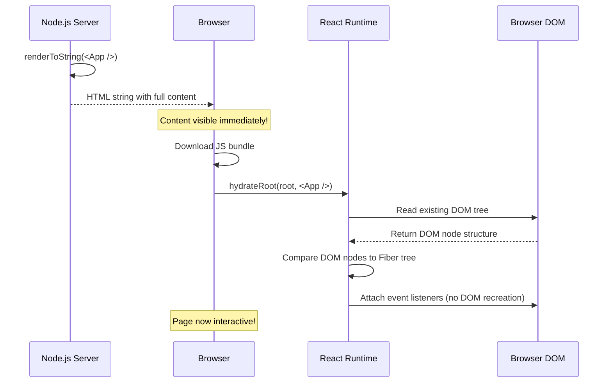
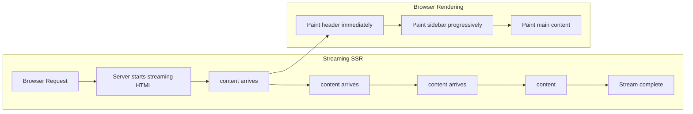
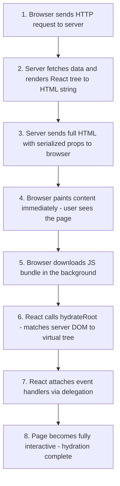

```mermaid
flowchart TD
    subgraph Client-Side Rendering CSR
        RequestA[Browser Requests Page] --> EmptyHTML[Receives Empty HTML Shell]
        EmptyHTML --> DownloadJS[Downloads & Parses JS Bundle 500KB]
        DownloadJS --> RenderA[React renders UI in browser]
        RenderA --> VisibleA[User sees content after JS loads]
    end
    subgraph SSR with Hydration
        RequestB[Browser Requests Page] --> ServerRender[Server renders React to HTML]
        ServerRender --> FullHTML[Sends Complete HTML with Content]
        FullHTML --> VisibleB[User sees content immediately]
        FullHTML --> DownloadHydration[Downloads JS Bundle in Background]
        DownloadHydration --> Hydration[Hydration: Attach listeners to existing DOM]
        Hydration --> Interactive[Page becomes interactive]
    end
    style FullHTML fill:#dfd,stroke:#3a3
    style VisibleB fill:#dfd,stroke:#3a3
```

# Hydration & Server-Side Rendering

## Introduction

React applications can render on the server, producing fully-formed HTML that is sent to the browser. Once the HTML loads, React "hydrates" it — attaching event listeners and state to the existing DOM nodes on the client. This process is called **Server-Side Rendering (SSR)** followed by **Hydration**. This module covers the SSR architecture, the hydration algorithm, common hydration mismatch bugs, streaming SSR, selective hydration (React 18+), and when to choose SSR over Client-Side Rendering (CSR) or Static Site Generation (SSG).

---

## Why do we need this?

In a standard Client-Side Rendered (CSR) React app, the browser receives an empty HTML shell with a JavaScript bundle. Until the bundle downloads and executes, the user sees a blank white screen.

### Problem Statement

Consider a blog post page built with React:

1. The browser requests `https://blog.example.com/post-123`.
2. The server returns an empty `<div id="root"></div>` with a `<script>` tag pointing to `app.js` (500KB).
3. The user stares at a blank white screen for 2 seconds while the JavaScript downloads and parses.
4. Once parsed, React fetches the blog post data from an API, renders it, and finally the user can read the content.

This delays content visibility (poor **LCP** — Largest Contentful Paint) and prevents search engine crawlers from indexing the content (poor **SEO**). We need a way to generate the complete HTML on the server so that users and crawlers see the content immediately, then enhance it with interactivity once the JavaScript loads.

---

## Real World Story

In the early years of React (2013-2015), React apps were exclusively client-side rendered. Developers at companies like Airbnb, Netflix, and Twitter noticed that their Single Page Applications were slow to load on mobile devices, especially on 3G networks. Users would see blank screens for several seconds.

In 2015, React 0.14 introduced `ReactDOMServer.renderToString()`, allowing developers to render React components on the server. Next.js (2016) and Gatsby (2017) popularized SSR and SSG patterns. However, the original hydration model was fragile — if the server HTML and client render mismatched (due to timestamps, random values, or different data), React would throw a warning and discard the server HTML, re-rendering the entire layout from scratch, which defeated the purpose of SSR. React 16 improved hydration error recovery, and React 18 introduced **Streaming SSR** and **Selective Hydration**, allowing the page to become interactive in stages.

---

## Real World Analogy

Think of SSR + Hydration like a **Blueprint and Final Decoration Service** compared to a **Furniture Assembly Kit**.

- **CSR (Furniture Assembly Kit)**: The store delivers a flat box containing boards, screws, and a manual (JavaScript bundle). You must open the box, read the manual, and assemble the entire cabinet before you can sit on it. This takes hours (seconds of load time).

- **SSR + Hydration (Blueprint + Decoration)**: The moving company delivers a fully assembled, painted cabinet (Server HTML). You can place your books on it immediately. Later, the interior designer arrives (JavaScript hydration) and adds drawer handles, soft-close hinges, and LED strip lights (event listeners and interactivity). The cabinet is usable from the moment it arrives.

---

## Visual Explanation

Below is a comparison of CSR, SSR, and the hydration process.

### CSR Flow
```
[Empty HTML] ──> [Download JS Bundle] ──> [Parse & Execute] ──> [Fetch API Data] ──> [Render UI]
```

### SSR + Hydration Flow
```
[Full HTML from Server] ──> [User sees content immediately] ──> [Download JS Bundle] ──> [Hydrate: Attach Events]
```



---

## Internal Working

### The SSR Pipeline

1. **Server Rendering**: The server imports the React component tree, provides initial props and context, and calls `ReactDOMServer.renderToString()` or `renderToPipeableStream()`. React traverses the component tree and produces a string of HTML.

2. **HTML Injection**: The server injects the rendered HTML string into the HTML template (typically inside `<div id="root">`). It also injects serialized props (`<script>window.__INITIAL_PROPS__ = {...}</script>`) so the client can reconstruct the same initial state.

3. **Client Load**: The browser receives the full HTML with content visible immediately. It then downloads the JavaScript bundle.

4. **Hydration**: React calls `hydrateRoot()` (React 18+) instead of `createRoot()`. Instead of creating new DOM nodes from scratch, React traverses the existing DOM tree, matches each component to its corresponding DOM node, attaches event listeners via event delegation, and sets up internal Fiber state without regenerating the DOM.

### Hydration Algorithm

During hydration, React walks the Fiber tree and compares the server-rendered HTML with the expected virtual tree:

- If the DOM structure **matches**, React skips that node (no DOM work needed) and just attaches listeners.
- If there's a **mismatch** (e.g., an extra `<div>` or wrong text content), React throws a hydration warning in development and, in React 18+, attempts to patch the DOM to match the expected output. In React 17 and earlier, it would discard the entire server HTML and re-render from scratch.



---

## Architecture

### Streaming SSR (React 18+)

React 18 introduced **Streaming SSR** via `renderToPipeableStream()`. Instead of waiting for the entire tree to render before sending HTML, React streams HTML chunks as they render. The browser progressively renders content — the header appears first, followed by the sidebar, then the main content, and finally the footer.



### Selective Hydration (React 18+)

When the JS bundle finishes loading, React does not hydrate the entire page at once. It hydrates components based on user interaction priority:

- The component the user clicked on gets hydrated first (highest priority).
- Visible components (above the fold) hydrate next.
- Hidden or off-screen components hydrate last.

---

## Step-by-Step Flow

When a user visits an SSR page, the full end-to-end flow looks like this:



---

## Syntax

```javascript
// ---- Server (Node.js) ----
import { renderToString } from 'react-dom/server';
import App from './App.jsx';

// Option 1: Legacy synchronous render
const html = renderToString(<App />);

// Option 2: Streaming SSR (React 18+)
import { renderToPipeableStream } from 'react-dom/server';
const { pipe } = renderToPipeableStream(<App />, {
  bootstrapScripts: ['/client.js'],
  onShellReady() {
    response.setHeader('content-type', 'text/html');
    pipe(response);
  }
});

// ---- Client (Browser) ----
// React 17 and earlier
import { hydrate } from 'react-dom';
hydrate(<App />, document.getElementById('root'));

// React 18+ (recommended)
import { hydrateRoot } from 'react-dom/client';
hydrateRoot(document.getElementById('root'), <App />);
```

---

## Basic Example

Here is a minimal SSR Express server that renders a React component to HTML and sends it to the browser.

```jsx
// ---- server.js (Node.js + Express) ----
import express from 'express';
import React from 'react';
import { renderToString } from 'react-dom/server';
import App from './App.jsx';

const app = express();
const PORT = 3000;

app.get('/', (req, res) => {
  // 1. Render the React component tree to an HTML string on the server
  const appHtml = renderToString(<App />);

  // 2. Inject the HTML into a template with the client bundle
  const html = `
    <!DOCTYPE html>
    <html>
      <head><title>SSR React App</title></head>
      <body>
        <div id="root">${appHtml}</div>
        <script src="/client.js" defer></script>
      </body>
    </html>
  `;

  // 3. Send the complete HTML to the browser
  res.send(html);
});

app.listen(PORT, () => {
  console.log(`Server listening at http://localhost:${PORT}`);
});

// ---- App.jsx (shared between server and client) ----
import React from 'react';

export default function App() {
  return (
    <div style={{ padding: '20px', fontFamily: 'sans-serif' }}>
      <h1>Welcome to SSR React</h1>
      <p>This content was rendered on the server!</p>
      <p>Timestamp: {new Date().toISOString()}</p>
    </div>
  );
}

// ---- client.js (Browser bundle entry) ----
import React from 'react';
import { hydrateRoot } from 'react-dom/client';
import App from './App.jsx';

// Hydrate instead of createRoot — reuse existing server DOM
const root = document.getElementById('root');
hydrateRoot(root, <App />);
```

---

## Intermediate Example

An intermediate SSR example demonstrating the **hydration mismatch problem**. Server and client timestamps produce different text content, causing React to log a warning.

```jsx
// ---- App.jsx ----
import React, { useState } from 'react';

export default function ClockWidget() {
  // BUG: Date.now() produces a different value on the server and client!
  // The server calls Date.now() during renderToString
  // The client calls Date.now() during hydration — they differ by milliseconds
  const [timestamp] = useState(Date.now());

  return (
    <div style={{ padding: '16px', border: '1px solid #ccc' }}>
      <h3>Server Timestamp</h3>
      <p>Rendered at: {timestamp}</p>
    </div>
  );
}

// ---- Fixed version ----
// Option A: Use useEffect to set the timestamp on the client only
export default function ClockWidgetFixed() {
  const [timestamp, setTimestamp] = useState(null);

  useEffect(() => {
    setTimestamp(Date.now()); // Only runs on client after hydration
  }, []);

  return (
    <div style={{ padding: '16px', border: '1px solid #ccc' }}>
      <h3>Server Timestamp</h3>
      <p>Rendered at: {timestamp ?? 'Loading...'}</p>
    </div>
  );
}

// Option B: Pass the timestamp as a prop from the server
// export default function ClockWidgetFixed({ serverTimestamp }) {
//   return <p>Rendered at: {serverTimestamp}</p>;
// }
```

---

## Advanced Example

An advanced example showing **Streaming SSR** with React 18's `renderToPipeableStream`. The shell (skeleton layout) streams immediately, while heavy content (like a sidebar with database queries) streams later.

```jsx
// ---- server.js (Streaming SSR) ----
import express from 'express';
import { renderToPipeableStream } from 'react-dom/server';
import App from './App.jsx';

const app = express();

app.get('/', (req, res) => {
  res.setHeader('content-type', 'text/html');

  const { pipe } = renderToPipeableStream(<App />, {
    bootstrapScripts: ['/client.js'],
    onShellReady() {
      // Send the shell (header, layout) immediately
      res.write(`
        <!DOCTYPE html>
        <html>
          <head><title>Streaming SSR</title></head>
          <body>
            <div id="root">
      `);
      pipe(res); // Stream React content as it renders
      res.write(`
            </div>
            <script src="/client.js" defer></script>
          </body>
        </html>
      `);
    },
    onShellError(err) {
      res.status(500).send('Server error');
    }
  });
});

// ---- SlowDataWidget.jsx ----
// This component simulates a slow database query.
// In streaming SSR, the shell renders immediately,
// and this component's HTML streams when the query finishes.
import React from 'react';

async function fetchData() {
  // Simulate a 2-second database query
  await new Promise(resolve => setTimeout(resolve, 2000));
  return { items: ['Data A', 'Data B', 'Data C'], count: 42 };
}

export default async function SlowDataWidget() {
  const data = await fetchData();

  return (
    <div style={{ border: '1px solid blue', padding: '12px', marginTop: '12px' }}>
      <h4>Slow Database Query Result</h4>
      <p>Items: {data.items.join(', ')}</p>
      <p>Total Count: {data.count}</p>
    </div>
  );
}
```

---

## Production Example

A production-grade SSR setup showing **Selective Hydration** using Suspense boundaries. The page shells out immediately, and different sections hydrate independently based on user interaction priority.

```jsx
// ---- App.jsx ----
import React, { Suspense, lazy } from 'react';

// Lazy load heavy components — they stream in SSR and hydrate selectively
const HeavyDashboard = lazy(() => import('./HeavyDashboard.jsx'));
const CommentsSection = lazy(() => import('./CommentsSection.jsx'));
const LiveChatWidget = lazy(() => import('./LiveChatWidget.jsx'));

export default function App() {
  return (
    <div style={{ maxWidth: '800px', margin: '0 auto', padding: '20px' }}>
      <h1>Production SSR Dashboard</h1>

      {/* This component renders synchronously on server and hydrates first */}
      <Header user={{ name: 'Alice' }} />

      {/* CommentsSection streams in and hydrates when user scrolls down */}
      <Suspense fallback={<div className="skeleton" style={{ height: '200px' }} />}>
        <CommentsSection />
      </Suspense>

      {/* HeavyDashboard streams last and hydrates with lowest priority */}
      <Suspense fallback={<div className="skeleton" style={{ height: '400px' }} />}>
        <HeavyDashboard />
      </Suspense>

      {/* LiveChatWidget has its own Suspense boundary — hydrates independently */}
      <Suspense fallback={<div>Loading chat...</div>}>
        <LiveChatWidget />
      </Suspense>
    </div>
  );
}

function Header({ user }) {
  return (
    <header style={{ borderBottom: '2px solid #333', padding: '12px 0', marginBottom: '20px' }}>
      <strong>Welcome, {user.name}</strong>
      <nav style={{ float: 'right' }}>
        <a href="/dashboard" style={{ marginLeft: '12px' }}>Dashboard</a>
        <a href="/settings" style={{ marginLeft: '12px' }}>Settings</a>
      </nav>
    </header>
  );
}
```

---

## Folder Structure

```
hydration-ssr-demo/
├── server/
│   └── server.js           # Express server with renderToPipeableStream
├── src/
│   ├── components/
│   │   ├── Header.jsx
│   │   ├── SlowDataWidget.jsx
│   │   └── HeavyDashboard.jsx
│   ├── App.jsx             # Shared component tree
│   └── client.js           # hydrateRoot entry point
├── package.json
└── vite.config.js
```

---

## Best Practices

💡 **Did You Know?**  \
In React 18, `hydrateRoot` replaced the legacy `ReactDOM.hydrate` API. The new API supports Selective Hydration out of the box — React can hydrate components in any order, prioritizing the ones the user interacts with.

🚀 **Best Practices**
- Ensure server and client render the **exact same component tree** and data to prevent hydration mismatches.
- Use `Suspense` boundaries to wrap components that depend on browser-only APIs (like `localStorage`, `window.innerWidth`, or `document.querySelector`).
- Avoid using values that differ between server and client (timestamps, random IDs) in the initial render. Use `useEffect` to set them after hydration, or pass them as server props.
- Use Streaming SSR (`renderToPipeableStream`) for faster TTFB (Time to First Byte) — the browser receives HTML progressively instead of waiting for the entire page.

---

## Common Mistakes

⚠ **Common Mistakes**

### Hydration Mismatch Due to Browser-Only APIs

Accessing browser-only APIs (like `window`, `localStorage`, or `navigator`) directly during render causes hydration mismatches because these APIs don't exist on the server.

```jsx
// ❌ WRONG: window is not defined on the server
function UserAgent() {
  return <p>Browser: {navigator.userAgent}</p>; // Crashes on server!
}

// ✅ RIGHT: Check environment or defer to useEffect
function UserAgent() {
  const [userAgent, setUserAgent] = useState('');

  useEffect(() => {
    setUserAgent(navigator.userAgent); // Only runs on client after hydration
  }, []);

  return <p>Browser: {userAgent || 'Loading...'}</p>;
}
```

### Missing Hydration Root

Using `createRoot` instead of `hydrateRoot` on a server-rendered page will discard the existing DOM and recreate it, causing a flash of re-rendered content.

```jsx
// ❌ WRONG: Destroys server HTML and recreates from scratch
import { createRoot } from 'react-dom/client';
createRoot(document.getElementById('root')).render(<App />);

// ✅ RIGHT: Preserves server HTML and attaches listeners
import { hydrateRoot } from 'react-dom/client';
hydrateRoot(document.getElementById('root'), <App />);
```

---

## Performance Notes

⚡ **Performance Tips**

| Metric | CSR | SSR | Streaming SSR |
|--------|-----|-----|---------------|
| TTFB | Fast (empty shell) | Slower (full render on server) | Fast (streams shell immediately) |
| LCP | Slow (wait for JS + API) | Fast (full HTML sent) | Fast (progressively paints) |
| TTI | After all JS loads | After hydration | After selective hydration |
| TBT | Low during load | Higher on server | Low on client |

---

## Accessibility Notes

♿ **Accessibility Tips**
- SSR ensures semantic HTML is available immediately, which benefits screen readers that don't wait for JavaScript to execute.
- Ensure focus management during hydration — if a user tabs to an interactive element before it hydrates, the element should maintain its focus state after hydration.

---

## SEO Notes

SSR is critical for SEO because search engine crawlers can read the full HTML content immediately without executing JavaScript. Google's crawler (Googlebot) can execute JavaScript, but it may deprioritize pages that rely on JS rendering, especially if the JS takes too long to load. SSR eliminates this uncertainty by delivering fully rendered HTML on the first response.

---

## Interview Questions

🎯 **Interview Tips**  \
In an interview, define hydration as "attaching JavaScript event handlers and state to server-rendered HTML without recreating the DOM." Contrast hydration with SSR and CSR, and explain how React 18's Selective Hydration improves perceived performance.

### Q1: What is hydration and why is it necessary?

**Answer**: Hydration is the process where React takes over server-rendered HTML and makes it interactive by attaching event listeners, initializing state, and setting up the Fiber tree. It is necessary because server-rendered HTML is static — it looks correct but doesn't respond to clicks, form inputs, or state changes. Hydration bridges the gap between static server HTML and interactive client React without discarding the already-rendered DOM.

### Q2: What causes a hydration mismatch and how do you fix it?

**Answer**: A hydration mismatch occurs when the server-rendered HTML differs from what React expects to render on the client. Common causes include: browser-only API calls during render, random values (like `Math.random()`), timestamps, or different data on server vs client. Fixes include: using `useEffect` for client-only values, passing data as serialized server props, wrapping browser-only components in `<Suspense>`, or using `suppressHydrationWarning` for intentionally different attributes (like data-theme).

### Q3: What is Selective Hydration in React 18?

**Answer**: Selective Hydration allows React to hydrate components independently based on priority. When the JS bundle loads, React doesn't hydrate the entire page at once. It prioritizes the component the user interacted with (e.g., a clicked button), then hydrates visible components, and finally hydrates hidden or off-screen components. This makes the page feel interactive much faster.

---

## MCQs

1. **Which API is used in React 18+ to hydrate a server-rendered React application?**
   - A) `ReactDOM.render()`
   - B) `ReactDOM.hydrate()`
   - C) `hydrateRoot()`
   - D) `createRoot()`
   - *Answer: C*

2. **What happens if a hydration mismatch occurs in React 18?**
   - A) The page crashes with a runtime error.
   - B) React discards the server HTML and re-renders from scratch.
   - C) React logs a warning in development and attempts to patch the mismatched DOM nodes.
   - D) React ignores the mismatch and leaves the old HTML.
   - *Answer: C*

3. **Which React 18 API enables Streaming SSR?**
   - A) `renderToString()`
   - B) `renderToStaticMarkup()`
   - C) `renderToPipeableStream()`
   - D) `renderToStream()`
   - *Answer: C*

4. **What problem does SSR primarily solve?**
   - A) Reducing JavaScript bundle size.
   - B) Showing content to users before JavaScript loads (improving LCP and SEO).
   - C) Making React state updates faster.
   - D) Enabling server-side API rate limiting.
   - *Answer: B*

5. **What does Selective Hydration prioritize?**
   - A) Hydrating all components at once as fast as possible.
   - B) Hydrating the component the user interacted with first.
   - C) Hydrating components in alphabetical order.
   - D) Hydrating only visible components and skipping hidden ones entirely.
   - *Answer: B*

---

## Practice Exercise

### Exercise 1: SSR to Hydration Migration
Convert this CSR-only setup to use SSR with hydration:

```jsx
// Current CSR (index.js)
import { createRoot } from 'react-dom/client';
const root = createRoot(document.getElementById('root'));
root.render(<App />);
```

*Solution*: Create a server that calls `renderToString(<App />)`, injects the HTML, and on the client, replace `createRoot` with `hydrateRoot`.

### Exercise 2: Hydration Mismatch Fix
Identify the hydration mismatch in this component and fix it:

```jsx
function RandomValue() {
  return <p>Random: {Math.random()}</p>;
}
```

*Solution*: Use `useEffect` to set the random value after hydration:

```jsx
function RandomValue() {
  const [value, setValue] = useState(null);
  useEffect(() => { setValue(Math.random()); }, []);
  return <p>Random: {value ?? 'generating...'}</p>;
}
```

### Exercise 3: Suspense SSR Boundary
Wrap a heavy component in a `<Suspense>` boundary so it streams in SSR and hydrates independently.

---

## Debugging Exercise

### The `Text content did not match` Hydration Error

A developer is rendering a theme-aware component that reads the user's preferred color scheme. The server renders a default theme, but the client checks `window.matchMedia` and renders differently. React throws a hydration mismatch error.

```jsx
import React from 'react';

export default function ThemeBanner() {
  // Server: always returns 'light' because window is not defined
  // Client: returns 'dark' if user prefers dark mode
  const prefersDark = window.matchMedia('(prefers-color-scheme: dark)').matches;
  const theme = prefersDark ? 'dark' : 'light';

  return (
    <div className={`banner banner-${theme}`}>
      Current theme: {theme}
    </div>
  );
}
```

#### Solution
Move the browser-dependent logic into a `useEffect` and use a placeholder during the initial render:

```jsx
// Corrected
import React, { useState, useEffect } from 'react';

export default function ThemeBanner() {
  const [theme, setTheme] = useState('light'); // Default matches server

  useEffect(() => {
    const prefersDark = window.matchMedia('(prefers-color-scheme: dark)').matches;
    setTheme(prefersDark ? 'dark' : 'light');
  }, []);

  return (
    <div className={`banner banner-${theme}`}>
      Current theme: {theme}
    </div>
  );
}
```

---

## Real-world Scenario

You are building a large e-commerce product page. The page includes: a product image carousel, product details with reviews, a personalized recommendation sidebar, and a live chat widget. The product carousel and details must be visible and interactive as fast as possible, while the recommendation sidebar and chat widget can load later.

**Design Strategy**: Use SSR with Streaming via `renderToPipeableStream`. Wrap the product carousel and details in a high-priority Suspense boundary that hydrates first. Wrap the recommendation sidebar and chat widget in lower-priority Suspense boundaries. The user sees the product details immediately (SSR HTML), and hydration prioritizes the "Add to Cart" button (the element the user is most likely to click) over the chat widget.

---

## Interview Coding Question

### Problem Statement

Write an SSR Express route handler that:
- Fetches user data from a mock API.
- Passes the data as props to a React component.
- Renders the component to an HTML string.
- Sends the complete HTML to the browser.

```jsx
// server.js
import express from 'express';
import React from 'react';
import { renderToString } from 'react-dom/server';
import ProfilePage from './ProfilePage.jsx';

const app = express();

app.get('/user/:id', async (req, res) => {
  try {
    // 1. Fetch data on the server
    const response = await fetch(`https://jsonplaceholder.typicode.com/users/${req.params.id}`);
    const user = await response.json();

    // 2. Render component with server data
    const appHtml = renderToString(<ProfilePage user={user} />);

    // 3. Send complete HTML with serialized data for hydration
    const html = `
      <!DOCTYPE html>
      <html>
        <head><title>${user.name} — Profile</title></head>
        <body>
          <div id="root">${appHtml}</div>
          <script>
            window.__INITIAL_USER__ = ${JSON.stringify(user)};
          </script>
          <script src="/client.js" defer></script>
        </body>
      </html>
    `;

    res.send(html);
  } catch (error) {
    res.status(500).send('Server error');
  }
});

// ProfilePage.jsx (shared)
export default function ProfilePage({ user }) {
  return (
    <div>
      <h1>{user.name}</h1>
      <p>Email: {user.email}</p>
      <p>Phone: {user.phone}</p>
    </div>
  );
}

// client.js
import { hydrateRoot } from 'react-dom/client';
import ProfilePage from './ProfilePage.jsx';

const user = window.__INITIAL_USER__;
delete window.__INITIAL_USER__;

hydrateRoot(
  document.getElementById('root'),
  <ProfilePage user={user} />
);
```

---

## Mini Project

### Streaming SSR Dashboard Builder

Build a full SSR application with:

- An Express server using `renderToPipeableStream` for streaming HTML.
- A React component tree with at least 3 Suspense boundaries (Header, Main Content, Footer).
- One Suspense boundary with a simulated 3-second delay to demonstrate progressive streaming.
- A client entry point using `hydrateRoot`.
- Visual indicators showing when each section hydrates (e.g., console logs or color changes).
- Implement Selective Hydration by wrapping user-interactive components (like a button) so they hydrate first.

---

## Summary

🧠 **Memory Tricks**  \
`SSR = Send HTML first` — SSR sends a complete HTML page to the browser immediately, so users see content before JavaScript loads.

`Hydrate, don't recreate` — Hydration attaches event listeners to existing DOM nodes instead of rebuilding them. This makes the page interactive faster.

📖 **Summary**  \
Server-Side Rendering (SSR) improves initial page load performance and SEO by generating complete HTML on the server. Hydration bridges the gap between static server HTML and interactive client React. React 18's Streaming SSR and Selective Hydration further improve perceived performance by progressively streaming content and prioritizing hydration of user-interactive elements. Understanding the SSR pipeline, hydration algorithm, and common mismatch causes is essential for building production-grade React applications.

---

## Cheat Sheet

```javascript
// Server: Streaming SSR
import { renderToPipeableStream } from 'react-dom/server';
renderToPipeableStream(<App />, { bootstrapScripts: ['/client.js'] });

// Client: Hydration (React 18+)
import { hydrateRoot } from 'react-dom/client';
hydrateRoot(document.getElementById('root'), <App />);

// Avoid hydration mismatches
// ❌ Don't read window/document during render
// ✅ Use useEffect for browser-only values
```

---

## Related Topics

- [Reconciliation & Diffing Deep Dive](reconciliation-virtual-dom)
- [React Server Components (RSC)](../phase-8-modern/server-components)
- [Suspense & Dynamic Loading](suspense-lazy)

---

## Further Reading

- [React Docs: Server-Side Rendering](https://react.dev/reference/react-dom/server)
- [React Docs: hydrateRoot](https://react.dev/reference/react-dom/client/hydrateRoot)
- [Next.js Docs: SSR Basics](https://nextjs.org/docs/pages/building-your-application/rendering/server-side-rendering)
- [Web Vitals: Largest Contentful Paint (LCP)](https://web.dev/lcp/)
