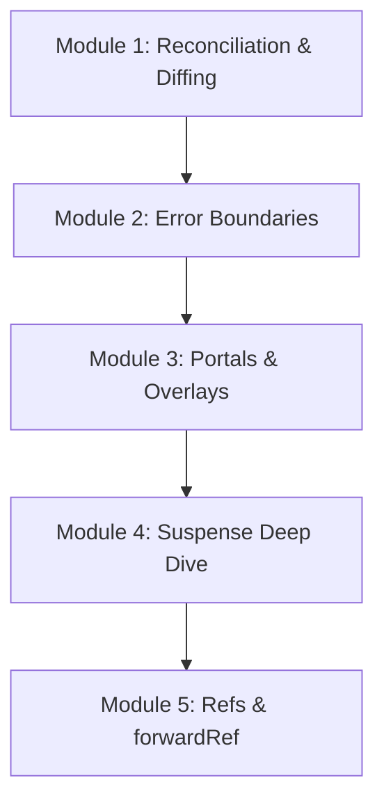

# Phase 7: Advanced React

Welcome to the **Advanced React** phase of the React Engineering Academy. This phase covers advanced features of the React runtime: reconciliation heuristics, catching rendering errors using error boundaries, rendering components outside the parent node using portals, managing loading screens with suspense, and passing refs down the component tree using `forwardRef`.

## Why this topic exists

To build resilient, highly interactive, and developer-friendly applications, you must master the advanced APIs of the React runtime.
- If a component throws a JavaScript exception during rendering (e.g., trying to read a property from undefined), React will unmount the entire page, leaving the user with a blank screen. Error Boundaries allow you to catch errors and display fallback layouts.
- Modal dialogs and tooltips must overlay the entire UI. If they are nested inside containers with `overflow: hidden`, they will be clipped. Portals allow you to render them directly inside the document body while maintaining component state.
- Custom form controls and inputs must be focusable by parent components. `forwardRef` allows child elements to expose their DOM nodes, enabling advanced focus and media controls.

Understanding these patterns is critical for building production-grade web applications.

---

## Learning Objectives

By the end of this phase, you will be able to:
- Explain React's O(n) reconciliation heuristic and how the diffing algorithm matches keys.
- Build custom class-based Error Boundaries to prevent runtime errors from unmounting pages.
- Render modals, dropdowns, and overlays outside the parent container using Portals.
- Configure loading boundaries and resource loading workflows using Suspense.
- Forward component DOM references using `React.forwardRef` and `useImperativeHandle`.

---

## Prerequisites

Before starting this phase, you should have completed:
1. **[Phase 1: React Fundamentals](../phase-1-fundamentals)**
2. **[Phase 2: Components & JSX](../phase-2-components-jsx)**
3. **[Phase 3: State Management](../phase-3-state-management)**
4. **[Phase 4: React Hooks](../phase-4-hooks)**
5. **[Phase 5: Routing & Data Fetching](../phase-5-routing-fetching)**
6. **[Phase 6: Performance Optimization](../phase-6-performance)**

---

## Learning Roadmap & Topics Covered

This phase is broken down into five comprehensive modules:

1. **[Module 1: Reconciliation & Diffing](reconciliation-virtual-dom)**  
   How the diffing algorithm compares virtual trees, element-type matching, and key usage under the hood.
2. **[Module 2: Error Boundaries](error-boundaries)**  
   Catching rendering errors using componentDidCatch and getDerivedStateFromError class lifecycles.
3. **[Module 3: Portals & Overlays](portals)**  
   Creating overlay elements, event bubbling through portals, and absolute positioning techniques.
4. **[Module 4: Suspense Deep Dive](suspense-lazy)**  
   Suspense boundaries, fallback strategies, and how to handle data-fetching loaders.
5. **[Module 5: Refs & forwardRef](refs-forwardref)**  
   Forwarding DOM element references down layout components and custom ref bindings.

---

## Estimated Learning Time

- **Total Time**: 12 - 15 Hours
- **Module 1**: 3 Hours
- **Module 2**: 2 Hours
- **Module 3**: 2 Hours
- **Module 4**: 3 Hours
- **Module 5**: 3 Hours
- **Exercises & Projects**: 2 Hours

---

## Real-World Applications

- **SaaS Modal Systems**: Rendering overlays, dialog drawers, and alerts anywhere in the application.
- **Enterprise Form Libraries**: Building custom input fields that expose their DOM node ref pointers.
- **Resilient Banking Dashboards**: Wrapping payment forms in Error Boundaries to prevent errors from crashing the page.

---

## Practice Exercises

- **Custom Error Fallback Layout**: Building a class error boundary that shows a retry form on crash.
- **Portal Modal Drawer**: Implementing a slide-out modal panel rendered outside the parent app container.
- **Parent-Controlled Input Focus**: Forwarding a ref to focus a text field when a button is clicked.

---

## Mini Projects

- **An Advanced Workspace Studio**: A routed workspace console utilizing portals, error boundaries, and nested suspense pages to build a resilient, interactive user environment.

---

## Related Topics

- [Virtual DOM & Reconciliation](../phase-1-fundamentals/virtual-dom)
- [Advanced Hook Patterns](../phase-4-hooks/advanced-hooks)

---

## Further Reading

- [React Docs: Advanced Guides](https://react.dev/reference/react)
- [Dan Abramov: React as a UI Runtime](https://overreacted.io/react-as-a-ui-runtime/)
