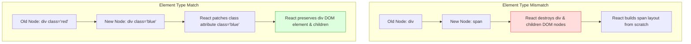
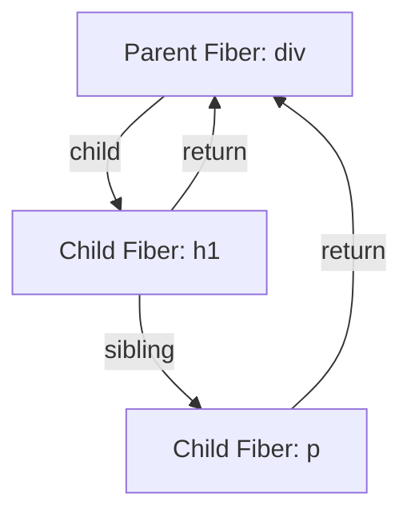
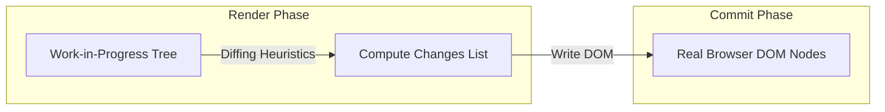
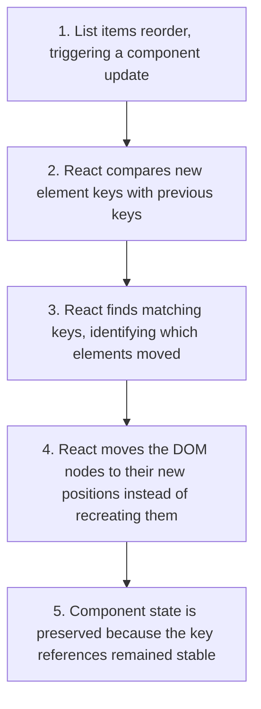

# Reconciliation & Diffing Deep Dive

## Introduction

React's main feature is its declarative API. You describe how the UI should look, and React updates the DOM to match that state. Under the hood, this synchronization process is called **Reconciliation**. It uses a diffing algorithm to compare the current Virtual DOM tree with the new one and updates only the browser nodes that changed. This module covers React's O(n) heuristic diffing rules, component-type matching, the role of key properties, and the Fiber node architecture.

---

## Why do we need this?

Comparing two arbitrary tree structures has a computational complexity of O(n³). This means comparing a page of 1,000 elements would require 1 billion operations, freezing the browser.

### Problem Statement
If React compared Virtual DOM trees using a standard tree diffing algorithm, rendering updates would be too slow for real-world applications. React needs a fast O(n) algorithm that makes assumptions about how developers build web pages:
1. Two elements of different HTML types will produce different DOM trees.
2. Sibling elements can be matched across renders using a unique `key` prop.

Without understanding these heuristics, developers can write code that causes full layout redraws or state bugs, slowing down their applications.

---

## Real World Story

In 2013, React launched with its Virtual DOM diffing engine. At the time, other frameworks updated the DOM by manually editing elements (impreative) or re-rendering entire templates (slow).

React's declarative model and reconciliation algorithm changed how developers built web interfaces. In 2017 (React 16), the core team spent over two years rebuilding the reconciliation engine from scratch, creating **React Fiber**. The legacy stack reconciler was synchronous, meaning it had to process updates to completion without interruption. Fiber introduced incremental rendering: the ability to split rendering tasks into small chunks, pause work to handle urgent interactions, and resume work later, keeping modern web applications responsive.

---

## Real World Analogy

Think of reconciliation like a **Hotel Renovator Remodeling Rooms** compared to **Bulldozing the Building**.

- **Without Reconciliation (Bulldozing)**: A guest requests a new bed color in room 304. Instead of changing the sheets, you demolish the entire wing of the hotel and rebuild all the rooms from scratch. It is slow, expensive, and disrupts other guests.
- **With Reconciliation (Renovator)**: The renovator carries a clipboard checklist (Reconciliation checklist). They compare the current room layout (Current Virtual DOM) with the new layout blueprint (New Virtual DOM). They see that room 304 has the same bed and desk, but needs blue sheets instead of red. They swap the sheets (Patching the DOM) and leave the rest of the room untouched, completing the update instantly.

---

## Visual Explanation

Below is a diagram showing how the reconciliation diffing algorithm checks element types during updates.

### Element-Type Mismatch (Full Rebuild)
```
[Update: <div> to <span>] ──> [Unmount <div> & children] ──> [Mount new <span> layout]
```

### Element-Type Match (Attribute Patch)
```
[Update: <div class="red"> to <div class="blue">] ──> [Patch class attribute] ──> [Preserve children]
```



---

## Internal Working

React Fiber represents the virtual tree using a linked list of **Fiber Nodes**.

Each Fiber node has pointers to its:
- **`child`**: Points to the first child node.
- **`sibling`**: Points to the next sibling node.
- **`return`**: Points back to the parent node.

During rendering, React traverses this linked list in a depth-first loop, building a draft tree (Work-in-Progress). When comparing nodes, React checks the element's `type` and its `key` prop:
- If the type and key match, React preserves the DOM node and updates its attributes (updates).
- If the type changes, React unmounts the old node, destroying its state, and builds the new node from scratch.



---

## Architecture

The reconciler executes tasks in two phases: the **Render Phase** (asynchronous and interruptible calculations) and the **Commit Phase** (synchronous writes to the real DOM).



---

## Step-by-Step Flow

When a list component re-orders its items, the diffing algorithm uses `key` props to update the elements:



---

## Syntax

```javascript
// Fiber internal node representation (simplified)
const FiberNode = {
  type: 'div',          // Element type
  key: 'unique_id_1',   // Key identifier
  child: null,          // First child pointer
  sibling: null,        // Next sibling pointer
  return: null,         // Parent pointer
  memoizedState: null,  // Component hooks state store
  alternate: null       // Pointer to work-in-progress copy
};
```

---

## Basic Example

Here is a basic component showing how changing an element's `type` destroys its state, while matching types preserve it.

```jsx
import React, { useState } from 'react';

function StatefulCounter() {
  const [count, setCount] = useState(0);
  return (
    <button onClick={() => setCount(count + 1)}>
      Count: {count}
    </button>
  );
}

export default function ElementTypeDemo() {
  const [useDiv, setUseDiv] = useState(true);

  return (
    <div style={{ padding: '16px' }}>
      <h3>Element Type Mismatch Demo</h3>
      <button onClick={() => setUseDiv(!useDiv)}>
        Change Wrapper Container
      </button>

      {/* When useDiv changes, the wrapper element type changes (div vs section).
          React destroys the wrapper DOM node and unmounts the StatefulCounter, resetting its count state to 0 */}
      {useDiv ? (
        <div style={{ padding: '8px', border: '1px solid red' }}>
          <StatefulCounter />
        </div>
      ) : (
        <section style={{ padding: '8px', border: '1px solid blue' }}>
          <StatefulCounter />
        </section>
      )}
    </div>
  );
}
```

---

## Intermediate Example

An intermediate component showing why using index keys can cause state bugs when list items are reordered or deleted, and how using stable, unique IDs resolves the issue.

```jsx
import React, { useState } from 'react';

export default function IndexKeyDemo() {
  const [items, setItems] = useState([
    { id: 'usr-1', name: 'Alice' },
    { id: 'usr-2', name: 'Bob' }
  ]);

  const deleteFirst = () => {
    // Delete the first item
    setItems(prev => prev.slice(1));
  };

  return (
    <div style={{ padding: '16px' }}>
      <h3>Index Keys vs Unique IDs</h3>
      <button onClick={deleteFirst}>Delete Alice</button>
      
      {/* ❌ WRONG: Using array index as key causes inputs to display incorrect values after deletion */}
      <h4>Using Array Index (Key=index)</h4>
      {items.map((item, index) => (
        <div key={index} style={{ marginBottom: '8px' }}>
          <span>{item.name}: </span>
          <input type="text" placeholder="Enter comments..." />
        </div>
      ))}

      {/*  RIGHT: Using stable unique ID preserves input values correctly */}
      <h4>Using Stable ID (Key=item.id)</h4>
      {items.map((item) => (
        <div key={item.id} style={{ marginBottom: '8px' }}>
          <span>{item.name}: </span>
          <input type="text" placeholder="Enter comments..." />
        </div>
      ))}
    </div>
  );
}
```

---

## Advanced Example

An advanced example illustrating **State Preservation via Position Controls**. When rendering conditional components at identical tree positions, React preserves their state. If you want to force state reset, you must specify a unique `key` prop on the components.

```jsx
import React, { useState } from 'react';

function UserFormInput({ label }) {
  const [value, setValue] = useState('');
  return (
    <label style={{ display: 'block', margin: '8px 0' }}>
      {label}: <input value={value} onChange={e => setValue(e.target.value)} />
    </label>
  );
}

export default function IdentityConsole() {
  const [isAdmin, setIsAdmin] = useState(true);

  return (
    <div style={{ padding: '20px', border: '1px solid #ccc' }}>
      <h3>Profile Console</h3>
      <button onClick={() => setIsAdmin(!isAdmin)}>
        Toggle Account Type ({isAdmin ? 'Admin' : 'Guest'})
      </button>

      {/* Case 1: Identical component types at identical positions.
          React preserves the input text when you toggle accounts because the DOM structure is unchanged */}
      <h4>State Preserved (Same Position)</h4>
      {isAdmin ? (
        <UserFormInput label="Admin Name" />
      ) : (
        <UserFormInput label="Guest Name" />
      )}

      {/* Case 2: Unique keys are provided.
          React unmounts and recreates the component, resetting the input state on account toggles */}
      <h4>State Reset (Unique keys)</h4>
      {isAdmin ? (
        <UserFormInput key="admin-input" label="Admin Name" />
      ) : (
        <UserFormInput key="guest-input" label="Guest Name" />
      )}
    </div>
  );
}
```

---

## Production Example

A production-grade grid component illustrating structural diffing optimizations, utilizing keys to filter, sort, and reorder grid elements without visual flickers.

```jsx
import React, { useState } from 'react';

// Generates a mock grid list
const INITIAL_GRID = Array.from({ length: 50 }, (_, i) => ({
  id: `key-user-${i}`,
  username: `Member #${i + 1}`,
  score: Math.floor(Math.random() * 100)
}));

export default function ProductionGrid() {
  const [grid, setGrid] = useState(INITIAL_GRID);

  const sortByScore = () => {
    // Sort items by score descending
    setGrid(prev => [...prev].sort((a, b) => b.score - a.score));
  };

  const deleteRow = (id) => {
    setGrid(prev => prev.filter(row => row.id !== id));
  };

  return (
    <div style={{ padding: '16px', border: '1px solid #ddd', borderRadius: '8px' }}>
      <h3>Performance Grid Console</h3>
      <button onClick={sortByScore} style={{ marginBottom: '12px' }}>
        Sort Rows by Score
      </button>

      <div style={{ maxHeight: '200px', overflowY: 'auto' }}>
        {grid.map(row => (
          // Using a stable unique ID key allows React to reorder the rows
          // in the DOM instead of recreating them, preserving DOM node references.
          <div
            key={row.id}
            style={{
              display: 'flex',
              justifyContent: 'space-between',
              padding: '6px',
              borderBottom: '1px solid #eee'
            }}
          >
            <span>{row.username}</span>
            <span>Score: {row.score}</span>
            <button onClick={() => deleteRow(row.id)}>Delete</button>
          </div>
        ))}
      </div>
    </div>
  );
}
```

---

## Folder Structure

```
reconciliation-virtual-dom/
├── src/
│   ├── components/
│   │   ├── ElementTypeDemo.jsx
│   │   └── ProductionGrid.jsx
│   ├── App.jsx
│   └── main.jsx
├── package.json
└── vite.config.js
```

---

## Best Practices

💡 **Did You Know?**  
React's O(n) heuristic diffing algorithm assumes that two elements of different HTML types will produce different DOM trees. If you change a parent tag from a `div` to a `section`, React unmounts the div and all of its children, destroying the states of the child components.

🚀 **Best Practices**
- Always use stable, unique IDs as key values when rendering lists. Avoid using array indexes as keys, as reordering or deleting items will cause state bugs in inputs and checkboxes.
- If you want to force React to reset a component's state (e.g., clearing a form when switching users), change its `key` prop value.
- Keep component structures stable. Avoid changing wrapper element types (e.g., div to section) conditionally, as this destroys the state of all child components.

---

## Common Mistakes

⚠ **Common Mistakes**

### Using Random Numbers as Keys
Using random numbers (like `key={Math.random()}`) as keys will cause React to check the element as a new node on every single render. This forces React to destroy and recreate the DOM element on every update, causing slow performance, resetting input states, and losing focus.

```jsx
// ❌ WRONG
// Inputs will lose focus and reset text on every keystroke!
{items.map(item => (
  <input key={Math.random()} placeholder={item.name} />
))}

//  RIGHT
{items.map(item => (
  <input key={item.id} placeholder={item.name} />
))}
```

---

## Performance Notes

⚡ **Performance Tips**
Updating a component's `key` prop will force React to unmount the old component and mount a new one from scratch, resetting its state. Use keys to force state resets only when necessary, as excessive unmounting adds rendering overhead.

---

## Accessibility Notes

♿ **Accessibility Tips**
When lists are sorted or reordered dynamically using keys, notify screen reader users of the updates by using an `aria-live` announcer to describe the changes (e.g., "Sorted list descending by rating").

---

## SEO Notes

Reconciliation algorithms keep page updates fast, improving search engine page responsiveness scores (like INP), which are ranking factors for SEO.

---

## Interview Questions

🎯 **Interview Tips**  
In an interview, explain reconciliation as the process where React diffs Virtual DOM trees and updates only the browser nodes that changed. Explain that standard tree diffing is O(n³), but React achieves O(n) performance using two heuristics: element-type matching and stable keys.

### Q1: Why is using the array index as a `key` discouraged for lists that can change?
**Answer**: Using the array index as a key is discouraged because if the list is sorted, filtered, or has items inserted or deleted, the index values of items change. React associates component state with key values; when indexes shift, state remains bound to the index rather than the item, causing inputs, checkboxes, and animations to display incorrect states.

### Q2: What are the two main heuristic assumptions behind React's O(n) diffing algorithm?
**Answer**:
1. Two elements of different HTML types will produce different DOM trees. If element types change, React destroys the old element and its children and builds the new layout from scratch.
2. Sibling elements can be matched across renders using a unique, stable `key` prop.

---

## MCQs

1. **What is the computational complexity of React's heuristic diffing algorithm?**
   - A) O(n³)
   - B) O(n²)
   - C) O(n)
   - D) O(log n)
   - *Answer: C*

2. **What occurs when React encounters a different element type (e.g., replacing a `div` with a `span`) during diffing?**
   - A) It patches the tag name without affecting child elements.
   - B) It unmounts the old element and all of its children, destroying their state, and builds the new node from scratch.
   - C) It throws a compile warning.
   - D) It redirects the browser page.
   - *Answer: B*

3. **Why does using `Math.random()` as a key cause inputs to lose focus on keystrokes?**
   - A) Because random numbers are not supported in HTML attributes.
   - B) React sees the element as a new node on every render, destroying the old DOM node and creating a new one, losing input focus.
   - C) It disables keyboard events.
   - D) It locks the input field.
   - *Answer: B*

4. **What are the pointer connections used by React Fiber nodes to build the virtual tree?**
   - A) parent, sibling, left
   - B) child, sibling, return
   - C) next, prev, parent
   - D) index, key, type
   - *Answer: B*

5. **How can you force a component to reset its local state?**
   - A) By wrapping it in `React.memo`.
   - B) By changing its `key` prop value.
   - C) By wrapping it inside an `if` condition.
   - D) By disabling React Strict Mode.
   - *Answer: B*

---

## Practice Exercise

### Exercise 1: Stable key assignment
Assign a stable key to the items in this list to ensure safe sorting:
```jsx
const userItems = [{ uid: 'u-1', name: 'Alice' }, { uid: 'u-2', name: 'Bob' }];
// TODO: Write list map loop
```

*Solution*:
```jsx
{userItems.map(user => <div key={user.uid}>{user.name}</div>)}
```

### Exercise 2: Element Tag state check
Create a component that conditionally wraps a child stateful counter in a `div` or a `p` tag. Verify that toggling the tag resets the counter to 0.

### Exercise 3: Key reset form
Create a form component. Use a key prop (such as active userId) to automatically clear the form inputs when switching between users.

---

## Debugging Exercise

### The Shifting Input values Bug
A user is writing comments on a list of item feedback forms. When they delete the first feedback card, they notice that the comment text they typed shifts down to the next card. Identify the bug and write the fix.

```jsx
import React, { useState } from 'react';

export default function FeedbackFormList() {
  const [feedbacks, setFeedbacks] = useState([
    { id: 'f-1', title: 'Quality Report' },
    { id: 'f-2', title: 'Shipping Delay' }
  ]);

  const removeFeedback = (id) => {
    setFeedbacks(prev => prev.filter(item => item.id !== id));
  };

  return (
    <div>
      <h3>Feedback Forms</h3>
      {/* BUG: Using array index as key causes typed input values to shift to the wrong cards upon deletion */}
      {feedbacks.map((card, index) => (
        <div key={index} style={{ border: '1px solid #ccc', margin: '8px', padding: '8px' }}>
          <h4>{card.title}</h4>
          <input type="text" placeholder="Write feedback here..." />
          <button onClick={() => removeFeedback(card.id)}>Delete</button>
        </div>
      ))}
    </div>
  );
}
```

#### Solution
Using the array index as a key causes React to associate input state with the index. When the first item is deleted, the remaining item shifts to index 0, keeping the input state of the deleted item. To fix this, change the key value to the item's stable ID:

```jsx
// Corrected
{feedbacks.map((card) => (
  <div key={card.id} style={{ border: '1px solid #ccc', margin: '8px', padding: '8px' }}> {/* Use card.id instead of index */}
    <h4>{card.title}</h4>
    <input type="text" placeholder="Write feedback here..." />
    <button onClick={() => removeFeedback(card.id)}>Delete</button>
  </div>
))}
```

---

## Real-world Scenario

You are building a complex tabs-based interface where switching tabs loads different profile editors. If the user type details in Tab A and switches to Tab B, Tab B displays Tab A's typed text. Explain why this happens and how to fix it.
- **Design Strategy**: This happens because both tab forms share identical layouts at the same position in the Virtual DOM tree, causing React to preserve the inputs. To fix this, apply a unique `key` prop (e.g., the tab's active ID) to each tab form. This forces React to unmount the old tab form and mount a new one, clearing the inputs.

---

## Interview Coding Question

### Problem Statement
Write a component that renders a list of items.
- Provide a button to sort the list reverse alphabetically.
- Provide a button to append a new item to the top.
- Ensure that sorting or prepending items does not recreate the DOM nodes, logging list node reference counts to the console to verify.

```jsx
import React, { useState } from 'react';

export default function StableGridApp() {
  const [items, setItems] = useState([
    { id: 'itm-a', val: 'Apple' },
    { id: 'itm-b', val: 'Banana' },
    { id: 'itm-c', val: 'Orange' }
  ]);

  const handlePrepend = () => {
    const newItem = { id: `itm-${Date.now()}`, val: 'New Item' };
    setItems(prev => [newItem, ...prev]);
  };

  const handleSort = () => {
    setItems(prev => [...prev].reverse());
  };

  return (
    <div style={{ padding: '16px' }}>
      <button onClick={handlePrepend}>Prepend Item</button>
      <button onClick={handleSort}>Sort List</button>
      
      <ul>
        {items.map(item => (
          // Using stable key ensures DOM nodes are moved or prepended
          // instead of recreated from scratch.
          <li key={item.id}>{item.val}</li>
        ))}
      </ul>
    </div>
  );
}
```

---

## Mini Project

### Reconciliation Diff Explorer
Build an interactive Virtual DOM playground:
- Render a list of items with index keys, random keys, and stable keys.
- Add features to sort, prepend, and delete items from the list.
- Display a live DOM element inspector showing which nodes are updated, unmounted, or recreated, visualizing diffing performance in real-time.

---

## Summary

🧠 **Memory Tricks**  
`Keys preserve state` - Unique, stable keys tell React exactly which sibling element is which. This allows React to preserve component state and DOM node references when lists are reordered or updated.

📖 **Summary**  
Reconciliation is React's engine for synchronizing virtual elements with real DOM nodes. By using O(n) diffing heuristics, checking element types, and checking keys, React keeps page updates fast and responsive.

---

## Cheat Sheet

```javascript
// Stable key list mapping
{list.map(item => <Row key={item.id} data={item} />)}
```

---

## Related Topics
- [Virtual DOM & Reconciliation (Fundamentals)](../phase-1-fundamentals/virtual-dom)
- [Advanced & Edge Hooks](../phase-4-hooks/advanced-hooks)

---

## Further Reading
- [React Docs: Preserving and Resetting State](https://react.dev/learn/preserving-and-resetting-state)
- [React Docs: Reconciliation](https://legacy.reactjs.org/docs/reconciliation.html)
