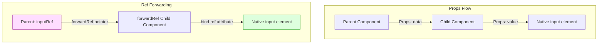
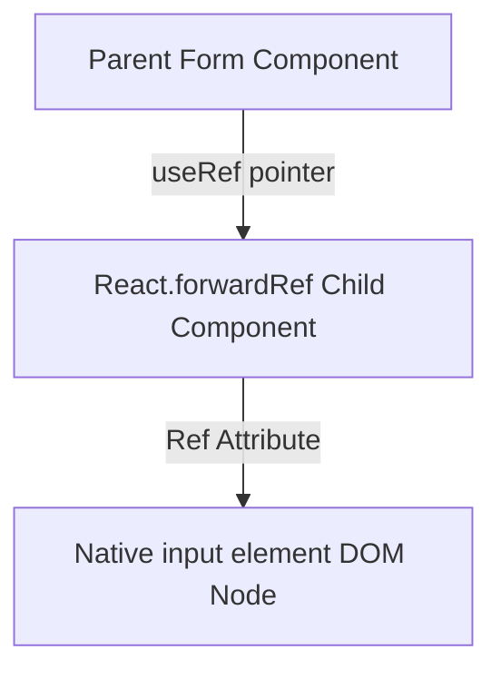
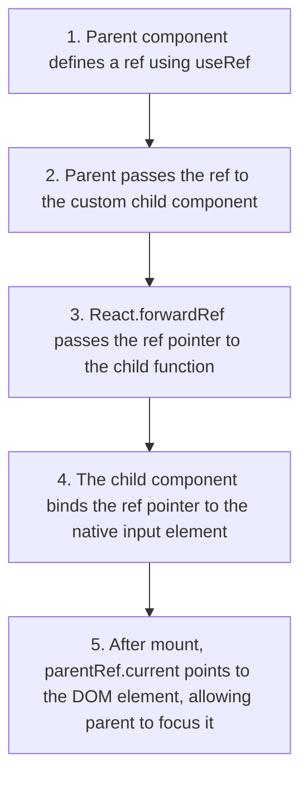

# Refs & forwardRef DOM Forwarding

## Introduction

In React, components communicate with each other using props. Parents pass data down, and children notify parents using callback props. This is called unidirectional data flow. However, in specific cases (like focusing inputs, measuring layout nodes, or controlling media playback), parent components need to interact directly with a child component's real DOM node. To support this, React provides **Refs** (`useRef`), **`React.forwardRef`**, and the **`useImperativeHandle`** hook. This module covers forwarding ref pointers down component trees and defining custom child APIs.

---

## Why do we need this?

By default, React does not allow parent components to access the DOM nodes of custom child components.

### Problem Statement
Consider a login form layout containing a submit button and a custom inputs element: `<CustomInput />`.
1. The custom input component wraps a native `<input>` tag inside some styled wrapper divs:

```jsx
// Custom child input component
export default function CustomInput() {
  return (
    <div className="input-wrapper">
      <input type="text" />
    </div>
  );
}
```

2. When the user loads the page, the parent login form needs to focus the input field inside `<CustomInput />` automatically.
3. If the parent passes a ref prop directly: `<CustomInput ref={inputRef} />`, React ignores it or throws a warning.
4. The parent cannot access the inner `<input>` element DOM node because component boundaries prevent direct DOM access.

We need a way to forward the ref pointer passed by the parent down to the inner native input element inside the child component.

---

## Real World Story

In early versions of React, class components exposed their internal elements by default, allowing parent components to access child elements using `this.refs.childName`.

This violated component encapsulation rules and made codebases fragile: if a child component changed its internal structure, parent code broke. React resolved this by introducing **Ref Forwarding** (`React.forwardRef`) in version 16.3. This API made ref forwarding explicit: a child component had to opt-in to expose its internal DOM nodes. Later, React added the `useImperativeHandle` hook, allowing child components to customize the instance value exposed to parent components, letting them hide internal details and expose only specific control methods.

---

## Real World Analogy

Think of ref forwarding like a **Package Delivery Redirect** compared to **Breaking into a House**.

- **Without Ref Forwarding (Breaking in)**: You want to deliver a package directly to the tenant's desk (native input field) inside an office building (custom child component). If the front desk receptionist (component boundary) blocks you, you must break in, climb the stairs, and search the office. This violates security rules and is fragile.
- **With Ref Forwarding (Redirect)**: The building manager sets up a delivery slot (forwardRef API) at the entrance. The receptionist accepts the package, matches the label instructions, and hands the package to a courier who delivers it directly to the tenant's desk (forwards the ref to the native input field). You deliver the package without violating security rules.

---

## Visual Explanation

Below is a flowchart comparing how standard props flow down the tree vs. how ref pointers are forwarded down to child DOM elements.

### Standard Props Flow (Unidirectional)
```
[Parent Component] ──(Props: data)──> [Child Component] ──(Props: data)──> [Native DOM Node]
```

### Ref Forwarding Flow (ReactDOM Pointer Link)
```
[Parent (declares ref)] ──(forwardRef pointer)──> [Child Component]
                                                          │
                                                (Assigns ref attribute)
                                                          │
                                                          ▼
                                                  [Native DOM Node]
                                    (Parent inputRef.current points directly here)
```



---

## Internal Working

React wraps child components in `React.forwardRef` to pass the `ref` pointer as a second parameter alongside props.

When you write `const MyInput = React.forwardRef((props, ref) => ...)`:
1. The parent component defines a ref using `useRef(null)` and passes it to the child: `<MyInput ref={myRef} />`.
2. React identifies the `ref` prop and passes it as the second argument to your component function.

```mermaid
sequenceDiagram
    participant Parent as Parent Component
    participant Child as forwardRef Child Component
    participant DOM as Real Browser DOM

    Parent->>Child: Render <Child ref={parentRef} />
    Child->>DOM: Bind ref to native <input ref={parentRef} />
    DOM-->>Parent: Update parentRef.current with input DOM node
    Note over Parent: Parent calls parentRef.current.focus()
    Parent->>DOM: Focus input element directly
```

3. You bind the incoming `ref` argument to the native element inside your component body: `<input ref={ref} />`.
4. After React mounts the component, the parent's `myRef.current` points directly to the real browser DOM node of the native `<input>` element.



---

## Architecture

Ref forwarding creates a direct pointer connection from the parent component down to the target native DOM node, bypassing intermediate component layouts.



---

## Step-by-Step Flow

When a parent component focuses a child input field using ref forwarding, the following steps occur:



---

## Syntax

```jsx
import React, { forwardRef } from 'react';

// Wraps component function in forwardRef, exposing ref as second argument
const CustomInput = forwardRef((props, ref) => {
  return (
    <div className="wrapper">
      <input ref={ref} {...props} />
    </div>
  );
});
```

---

## Basic Example

Here is a basic component showing how to focus a child input field using `React.forwardRef`.

```jsx
import React, { useRef, forwardRef } from 'react';

// 1. Child component wrapped in forwardRef
const FancyInput = forwardRef((props, ref) => {
  return (
    <input
      ref={ref}
      type="text"
      placeholder="Type here..."
      style={{ border: '2px solid blue', padding: '6px', borderRadius: '4px' }}
    />
  );
});

// 2. Parent component
export default function App() {
  const inputRef = useRef(null);

  const handleFocus = () => {
    // Focus the child input element directly using the ref
    inputRef.current?.focus();
  };

  return (
    <div style={{ padding: '16px' }}>
      <h3>Ref Forwarding Sandbox</h3>
      <FancyInput ref={inputRef} />
      <button onClick={handleFocus} style={{ marginLeft: '8px' }}>
        Focus Input Field
      </button>
    </div>
  );
}
```

---

## Intermediate Example

An intermediate component showing how to control a child `<video>` player (play and pause) using ref forwarding.

```jsx
import React, { useRef, forwardRef } from 'react';

// 1. Custom Player Component wrapped in forwardRef
const VideoPlayer = forwardRef(({ src }, ref) => {
  return (
    <video
      ref={ref}
      src={src}
      width="250"
      style={{ display: 'block', marginBottom: '12px', borderRadius: '4px' }}
    />
  );
});

// 2. Parent Dashboard
export default function PlayerApp() {
  const videoRef = useRef(null);

  return (
    <div style={{ padding: '20px' }}>
      <h3>Media Controller</h3>
      <VideoPlayer
        ref={videoRef}
        src="https://interactive-examples.mdn.mozilla.net/media/cc0-videos/flower.mp4"
      />
      <div style={{ display: 'flex', gap: '8px' }}>
        <button onClick={() => videoRef.current?.play()}>Play Video</button>
        <button onClick={() => videoRef.current?.pause()}>Pause Video</button>
      </div>
    </div>
  );
}
```

---

## Advanced Example

An advanced component illustrating the use of `useImperativeHandle` combined with `forwardRef`. Instead of exposing the entire DOM node, the child component exposes only specific control methods (like clearing the input and shaking the wrapper) to the parent, preserving encapsulation.

```jsx
import React, { useState, useRef, useImperativeHandle, forwardRef } from 'react';

// Child Component
const SecureInput = forwardRef((props, ref) => {
  const [val, setVal] = useState('');
  const inputRef = useRef(null);

  // Customize the instance value exposed to the parent component
  useImperativeHandle(ref, () => ({
    focus: () => {
      inputRef.current?.focus();
    },
    clear: () => {
      setVal('');
    },
    getValueLength: () => {
      return val.length;
    }
  }));

  return (
    <input
      ref={inputRef}
      type="password"
      value={val}
      onChange={e => setVal(e.target.value)}
      placeholder="Enter password..."
      style={{ padding: '8px', border: '2px solid black' }}
    />
  );
});

// Parent Form
export default function LoginConsole() {
  const secureRef = useRef(null);

  const handleInspect = () => {
    if (secureRef.current) {
      alert(`Characters entered: ${secureRef.current.getValueLength()}`);
      secureRef.current.focus();
    }
  };

  return (
    <div style={{ padding: '20px', border: '1px solid #ccc' }}>
      <h3>Authentication Form</h3>
      <SecureInput ref={secureRef} />
      <div style={{ marginTop: '12px', display: 'flex', gap: '8px' }}>
        <button onClick={handleInspect}>Inspect Password Length</button>
        <button onClick={() => secureRef.current?.clear()}>Clear Field</button>
      </div>
    </div>
  );
}
```

---

## Production Example

A production-grade input element incorporating custom ref forwarding, full aria attributes mapping for accessibility, theme overrides, and automatic focus control logic on error validation triggers.

```jsx
import React, { useRef, useImperativeHandle, forwardRef } from 'react';

const FormFieldInput = forwardRef(({ label, error, ...props }, ref) => {
  const inputRef = useRef(null);

  // Expose focus and select APIs to parent validation checks
  useImperativeHandle(ref, () => ({
    focus: () => {
      inputRef.current?.focus();
    },
    select: () => {
      inputRef.current?.select();
    }
  }));

  return (
    <div style={{ marginBottom: '16px' }}>
      <label style={{ display: 'block', marginBottom: '4px', fontWeight: 'bold' }}>
        {label}
      </label>
      <input
        ref={inputRef}
        {...props}
        style={{
          width: '100%',
          padding: '8px',
          border: error ? '2px solid red' : '1px solid #ccc',
          borderRadius: '4px',
          boxSizing: 'border-box'
        }}
        aria-invalid={!!error}
        aria-describedby={error ? `${props.id}-error` : undefined}
      />
      {error && (
        <span id={`${props.id}-error`} style={{ color: 'red', fontSize: '0.85rem', display: 'block', marginTop: '4px' }}>
          {error}
        </span>
      )}
    </div>
  );
});

export default function ProductionForm() {
  const fieldRef = useRef(null);

  const handleSubmit = (e) => {
    e.preventDefault();
    // Simulate validation error trigger
    alert('Validation Error: Focusing input field.');
    fieldRef.current?.focus();
    fieldRef.current?.select();
  };

  return (
    <form onSubmit={handleSubmit} style={{ maxWidth: '300px', margin: '20px auto', padding: '16px', border: '1px solid #ddd', borderRadius: '8px' }}>
      <FormFieldInput
        ref={fieldRef}
        id="username-input"
        label="Username ID"
        error="Invalid username. Please correct."
      />
      <button type="submit">Submit Form</button>
    </form>
  );
}
```

---

## Folder Structure

```
refs-forwardref/
├── src/
│   ├── components/
│   │   ├── FancyInput.jsx
│   │   └── FormFieldInput.jsx
│   ├── App.jsx
│   └── main.jsx
├── package.json
└── vite.config.js
```

---

## Best Practices

💡 **Did You Know?**  
In React 19, you no longer need `React.forwardRef`! You can pass `ref` directly as a standard prop to functional components, just like any other prop: `<MyInput ref={myRef} />`.

🚀 **Best Practices**
- Opt-in explicitly to ref forwarding using `React.forwardRef`. Do not expose child DOM nodes unless the parent needs to focus the element, measure layout coordinates, or control media playback.
- Combine `React.forwardRef` with the `useImperativeHandle` hook to customize the instance value exposed to parent components, preserving component encapsulation.
- Make sure to forward the ref to a native HTML DOM element inside your child component body, rather than attaching it to custom wrapper divs.

---

## Common Mistakes

⚠ **Common Mistakes**

### Attempting to Bind Ref on Functional Components Directly
Attempting to bind a `ref` on a custom functional component directly without wrapping it in `React.forwardRef` is a common mistake. This causes React to ignore the ref or throw a warning, and `ref.current` remains `null`.

```jsx
// ❌ WRONG (App throws a warning and input is not focused)
function CustomInput({ label }) {
  return <input type="text" />;
}

function Form() {
  const ref = useRef(null);
  return <CustomInput ref={ref} />;
}
```

---

## Performance Notes

⚡ **Performance Tips**
Ref updates do not trigger component re-renders. Modifying the `.current` property of a Ref is a mutation, allowing parent components to store and read values without triggering redundant render cycles.

---

## Accessibility Notes

♿ **Accessibility Tips**
Manage focus transitions when modal dialogs open. Use ref forwarding to focus the main interactive element inside the modal on open, ensuring keyboard navigation remains accessible.

---

## SEO Notes

Refs and ref forwarding run client-side to manage DOM interactions. Ensure that the initial page content (such as headings and links) is rendered statically, keeping the page indexable by search engine crawlers.

---

## Interview Questions

🎯 **Interview Tips**  
In an interview, explain ref forwarding as a mechanism to allow parent components to access a child component's DOM nodes. Explain that child components opt-in to this by wrapping their functions in `React.forwardRef`.

### Q1: What is the purpose of `React.forwardRef`?
**Answer**: `React.forwardRef` is a utility function used to forward the `ref` pointer passed from a parent component down to an inner native element (e.g., a native input tag) inside the child component, enabling direct DOM interactions like focus control or measurements.

### Q2: How does `useImperativeHandle` improve component encapsulation?
**Answer**: `useImperativeHandle` allows child components to customize the instance value exposed to parent components when they receive a `ref`. Instead of exposing the entire raw DOM node (which violates encapsulation), the child can expose only specific control methods (e.g. `focus()`, `clear()`), hiding internal details.

---

## MCQs

1. **Which React API is used to forward a ref pointer down to a child element?**
   - A) `useImperativeHandle`
   - B) `React.forwardRef`
   - C) `useRef`
   - D) `useLayoutEffect`
   - *Answer: B*

2. **Which parameter index does the ref pointer occupy in a forwardRef component function?**
   - A) First parameter (e.g., `(ref, props)`)
   - B) Second parameter (e.g., `(props, ref)`)
   - C) Third parameter
   - D) It is passed as a property on the props object.
   - *Answer: B*

3. **What does the hook `useImperativeHandle` do?**
   - A) It cancels active API requests.
   - B) It allows child components to customize the instance value and methods exposed to parent components when they receive a `ref`.
   - C) It updates component state.
   - D) It compiles components into web assemblies.
   - *Answer: B*

4. **Why does attaching a ref to a regular functional component without forwardRef throw a warning?**
   - A) Because functional components do not support CSS.
   - B) Functional components do not have instances, so React cannot attach a ref to them directly.
   - C) It triggers database errors.
   - D) It exposes environment variables.
   - *Answer: B*

5. **In which React version was the requirement for React.forwardRef wrapper removed for standard ref props?**
   - A) React 16.8
   - B) React 17.0
   - C) React 18.0
   - D) React 19.0
   - *Answer: D*

---

## Practice Exercise

### Exercise 1: forwardRef template setup
Wrap this input component in `React.forwardRef` to expose the native input ref:
```jsx
// TODO: Refactor using forwardRef
function TextWidget({ label }, ref) {
  return <input ref={ref} />;
}
```

*Solution*:
```jsx
const TextWidget = React.forwardRef(({ label }, ref) => {
  return <input ref={ref} />;
});
```

### Exercise 2: Play/Pause audio controller
Create an audio player component using a portal. Use `React.forwardRef` to expose play and pause control methods of the native HTML `<audio>` tag to the parent dashboard.

### Exercise 3: Clear input via hook
Build an input child component using `useImperativeHandle`. Expose a `clearText()` method that parent components can call to clear the input field's value.

---

## Debugging Exercise

### The Null Ref Error Bug
A developer wants to focus a custom input field on mount, but `inputRef.current.focus()` throws an error: `Cannot read properties of null (reading 'focus')`. Identify the bug and write the fix.

```jsx
import React, { useRef, useEffect } from 'react';

// Child component
function SpecialInput({ label }) {
  // BUG: Functional component receives ref on props, but is not wrapped in forwardRef,
  // meaning the ref is not bound and remains null in the parent.
  return <input type="text" />;
}

export default function FormPanel() {
  const inputRef = useRef(null);

  useEffect(() => {
    inputRef.current?.focus(); // Fails: current is null
  }, []);

  return (
    <div>
      <SpecialInput ref={inputRef} />
    </div>
  );
}
```

#### Solution
The child component is a functional component but is not wrapped in `React.forwardRef` to receive the ref parameter, causing the ref to remain unbound and `inputRef.current` to remain null. To fix this, wrap the child component in `React.forwardRef`:

```jsx
// Corrected
import React, { useRef, useEffect, forwardRef } from 'react'; // Import forwardRef

// Wrap child component in forwardRef and bind ref to native input
const SpecialInput = forwardRef(({ label }, ref) => {
  return <input ref={ref} type="text" />;
});

export default function FormPanel() {
  const inputRef = useRef(null);

  useEffect(() => {
    inputRef.current?.focus(); // Works correctly: focuses input on mount
  }, []);

  return (
    <div>
      <SpecialInput ref={inputRef} />
    </div>
  );
}
```

---

## Real-world Scenario

You are building an enterprise form builder wizard. The active page validation logic must inspect all custom input components and focus the first invalid input. Explain how you would structure the pages.
- **Design Strategy**: Wrap all custom input components in `React.forwardRef` to expose their native input nodes. In the parent wizard component, maintain refs for all inputs. During validation, loop through the fields and call the `focus()` method of the first invalid field using its ref.

---

## Interview Coding Question

### Problem Statement
Write a child component called `DynamicCard` that:
- Exposes a `shake()` method to the parent using `useImperativeHandle` and `React.forwardRef`.
- Clicking the shake button in the parent component should toggle a CSS class to shake the card wrapper.

```jsx
import React, { useState, useRef, useImperativeHandle, forwardRef } from 'react';

// Child Component
const DynamicCard = forwardRef(({ children }, ref) => {
  const [shaking, setShaking] = useState(false);

  useImperativeHandle(ref, () => ({
    shake: () => {
      setShaking(true);
      setTimeout(() => setShaking(false), 500); // Reset shake class after animation completes
    }
  }));

  return (
    <div
      style={{
        border: '1px solid #ccc',
        padding: '16px',
        animation: shaking ? 'shake 0.5s ease-in-out' : 'none'
      }}
    >
      {children}
    </div>
  );
});

// Parent Control Panel
export default function FormConsole() {
  const cardRef = useRef(null);

  return (
    <div style={{ padding: '20px' }}>
      <DynamicCard ref={cardRef}>
        <p>Security verification form</p>
      </DynamicCard>
      <button onClick={() => cardRef.current?.shake()} style={{ marginTop: '12px' }}>
        Trigger Validation Shake
      </button>
    </div>
  );
}
```

---

## Mini Project

### Input Validation Studio
Build a form wizard workspace:
- Create a list of 5 custom input fields wrapped in `React.forwardRef`.
- Implement validation checks inside the parent container.
- If a field fails validation on submit, focus and highlight the invalid field using its ref.
- Verify that focus transitions work smoothly and accessibility inputs match correctly.

---

## Summary

🧠 **Memory Tricks**  
`forwardRef passes pointers`  
- `React.forwardRef` allows parent components to access a child component's native DOM nodes.
- Use `useImperativeHandle` to expose only custom control methods to the parent.

📖 **Summary**  
React Refs and `React.forwardRef` enable direct DOM interactions across components. By forwarding ref pointers down layouts and using `useImperativeHandle` to customize exposed methods, React maintains clean element bindings.

---

## Cheat Sheet

```javascript
// Forwarding ref pointers down to elements
const Input = forwardRef((props, ref) => <input ref={ref} />);
```

---

## Related Topics
- [Advanced & Edge Hooks](../phase-4-hooks/advanced-hooks)
- [Suspense & Dynamic Loading](suspense-lazy)

---

## Further Reading
- [React Docs: Forwarding Refs](https://react.dev/reference/react/forwardRef)
- [React Docs: Manipulating the DOM with Refs](https://react.dev/learn/manipulating-the-dom-with-refs)
