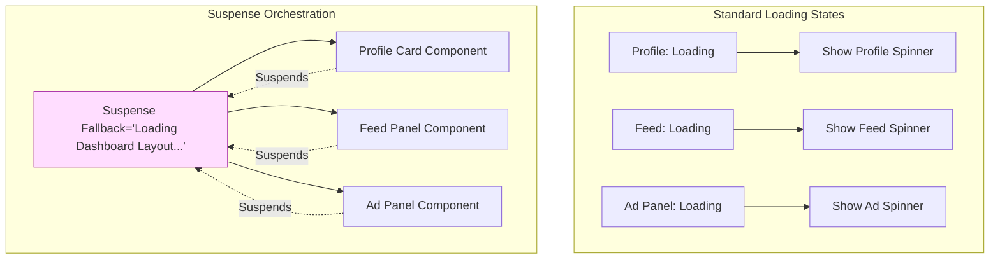
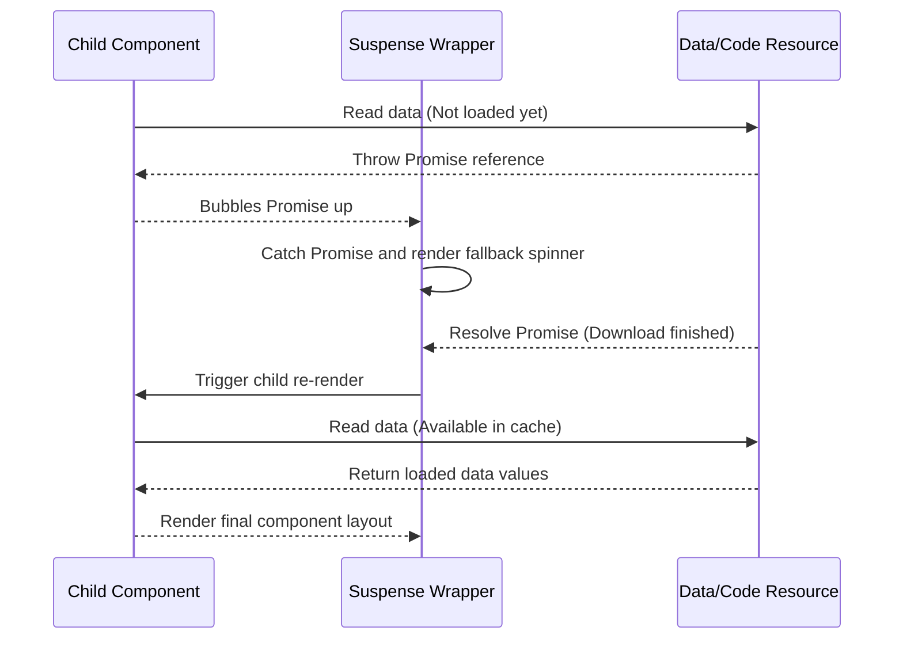
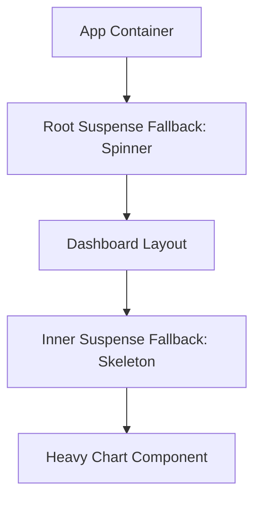
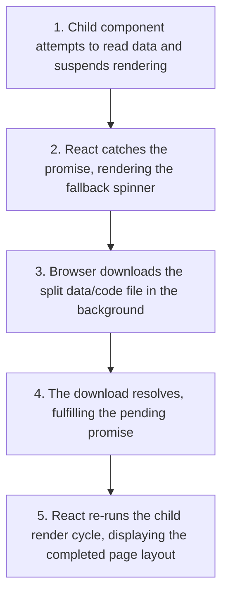

# Suspense & Dynamic Loading

## Introduction

In standard web applications, managing loading states for asynchronous tasks (like fetching data or importing files) requires writing duplicate loading state checks inside every component. To simplify this, React provides **Suspense**. Suspense is a wrapper component that allows you to specify a fallback UI (like a loading spinner or skeleton) to display while its child component tree is loading asynchronous resources. This module covers Suspense boundaries, dynamic loading, and data-fetching integrations.

---

## Why do we need this?

Managing loading indicators manually inside multiple components leads to messy code and jarring user experiences.

### Problem Statement
Consider a dashboard page that displays user details, posts feed, and an activity chart. Each component fetches its own data independently.
1. Each component defines its own state variables: `const [loading, setLoading] = useState(true)`.
2. When the page loads, each component renders its own independent loading spinner.
3. This creates a messy page layout with multiple spinners loading at different speeds, followed by layout shifts as data arrives.
4. If a fetch request fails, catching the error requires writing separate try/catch checks in every component.

We need a centralized way to coordinate loading states and display a unified loading layout while asynchronous resources are loading in the background.

---

## Real World Story

In React 16.6, the team released `<Suspense>` to handle route-based bundle splitting (`React.lazy`).

This allowed developers to lazy-load components on demand, displaying fallback spinners while the browser downloaded files in the background. In React 18, the team expanded `<Suspense>` to support data-fetching workflows. Suspense became the foundation of React's **Concurrent Mode**: instead of developers tracking loading states manually, asynchronous libraries (like TanStack Query or framework loaders) could notify React when resources were loading, allowing React to orchestrate loading boundaries and render skeletons automatically.

---

## Real World Analogy

Think of Suspense boundaries like a **Catering Crew Setting Up tables** compared to **Guests Fetching Their Own Plates**.

- **Without Suspense (Guests Fetching Plates)**: Sibling guests stand in the dining hall. The chef brings out food plates one by one. The first guest gets a salad, the second guest stands empty-handed, and the third guest gets a steak. The table layout updates constantly, creating a chaotic and uncoordinated dining experience.
- **With Suspense (Catering Crew)**: Sibling guests sit at the table. The catering crew places a decorative partition screen (Fallback spinner) around the table. Behind the screen, the waiters set up all plates (asynchronous resource rendering) in parallel. When all plates are placed, the crew slides open the screen (Suspense boundary resolves), displaying the complete dinner table setup at once.

---

## Visual Explanation

Below is a diagram showing how Suspense wraps asynchronous child components, rendering a fallback spinner until the data fetches resolve.

### Uncoordinated Spinner Chaos (Standard Fetching)
```
[Page Load] ──> [Component A: Spinner] ──> [Component B: Spinner] ──> [Component C: Spinner]
```

### Coordinated Loading Boundary (Suspense)
```
[Page Load] ──> [Suspense Boundary Fallback Spinner (One for all)]
                         │
                  (Data fetches resolve)
                         │
                         ▼
             [Fully Loaded Dashboard Layout] (Rendered at once)
```



---

## Internal Working

Suspense works by catching **Promises** thrown by child components during rendering.

During rendering:
1. React attempts to render the child component tree inside a `<Suspense>` wrapper.
2. If a child component reads an asynchronous resource (like a database query or file chunk) that is not loaded yet, it **throws a Promise**.
3. React catches the thrown Promise, stops rendering the child tree, and displays the `<Suspense>` component's fallback UI.
4. React subscribes to the Promise. When the Promise resolves, React clears the fallback UI, re-evaluates the child component tree, and renders it on screen.



---

## Architecture

Suspense boundaries can be nested, allowing you to display a global loading layout while specific, slower components load their data independently.



---

## Step-by-Step Flow

When loading dynamic resource pages using Suspense, the following steps occur:



---

## Syntax

```jsx
import React, { Suspense } from 'react';

function App() {
  return (
    // Wrap async components in a Suspense boundary with a fallback loader
    <Suspense fallback={<DashboardSkeleton />}>
      <ProfileFeed />
      <AnalyticsPanel />
    </Suspense>
  );
}
```

---

## Basic Example

Here is a basic component showing how to wrap a lazy-loaded component in a Suspense boundary.

```jsx
import React, { lazy, Suspense } from 'react';

// Lazy-load the heavy panel component dynamically
const LazySettings = lazy(() => import('./components/SettingsPanel.jsx'));

export default function SettingsConsole() {
  return (
    <div style={{ padding: '16px' }}>
      <h3>Console Settings</h3>
      {/* Renders the fallback div until the SettingsPanel chunk is downloaded */}
      <Suspense fallback={<div>Loading settings chunk...</div>}>
        <LazySettings />
      </Suspense>
    </div>
  );
}
```

---

## Intermediate Example

An intermediate component showing nested Suspense boundaries. This layout displays a global sidebar layout instantly, while loading details display independent skeleton screens at their own speed.

```jsx
import React, { lazy, Suspense } from 'react';

// Lazy-load page components
const UserBio = lazy(() => import('./components/UserBio.jsx'));
const ActivityGrid = lazy(() => import('./components/ActivityGrid.jsx'));

export default function ProfileDashboard() {
  return (
    <div style={{ display: 'flex', gap: '16px', padding: '20px' }}>
      <aside style={{ width: '150px', background: '#eee', padding: '12px' }}>
        <h4>Navigation</h4>
        <ul>
          <li>Profile Home</li>
        </ul>
      </aside>

      <main style={{ flexGrow: 1 }}>
        <h3>Dashboard Profile</h3>
        
        {/* Parent Suspense boundary wraps child blocks */}
        <Suspense fallback={<div>Loading profile container...</div>}>
          <div style={{ display: 'flex', flexDirection: 'column', gap: '16px' }}>
            
            {/* Nested Suspense boundary allows UserBio to load independently */}
            <Suspense fallback={<div style={{ height: '50px', background: '#ccc' }}>Loading user bio...</div>}>
              <UserBio />
            </Suspense>

            {/* Nested Suspense boundary handles the heavy activity grid */}
            <Suspense fallback={<div style={{ height: '100px', background: '#eaeaea' }}>Loading activity logs...</div>}>
              <ActivityGrid />
            </Suspense>

          </div>
        </Suspense>
      </main>
    </div>
  );
}
```

---

## Advanced Example

An advanced example showing how to build a basic custom data fetcher that supports React Suspense. It wraps a fetch Promise and throws it during rendering until the data is loaded.

```jsx
import React, { Suspense } from 'react';

// 1. Custom Resource Wrapper that throws a Promise until resolved
function createSuspenseResource(fetchPromise) {
  let status = 'pending';
  let result;
  
  const suspender = fetchPromise.then(
    (res) => {
      status = 'success';
      result = res;
    },
    (err) => {
      status = 'error';
      result = err;
    }
  );

  return {
    read() {
      if (status === 'pending') {
        throw suspender; // Throw the pending promise to suspend rendering
      } else if (status === 'error') {
        throw result; // Throw the error so an Error Boundary can catch it
      } else if (status === 'success') {
        return result; // Return the loaded data values
      }
    }
  };
}

// Mock API Call
const mockFetchData = () => new Promise(resolve => setTimeout(() => resolve('Hello from API Database!'), 2000));
const databaseResource = createSuspenseResource(mockFetchData());

// 2. Child Component that consumes the resource
function SuspensefulDataConsumer() {
  // Reads resource value; if not resolved, throws Promise and suspends rendering
  const message = databaseResource.read();
  return <h4>Fetched Message: {message}</h4>;
}

export default function SuspenseSandbox() {
  return (
    <div style={{ padding: '20px', border: '1px solid #ccc' }}>
      <h3>Custom Suspense Data Fetcher</h3>
      
      {/* Wrap component in a Suspense boundary with a fallback loader */}
      <Suspense fallback={<p>Fetching API data in background...</p>}>
        <SuspensefulDataConsumer />
      </Suspense>
    </div>
  );
}
```

---

## Production Example

A production-grade routed dashboard utilizing TanStack Query's native Suspense support, catching chunk loading errors with an Error Boundary and managing loading boundaries with nested Suspense skeletons.

```jsx
import React, { Component, Suspense } from 'react';
import { useSuspenseQuery } from '@tanstack/react-query';

// Error Boundary Component
class CatchErrorPage extends Component {
  state = { hasError: false };
  static getDerivedStateFromError() { return { hasError: true }; }
  render() {
    if (this.state.hasError) return <p style={{ color: 'red' }}>Failed to download catalog metrics.</p>;
    return this.props.children;
  }
}

// Fetch Function
const loadUserMetadata = () => fetch('https://jsonplaceholder.typicode.com/users/1').then(res => res.json());

// Component consumes the resource using the useSuspenseQuery hook
function UserPanel() {
  const { data: user } = useSuspenseQuery({
    queryKey: ['suspense-user-profile'],
    queryFn: loadUserMetadata
  });

  return (
    <div>
      <h4>Active Member: {user.name}</h4>
      <p>Company: {user.company?.name}</p>
    </div>
  );
}

export default function ProductionDashboard() {
  return (
    <div style={{ padding: '16px', border: '1px solid #bbb', borderRadius: '8px' }}>
      <h3>Corporate Panel Portal</h3>
      
      {/* Wrap component in both an Error Boundary and a Suspense container */}
      <CatchErrorPage>
        <Suspense fallback={<div>Loading member workspace profile...</div>}>
          <UserPanel />
        </Suspense>
      </CatchErrorPage>
    </div>
  );
}
```

---

## Folder Structure

```
suspense-lazy/
├── src/
│   ├── components/
│   │   ├── UserBio.jsx
│   │   └── SuspensefulDataConsumer.jsx
│   ├── App.jsx
│   └── main.jsx
├── package.json
└── vite.config.js
```

---

## Best Practices

💡 **Did You Know?**  
React's `<Suspense>` container does not catch errors on its own. If a resource throws an error (e.g., a network request fails), the application will crash unless you wrap the `<Suspense>` boundary in an **Error Boundary**.

🚀 **Best Practices**
- Always wrap Suspense boundaries in an **Error Boundary** component to catch and handle network request failures gracefully.
- Use nested Suspense boundaries to load slower components (like charts or widgets) independently, preventing them from delaying the entire page load.
- Design lightweight fallback layouts (like CSS skeleton screens) that match the dimensions of the final loaded components to prevent jarring layout shifts.

---

## Common Mistakes

⚠ **Common Mistakes**

### Not Wrapping Suspense in an Error Boundary
Assuming that `<Suspense>` handles network request failures is a common mistake. `<Suspense>` only manages loading states. If an API request fails, it throws an error that will crash the application unless caught by a parent Error Boundary.

```jsx
// ❌ WRONG (App crashes if fetch fails)
<Suspense fallback={<Loader />}>
  <SuspenseComponent />
</Suspense>

//  RIGHT
<ErrorBoundary fallback={<ErrorBanner />}>
  <Suspense fallback={<Loader />}>
    <SuspenseComponent />
  </Suspense>
</ErrorBoundary>
```

---

## Performance Notes

⚡ **Performance Tips**
Use CSS skeleton screens in fallback components to reserve layout space. This prevents layout shifts and improves **Cumulative Layout Shift (CLS)** scores when the final component loads.

---

## Accessibility Notes

♿ **Accessibility Tips**
- Display fallback loaders with `aria-live="polite"` or `role="status"` to inform screen reader users that content is loading.
- Use `aria-busy="true"` on loading containers and toggle it to `false` when resources finish loading.

---

## SEO Notes

Search engines like Google index lazy-loaded content, but they may time out before all asynchronous resources finish loading. Pre-render initial page layouts to ensure crawlers index the page content immediately.

---

## Interview Questions

🎯 **Interview Tips**  
In an interview, explain Suspense as a mechanism to coordinate loading states. Clarify that it works by catching Promises thrown by child components during rendering, rendering a fallback UI until the Promises resolve.

### Q1: How does a component notify `<Suspense>` that it is loading data?
**Answer**: A component notifies `<Suspense>` by **throwing a Promise** during the rendering phase. React catches the thrown Promise, stops rendering the child tree, and displays the Suspense component's fallback UI. When the Promise resolves, React re-renders the child component.

### Q2: Why is wrapping `<Suspense>` in an Error Boundary recommended?
**Answer**: Wrapping `<Suspense>` in an Error Boundary is recommended because Suspense only manages loading states and does not catch errors. If an asynchronous resource fails to load (e.g., a network error occurs), the resource throws an error that will crash the application unless caught by a parent Error Boundary.

---

## MCQs

1. **How does a child component notify `<Suspense>` that it is not ready to render?**
   - A) By returning `null`.
   - B) By throwing a Promise reference during the render phase.
   - C) By dispatching a global Redux action.
   - D) By updating a local ref pointer.
   - *Answer: B*

2. **What occurs when the Promise thrown by a suspended child component resolves?**
   - A) The page reloads.
   - B) React clears the fallback UI, re-evaluates the child component tree, and renders it on screen.
   - C) Sibling components unmount.
   - D) Local storage keys are reset.
   - *Answer: B*

3. **Which library hook is used to consume queries inside Suspense boundaries?**
   - A) `useQuery`
   - B) `useSuspenseQuery`
   - C) `useReducer`
   - D) `useSyncExternalStore`
   - *Answer: B*

4. **Why should you use nested Suspense boundaries?**
   - A) To improve CSS compiling speeds.
   - B) To load slower components independently, displaying local skeletons instead of delaying the entire page render.
   - C) To secure API tokens.
   - D) To bypass JS syntax checks.
   - *Answer: B*

5. **Does `<Suspense>` catch errors thrown by failed network requests?**
   - A) Yes, it renders the fallback UI.
   - B) No, it only manages loading states; you must wrap it in an Error Boundary to catch errors.
   - C) Yes, but only in development mode.
   - D) No, unless you configure a custom gcTime.
   - *Answer: B*

---

## Practice Exercise

### Exercise 1: Suspense loader wrap
Wrap this dynamic component in a Suspense boundary that displays a loading text fallback:
```jsx
const LazyBoard = React.lazy(() => import('./Board.jsx'));
// TODO: Wrap in Suspense boundary
```

*Solution*:
```jsx
<Suspense fallback={<div>Loading dashboard...</div>}>
  <LazyBoard />
</Suspense>
```

### Exercise 2: Nested skeleton layout
Create a dashboard component. Wrap a heavy sidebar list in a Suspense boundary with a skeleton list loader, and wrap the main chart container in a separate Suspense boundary.

### Exercise 3: Promise thrower mock
Write a component that simulates loading by throwing a Promise on its initial render. Resolve the Promise after 3 seconds, letting the component display a success message.

---

## Debugging Exercise

### The Crashing Loading Screen Bug
A developer is using Suspense to lazy-load an administrative page, but when a user offline tries to navigate to it, the application crashes completely. Identify the bug and write the fix.

```jsx
// Dashboard.jsx
import React, { lazy, Suspense } from 'react';

const LazyAdmin = lazy(() => import('./Admin.jsx'));

export default function Dashboard() {
  return (
    <div>
      <h3>Corporate Console</h3>
      {/* BUG: Routes contain lazy components but lack an Error Boundary wrapper to catch network loading failures */}
      <Suspense fallback={<p>Downloading admin console...</p>}>
        <LazyAdmin />
      </Suspense>
    </div>
  );
}
```

#### Solution
If a network error occurs or a chunk fails to download (e.g. when offline), the lazy-load dynamic import rejects, throwing an error. Because there is no Error Boundary to catch the failure, the application crashes. To fix this, wrap the Suspense container in an Error Boundary:

```jsx
// Corrected
import React, { lazy, Suspense } from 'react';
import ErrorBoundary from './ErrorBoundary.jsx'; // Import custom Error Boundary

const LazyAdmin = lazy(() => import('./Admin.jsx'));

export default function Dashboard() {
  return (
    <div>
      <h3>Corporate Console</h3>
      {/* Wrap Suspense in an Error Boundary to catch chunk loading failures */}
      <ErrorBoundary fallback={<p>Failed to load admin console. Please check connection.</p>}>
        <Suspense fallback={<p>Downloading admin console...</p>}>
          <LazyAdmin />
        </Suspense>
      </ErrorBoundary>
    </div>
  );
}
```

---

## Real-world Scenario

You are building a real-time multiplayer gaming lobby. The game assets list takes 4 seconds to load from a database. While loading, sibling components (like chat and user profiles) should remain active. Explain how you would structure the page.
- **Design Strategy**: Wrap the game assets list component in its own local `<Suspense>` boundary that displays a skeleton screen. Sibling components (chat and user profiles) should be kept outside the Suspense boundary, allowing them to mount and render immediately while the game assets load in the background.

---

## Interview Coding Question

### Problem Statement
Write a React component structure that handles data fetching using Suspense:
- Wrap a data-consuming child component in both an Error Boundary and a Suspense container.
- Mock a data-fetching resource that throws a Promise for 2 seconds before returning a "User metrics loaded" string.

```jsx
import React, { Component, Suspense } from 'react';

// 1. Error Boundary
class LocalBoundary extends Component {
  state = { hasError: false };
  static getDerivedStateFromError() { return { hasError: true }; }
  render() {
    if (this.state.hasError) return <p>Caught network error.</p>;
    return this.props.children;
  }
}

// 2. Custom Suspense Resource Wrapper
function createResource(promise) {
  let status = 'pending';
  let val;
  const suspender = promise.then(
    (res) => { status = 'success'; val = res; },
    (err) => { status = 'error'; val = err; }
  );

  return {
    read() {
      if (status === 'pending') throw suspender;
      if (status === 'error') throw val;
      return val;
    }
  };
}

const mockPromise = () => new Promise(res => setTimeout(() => res('User metrics loaded'), 2000));
const resource = createResource(mockPromise());

// 3. Child Component
function UserMetrics() {
  const data = resource.read();
  return <p>{data}</p>;
}

// 4. Main Export
export default function App() {
  return (
    <LocalBoundary>
      <Suspense fallback={<p>Loading metrics stream...</p>}>
        <UserMetrics />
      </Suspense>
    </LocalBoundary>
  );
}
```

---

## Mini Project

### routed Suspense Playground
Build a routed dashboard demonstrating Suspense:
- Lazy-load page components.
- Wrap page components in a single `<Suspense>` boundary with a custom loading skeleton.
- Implement an Error Boundary to catch loading failures.
- Add toggle settings to simulate slow network connections and verify that fallback layout loading states display correctly.

---

## Summary

🧠 **Memory Tricks**  
`Suspense wraps async`  
- Suspense manages loading states by catching Promises thrown by child components.
- Always wrap Suspense in an Error Boundary to catch network request failures.

📖 **Summary**  
React Suspense coordinates loading states for asynchronous resources. By catching thrown Promises and rendering fallback layouts until they resolve, React simplifies loading state management and prevents layout shifts.

---

## Cheat Sheet

```javascript
// Orchestrating loading boundaries
<Suspense fallback={<Skeleton />}>
  <HeavyComponent />
</Suspense>
```

---

## Related Topics
- [Code Splitting & Lazy Loading](../phase-6-performance/code-splitting)
- [Refs & DOM forwarding (Next Module)](refs-forwardref)

---

## Further Reading
- [React Docs: Suspense](https://react.dev/reference/react/Suspense)
- [TanStack Query Docs: Suspense Guide](https://tanstack.com/query/v5/docs/framework/react/guides/suspense)
