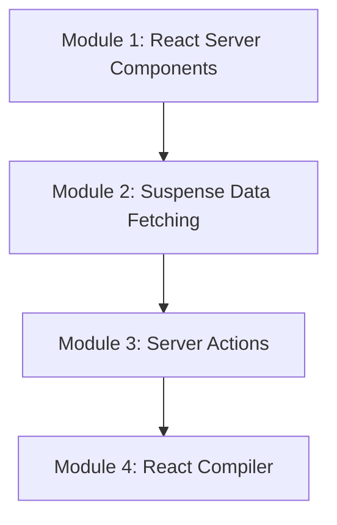

# Phase 8: Modern React

Welcome to the **Modern React** phase of the React Engineering Academy. This phase covers the architecture and features introduced in React 18 and 19: React Server Components (RSC), server-driven data fetching, Server Actions (secure database operations from components), and the React Compiler (automatic memoization).

## Why this topic exists

React has evolved from a client-side library into a full-stack architecture.
- Traditional single-page applications suffer from large client bundle sizes, slow initial page loads, and complex data-fetching waterfalls. **React Server Components (RSC)** solve this by rendering components on the server, removing their dependencies from the client bundle.
- Traditional data mutations require writing manual POST requests, state loaders, and error handlers. **Server Actions** allow you to trigger secure server-side functions (like database updates) directly from your client components using forms.
- Manual performance optimization (using `useMemo` and `useCallback` everywhere) is tedious and error-prone. The **React Compiler** automates this by automatically caching values and function references during compile time.

Understanding these modern paradigms is critical for building production-grade full-stack applications.

---

## Learning Objectives

By the end of this phase, you will be able to:
- Explain the difference between React Server Components (RSC) and Client Components.
- Implement server-driven data fetching inside RSCs without client-side waterfalls.
- Build form mutations and database updates using React 19 Server Actions.
- Manage pending states and optimistic updates during server mutations using the `useTransition` and `useOptimistic` hooks.
- Describe how the React Compiler automatically optimizes rendering without manual hooks.

---

## Prerequisites

Before starting this phase, you should have completed:
1. **[Phase 1: React Fundamentals](../phase-1-fundamentals)**
2. **[Phase 2: Components & JSX](../phase-2-components-jsx)**
3. **[Phase 3: State Management](../phase-3-state-management)**
4. **[Phase 4: React Hooks](../phase-4-hooks)**
5. **[Phase 5: Routing & Data Fetching](../phase-5-routing-fetching)**
6. **[Phase 6: Performance Optimization](../phase-6-performance)**
7. **[Phase 7: Advanced React](../phase-7-advanced)**

---

## Learning Roadmap & Topics Covered

This phase is broken down into four comprehensive modules:

1. **[Module 1: React Server Components](server-components)**  
   The RSC architecture, Server vs. Client components, dynamic rendering, and bundle size optimizations.
2. **[Module 2: Suspense Data Fetching](suspense-data-fetching)**  
   Fetching data directly in Server Components using async/await and streaming HTML layouts using Suspense.
3. **[Module 3: Server Actions](server-actions)**  
   Performing secure server-side mutations from components using form actions and the `useTransition` hook.
4. **[Module 4: React Compiler](react-compiler)**  
   How the React Compiler automatically memoizes components, values, and callback references under the hood.

---

## Estimated Learning Time

- **Total Time**: 10 - 12 Hours
- **Module 1**: 3 Hours
- **Module 2**: 3 Hours
- **Module 3**: 3 Hours
- **Module 4**: 3 Hours
- **Exercises & Projects**: 2 Hours

---

## Real-World Applications

- **E-Commerce Portals**: Loading product grids instantly using Server Components and pre-rendering layouts for SEO.
- **Dynamic Blogs**: Writing content articles that pull data directly from databases without client-side API requests.
- **SaaS Mutation Dashboards**: Building forms that execute database operations directly from client interfaces.

---

## Practice Exercises

- **Server-to-Client Prop Validation**: Resolving serialization warnings when passing data from Server to Client components.
- **Form Mutator with Pending State**: Creating a comment form that uses Server Actions and displays a loading spinner using `useTransition`.
- **Compiler check dashboard**: Profiling a component to verify that the React Compiler automatically optimizes rendering.

---

## Mini Projects

- **Modern Catalog Workspace**: A fully server-driven catalog system featuring Server Components for data display, Server Actions for inventory updates, and Suspense streaming to keep pages loading instantly.

---

## Related Topics

- [Performance Optimization Overview](../phase-6-performance)
- [Enterprise System Architecture](../phase-9-architecture)

---

## Further Reading

- [React Docs: Server Components](https://react.dev/reference/react/components#server-components)
- [React 19 RC: Server Actions Guide](https://react.dev/blog/2024/04/25/react-19)
