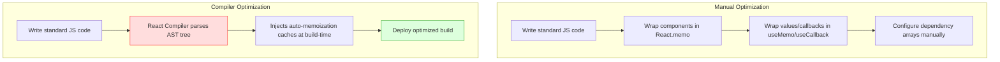
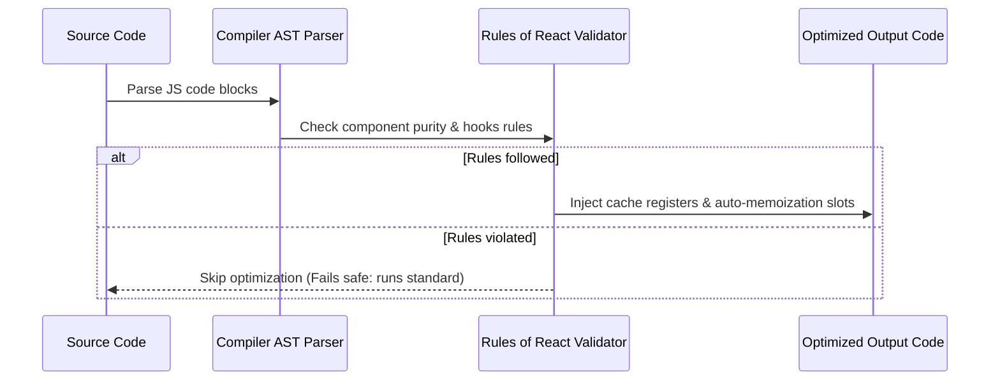
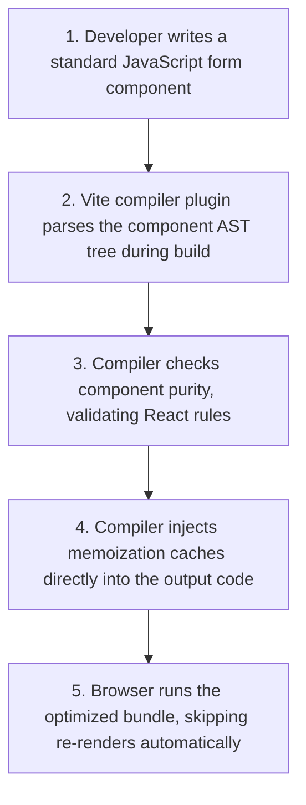

# The React Compiler

## Introduction

In standard React development, optimizing performance requires manually managing dependency arrays and wrapping components, values, and functions in hooks like `React.memo`, `useMemo`, and `useCallback`. This manual process is tedious, error-prone, and adds boilerplate code to codebases. To solve this, React 19 introduces the **React Compiler** (formerly React Forget). The React Compiler is a build-time compiler that parses your JavaScript code, detects optimization opportunities, and automatically injects memoization logic during compilation. This module covers compile-time optimization, auto-memoization rules, and analyzing compiler outputs.

---

## Why do we need this?

Manual memoization requires writing boilerplate code and introduces bugs if dependency arrays are misconfigured.

### Problem Statement
Consider a component that filters a list of search results. To optimize performance, the developer wraps the filter query in `useMemo`:

```jsx
// Manual optimization is fragile
const filteredItems = useMemo(() => {
  return items.filter(item => item.name.includes(query));
}, [items]); // Bug: Query is missing from the dependency array!
```

If the developer forgets to include `query` in the dependency array, the hook will reference a stale closure value, displaying incorrect search results on screen. Additionally, wrapping every function in `useCallback` clutter components. We need a compiler that handles these performance optimizations automatically during build time, letting developers write plain JavaScript.

---

## Real World Story

For years, React's core team researched ways to automate performance optimizations.

In 2021, Mingshun Kou and the team at Meta introduced "React Forget" at React Conf. The project aimed to create a compiler that enforces the "Rules of React" and automates memoization. The challenge was that JavaScript is highly dynamic, making compile-time analysis complex. Over the next three years, the team rebuilt the compiler, testing it on Meta's production codebases (like Instagram). In React 19, the tool was renamed the **React Compiler**. It compiles standard React code into highly optimized code, removing the need for manual `useMemo` and `useCallback` hooks.

---

## Real World Analogy

Think of the React Compiler like an **Automatic Transmission in a Car** compared to a **Manual Stick Shift**.

- **Manual Memoization (Stick Shift)**: You must manually press the clutch, match the RPMs, and shift gears (write `useMemo`, `useCallback`, and dependency arrays) on every speed change. If you miss a shift or select the wrong gear (misconfigure dependencies), the engine stalls (visual bugs or lag).
- **The React Compiler (Automatic Transmission)**: You put the car in drive and focus on steering (write standard JavaScript). The onboard computer measures speeds, calculates ratios, and shifts gears (injects memoization) automatically in the background during compilation. The drive is smooth without requiring manual gear adjustments.

---

## Visual Explanation

Below is a diagram comparing the developer workflow of manual memoization vs. build-time compilation with the React Compiler.

### Manual Memoization Workflow
```
[Write Component] ──> [Wrap in React.memo] ──> [Wrap values in useMemo] ──> [Wrap functions in useCallback]
```

### Compiler Auto-Memoization Workflow
```
[Write Standard JS Component] ──> [React Compiler compiles code] ──> [Optimized build deployed]
```



---

## Internal Working

The React Compiler acts as a build plugin (e.g., Babel or Vite plugin) that analyzes your code's **Abstract Syntax Tree (AST)**.

During compilation, the compiler:
1. Verifies that your components follow the **Rules of React** (e.g., hooks are not called conditionally, components do not mutate props).
2. If the component complies with these rules, the compiler splits the rendering code into blocks.
3. It generates cache registers (memoization slots) in the compiled output.
4. It wraps variables, hooks outputs, and JSX trees in cache checks, skipping re-execution if dependencies have not changed.



---

## Architecture

The compiler integrates directly into your build pipeline, modifying code blocks before they are packaged into the production bundle.


---

## Step-by-Step Flow

When the compiler processes and renders an optimized component structure, the following steps occur:



---

## Syntax

The React Compiler processes standard JavaScript code and does not introduce new syntax. It optimizes standard code blocks automatically:

```jsx
// ❌ Traditional Manual Optimization
const list = useMemo(() => items.filter(fn), [items]);
const clickHandler = useCallback(() => setOpen(true), []);

//  Modern Compiler-optimized Code (write plain JavaScript)
const list = items.filter(fn); // Optimized automatically by compiler
const clickHandler = () => setOpen(true); // Optimized automatically by compiler
```

---

## Basic Example

Here is a basic component showing how the React Compiler automatically optimizes rendering without manual `useMemo` hooks.

```jsx
import React, { useState } from 'react';

// Standard Component: no manual useMemo or React.memo wrappers needed!
export default function AutoOptimizedList() {
  const [query, setQuery] = useState('');
  const [count, setCount] = useState(0);

  const items = ['Laptop', 'Smartphone', 'Tablet'];
  
  // The React Compiler optimizes this filter operation automatically.
  // It only re-calculates when the query state changes, skipping updates when count updates.
  const filteredItems = items.filter(item => item.toLowerCase().includes(query.toLowerCase()));

  return (
    <div style={{ padding: '16px' }}>
      <h3>Compiler Auto-Optimization</h3>
      <input
        type="text"
        value={query}
        onChange={e => setQuery(e.target.value)}
        placeholder="Filter items..."
      />
      <ul>
        {filteredItems.map(item => <li key={item}>{item}</li>)}
      </ul>
      <button onClick={() => setCount(count + 1)}>
        Force Parent Render ({count})
      </button>
    </div>
  );
}
```

---

## Intermediate Example

An intermediate component showing how the compiler handles **Referential Equality** for callback function props, preventing child components from re-rendering without manual `useCallback` hooks.

```jsx
import React, { useState } from 'react';

// Simple Child Component
const ActionButton = React.memo(({ onClick, label }) => {
  console.log(`[RENDER CHILD] ${label}`);
  return <button onClick={onClick}>{label}</button>;
});

export default function CallbackConsole() {
  const [text, setText] = useState('');
  const [clicks, setClicks] = useState(0);

  // The React Compiler caches this function reference automatically.
  // Sibling components will not re-render when text state updates,
  // even though we did not use useCallback.
  const handleAction = () => {
    setClicks(c => c + 1);
  };

  return (
    <div style={{ padding: '20px' }}>
      <h3>Referential Equality</h3>
      <input
        type="text"
        value={text}
        onChange={e => setText(e.target.value)}
        placeholder="Type to render parent..."
        style={{ display: 'block', marginBottom: '12px' }}
      />
      <p>Clicks: {clicks}</p>
      <ActionButton onClick={handleAction} label="Submit Action" />
    </div>
  );
}
```

---

## Advanced Example

An advanced example showing the **Fail-safe mechanism** of the compiler. If a component violates the Rules of React (e.g., mutating props directly), the compiler skips optimizing that component and compiles it as standard React code safely, without crashing the build.

```jsx
import React, { useState } from 'react';

// Case 1: Pure component. Follows Rules of React.
// Optimized automatically by the compiler.
export function PureCard({ data }) {
  return <div>Username: {data.name}</div>;
}

// Case 2: Impure component. Mutates props directly.
// The compiler detects this violation and skips optimizing this component,
// compiling it as standard React code safely instead of crashing the build.
export function ImpureCard({ data }) {
  // ❌ Props Mutation Violation!
  data.name = 'Mutated ' + data.name; 
  return <div>Username: {data.name}</div>;
}

export default function Workspace() {
  const [user] = useState({ name: 'Alice' });

  return (
    <div style={{ padding: '20px', border: '1px solid #ccc' }}>
      <h3>Compiler Fail-safe Console</h3>
      <PureCard data={user} />
      <ImpureCard data={user} />
    </div>
  );
}
```

---

## Production Example

A production-ready build configuration setting up the React Compiler plugin in a Vite project, managing environment configurations and checking compiler output metrics.

```javascript
// vite.config.js (Vite Production Configuration)
import { defineConfig } from 'vite';
import react from '@vitejs/plugin-react';

// Configure the React Compiler Babel plugin options
const reactCompilerPlugin = [
  'babel-plugin-react-compiler',
  {
    target: '19', // Target React 19 runtime optimization
    sources: (filename) => {
      // Opt-in optimization scope rules
      return filename.includes('src/');
    }
  }
];

export default defineConfig({
  plugins: [
    react({
      babel: {
        plugins: [
          reactCompilerPlugin
        ]
      }
    })
  ]
});
```

---

## Folder Structure

```
react-compiler-demo/
├── src/
│   ├── components/
│   │   ├── AutoOptimizedList.jsx
│   │   └── CallbackConsole.jsx
│   ├── App.jsx
│   └── main.jsx
├── package.json
└── vite.config.js
```

---

## Best Practices

💡 **Did You Know?**  
The React Compiler features a fail-safe mode. If a component violates the Rules of React (like mutative changes to props or conditional hooks calls), the compiler skips optimizing that component and compiles it as standard React code safely, without crashing your build.

🚀 **Best Practices**
- Follow the **Rules of React** (keep components pure, do not mutate props/state directly, call hooks only at the top level). The compiler only optimizes components that follow these rules.
- Do not write new `useMemo` or `useCallback` hooks in React 19. Let the compiler handle memoization automatically during build time.
- Use **ESLint plugin React Compiler** rules to detect and fix rule violations during development, before the build step.

---

## Common Mistakes

⚠ **Common Mistakes**

### Mutating Props Directly
Mutating props inside a component is a violation of React's purity rules. The compiler will detect this violation and skip optimizing the component, preventing performance optimizations.

```jsx
// ❌ WRONG (Compiler skips optimization due to mutation check failure)
function UserPanel({ user }) {
  user.role = 'Admin'; // Mutates props directly
  return <div>Role: {user.role}</div>;
}

//  RIGHT
function UserPanel({ user }) {
  const updatedUser = { ...user, role: 'Admin' }; // Pure state transformation
  return <div>Role: {updatedUser.role}</div>;
}
```

---

## Performance Notes

⚡ **Performance Tips**
Automated compile-time optimizations improve **First Input Delay (FID)** and **Interaction to Next Paint (INP)** by removing rendering delays caused by unoptimized components.

---

## Accessibility Notes

♿ **Accessibility Tips**
Automated optimizations keep keyboard inputs and focus animations running smoothly, without lags or pauses that can disorient screen reader users.

---

## SEO Notes

Automated performance optimizations improve PageSpeed and Core Web Vitals scores, which directly helps improve Google search ranking results.

---

## Interview Questions

🎯 **Interview Tips**  
In an interview, define the React Compiler as a build-time compiler that parses code AST trees and injects memoization caches automatically, removing the need for manual `useMemo` and `useCallback` hooks.

### Q1: What is the main benefit of the React Compiler?
**Answer**: The main benefit is automated performance optimization. The compiler parses components during build time and injects memoization caches automatically, removing the need for manual `useMemo` and `useCallback` hooks. This simplifies code, removes boilerplate, and prevents bugs caused by misconfigured dependency arrays.

### Q2: What happens if the compiler encounters a component that violates the Rules of React?
**Answer**: The compiler uses a fail-safe compilation path. If it detects a rule violation (like mutating props directly or conditional hooks calls), it skips optimizing that specific component and compiles it as standard React code safely, without crashing the build.

---

## MCQs

1. **At which phase of development does the React Compiler optimize code?**
   - A) During runtime execution in the browser.
   - B) During the build/compile phase.
   - C) Inside database queries.
   - D) In CSS pre-processing.
   - *Answer: B*

2. **Why does the React Compiler remove the need for manual `useMemo` and `useCallback` hooks?**
   - A) Because hooks are deprecated in React 19.
   - B) It analyzes component code and injects memoization caches automatically during compilation.
   - C) It translates code into CSS variables.
   - D) It disables all rendering cycles.
   - *Answer: B*

3. **What is the compiler's behavior when a component violates the Rules of React?**
   - A) The entire build crashes.
   - B) It skips optimizing that component and compiles it as standard React code safely.
   - C) It alerts the security server.
   - D) It deletes the file.
   - *Answer: B*

4. **Which plugin is used to configure the React Compiler in a Vite project?**
   - A) `@vitejs/plugin-react` with Babel compiler options.
   - B) `eslint-plugin-react-compiler`.
   - C) Webpack Dev Server.
   - D) serviceWorker.
   - *Answer: A*

5. **Which developer behavior is critical for the React Compiler to work?**
   - A) Writing class components.
   - B) Following the Rules of React (keeping components pure, not mutating props).
   - C) Storing all variables in localStorage.
   - D) Manually defining dependency arrays.
   - *Answer: B*

---

## Practice Exercise

### Exercise 1: Pure Component Refactoring
Refactor this mutative component to be pure, allowing the compiler to optimize it:
```javascript
function Card({ item }) {
  // TODO: Refactor mutative line
  item.views += 1;
  return <div>Views: {item.views}</div>;
}
```

*Solution*:
```javascript
function Card({ item }) {
  const updatedItem = { ...item, views: item.views + 1 };
  return <div>Views: {updatedItem.views}</div>;
}
```

### Exercise 2: Auto-Optimized Search filter
Write a component displaying a list of products. Implement a search input filter without using `useMemo` or `React.memo`. The compiler will optimize it automatically.

### Exercise 3: Compiler configuration setup
Write a mock Babel configuration script that sets up the React Compiler plugin, targeting React 19.

---

## Debugging Exercise

### The Optimization Skip Bug
A developer wants their list component to be optimized by the compiler, but notice that the compiler skips optimizing the file. Identify the purity violation and write the fix.

```jsx
import React from 'react';

export default function UserCatalog({ users }) {
  // BUG: Mutating the incoming users prop directly violates purity rules,
  // causing the compiler to skip optimizing this component.
  users.push({ id: 99, name: 'Guest User' });

  return (
    <ul>
      {users.map(u => <li key={u.id}>{u.name}</li>)}
    </ul>
  );
}
```

#### Solution
Modifying props directly violates React's purity rules, causing the compiler to skip optimizing the component. To fix this, copy the array before updating it:

```jsx
// Corrected
import React from 'react';

export default function UserCatalog({ users }) {
  // Copy the users array before modifying it to preserve component purity
  const catalogUsers = [...users, { id: 99, name: 'Guest User' }];

  return (
    <ul>
      {catalogUsers.map(u => <li key={u.id}>{u.name}</li>)}
    </ul>
  );
}
```

---

## Real-world Scenario

You are maintaining a legacy React codebase that has thousands of `useMemo` and `useCallback` hooks. You want to upgrade to React 19 and use the React Compiler. Explain how you would manage this transition.
- **Transition Strategy**: Configure the React Compiler plugin in your build tool. The compiler will optimize all components that follow the purity rules automatically. You do not need to delete old hooks immediately; you can migrate the codebase gradually, removing manual hooks over time to clean up code complexity.

---

## Interview Coding Question

### Problem Statement
Write a component that:
- Receives a list of transaction records.
- Computes total expenses without using manual `useMemo` hooks.
- Extends a button callback prop without using manual `useCallback` hooks.
- Ensures the component is pure, allowing the compiler to optimize it.

```jsx
import React from 'react';

// Pure Component: Optimized automatically by the compiler
export default function FinancialBoard({ transactions, onExport }) {
  // Calculations are optimized automatically by the compiler
  const total = transactions.reduce((sum, t) => sum + t.amount, 0);

  // Callback wrapper is optimized automatically by the compiler
  const handleExportClick = () => {
    onExport(total);
  };

  return (
    <div style={{ padding: '16px', border: '1px solid #ccc' }}>
      <h4>Account Financial Summary</h4>
      <p>Total Calculated Expenses: ${total}</p>
      <button onClick={handleExportClick}>Export Accounts</button>
    </div>
  );
}
```

---

## Mini Project

### Compiler Analytics Playground
Build a compiler validation sandbox:
- Create pure and impure components side by side.
- Add features to inspect and check render metrics.
- Verify in build tool outputs that pure components are optimized automatically, while impure components run on fail-safe paths safely.

---

## Summary

🧠 **Memory Tricks**  
`Keep components pure`  
- The React Compiler only optimizes components that follow purity rules.
- Purity rules: do not mutate props/state, do not call hooks conditionally, keep renders side-effect free.

📖 **Summary**  
The React Compiler automates performance optimizations by parsing components during build time and injecting memoization caches. This removes the need for manual `useMemo` and `useCallback` hooks, simplifying codebases.

---

## Cheat Sheet

```javascript
// Plain code compiled to optimized caches
const data = array.map(fn); // Compiler handles caching automatically
```

---

## Related Topics
- [Optimization Hooks (useMemo)](../phase-4-hooks/optimization-hooks)
- [React Server Components (RSC)](server-components)

---

## Further Reading
- [React Docs: The React Compiler](https://react.dev/learn/react-compiler)
- [React Blog: React Compiler Developer Preview](https://react.dev/blog/2024/02/15/react-labs-what-we-have-been-working-on-february-2024#react-compiler)
