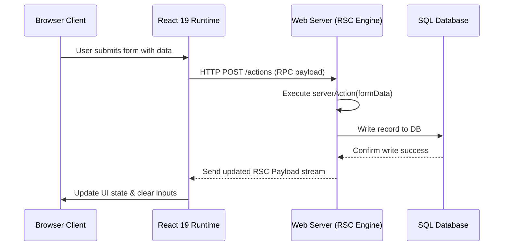
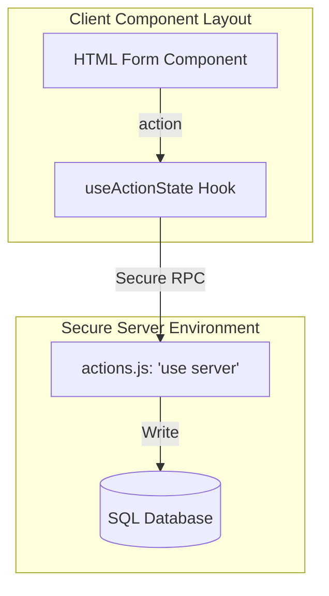
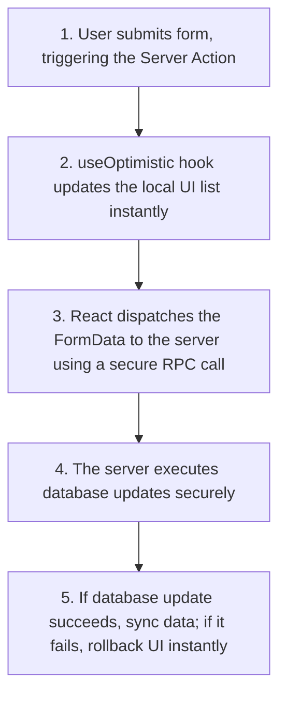

```mermaid
flowchart TD
    subgraph Traditional API Mutation
        Submit1[Submit Form] --> Fetch[Client Fetch POST request]
        Fetch --> Router[API Router Handler]
        Router --> DB1[SQL Database Write]
        DB1 --> JSON[Return JSON response]
        JSON --> State[Update client state]
    end
    subgraph Server Actions
        Submit2[Submit Form] --> Action[action=serverAction]
        Action -->|Secure RPC| DB2[Server: SQL Database Write]
        DB2 --> Sync[Component Auto-Refresh / Query Invalidation]
    end
    style DB2 fill:#fdd,stroke:#f33
    style Sync fill:#dfd,stroke:#3a3
```

# Server Actions & Mutations

## Introduction

In traditional web applications, updating database entries (mutating data) from frontend components is a multi-step process: you build client-side form handlers, write custom fetch logic to send POST/PUT requests, set up API route endpoints on the server to process the request, and manually update local UI states on success. In React 19, **Server Actions** simplify this workflow. Server Actions are asynchronous functions that execute directly on the server but are triggered from component HTML forms. This module covers form bindings, managing mutations, using the **`useActionState`** hook, and updating UIs using **`useOptimistic`**.

---

## Why do we need this?

Building API endpoints and writing manual request handlers for simple database operations (like adding a task or editing a profile) requires writing excessive boilerplate code.

### Problem Statement
Consider an application that has an input field to update a profile name.
1. In a standard React application, you write an `onSubmit` handler, manage state for loading spinners and errors, and call `fetch('/api/profile/update', { method: 'POST', body: JSON.stringify({ name }) })`.
2. You must build the backend API route handler `/api/profile/update` in a separate file to receive the request, validate the data, and write to the database.
3. This duplicates validation logic, splits code across multiple files, and increases the chance of bugs.

We need a secure way to execute server-side database mutations directly from our component form elements, managing loading states and error handling out of the box.

---

## Real World Story

For years, React was purely a client-side library. When developers wanted to update databases, they relied on REST or GraphQL APIs.

When frameworks like Next.js introduced Server-Side Rendering, developers still had to build API routes to handle mutations. To simplify this, the React core team developed **Server Actions** for React 19. By adding the `"use server"` directive inside a function or file, developers could define secure functions that run exclusively on the server but can be called directly from component form elements. This consolidated full-stack mutation workflows, removing the need for manual API routing setups.

---

## Real World Analogy

Think of Server Actions like a **Secure pneumatic Mail tube in a Bank Vault** compared to **Writing letters and Mailing them**.

- **Traditional Mutations (Mailing a Letter)**: You sit at your desk (Client Component). You write a withdrawal letter, put it in an envelope, stick a stamp on it, walk to the mailbox, and mail it to the bank (API request). The post office delivers the letter, the teller processes it (API router), and mails a receipt letter back to you. It is slow and has multiple steps.
- **Server Actions (Pneumatic Tube)**: You sit at the bank lobby. You write the withdrawal form (Form input), place it in a canister, and insert it directly into the pneumatic mail tube built into the wall (Server Action). The canister travels directly into the secure bank vault (Server execution), updates the ledger, and returns a confirmation instantly. You update database records securely without leaving the room.

---

## Visual Explanation

Below is a diagram comparing traditional API mutation pipelines with React 19 Server Actions.

### Traditional API Mutation Pipeline
```
[Form Submit] ──> [Client Fetch POST] ──> [API Router Handler] ──> [DB Write] ──> [JSON Success]
```

### React 19 Server Actions
```
[Form action={myServerAction}] ──> [Direct Secure RPC Pipeline] ──> [DB Write] ──> [UI Auto-Sync]
```



---

## Internal Working

Vite or Webpack bundlers identify functions or files marked with the `"use server"` directive and replace them with a lightweight **Remote Procedure Call (RPC)** endpoint URL.

When a user submits a `<form action={myServerAction}>`:
1. React intercepts the native form submission event (`event.preventDefault()`).
2. React automatically creates a `FormData` object containing the inputs.
3. React dispatches an asynchronous POST request to the compiler-generated RPC endpoint.
4. The server runs the actual function code, executes database queries securely, and returns the result to the browser.
5. React receives the response and refreshes the layout using the updated server state.



---

## Architecture

Server Actions act as a secure mutation layer. They execute on the server but are bound to form elements inside client components.



---

## Step-by-Step Flow

When mutating database data using a Server Action with optimistic updates, the following steps occur:



---

## Syntax

```jsx
// actions.js (Server actions file)
"use server"; // Mark all exports as server actions

export async function addRecord(formData) {
  const title = formData.get('title');
  await db.insert(title); // Secure database write
}

// FormComponent.jsx (Client Component)
import { addRecord } from './actions.js';

function Form() {
  return (
    <form action={addRecord}>
      <input name="title" type="text" />
      <button type="submit">Submit</button>
    </form>
  );
}
```

---

## Basic Example

Here is a basic Server Action that adds a item to a database directly from a form.

```jsx
// 1. actions.js (Server Actions)
"use server"; // Tells React to compile functions to run exclusively on the server

export async function submitContactForm(formData) {
  const name = formData.get('userName');
  const email = formData.get('userEmail');
  
  console.log(`[SERVER WRITE] Saving contact query: Name: ${name}, Email: ${email}`);
  // Execute database writes securely here
  return { success: true };
}

// 2. ContactForm.jsx (Client Component)
"use client";

import React from 'react';
import { submitContactForm } from './actions.js';

export default function ContactForm() {
  return (
    <div style={{ padding: '16px', maxWidth: '300px', border: '1px solid #ccc' }}>
      <h3>Contact Us</h3>
      <form action={submitContactForm}>
        <input name="userName" placeholder="Your Name" style={{ display: 'block', marginBottom: '8px' }} />
        <input name="userEmail" type="email" placeholder="Your Email" style={{ display: 'block', marginBottom: '12px' }} />
        <button type="submit">Send Message</button>
      </form>
    </div>
  );
}
```

---

## Intermediate Example

An intermediate component showing the use of **`useActionState`** (formerly `useFormState`) to manage pending states, errors, and success responses during server actions.

```jsx
// 1. actions.js (Server Actions)
"use server";

export async function registerMember(prevState, formData) {
  const username = formData.get('username');

  // Perform validation on the server
  if (username.length < 3) {
    return { error: 'Username must be at least 3 characters long.' };
  }

  console.log(`[SERVER WRITE] Member registered: ${username}`);
  return { success: true, message: `Successfully registered: ${username}!` };
}

// 2. MemberSignUp.jsx (Client Component)
"use client";

import React, { useActionState } from 'react'; // React 19 Hook
import { registerMember } from './actions.js';

export default function MemberSignUp() {
  // useActionState manages state returns and pending states automatically
  const [state, formAction, isPending] = useActionState(registerMember, null);

  return (
    <div style={{ padding: '20px', maxWidth: '320px' }}>
      <h3>Sign Up Page</h3>
      
      <form action={formAction}>
        <input name="username" placeholder="Username" style={{ display: 'block', marginBottom: '8px' }} />
        <button type="submit" disabled={isPending}>
          {isPending ? 'Registering...' : 'Sign Up'}
        </button>
      </form>

      {/* Render error or success messages returned by the action */}
      {state?.error && <p style={{ color: 'red' }}>Error: {state.error}</p>}
      {state?.success && <p style={{ color: 'green' }}>{state.message}</p>}
    </div>
  );
}
```

---

## Advanced Example

An advanced component illustrating **Optimistic UI Updates** using React 19's **`useOptimistic`** hook. When a user adds an item to the list, the UI updates instantly before the server confirms the update, rolling back changes if the action fails.

```jsx
// 1. actions.js (Server Actions)
"use server";

export async function addMessageAction(messages, formData) {
  const text = formData.get('messageText');
  await new Promise(r => setTimeout(r, 1500)); // Simulate slow database write delay

  // Perform secure database write here
  return { id: Date.now().toString(), text };
}

// 2. ChatConsole.jsx (Client Component)
"use client";

import React, { useState, useOptimistic } from 'react';
import { addMessageAction } from './actions.js';

export default function ChatConsole() {
  const [messages, setMessages] = useState([
    { id: '1', text: 'Welcome to chat room.' }
  ]);

  // useOptimistic updates local list instantly before the server action resolves
  const [optimisticMessages, addOptimisticMessage] = useOptimistic(
    messages,
    (state, newText) => [...state, { id: 'optimistic', text: newText, pending: true }]
  );

  const formAction = async (formData) => {
    const text = formData.get('messageText');
    if (!text.trim()) return;

    // 1. Trigger optimistic UI update instantly
    addOptimisticMessage(text);

    // 2. Send request to Server Action
    try {
      const newMessage = await addMessageAction(messages, formData);
      // 3. Update actual state on success
      setMessages(prev => [...prev, newMessage]);
    } catch (e) {
      alert('Failed to send message. Rolling back.');
    }
  };

  return (
    <div style={{ padding: '20px', maxWidth: '350px', border: '1px solid #ccc' }}>
      <h3>Chat Lobby</h3>
      
      <div style={{ height: '150px', overflowY: 'auto', border: '1px solid #eee', marginBottom: '12px', padding: '6px' }}>
        {optimisticMessages.map((msg, index) => (
          <div key={index} style={{ opacity: msg.pending ? 0.5 : 1, padding: '4px 0' }}>
            {msg.text} {msg.pending && <small>(Sending...)</small>}
          </div>
        ))}
      </div>

      <form action={formAction}>
        <input name="messageText" placeholder="Write message..." style={{ width: '70%' }} />
        <button type="submit">Send</button>
      </form>
    </div>
  );
}
```

---

## Production Example

A production-ready task list component featuring schema validation, route layout revalidation, CSRF protection, and error logs using standard actions.

```jsx
// 1. actions.js (Server Actions)
"use server";

// Simulates importing route revalidation helpers
const revalidatePath = (path) => console.log(`[REVALIDATE] Revalidating page path: ${path}`);

export async function submitTaskAction(prevState, formData) {
  const title = formData.get('taskTitle');

  // 1. Server-side Validation
  if (!title || title.trim().length === 0) {
    return { status: 'error', message: 'Task title cannot be blank.' };
  }

  try {
    console.log(`[DATABASE WRITE] Saving task: ${title}`);
    // Execute database writes securely here
    
    // 2. Revalidate cache for target path to refresh UI data
    revalidatePath('/dashboard');

    return { status: 'success', message: 'Task created successfully.' };
  } catch (error) {
    console.error(`[DATABASE ERROR] Failed to save task: ${error.message}`);
    return { status: 'error', message: 'Database transaction failed.' };
  }
}

// 2. TaskFormPanel.jsx (Client Component)
"use client";

import React, { useActionState, useRef, useEffect } from 'react';
import { submitTaskAction } from './actions.js';

export default function TaskFormPanel() {
  const [state, formAction, isPending] = useActionState(submitTaskAction, null);
  const formRef = useRef(null);

  // Clear form inputs on successful submission
  useEffect(() => {
    if (state?.status === 'success') {
      formRef.current?.reset();
    }
  }, [state]);

  return (
    <div style={{ padding: '20px', maxWidth: '300px', border: '1px solid #bbb', borderRadius: '8px' }}>
      <h4>Task Registry</h4>
      
      <form ref={formRef} action={formAction}>
        <div style={{ marginBottom: '12px' }}>
          <label style={{ display: 'block', marginBottom: '4px' }}>Task Title</label>
          <input
            name="taskTitle"
            type="text"
            style={{ width: '100%', padding: '6px', border: state?.status === 'error' ? '2px solid red' : '1px solid #ccc' }}
          />
        </div>
        
        <button type="submit" disabled={isPending}>
          {isPending ? 'Saving task...' : 'Register Task'}
        </button>
      </form>

      {state?.status === 'error' && (
        <p style={{ color: 'red', marginTop: '8px' }} role="alert">
          {state.message}
        </p>
      )}
      {state?.status === 'success' && (
        <p style={{ color: 'green', marginTop: '8px' }}>
          {state.message}
        </p>
      )}
    </div>
  );
}
```

---

## Folder Structure

```
server-actions-demo/
├── src/
│   ├── actions/
│   │   └── actions.js
│   ├── components/
│   │   ├── ChatConsole.jsx
│   │   └── TaskFormPanel.jsx
│   ├── App.jsx
│   └── main.jsx
├── package.json
└── vite.config.js
```

---

## Best Practices

💡 **Did You Know?**  
Server Actions automatically handle progressive enhancement. If a user's browser has JavaScript disabled, the form action still submits successfully using a native HTML POST request, allowing the page to update without JavaScript.

🚀 **Best Practices**
- Keep database queries and sensitive APIs secure inside Server Actions (marked with `"use server"`).
- Use `useActionState` to manage pending loading indicators and display error/success messages returned by the action.
- Use `useOptimistic` to build instant interactive interfaces, updating the local UI list immediately before the server responds.

---

## Common Mistakes

⚠ **Common Mistakes**

### Forgetting the "use server" Directive
Defining Server Actions in a component file without placing the `"use server"` directive at the top of the file or function is a common mistake. This causes the compiler to bundle the action code in the client bundle, causing compilation failures or security leaks.

```jsx
// ❌ WRONG (Database credentials leaked or code fails to compile in client browser)
export async function updateDatabase(data) {
  await db.write(data);
}

//  RIGHT
"use server"; // Mark file as server execution environment only
export async function updateDatabase(data) {
  await db.write(data);
}
```

---

## Performance Notes

⚡ **Performance Tips**
Server Actions automatically refresh page cache segments. This means the server automatically streams updated HTML data blocks, saving bandwidth compared to traditional client-side page refreshes.

---

## Accessibility Notes

♿ **Accessibility Tips**
- Form loaders managed via `isPending` should notify screen reader users using appropriate `aria-live="polite"` containers.
- Disable submit buttons during pending mutation states (`isPending`) to prevent duplicate form submissions.

---

## SEO Notes

Server Actions support progressive enhancement. Because forms can submit without JavaScript, search engine crawlers and users on slow networks can submit forms successfully, improving accessibility and index optimizations.

---

## Interview Questions

🎯 **Interview Tips**  
In an interview, define Server Actions as React 19's mechanism to execute secure server-side database mutations directly from component HTML forms, removing the need for manual API routing setups.

### Q1: What is Progressive Enhancement in Server Actions?
**Answer**: Progressive Enhancement is the ability of Server Actions to execute successfully even if the browser has JavaScript disabled or has not finished loading scripts. Since Server Actions are bound to HTML form elements, forms submit using native HTML POST requests, allowing the server to process the action and return updated HTML pages successfully.

### Q2: What is the purpose of the `useOptimistic` hook?
**Answer**: `useOptimistic` is a React 19 hook used to make UIs feel faster by displaying optimistic state updates during asynchronous operations. When a user submits a form, the hook updates the local UI list instantly before the server action completes, rolling back changes automatically if the action fails.

---

## MCQs

1. **Which directive is required at the top of a file to declare Server Actions?**
   - A) `"use client"`
   - B) `"use server"`
   - C) `"import server"`
   - D) `"compile server"`
   - *Answer: B*

2. **Which React 19 hook is used to manage pending loading states and error responses returned by actions?**
   - A) `useActionState` (formerly `useFormState`)
   - B) `useState`
   - C) `useLayoutEffect`
   - D) `useSyncExternalStore`
   - *Answer: A*

3. **What does the `useOptimistic` hook do?**
   - A) It compiles code into WebAssembly.
   - B) It updates the local UI instantly during async tasks, rolling back changes automatically if the server action fails.
   - C) It secures client-side API keys.
   - D) It checks local storage keys.
   - *Answer: B*

4. **Do Server Actions require you to build API routes (e.g. /api/update) manually?**
   - A) Yes, in separate controller folders.
   - B) No, the compiler automatically generates the secure RPC endpoints in the background.
   - C) Yes, but only in development mode.
   - D) No, unless using mobile browsers.
   - *Answer: B*

5. **Why are submit buttons disabled during `isPending` states?**
   - A) To prevent CSS compile bugs.
   - B) To prevent duplicate form submissions and network requests during slow connections.
   - C) To cookies validation.
   - D) To restart the server.
   - *Answer: B*

---

## Practice Exercise

### Exercise 1: Server action file setup
Mark this database mutation file to run exclusively on the server:
```javascript
// TODO: Server directive
export async function deleteUser(userId) {
  await db.query(`DELETE FROM users WHERE id = ${userId}`);
}
```

*Solution*:
```javascript
"use server"; // Mark all exports as server actions
export async function deleteUser(userId) {
  await db.query(`DELETE FROM users WHERE id = ${userId}`);
}
```

### Exercise 2: useActionState Form binding
Create a form component that binds a server action using the `useActionState` hook. Display a red error message if the action returns an error state.

### Exercise 3: Optimistic message append
Create a list of messages. Implement a form with a text input. Use the `useOptimistic` hook to append the typed message text instantly to the UI list on form submit.

---

## Debugging Exercise

### The Client Direct Callback Crash
A developer wants to submit a form using a Server Action, but they invoke the action directly inside a client-side click handler without using form action attributes. The console throws a serialization error on submit. Identify the bug and write the fix.

```jsx
// 1. actions.js (Server Action)
"use server";
export async function saveProfileName(name) {
  await db.save(name);
}

// 2. ProfilePanel.jsx (Client Component)
"use client";
import React, { useState } from 'react';
import { saveProfileName } from './actions.js';

export default function ProfilePanel() {
  const [name, setName] = useState('');

  const handleSaveClick = () => {
    // BUG: Invoking Server Action directly as an inline click callback
    // without binding it to form actions or handling pending states, causing serialization issues.
    saveProfileName(name);
  };

  return (
    <div>
      <input value={name} onChange={e => setName(e.target.value)} />
      <button onClick={handleSaveClick}>Save Details</button>
    </div>
  );
}
```

#### Solution
Invoking a Server Action directly as an inline callback function without handling its Promise can cause serialization issues and fails to manage loading states. To fix this, bind the action to an HTML form element using the `action` attribute, or wrap the direct call inside a transition:

```jsx
// Corrected ProfilePanel using form actions
"use client";
import React, { useActionState } from 'react';
import { saveProfileName } from './actions.js';

// Adapt action signature to receive prevState and formData
async function formActionHandler(prevState, formData) {
  const name = formData.get('userName');
  await saveProfileName(name);
  return { success: true };
}

export default function ProfilePanel() {
  const [state, formAction, isPending] = useActionState(formActionHandler, null);

  return (
    <form action={formAction}>
      <input name="userName" placeholder="Enter name..." />
      <button type="submit" disabled={isPending}>
        {isPending ? 'Saving...' : 'Save Details'}
      </button>
    </form>
  );
}
```

---

## Real-world Scenario

You are building a forum application where users can submit comments. A comment submission takes 2 seconds to write to the database. Sibling components must show the new comment instantly. Explain how you would manage this.
- **Design Strategy**: Use the `useOptimistic` hook inside the comment list component. When a user submits the comment form, append the new comment to the local UI list optimism-state instantly. The Server Action writes the comment to the database in the background, and React updates the actual list once the query resolves.

---

## Interview Coding Question

### Problem Statement
Write a React 19 form component that:
- Uses a Server Action called `deleteItemAction` to delete an item from the database.
- Uses `useActionState` to track loading states.
- Displays a confirmation box before submitting the form action.

```jsx
"use client";

import React, { useActionState } from 'react';

// Mock Server Action (normally imported from actions.js)
async function deleteItemAction(prevState, formData) {
  const itemId = formData.get('itemId');
  console.log(`[SERVER WRITE] Deleting item: ${itemId}`);
  // Perform secure database delete query here
  return { success: true };
}

export default function DeleteConsole({ itemId }) {
  const [state, formAction, isPending] = useActionState(deleteItemAction, null);

  const handleSubmit = (e) => {
    // Confirm delete action before submitting form
    if (!window.confirm('Are you sure you want to delete this item?')) {
      e.preventDefault(); // Stop form submission
    }
  };

  return (
    <div style={{ padding: '16px', border: '1px solid red' }}>
      <form action={formAction} onSubmit={handleSubmit}>
        <input name="itemId" type="hidden" value={itemId} />
        <button type="submit" disabled={isPending} style={{ backgroundColor: 'red', color: 'white' }}>
          {isPending ? 'Deleting...' : 'Delete Item Record'}
        </button>
      </form>
      
      {state?.success && <p style={{ color: 'green', marginTop: '8px' }}>Item deleted successfully.</p>}
    </div>
  );
}
```

---

## Mini Project

### Sandbox Mutation Board
Build an database mutation console:
- Create a list of database items.
- Implement forms to add, update, and delete items using Server Actions.
- Use `useActionState` to handle loading/error indicators, and use `useOptimistic` to update list items instantly.
- Verify in your network tabs that all database writes occur securely on the server.

---

## Summary

🧠 **Memory Tricks**  
`useActionState tracks actions`  
- `useActionState` manages pending, error, and success states for Server Actions automatically.
- `useOptimistic` updates the local UI instantly before the server action resolves.

📖 **Summary**  
React 19 Server Actions execute secure server-side database mutations directly from component HTML forms. By using `useActionState` to manage pending states and `useOptimistic` for instant UI updates, React simplifies full-stack data mutation workflows.

---

## Cheat Sheet

```javascript
// Server action file exports
export async function deletePost(formData) {
  "use server";
  const id = formData.get('id');
  await db.delete(id);
}
```

---

## Related Topics
- [React Server Components (RSC)](server-components)
- [The React Compiler (Next Module)](react-compiler)

---

## Further Reading
- [React Docs: Server Actions](https://react.dev/reference/rsc/server-actions)
- [React 19: Form Actions and Hooks](https://react.dev/blog/2024/04/25/react-19#form-actions)
